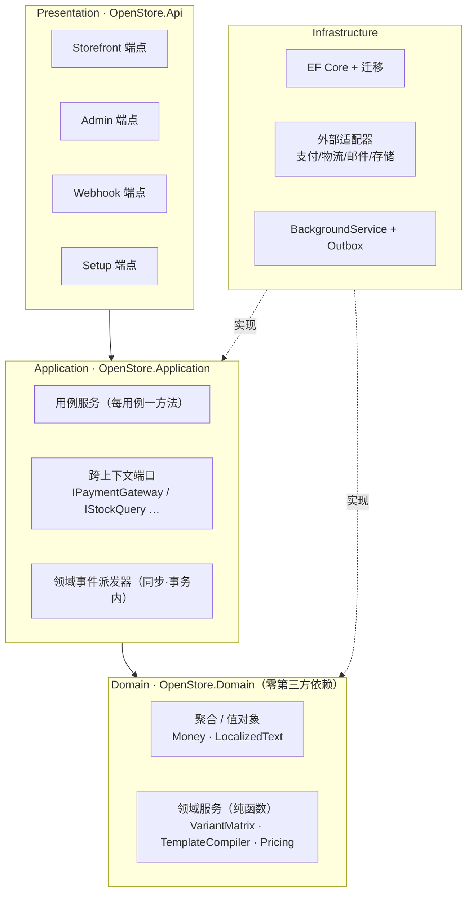
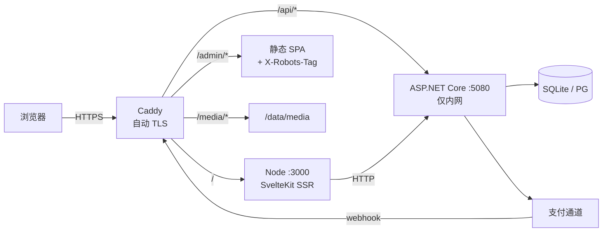

# OpenStore 项目交付方案

> 可复用电商独立站母版 · .NET 8 + SvelteKit + DDD
> 编制：高屋建（首席交付架构师） · 全栈架构交付专家团
> 依据文档：`01-需求基线`(v1.6) / `architecture/00-architecture`(v1.2) / `02-数据模型` / `03-后端设计` / `04-前端设计` / `05-部署运维` / `06-测试验收`

---

## 1. 项目定义与成功标准

### 1.1 一句话定义

**OpenStore 是一份可以被反复复用的电商独立站源码母版** —— 同一份代码，跑一遍配置向导选定行业模板（桌面机器人配件 / 女装 / 男装），就得到一套分类树、属性体系、示例商品、主题与语种都已就位、且能真实收款的店铺；换一套模板，就是另一家完全不同品类的店。

### 1.2 四条可验证的成功标准

| # | 标准 | 判定方式 |
|---|---|---|
| S1 | 全新机器从解压到首单支付成功 ≤ 30 分钟，全程零命令行、零配置文件编辑 | 计时，从浏览器首次打开站点开始 |
| S2 | 同一份代码用三个行业模板各初始化一次，**业务代码零 diff** | `git diff` 比对两次初始化之间的 `.cs`/`.svelte` |
| S3 | 非模板作者 30 分钟内新增第 4 个行业模板（如宠物用品）且不改业务代码 | **这是证明"母版真可复用"的唯一客观标准**，进 DoD 硬门 |
| S4 | 商品页 HTML 不执行 JS 也可 grep 到标题/价格/主图/canonical/hreflang/JSON-LD | `curl -s` 原始响应断言；演示时把链接贴进微信看是否出卡片 |

### 1.3 已确认的四条硬约束（客户拍板）

| 约束 | 含义 | 影响 |
|---|---|---|
| **单实例可复用模板**，非多租户 | 每商家独立部署一套，无 `TenantId` 隔离 | 数据模型与鉴权大幅简化；复用价值靠"模板 + 主题"承载 |
| **完整交易闭环 + 真实支付** | 商品→购物车→下单→支付→发货→售后 | 支付与幂等是核心工程量 |
| **主题包 + 运行时切换 + 可视化编辑** | 商家可改配色/字体/Logo/区块显隐/文案 | **不含"后台上传主题"**，见 §9 决策 D1 |
| **1 人主力 + AI 辅助，6-8 周** | 30-40 工作日 | 决定了 §6 的裁剪范围，见 §9 决策 D6 |

---

## 2. 需求范围

### 2.1 MVP 必做（In Scope）

| 域 | 内容 |
|---|---|
| **安装向导** | 8 步向导、3+1 行业模板、演示模式降级、一次性安装令牌、完成后锁定 |
| **商品** | 分类树、属性定义（6 类型）、分类属性集与继承、多维变体（≤3 维/≤100 组合）、变体独立价格库存图、多图、富文本 |
| **库存** | 单库存池、下单预占、30 分钟超时释放、变动流水（不可改） |
| **多语种** | zh+en，UI 文案 + 业务内容全可译、缺失回退、覆盖率统计、全前缀 URL + hreflang |
| **主题** | 主题包格式、内置 2 套、运行时切换、可视化编辑（token/区块/文案）、覆盖值持久化与重置 |
| **商城端** | 首页、分类（筛选 facet）、搜索、详情（变体选择器）、购物车、结算、支付结果、订单查询、账户 |
| **支付** | 1 个真实通道 + Fake、服务端下单、回调驱动、四层幂等、轮询对账兜底、退款（全额/部分/线下降级） |
| **订单履约** | 双列状态机（履约 × 退款）、发货、取消、退款、交易邮件、消费者查单 |
| **管理端** | 登录会话、两角色权限点、交易审计、系统设置、多语管理、主题编辑器 |
| **非功能** | SSR 可索引 HTML、JSON-LD/OG/sitemap/hreflang、性能预算、安全基线、备份恢复、图片多尺寸 |

### 2.2 明确不做（Out of Scope，写进 README 防中途加需求）

多租户 · 微服务/消息队列/Redis/独立搜索 · 多仓库多币种换算多税辖区 · **优惠券与促销引擎** · 积分等级 · 商品评价 · 主题市场/ZIP 上传 · 细粒度 RBAC · 实时物流 API · PDF 发票 · CDN 自动配置 · 高可用集群

> 优惠券会是第一个被提出的新需求。届时的正确切入点是：在 `Ordering` 加 `Discount` 值对象 + 扩展 `Pricing`，**而不是改订单表结构** —— 订单金额结构已预留折扣位（恒 0）。

### 2.3 二期延期项（Deferred）

商品 CSV 导出与按 SKU 更新 · 账户多地址簿与心愿单 · 退货申请全流程（RMA）· 管理端多语 · 第二支付通道 · 承运商 API 对接 · 翻译 CSV 往返 · 多币种

---

## 3. 系统架构

### 3.1 分层与依赖方向



**依赖规则由 `NetArchTest` 强制，违反即 CI 红灯。**

### 3.2 八个限界上下文（模块化单体，单进程）

| 上下文 | 核心聚合 | 关键裁决 |
|---|---|---|
| Catalog | Product（含 Variant）、Category、AttributeDefinition/Set | 变体是 Product 内实体 |
| Inventory | StockItem | **与 Product 分离**：库存高频争用、商品低频变化 |
| Cart | Cart | **持久化**，匿名用 HttpOnly Cookie 持 cartId |
| Ordering | Order、ReturnRequest | 内部双列 `FulfillmentStatus × RefundStatus`，对外纯函数投影 |
| Payments | Payment、Refund、WebhookEvent | **与 Order 分离**：支付有独立生命周期 |
| Customers | Customer、AdminUser、Session | Session 只存 token 哈希 |
| Content | ThemeInstance、StaticPage、UiTextOverride | token 用行表，DTO 仍扁平字典 |
| Settings | StoreSettings、SetupState | 单行表 `CHECK(Id=1)` |

**为什么不做微服务**：下单需"库存预占 + 订单创建 + 支付意图"同事务；每商家跑 3-8 进程的内存成本翻 3 倍；1 人无分布式可观测能力。边界靠命名空间 + 架构测试已足够。

### 3.3 技术选型与被否决方案

| 关注点 | 选型 | 被否决的备选及理由 |
|---|---|---|
| 应用层编排 | Application Service + 40 行事件派发器 | **MediatR + CQRS**：无高并发读写分离场景，Handler 注册与 Pipeline 是纯间接层 |
| ORM | EF Core 8 Code First | **Dapper**：8 上下文手写 SQL 量失控；**NHibernate**：AI 辅助语料弱 |
| 鉴权 | HttpOnly Cookie + DB Session（可撤销） | **JWT 存 localStorage**：XSS 直接拿走、需 refresh+黑名单（等于重做 session）、无法即时踢下线 |
| 前端框架 | **storefront: SvelteKit + adapter-node（SSR）**；admin: adapter-static（纯 SPA） | **纯 CSR SPA**：OG 抓取器不执行 JS，分享卡片全空白 —— 见决策 D2 |
| 样式 | 原生 CSS + CSS 变量 token | **Tailwind**：utility 类名会成为主题契约，第三方主题必须锁同版本，与"主题可独立分发"直接冲突 |
| 前端状态 | Svelte 5 runes + `.svelte.ts` 模块 | **TanStack Query**：SSR 水合与 Svelte 5 支持仍在演进，心智成本 > 收益 |
| i18n | 自建 `t()` + 类型生成脚本 | **svelte-i18n**：运行时异步加载字典，SSR 下 locale 竞态与 FOUC |
| 校验 | FluentValidation | **DataAnnotations**：跨字段规则（变体轴组合唯一）表达不了 |
| 后台任务 | BackgroundService + Outbox 表 | **Hangfire**：自有表+仪表盘+授权面，首版超范围（列为升级路径） |
| 缓存 | IMemoryCache + 版本号键 | **Redis**：单实例部署，纯运维负担 |
| 测试 | xUnit + Vitest + Playwright | **Cypress**：启动慢、并行需付费；**BDD**：多一层 Gherkin 维护 |
| 架构门禁 | NetArchTest + `check.sh` + `verify-gates.sh` | **靠 Code Review**：8 上下文 + AI 生成代码，纯人工守不住 |

### 3.4 部署形态



**三进程 + 一数据卷，无 Redis / MQ / 搜索服务。** 目标机器 2 核 2GB（内存预算：.NET 512MB 堆 + Node 320MB + SQLite 128MB）。

---

## 4. 数据模型摘要

**约 45 张表，四组 ER 图见 `02-数据模型.md`。** 六个关键设计点：

| # | 设计点 | 结论与理由 |
|---|---|---|
| 1 | **多语种内容** | 翻译子表 + `(EntityId, Locale)` 唯一 + **`(Locale, Slug)` 唯一**。per-locale slug 唯一索引是 SEO 硬前提，JSON 列给不了 |
| 2 | **属性模型** | 混合模型：定义 + 选项 + **窄值表**（`OptionId/NumberValue/TextValue/BoolValue` 四列互斥 CHECK）。纯 EAV 丢类型与约束，纯 JSON 列无法建 facet 索引 |
| 3 | **变体矩阵唯一性** | `AxisSignature` 规范化列（按 defId 升序拼）+ 唯一 `(ProductId, AxisSignature)`。两个 DB 都无法对变长子行集合建唯一索引 |
| 4 | **不超卖的 DB 兜底** | `StockItem CHECK(OnHand>=0 AND Reserved>=0 AND Reserved<=OnHand)`。代码可以写错，约束不会 |
| 5 | **价格形态** | **内联在 `ProductVariant` 上 + `Currency` 列**，不建 `VariantPrice` 子表（见决策 D3）。二期新增 1:N 表 + 回填 + 双写 + 切换读 |
| 6 | **幂等四层纵深** | `WebhookEvent(Gateway,DedupeKey)` 唯一 + Payment 状态守卫 + `Payment(Gateway,TxnId)` 唯一 + `Outbox.DedupeKey` 唯一。**不靠代码里的 if**，并发重放时 if 会漏 |

**金额一律 `Money(long minorUnits, currency)`**，禁止裸 decimal 跨层；币种不匹配抛异常。JPY/KRW 小数位为 0，不能写死 `/100`。

**可移植性**：只用 EF Core 可移植子集；双 provider **两套 migrations + CI 双向 `has-pending-model-changes`**；金额用 bigint minor units（SQLite 无原生 decimal）。

---

## 5. 关键机制实现要点

### 5.1 主题机制（本项目最核心的技术约束）

> **技术事实：Svelte 组件必须经 Vite 预编译才能运行。** 所以"后台上传 ZIP 主题、刷新即生效"在 Svelte 栈下**不可能实现**。

**可行模型：构建期存在、运行时选择。**

| 层面 | 实现 |
|---|---|
| 主题形态 | pnpm 工作区包 `themes/<id>/`：`theme.manifest.json` + `index.ts`（导出 `ThemeDefinition`）+ `tokens.json`（**本身就是 JSON Schema**，同时是编辑表单的数据源） |
| 自动发现 | `import.meta.glob` 构建期静态注册表；新增主题只加目录，不改任何中心化清单 |
| 运行时切换 | 读 `ThemeInstance.ActiveThemeId` → 加载对应 chunk → 用该主题 layout 渲染。**≤5s 生效，不重启** |
| 可视化编辑 | token 三层合并：主题默认 ← 模板预设 ← 商家 DB 覆盖 → 注入为 CSS 自定义属性。**换色不需重编译组件** |
| 新增主题成本 | `cp -r themes/base themes/mytheme` + 改 manifest/tokens + 改布局 → 4 步，约 10 分钟。**是发布行为，不是运营行为** |

**失败兜底三层**：构建期 SSR 冒烟（真防线）→ SSR 熔断计数 ≥3 次/5min 降级 base → 客户端 `<svelte:boundary>`。
> 注：`<svelte:boundary>` **兜不住 SSR 渲染期抛错**，架构 v1.0 的"错误边界降级"是虚假安全感，已修正。

### 5.2 多语种

- URL **全带前缀** `/{locale}/`，`/` 302 → `/{default}/`，缺前缀 302（**保留查询串**），slug 变更 301
- UI 文案（代码 JSON，商家可覆盖个别键）与业务内容（DB 翻译子表）**严格分家**
- 兜底链：`DB 覆盖 → 当前语种 → 默认语种 → key 本身`，前台永不因缺译报错
- hreflang **只对"该语种有翻译"的页面输出**，否则会触发重复内容惩罚

### 5.3 支付一致性（三条路径，一个出口）

webhook / 订单页手动刷新 / 定时对账（**2 分钟**，可配）→ 全部收敛到 `PaymentSettlementService.SettleAsync`。
后两条路径**合成同一个 eventId**（`manual:{order}:{status}:{txn}`）复用同一唯一索引，所以"连点 3 次刷新"天然只产生 1 条记录。

### 5.4 SEO 与索引控制

**storefront 走 SSR**（真 HTML，OG 抓取器可读），admin 是纯 SPA。

| URL 类别 | 策略 | 判据 |
|---|---|---|
| 带筛选/排序参数的分类页 | 允许抓取 + `canonical` → 无参数分类页 | **有归并目标** |
| 分页第 2 页起 | `canonical` 自引用 | 不归并，否则内容永不索引 |
| 站内搜索 `/search` | `robots` Disallow | **无归并目标** |
| 私有页（购物车/结算/账户/查单） | 允许抓取 + `noindex` | 有限 URL |
| `/admin` | 允许抓取 + Caddy 注入 `X-Robots-Tag` | 静态产物无 Node 层 |

> **反直觉陷阱（全组踩过三次）**：`Disallow` 挡住抓取后，爬虫**读不到页面里的 `noindex` 和 `canonical`** —— 指令互相抵消。所以"参数太多就 Disallow"是错的。

### 5.5 安装向导（选错模板零成本）

三阶段：**选择**（无事务，可反复改）→ **应用**（单事务，8 上下文同库提交）→ **完成**（提交后写 Completed）。

失败处理 = **整库重置重来**，不做增量幂等回滚 —— 比给每张表加 `SeedBatchId` 简单一个数量级，且首次部署时 DB 里没有真实数据。

**P0 安全**：向导完成前 `/setup` 写端点必须校验一次性安装令牌（`/data/setup-token.txt` 或 `OPENSTORE_SETUP_TOKEN`）。否则在"部署完先放着"的窗口里，任何扫到的人都能创建管理员并**改掉收款账户**。

---

## 6. 开发计划

### 6.1 人力假设与工作量账（必须先看这笔账）

| 项 | 数值 | 说明 |
|---|---|---|
| 完整范围估算 | **115~156 人日** | 需求侧逐域估算 |
| 可用时间 | **30~40 工作日**（6-8 周） | 1 人主力 |
| AI 辅助等效倍数 | 1.5~1.8x | 保守假设，不含返工 |
| 等效可用 | **45~72 人日** | — |
| **缺口** | **约 1.6~2.5 倍** | — |

**结论：8 周做不完完整范围，这是算术问题不是态度问题。** 三条路，需客户选一条：| 选项 | 交付内容 | 代价 |
|---|---|---|
| **A（推荐）** | 8 周交付"可收款的完整闭环"，按 §6.3 裁剪 | 上架 200 商品需手工（有最小 CSV 导入兜底） |
| B | 12 周交付完整范围 | 上线时间推后 4 周 |
| C | 8 周做完整范围 | 必然砍测试与打磨，上线质量不可控 —— **不建议** |

### 6.2 里程碑（按选项 A，8 周 / 40 工作日）

| 里程碑 | 周期 | 内容 | 完成判据（可独立验收） |
|---|---|---|---|
| **M0 骨架与门禁** | W1 前 3 天 | 4 项目分层、NetArchTest、`check.sh` + `verify-gates.sh`、首个垂直切片 | `dotnet run` 起得来；门禁全绿；**注入 8 处违规全部被拦住** |
| **M1 目录与库存** | W1-W2（8d） | Product/Variant/Category/Attribute（窄值表）、管理端商品 CRUD、变体矩阵编辑器、库存三元组+流水 | 后台能建"颜色×尺码"6 变体商品，前台 API 能读出 |
| **M2 storefront + 主题** | W3（5d） | SvelteKit SSR、locale 路由、主题包+glob 注册表+token 三层合并、首页/分类/详情 | `curl` 商品页能 grep 到标题/价格/canonical/JSON-LD |
| **M3 购物车与下单** | W4（5d） | Cart 持久化、结算、运费税、订单双列状态机 | 能下单并看到订单（尚未支付） |
| **M4 支付闭环** ★ | W5（5d） | `IPaymentGateway` + Fake + Stripe、三条确认路径收敛、四层幂等、退款 | **AC-05/06/07/09 全过**（串行+并发重放、回调丢失兜底） |
| **M5 向导与模板** ★ | W6（5d） | SetupState 状态机、安装令牌、TemplateCompiler、3 个模板 | **AC-01/02/03/04 全过**（含非作者 30 分钟加第 4 模板） |
| **M6 多语种 + 主题编辑** | W7（5d） | i18n 全链路、翻译子表 UI、覆盖率、主题可视化编辑器 | AC-13/14 过（含全译 fixture 上零中文命中） |
| **M7 管理端补齐 + 部署** | W8 前半（3d） | 订单/退款/客户/设置/审计、Docker Compose + Caddy + 备份恢复 | AC-16/17/19 过；一键部署 ≤30 分钟 |
| **M8 验收冲刺** | W8 后半（2d） | 20 条 AC 全跑、`verify-gates` 自证、备份恢复演练、分享卡演示 | 全部 AC 绿 + DoD 签字 |

**★ = 关键路径上的两个不可让步点。** 若 M4 在 W5 末未跑通，直接砍 M6（多语种后置），保 M7 部署 —— 因为"不能收钱的完整店"比"能收钱但只有中文的店"更不可交付。

### 6.3 相对完整范围的裁剪（选项 A 的具体取舍）

| 砍什么 | 保留什么 | 省 | 代价（必须告知） |
|---|---|---|---|
| 商品 CSV 导出与按 SKU 更新 | **单向导入 + 行级错误报告** | 3d | 批量改价走后台逐条 |
| 退货申请流程（RMA） | 管理员按订单行直接退款 | 4d | 退货沟通回到微信/邮件 |
| 管理端多语 | 管理端只中文 | 5d | 未来服务非中文商家需重抽文案 |
| 账户多地址、心愿单 | 单默认地址 + 订单列表 | 6d | 复购用户需改地址 |
| 主题区块拖拽排序 | 上移/下移按钮 + 显隐开关 | 3d | 交互朴素但功能等价 |

> **不砍**：支付幂等、库存预占、退款、向导与模板、变体矩阵、SSR 基础项、备份导出、鉴权与审计。任一缺失 = 不可上线或上线即事故。

### 6.4 关键路径与外部依赖

```
M0 → M1 → M2 → M3 → M4★ → M5★ → M7 → M8
                      ↘ M6（可牺牲）
```

| 外部依赖 | 何时必须就位 | 未就位的后果 |
|---|---|---|
| **支付通道签约 + 沙箱凭据** | M4 开始前（W4 末） | 用 Fake 可继续，但真实通道验证顺延，风险堆积到上线前 |
| **域名 + HTTPS** | M7 前 | 回调不可达，只能靠轮询对账（功能不缺，延迟 2 分钟） |
| **ICP 备案（中国大陆部署）** | **W1 就要启动** | 1~3 周，未启动 = 上线日期不可控 |
| 行业模板的商品图与文案 | M5 前 | 模板"像样程度"决定第一印象，约 5 人日的**内容工作**，必须显式排期 |

---

## 7. 部署与上线

| 项 | 方案 |
|---|---|
| 部署 | Docker Compose 三服务（caddy / api / storefront）+ 一个 `./data` bind mount |
| 反向代理 | Caddy 自动 TLS；`/admin/*` 用 `handle_path` + 注入 `X-Robots-Tag`；`/api/*` 仅内网 |
| 迁移 | **CLI 显式执行**，启动只检测不自动迁移；同一版本内绝不出现删/改迁移（contract 延后一版） |
| 零停机 | **做不到真零停机**（单机单实例），最小停机 ≈2 分钟；顺序 = 先迁移后发代码 |
| **域名一致性** | Caddy 的 `ORIGIN` 与库内 `PublicSiteUrl` 是**两个来源**，启动时比对，不一致**拒绝启动**并给出可操作错误 —— 不能降级为警告（警告会被忽略，站点带错误 canonical 跑一个月） |
| 备份 | SQLite `VACUUM INTO`（**不是 cp**，WAL 下 cp 会拿到撕裂页）+ media + keys，每日三件套 + `manifest.json` 记录镜像 digest 与迁移号 |
| 恢复 | 3 条命令 ≤15 分钟；**判据是"能真下一单"**，不是"文件到位" |
| 监控 | Serilog JSON + `CorrelationId`/`OrderNumber` 双检索键；5 条告警封顶；每日晨报邮件（6 个数字） |
| 成本 | 2C2G ¥50-150/月；不需要 Redis（会话在 DB）、不需要 MQ（Outbox 同库）、不需要 CDN（内容哈希 + immutable） |

**上线前检查清单**（详见 `05-部署运维.md` §8）：TLS 生效 · 向导已锁定 · 演示模式已退出 · **回调可达性自检** · 备份任务已生效 · 恢复演练已做 · `/admin` 有 X-Robots-Tag · 5xx 未被反代改写成 200。

---

## 8. 测试与验收

详见 `06-测试验收.md`。核心是 **DoD 的 20 条可执行验收标准**（需求基线 §6），其中五条最不可造假：

| AC | 内容 | 为什么重要 |
|---|---|---|
| AC-01 | 冷启动到首单 ≤30 分钟，零命令行 | 这是"母版"的第一卖点 |
| AC-04 | 非作者 30 分钟新增第 4 个行业模板，业务代码零 diff | **唯一能证明"真可复用"的客观标准** |
| AC-06 | 回调串行重放 5 次 **+ 并发 5 次**，支付记录 1 条、库存扣 1 次、邮件 1 封 | 纯 `if(已处理)` 在并发下会漏 |
| AC-10 | `curl` 不执行 JS 的原始 HTML 含标题/价格/canonical/hreflang/JSON-LD；数据不可用必须 503 **而非 200 空壳** | 空壳被索引比不收录更糟 |
| AC-16 | 空白环境恢复 = **1 条 `openstore restore` 命令 + 2 条验证**，恢复后**能下单** | 判据是业务可用，不是文件到位。PG 与 SQLite 的差异封装在 CLI 内，不暴露给慌乱的运维 |

**门禁自证机制**（客户最关心）：`scripts/verify-gates.sh` 自动注入 8 处故意违规（删分层 using、加跨上下文引用、给 storefront DTO 加成本价、删模板必填字段等），断言**每一处都被拦住**。任一注入后门禁仍绿 → 脚本自身失败。这是唯一能证明"门禁不是摆设"的可执行手段，也是防止 AI 逐步侵蚀架构边界的唯一办法。

---

## 9. 决策与权衡（含我的改判记录）

### 9.1 六条关键决策

| # | 决策 | 被否决的方案与理由 |
|---|---|---|
| **D1** | 主题**构建期打包、运行时选择**；不支持后台上传 ZIP | 否决 ZIP 上传 + 服务端模板引擎：等于自建一门主题语言与运行时（Shopify 做了十年），6-8 周做不对，且有模板注入风险；否决"每商家服务器现场构建主题"：生产机要装完整构建链，构建失败 = 站点不可用 |
| **D2** | storefront 上 **SvelteKit SSR**（+1 Node 进程） | 否决纯 CSR：OG 抓取器（微信/FB/X/Slack）**一律不执行 JS**，分享出去是无图灰卡片，对电商是断掉一条流量渠道；否决构建期预渲染：数据是每商家运行时的，构建时不知道有哪些商品 |
| **D3** | 价格**内联在 Variant + Currency 列** | 否决本期建 `VariantPrice(VariantId,Currency)` 子表：那是 1:1 单值拆表，本期付永久 join 利息，而二期新增 1:N 表是纯新增、可在线可回退。**我最初裁决建子表，被数据建模师的论证推翻** |
| **D4** | 多语种 URL **全带前缀** | 否决"默认语种无前缀 + 301"：URL 长短不影响 SEO，但会引入 301 分支、canonical 双形态、缓存键分裂。**架构 v1.1 一度改成无前缀，被前端按文档实现的事实纠正回来** |
| **D5** | 订单状态拆成 **履约 × 退款两个正交列**，对外纯函数投影 | 否决单列 9 状态枚举：表达不了"已发货 + 部分退款后继续发货"。`RefundFailed` **失败优先暴露**（US-E7-05 不允许静默失败） |
| **D6** | 8 周按 **§6.3 裁剪版**交付 | 否决"全都要 + 按期"：这是算术上不可能的，代价必然落在砍测试上 |

### 9.2 我作为主理人的三次改判（显式记录）

| 次 | 原裁决 | 改判 | 触发原因 |
|---|---|---|---|
| 1 | 价格不建币种子表 | → 要求建复合主键子表 | 架构师指出 SQLite 改 PK = 重建表 |
| 2 | 复合主键子表 | → **撤销，回到内联列** | 数据建模师指出 1:1 子表本期付永久 join 利息；我只算了二期的账 |
| 3 | 索引矩阵含"筛选组合 → Disallow" | → **筛选用 canonical 归并，只有 /search 用 Disallow** | `Disallow` 让爬虫读不到 canonical，归并失效 —— 与我要求修的是同一个坑 |

### 9.3 三个非技术但决定成败的规则

1. **结论只能有一个出口**：AC 只由需求侧改，技术口径只由主理人裁决后单点下发。本项目所有返工都源于"同一决定写进两个地方后各自演化"，**没有一次是技术判断错误**。
2. **文档是唯一权威，聊天口径不算数**：包含我自己的转述。冲突时以文件行号为准。
3. **升版必须写"作废了哪一版的哪一句"**，不能只记新增 —— 否则读者无法判断旧结论是否仍有效。

### 9.4 一条贯穿全案的设计原则：**能靠结构排除的错误，不要靠纪律去防**

这不是抽象主张，本项目有三处落地，都是把"可能写错"变成"写不出来"：

| 做法 | 排除了什么错误 |
|---|---|
| 退款幂等键由 `Refund.Id` **派生**，不设 `IdempotencyKey` 列 | 无法填错成订单 ID（一单可多次部分退款，用订单 ID 会把第二次退款误判为重放而吞掉） |
| `PaymentGatewayConfig` 独立成表 + 备份**按表排除** | 凭据无法忘在备份里（US-E9-05 从纪律变成结构） |
| `StockItem CHECK(OnHand>=0 AND Reserved<=OnHand)` | 无法写出负库存 |
| 主题 fixture 只允许装载进测试库、拒绝在已完成安装的库执行 | 测试数据无法污染商家店铺 |

**为什么这条重要**：纪律会被遗忘、注释会被跳过、代码会被 AI 重写，而约束不会。本项目全组踩过的所有坑（URL 前缀、robots 矩阵、价格形态、域名双源）**没有一个是判断力问题，全部是同一个决定写进两个地方后各自演化** —— 少一个地方，就少一次漂移。

---

## 10. 风险清单

| # | 风险 | 概率 | 影响 | 应对 |
|---|---|---|---|---|
| R1 | **工期与范围不匹配** | 高 | 严重 | §6.1 三条路让客户选；M4/M5 是关键路径不可让步点 |
| R2 | **客户按"Shopify 主题市场"对标主题能力** | 高 | 严重（交付被判功能缺失） | 签约前书面确认 Q11；卖点表述改为"开发者级可分发" |
| R3 | 主题构建期打包是 Svelte 硬限制 | 确定性 | 中 | 已写进 README 与向导文案；新增主题 4 步约 10 分钟 |
| R4 | 自托管收不到支付回调 | 高 | 中 | 三路径收敛 + 2 分钟对账兜底；部署文档给回调可达性自检清单 |
| R5 | 支付通道未定导致退款返工 | 中 | 中 | `IPaymentGateway` + 能力位；无退款能力的通道走"线下退款 + 凭证号"，金额口径不变 |
| R6 | 行业模板抽象不足，第三次复用要重写 | 中 | 严重 | AC-04 作为硬门（非作者 30 分钟加模板）；属性模型强制三层 |
| R7 | 属性筛选在 500/分类下退化全表扫 | 中 | 中 | `(AttributeId,OptionId,ProductId)` 索引 + 最多 3 维同选 + **facet 交叉计数明确不做** |
| R8 | 2GB 内存三进程 OOM | 中 | 中 | GC 硬限 512MB（不是架构原写的 896MB）+ Node 320MB + 图片解码前限像素 |
| R9 | 向导完成前被抢注管理员并改收款账户 | 中 | **严重（直接资金损失）** | 一次性安装令牌（P0，M1 必做）+ runbook 硬提示"完成向导前勿指向域名" |
| R10 | SQLite↔PG 行为差异（排序/日期/并发/decimal） | 中 | 中 | 只用可移植子集 + 双 provider CI + 金额用 bigint minor units |
| R11 | 备份未验证，故障时才发现恢复不了 | 中 | 严重 | 季度演练，判据是"能真下一单"；恢复必须连 `/data/keys` 一起 |
| R12 | AI 辅助生成代码侵蚀架构边界 | 高 | 中 | NetArchTest 门禁 + `verify-gates.sh` 注入自证 |
| R13 | ICP 备案未启动 | 中 | 中（延迟上线） | W1 即启动，作为外部依赖进计划 |

---

## 11. 需要客户拍板的事项

| # | 事项 | 我的建议 | 不定的后果 |
|---|---|---|---|
| **Q1** | **工期 vs 范围**（§6.1 三选一） | **选项 A**：8 周裁剪版 | 排期无法收敛，最终靠砍测试度日 |
| **Q2** | **支付通道**（是否已有商户号/退款 API/沙箱/结算币种） | 先 Stripe 沙箱 + Fake 跑通，国内通道排二期 | 支付域无法定稿；退款可能被迫降级手工 |
| **Q11** | **书面确认不按"Shopify 主题市场"对标** | 必须签前打死 | 交付必被判"功能缺失" |
| Q3 | 英文是否 MVP 必交 | **必交**（架构已按 N 语种建好，砍掉等于白做） | 翻译工作量与回归被压到最后 |
| Q4 | 税务深度 | **统一税率 + 分类覆盖 + 是否含税开关** | 结算金额模型无法定稿 |
| Q5 | 优惠券确认不做 | 确认（开业促销靠手工改价） | 订单金额结构是否留折扣位悬空 |
| Q6 | 物流只做手工运单号 | 接受 | 履约工作量低估 5-10 人日 |
| Q7 | 部署环境与公网可达性 | Linux VPS + Docker Compose | 决定支付主路径是回调还是轮询 |
| Q8 | 订单号规则 | `{前缀}-{yyMMdd}-{6位随机}` | 查单口径不一致、序号易被枚举 |
| Q9 | 人员结构（是否需打包工角色） | 两角色（Admin/Staff） | 若 3 类人则需 +3-4 人日 |
| Q10 | 是否承诺母版平滑升级 | 需要则主题覆盖值迁移不能砍 | 每次升级丢配置，口碑崩塌 |
| Q12 | 是否有确定域名（`PublicSiteUrl` 由谁提供） | 向导人工确认，不靠探测 | 填错 = 整站 SEO 输出全错 |

---

## 附：文档索引

| 文档 | 行数 | 内容 |
|---|---|---|
| `01-需求基线-OpenStore.md` | v1.6 | 场景、用户故事、范围、优先级、**20 条验收标准**、待确认项 |
| `architecture/00-architecture.md` | v1.2 | 分层、上下文地图、技术选型、主题/多语/模板/SSR 机制、非功能 |
| `02-数据模型.md` | 1516 | 4 张 ER 图、45 张表逐表清单、60+ 索引、可移植性 17 条、迁移策略 |
| `03-后端设计.md` | 2302 | 聚合不变量、双状态机、幂等推演、API 契约、鉴权、后台任务、门禁 |
| `04-前端设计.md` | 1796 | 13+31 页清单、主题包与注册表、token 合并、编辑器组件、i18n、SEO |
| `05-部署运维.md` | 1694 | 容器化、Caddy、13 步 CI、备份恢复、监控、Runbook、18 条运维风险 |
| `06-测试验收.md` | 编写中 | 测试策略、用例清单、自动化框架、性能与安全测试、DoD、发布门禁 |
