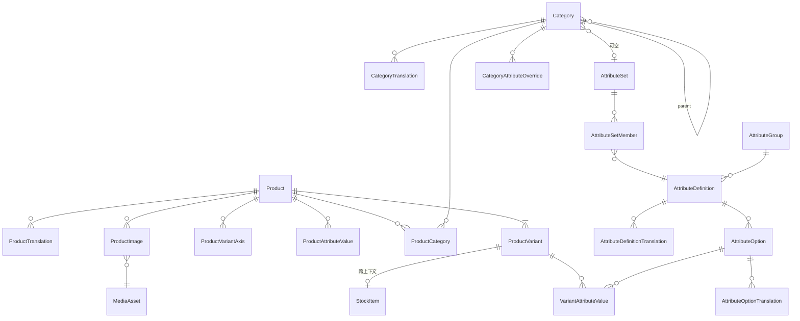
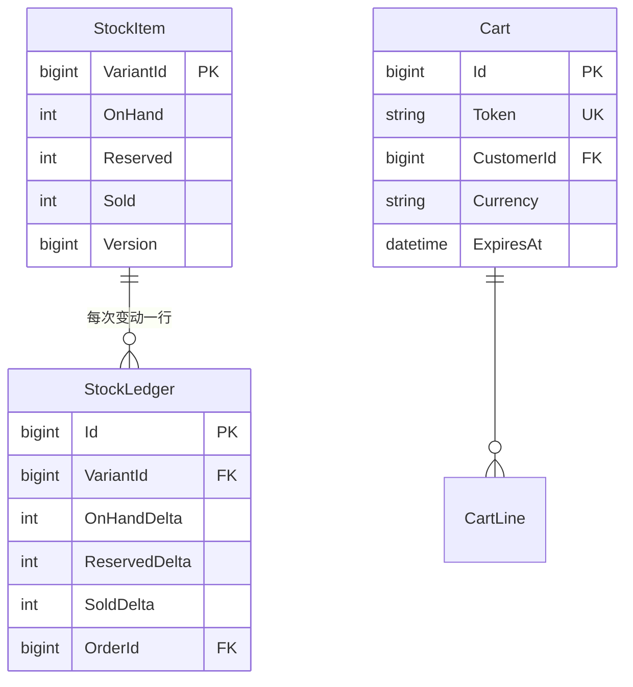
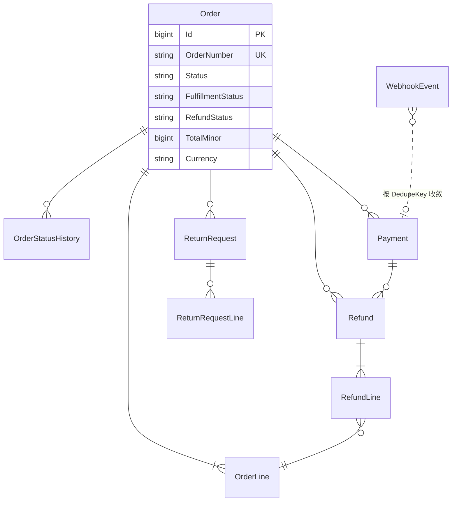
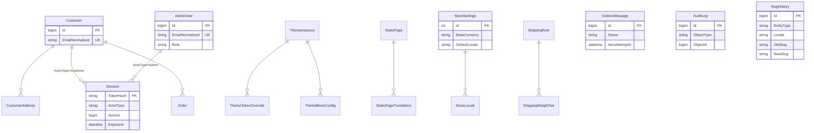

# OpenStore 数据模型（Phase 1）

> 作者：储海量（数据建模工程师）
> 上游依据：`docs/01-需求基线-OpenStore.md`、`docs/architecture/00-architecture.md`、主理人裁决（含 2025 复裁轮：价格内联列、投影列、BaseCurrency 禁改、CSV 单向导入保留）
> 本文范围：**数据长什么样、怎么约束、怎么演进**。不含 C# 实现、不含 API 端点。
> 技术前提：.NET 8 + EF Core 8 + 模块化单体（8 上下文同一 `DbContext`、同一本地事务），开发期 SQLite / 生产可切 PostgreSQL，**只使用两者可移植的 EF Core 子集**。

---

## 0. 决策速览（先看这张表，细节在后文）

| # | 决策点 | 结论 | 一句话理由 |
|---|---|---|---|
| D1 | 主键 | **业务表 `Guid`**（应用侧生成，`ValueGeneratedNever`）；对外标识另设独立列（`Order.OrderNumber`、`per-locale Slug`、`Cart.Token`） | **2025 复裁：保留 Guid，否决 `long` 自增**（四条理由见下方 D1 附注）；无论主键是什么，它都不能进 URL（防枚举），所以"内部主键 ≠ 对外标识"必须分离 |
| D2 | 时间 | `DateTime`（强制 UTC）+ 值转换器；**禁止** `DateTimeOffset` / `DateTime.Now` / DB 默认值 | SQLite 的 `DateTimeOffset` 是带偏移的 TEXT，跨偏移比较会错；PG 的 `timestamptz` 语义又不同，唯一安全的交集是"UTC DateTime" |
| D3 | 软删除 | 只有"商家可删、且被历史数据引用"的主数据软删（Product / ProductVariant / Category / StaticPage / AttributeDefinition）；**账务与审计类一律不可删**（Order / Payment / Refund / StockLedger / AuditLog / Outbox / WebhookEvent） | 删掉订单行 = 财务口径崩，这不是"要不要留痕"的问题 |
| D4 | 并发 | `long Version` 列 + `IsConcurrencyToken()` + `SaveChanges` 拦截器自增；**不用** `byte[] RowVersion` | `rowversion` 是 SQL Server 专有；SQLite/PG 的可移植交集是"应用维护的版本号" |
| D5 | 翻译 | 子表多行，`(EntityId, Locale)` 唯一 + `(Locale, Slug)` 唯一 | per-locale slug 唯一只能由唯一索引保证（JSON 列给不了），这是 SEO 硬前提 |
| D6 | 属性值 | 窄表四列互斥（`OptionId/NumberValue/TextValue/BoolValue`）+ `CHECK`；多选**拆多行** | 多选拆行才能 `GROUP BY OptionId` 做 facet 计数；JSON 数组在 SQLite JSON1 / PG jsonb 下要写两套 |
| D7 | 变体矩阵唯一 | `ProductVariant.AxisSignature`（规范化字符串）+ 唯一索引 `(ProductId, AxisSignature)` | 两个 DB 都无法对"变长子行集合"建唯一索引，只能把组合降维成一个标量 |
| D8 | 库存 | `StockItem(OnHand, Reserved, Sold)` 三计数 + **`CHECK (OnHand >= Reserved + Sold)`**；`Available = OnHand − Reserved − Sold` 为计算属性不落库；另建 `StockHold`（`(State, ExpiresAt)` 索引）让 Commit/Release 幂等 | `OnHand ≥ Reserved + Sold` 是"不超卖"的**最后一道** DB 级防线（与后端 `INV-S06` 同一口径）；单一 Available 表达不了"锁定"与"已售未发"的区别；没有 hold 的状态机，支付回调与超时任务并发时会重复扣减 |
| D9 | 订单金额 | Order 上冗余 `Subtotal/Shipping/Tax/Discount/Total/Paid/Refunded`（各带 minor units + 单列 Currency） | 金额快照必须性：改价、改税率、改运费规则都不得改写历史订单 |
| D10 | 主题 token 覆盖 | **单独行表** `ThemeTokenOverride(ThemeInstanceId, TokenKey, Value)`；区块参数用 JSON 列 | token 是扁平键值且需"按前缀/单项重置"→ 行表；区块 props 是整块不透明参数、从不按内容查询 → JSON |
| D11 | 币种与价格形态 | **本期价格内联在 `ProductVariant` 列上**（`AmountMinor` / `CompareAtMinor` / `Currency`），**不建 `VariantPrice` 表**；`Currency` 必须本期就落库（ISO 4217 定长 3 位，不用枚举整数）。二期加币种 = **新增** `VariantPrice(VariantId, Currency)` 表 + 回填 + 双写 + 切换读 | **定论（主理人复裁，架构 §2.4 的"价格子表"已被改判，架构侧已同步，不是遗留偏差）**：本期建 1:1 子表 = 单值拆表，列表/详情/下单每次多一次 join，等于为避免一次未来迁移先付永久利息；而二期走"新增 1:N 表"是纯新增、可在线、可回退，本期开销为零。API DTO 仍只暴露**单一价格对象**，不因内联而变成数组 |
| D12 | 双 provider 迁移 | **两套独立 migrations 目录**（Sqlite / Postgres），同一个模型生成，CI 双向校验"无待处理变更" | 迁移产出的 SQL 是 provider 特定的（自增、时间类型、部分索引 filter 语法），一套迁移不可能两边都对 |

---

#### D1 附注（2025 复裁）：主键**保留 `Guid`**，`long` 自增方案**被否决** —— 留档防翻案

> 这一条改过两次结论，写清全过程，避免半年后有人第三次提出来。

| 阶段 | 结论 | 当时的理由 |
|---|---|---|
| 初稿 | `long` 自增 | "单实例无分布式 ID 需求，long 索引最紧凑；Guid 在 SQLite 是 TEXT/BLOB，索引更大且不友好" |
| M1 落地核定 | 仍主张改 `long`（数据工程师提，理由是"自增即时间序，可做 keyset tiebreaker"） | 见下方"被否决的四条"里第 3 条 |
| **2025 复裁（现行）** | **保留 `Guid`，不做改型** | 下面四条 |

**为什么否决 `long` 自增（四条，按重要性）**

1. **收益不可测。** 本项目是 10k 商品量级，主键只用于点查与 join，且这些查询都有覆盖索引命中的路径。SQLite 下 `TEXT(36)` 与 `INTEGER(8)` 的行宽差在 10k 行上不到 1MB，换不来任何可观测的 TTFB 改善 —— 而 AC-12 的性能预算花在 facet 聚合上，不在主键宽度上。
2. **成本确定且大。** 改型要动：领域层全部 `Guid.Empty` 守卫、全部 DTO、全部测试、两个仓储、映射层；且改型错误会以"某处静默截断/隐式转换"的形式出现（SQLite 容忍 `INTEGER` 与 `TEXT` 混比，PG 直接报错，等于把错误推迟到切库那天）。典型的"高风险、零功能收益"。
3. **"自增即时间序"这个论据在本项目不成立。** 所有排序都依赖显式列（`PublishedAt` / `CreatedAt` / `SortOrder`），从不依赖主键顺序；keyset 深翻页的 tiebreaker 用 `(MinPriceMinor, Id)` 里的 `Id`，只需要"唯一且可比较"，Guid 满足（`TEXT` 字典序稳定，PG `uuid` 有全序）。**它不保证"新插入的排在后面"，而本项目的任何查询都不需要这件事。**
4. **向前兼容路径存在。** 真需要自增序时，加一个**代理键**（`surrogate long Seq` + 保留 `Guid Id` 作为对外/主键）是"新增列 + 回填 + 可空→收紧"的非破坏性演进（§6.5 允许的路径）；而此刻把主键从 `Guid` 改成 `long` 是**破坏性重建**（SQLite 重建表、PG 重写全表）。

**落地的具体形态**：`Guid Id`，`ValueGeneratedNever()`（应用侧 `Guid.NewGuid()`），SQLite 存 `TEXT`（36 字符，实测），PG 存 `uuid`。**外键列类型随主键 `Guid`**；`long` 只保留给金额（`*Minor`）、计数与 `long Version`。

---

#### 2025 终裁补录（J1~J8 / A1~A4）—— 改在哪些章，一句话版本

> 主理人对 02 的 10 条终裁已逐条落到下文，这里只做索引，避免读者在 2000 行里找结论。**凡本表与后文冲突，以本表为准。**

| 裁决 | 结论 | 落在 02 的哪一节 |
|---|---|---|
| J1 | `InitialCreate` **squash 全新生成**（删旧迁移三件套 + 删 dev db，禁手改 `Up()`），PR 写 `squashes InitialCreate (never deployed)` | §6.1 |
| J2 | `ProductTranslation.Slug` **创建后不可改**，管理端 DTO 不含该字段 | §3.1 `ProductTranslation` |
| J3 | `StoreSettings.BaseCurrency` 走配置 `OpenStore:Store:BaseCurrency`，启动校验与已有数据一致 | §3.8 |
| J4 | **主键保留 `Guid`**，否决 `long` 自增 | §0 D1 + D1 附注、§3.0 主键统一更正框 |
| J5 | `SessionActorType` = **{Admin=0, Customer=1}**，不加 System/Guest；03 §6.2 数值有误 | §3.6 `Session` |
| J6 | **不补 `SecurityStamp`**；吊销是一条 `UPDATE … WHERE ActorType=@t AND ActorId=@id`；03 §11#19 标注有误；`Session` 无 `UpdatedAt` | §3.6 `AdminUser`、§1.5 |
| J7 | `AxisSignature` = 轴 **code** Ordinal 升序、`\|` 连接、**无轴返回 `""`**（改 label 不漂移） | §3.10 |
| J8 | `StockLedger.OrderId/OrderLineId` **永久不加 FK**；排序键 NULL 位置两端相反 → 进集成测试 | §3.2、§5 |
| A1 | `maxOrderQuantity` = **`min(99, available)`**，"与库存无关"作废 | §8.2 |
| A2 | **不设 `SkuRoot` 列**，契约删除 | §3.1 `Product` |
| A3 | 成本价 M1 **不做**（无持久化列，契约已删） | §2.1 / 本节 |
| A4 | `PATCH /api/admin/products/{id}/status` 保留但**只允许回到 Draft** | §8（API 相关）与对照表 |
| D7 | 软删时 `AxisSignature` 改写为 `~{Id}~{原签名}`（M1 实现） | §3.10 |
| Q3 | `Session.ExpiresAt` → **`IdleExpiresAt`**；绝对过期按 ActorType 分档（Admin 7 天 / Customer 90 天，原 30 天作废） | §3.6 |
| — | Cookie 命名统一到 03 §6.1：`os_shop_sid` / `os_admin_sid` / `os_admin_csrf` / `os_cart` | §3.6 |
| — | `StockLedger` 的 `唯一 (OrderLineId, ChangeType)` **作废**（会误拦第二次部分退款） | §3.2 |

---

### 0.1 与需求基线的对齐说明（本文的增量）

需求基线**验收项已全部定稿**（条数以需求 §6 表的行数为准，本文不复述——此前这里写过"22 条"，而需求 §6 表已有 23 行）。其中 8 处是结构级增量；其余只动 SEO 口径与验收切分（**无表结构变化**，但有"实现会写错"的判据与一处 DTO 定义错）。逐条列出，便于评审核对"是否漏改"：

| # | 需求变更 | 对数据模型的影响 | 本文位置 |
|---|---|---|---|
| 1 | 多语种 URL **全带前缀**（含默认语种）；`/` 与缺前缀 → **302**；slug 变更 **301** | 无表结构变化；关键是**边界**：302 是路由行为**不入库**，`SlugHistory` 只服务 301 | §3.9、§8.2（URL 口径表） |
| 2 | 新增 **`PublicSiteUrl`**（配置项优先于 Host 头） | `StoreSettings.PublicSiteUrl`（必填、无尾斜杠） | §3.8 + 其下方说明块 |
| 3 | **`canSell` 是派生值** + `canSellReason`；禁止手翻；TOCTOU 二次校验 | `PaymentGatewayConfig` **不设** `CanSell` 列（事实源仍是启用位 + 凭据非空 + 那四个时间/状态字段的比较）；`StoreSettings` 上有**只读投影列** `CanSell`/`CanSellReason`（**无写入口**，唯一写入点 = 重算流程），读路径读列，**每日对账只比对、不回写**（探针不是修复器）；新增 `CapabilitiesJson` | §3.8、§8.1 |
| 4 | **线下退款**：`Refund.Status = AwaitingManual`，`Provider=manual`，`ProviderRefundId`=凭证号；订单状态机不新增分支 | `Refund` 加 **`Mode`（Gateway/Offline，不可变）** / `Provider` / `OfflineRefundDate` / `SettledByAdminId` / `SettledAt` + 两条 CHECK；状态枚举加 `AwaitingManual` | §3.5 |
| 5 | **退款幂等键 = 退款单 ID**（`refund:{RefundId}`），落库兜底 `(Provider, ProviderRefundId)` | **删除** `Refund.IdempotencyKey` 列（键由主键派生，存列会诱导误用订单 ID） | §3.5 |
| 6 | 税率收敛为**统一税率 + 分类级覆盖 + 含税开关**（不做按地区/多辖区） | **删除** `TaxRule`（含 `CountryCode/RegionCode`），改为 `StoreSettings.SingleTaxRateBasisPoints` + `CategoryTaxRate` 窄表 | §3.8 |
| 7 | 商品 CSV **仅保留单向导入**（导入 + 行级错误报告；不做导出、不做按 SKU 更新） | 无结构变化。`Sku` 全局唯一性的**正当性反而更强**：导入必然产生重复 SKU 冲突，需要唯一约束把冲突拦在入库前 | §3.1、§4.1 |
| 8 | **AC-14 的 "en 100% 已译" fixture 属 MVP 交付物（数据工程师产出）** | 新增"第三类数据：验收 fixture"，与迁移种子/行业模板严格隔离 | §7.3 |
| 9 | **索引控制改判（见 W15~W17）**：站内搜索 `Disallow` → **`noindex,follow` 且不输出 canonical**；`robots.txt` **只剩 `/api`**；**"每档只用一种信号"**（`noindex` 与跨 URL canonical 禁止同用） | 无表结构变化；重写 §8.2 的 SEO 矩阵为五档（a/b1/b2/b3/c）+ 禁令 | §8.2 |
| 10 | 逃生口定名 `OPENSTORE_ALLOW_SETUP_RESET`；**AC-16 备份恢复 = `openstore restore --from <backup>` 一条命令 + 2 条验证**（PG 的 5 步降为该命令的内部实现，不手敲——原"SQLite ≤3 / PG ≤5 条命令"口径已作废，台账 W19） | 无结构变化。备份导出"不含支付凭据明文"仍由 `PaymentGatewayConfig` **按表排除**保证；`restore` 需校验备份 manifest 里的**镜像 digest 与迁移号** | §3.8 |
| 11 | **b1∩分页交集（见 W18）**：**带任何筛选/排序参数时，不论第几页，canonical 一律指向该分类页的无参数第 1 页**；"第 2 页起自引用"**仅适用于不带筛选/排序的分页**（见 AC-11、§6.1 S3/S4） | 无表结构变化。**本文 §8.2 原写的"(b1) 分页第 2 页起自引用"是错的**，已按 S3/S4 拆成两行（筛选维度与分页维度正交，不能拼在一格里） | §8.2 SEO 矩阵 |
| 12 | **AC-14 拆成 14a/14b/14c/14d 四条带 owner 的验收项（见 W21）**，并新增 **fixture 必备样本**（当时的四项为 F1~F4；**现行完整清单与本轮补齐的样本见 §7.3.4 的样本表，本文其它地方不写编号与数量**）；同时定"**引用不复制**"结构规则 | **数据侧新增两件东西**：① fixture 从"三条断言"改为**按样本逐样本建档**（样本清单见 §7.3.4），且**必须可唯一归因到"哪个实体哪个字段缺 en"**；② **翻译覆盖率的分母必须有唯一定义**（原文档只有"已译/应译"这一口号，没有"应译"的清单 → 覆盖率数字不可复现）。新增**可译字段登记表**（代码级常量，**不建表**），见 §7.3.5 | §7.3 |
| 13 | **"引用不复制"（结构规则 2）**：下游引用验收标准只写"见 AC-xx / §6.1 Sn" | 本文做一次自查：凡复述判定结果的句子改为引用；**保留**的是"哪张表哪一列决定这条判定"（那是本文的贡献，不是复述） | §7.3.4、§8.2 |
| 14 | **本文自查纠正（我自己的错）**：§4.5 原写"该 locale 无译文行 → 回退到默认语种的 slug → 200 + 回退渲染" | **删除，改为 404**。它与 AC-14d② 直接冲突，且会造出"英文 URL 渲染中文正文"的页面；同时把"页级未译"与"字段级为空"两种相反行为揉成一个 200，导致 14a 与 14d② 永远无法同时绿。连带结论：**面向某 locale 的集合查询（列表/搜索/sitemap）必须按 `translatedIn` 过滤**，否则会产出指向 404 的链接 | §4.5、§7.3.4 |

> **另有"复裁轮"决定**（本轮由主理人裁定，已落进正文，非悬空项；**逐项清单见正文与 §9 的"已裁"标记，此处不写数量**——数量会变，写死的数字下一个人不知道要改）：价格形态 = 内联列（原架构 §2.4 子表已改判）、投影列 = 采纳并附对账三条件（**清单见 §3.8 与 §9 Q1 的表，此处不写数量**——数量会变，写在这里的下一个人不知道要改）、`BaseCurrency` 有订单后禁改并给出口、CSV 仅保留**单向导入**（不做导出、不做按 SKU 更新）。对应的 §9 Q1/Q2/Q11 已标"已裁"。
>
> 术语统一：全文用 **`Provider`**（对齐需求的 `Provider=manual` / `ProviderRefundId`，见 W10），不叫 `Gateway`。后端设计里的 `Gateway` 视为同义，建议一并改名，避免"线下退款是一种通道"的误读。

## 1. 建模总原则

### 1.1 命名与主键

| 项 | 规约 | 理由 |
|---|---|---|
| 表名 / 列名 | PascalCase，单数（`Product`、`ProductTranslation`），走 EF Core 默认，不引 `EFCore.NamingConventions` 之类三方包 | 引命名约定包 = 多一个依赖 + 一次全表重命名重来；代价是 PG 下所有标识符必须带双引号（写进运维文档） |
| 主键类型 | 业务表 `Guid`（`ValueGeneratedNever`，应用侧生成，EF 默认映射） | SQLite → `TEXT`（36 字符；实测 DDL：`"Id" TEXT NOT NULL CONSTRAINT "PK_x" PRIMARY KEY`）；PG → `uuid`（原生 16 字节）。**`long` 自增已被复裁否决，理由留档在 §0 的 D1 附注** |
| 主键顺序 | 无自增、无顺序语义 | Guid 无序。**禁止任何业务逻辑依赖主键顺序或大小**（统计用 `COUNT(*)`、排序一律用显式列 `PublishedAt`/`CreatedAt`/`SortOrder`）。对外单号是独立的随机串 |
| 对外标识 | 单独列：`Order.OrderNumber`（`{prefix}-{yyMMdd}-{6位随机}`）、`*Translation.Slug`、`Cart.Token`、`Session` 用 hash | 自增 id 进 URL 就能被爬出订单量；`Q8` 已要求防枚举 |
| ~~不用 Guid 主键~~ | **已作废（2025 复裁：保留 Guid 主键）** | 原文"SQLite 上 Guid 是 TEXT，索引比 INTEGER 大且不友好"在 10k 行量级上不可观测；而改型成本确定且大。四条理由见 §0 的 D1 附注 |

### 1.2 时间字段

- 一律 `DateTime`（`DateTimeKind.Utc`），列名 `CreatedAt` / `UpdatedAt` / `OccurredAt` / `ExpiresAt`。
- 一个全局 `DateTimeUtcConverter`：写库前强制 `ToUniversalTime()`，读库后强制 `SpecifyKind(Utc)`（SQLite 读回是 `Unspecified`，不修正会让序列化出歧义）。
- **禁用 `DateTimeOffset`**：SQLite 存成 `2025-01-01 10:00:00.0000000+08:00` 这种 TEXT，排序/比较只在"偏移完全相同"时正确；PG 的 Npgsql 映射到 `timestamptz` 又会在非零偏移上抛异常。交集只有 UTC `DateTime`。
- **禁用 DB 默认值**（`GetUtcNow()` / `CURRENT_TIMESTAMP` / `now()`）：SQLite 的 `CURRENT_TIMESTAMP` 是**秒级**且格式为 `YYYY-MM-DD HH:MM:SS`（无 `T`、无小数秒），PG 的 `now()` 是微秒 + 时区，两者语义不同；统一用 `IClock.UtcNow` 在 `SaveChanges` 里赋值。DDL 里只写 `NOT NULL`，不写 `DEFAULT`。
- 展示时区是**呈现层**的事：`StoreSettings.TimeZoneId`（IANA 字符串）。已知副作用：商家改时区后历史时间显示会平移，接受并写入文档（存储永远是 UTC）。

### 1.3 软删除 vs 硬删除

| 类别 | 实体 | 处理 |
|---|---|---|
| 软删除（`IsDeleted` + `DeletedAt`） | Product、ProductVariant、Category、StaticPage、AttributeDefinition | 被订单/历史引用，删掉会让历史页面与报表断裂 |
| 软删除但语义是"停用"（`Status`/`IsActive`） | AdminUser（`Suspended`）、Customer（`Anonymized`）、AttributeOption（`IsActive`）、Carrier、ShippingRule、StoreLocale | 用状态枚举比 `IsDeleted` 表达力更强，读侧过滤条件也更自然；且这些实体"停用"后仍要能被历史数据引用 |
| **绝不删除** | Order、OrderLine、OrderStatusHistory、Payment、Refund、RefundLine、StockItem、StockLedger、ReturnRequest、AuditLog、OutboxMessage、WebhookEvent、SlugHistory、SetupState、StoreSettings | 账务与审计不可变；`StockLedger` / `AuditLog` 只追加 |
| 硬删除（允许物理删） | Cart、CartLine、Session、翻译行（`*Translation`）、ThemeTokenOverride、ProductImage（图片绑定）、Sent/Dead 的 OutboxMessage | 无历史价值，靠后台任务清理。**图片绑定可硬删**：订单行已快照 `ImageKeySnapshot`，删绑定不影响历史订单展示；`MediaAsset` 由孤儿清理任务按引用计数回收 |
| 条件硬删（有引用则拒绝） | AttributeOption（被值表引用时拒绝）、Category（有子分类/有商品时拒绝）、AttributeDefinition（被引用时拒绝） | 这些删除判断需要跨表计数，属领域层规则（§8.1） |

**关键取舍：slug 唯一索引不过滤 `IsDeleted`。** 软删商品的 slug 继续占位，防止新品复用旧 slug 造成"旧外链 301 到不相干商品"。旧 URL 的正确行为由 `SlugHistory` + `Product.Status=Archived`（410）回答。

### 1.4 并发控制

- 需要乐观锁的表：`StockItem`（最关键）、`StockHold`、`Product`、`ProductVariant`、`Order`、`Payment`、`Refund`、`Cart`、`StoreSettings`、`SetupState`、`ThemeInstance`、`Customer`、`AdminUser`、`Category`。
- 实现：`long Version`（**统一命名，不要叫 `RowVersion`**），`IsConcurrencyToken()`，由 `SaveChanges` 拦截器对 `Modified` 实体自增。EF 把它放进 `UPDATE ... WHERE Id=@id AND Version=@old`，影响 0 行即抛 `DbUpdateConcurrencyException`。
- **不依赖数据库原生机制**（SQL Server `rowversion` 类型、PG `xmin`）。特别说明：PG 的 `UseXminAsConcurrencyToken()` 是 provider 专有开关，切到 SQLite 会直接失效，属于架构 §7-7 明令避免的 provider 分叉。`long Version` 是两 provider 唯一一致的表达。
- **不该加并发令牌的地方：`Session`。** 会话每请求都要写 `LastSeenAt`，若加 `Version` 会让"同一用户两个并行请求"频繁 409。正确写法是单调更新：`UPDATE "Session" SET "LastSeenAt"=@now WHERE "TokenHash"=@h AND "LastSeenAt" < @now`（不需要读-改-写，也无冲突语义）。
- 已知限制（写进文档）：直接执行 SQL 改数据不会 bump `Version`；所有写操作必须经聚合仓储。
- 库存冲突策略：乐观锁失败后**重试 1 次**，仍失败则向用户返回"库存变化，请重试"（架构 §6 已定）。

### 1.5 审计字段

| 字段 | 出现范围 | 说明 |
|---|---|---|
| `CreatedAt` | **所有表**（除单行配置表也用） | UTC，`IClock` 赋值 |
| `UpdatedAt` | 所有**可变**表 | 不可变表（见下表）不设此列 |
| `ActorType` / `ActorId` / `ActorLabel` | 只有"谁做的"有意义的地方：StockLedger、OrderStatusHistory、AuditLog、Payment、Refund、ReturnRequest、UiTextOverride、ProductImage | 普通主数据不挂 `CreatedBy/UpdatedBy`：本系统单商家、单管理员族群，写操作人去 `AuditLog` 查即可，避免每张表 +4 列 |
| 不可变表（无 `UpdatedAt`） | StockLedger、AuditLog、OrderStatusHistory、SlugHistory、WebhookEvent（见备注） | 只追加语义；`UpdatedAt` 会诱导"这行被改过"的错误认知 |
| 有可变状态的消息表（有 `UpdatedAt`） | OutboxMessage、WebhookEvent | 它们既"入箱/收单"又"会被改状态（Pending→Sent / Received→Processed）"，故：`CreatedAt`（或 `ReceivedAt`）+ `UpdatedAt` 都有 |

> 例外说明：需求侧要求"每张表必须有创建/更新时间"。对**只追加**表，`UpdatedAt` 恒等于 `CreatedAt`，设列无信息量；本文按上表显式豁免，豁免清单即上表第三行。
> `WebhookEvent` 属特殊：入箱时间叫 `ReceivedAt`（语义更准）+ 处理态变更用 `UpdatedAt`，两者都有，故它同时出现在第三、四行，实际列清单以 §3.5 为准。
>
> **第二类豁免：`Session` 不设 `UpdatedAt`（2025 补录，与 J6 同批）**。会话的每次写入都是"续期"，语义已由 `LastSeenAt` 精确表达；再加 `UpdatedAt` 会得到两个几乎同时更新的时间列，且 `LastSeenAt` 走的是单条 `UPDATE ... WHERE "LastSeenAt" < @now`（§1.4 末段）**不经过 EF 变更跟踪**，`UpdatedAt` 反而无法被自动维护。故 `Session` 的审计尾部是 `CreatedAt` + `LastSeenAt`，不设 `UpdatedAt`。

---

## 2. 实体与关系（概念模型）

### 2.1 实体清单

| 上下文 | 实体 | 说明 | 关键属性 |
|---|---|---|---|
| Catalog | Product | 商品（所有商品都至少有 1 个变体，"单规格"= 单变体） | Status、MinPriceMinor、PrimaryImageId |
| Catalog | ProductTranslation | 商品译文（含 per-locale slug） | Locale、Slug、Name、Description |
| Catalog | ProductVariant | 变体（Product 聚合内实体，独立表），**自带价格列** | Sku、AxisSignature、Status、AmountMinor、CompareAtMinor、Currency |
| Catalog | ProductVariantAxis | 本商品启用的变体轴（≤3） | AttributeDefinitionId、SortOrder |
| Catalog | Category | 分类（邻接表 + 物化路径） | ParentId、Path、Depth、AttributeSetId |
| Catalog | CategoryTranslation | 分类译文（含 per-locale slug） | Locale、Slug、Name |
| Catalog | AttributeDefinition | 属性定义 | Code、DataType、Scope、IsFilterable |
| Catalog | AttributeOption | 枚举属性选项 | AttributeDefinitionId、Code |
| Catalog | AttributeSet / Member | 属性集与成员 | IsRequired、SortOrder |
| Catalog | CategoryAttributeOverride | 分类对继承属性的"隐藏/必填"覆盖 | IsHidden |
| Catalog | ProductAttributeValue | 商品级属性值（窄表） | OptionId/NumberValue/TextValue/BoolValue |
| Catalog | VariantAttributeValue | 变体维取值（OptionId NOT NULL） | VariantId、AttributeDefinitionId、OptionId |
| Catalog | ProductCategory | 商品↔分类 多对多 + 主分类 | IsPrimary |
| Catalog | MediaAsset / ProductImage | 媒体元数据 + 图片绑定（商品图/变体图共用） | ContentHash、SortOrder |
| Inventory | StockItem | 每变体一行库存计数 | OnHand、Reserved、Sold、Version |
| Inventory | StockHold | 占用量（Commit/Release 幂等键 + 超时扫描） | OrderLineId、State、ExpiresAt |
| Inventory | StockLedger | 库存流水（只追加） | ChangeType、各 delta、After 快照 |
| Cart | Cart / CartLine | 购物车（游客/登录共用） | Token、CustomerId、ExpiresAt |
| Ordering | Order | 订单（含金额与地址快照） | OrderNumber、Status、FulfillmentStatus、RefundStatus、各 AmountMinor |
| Ordering | OrderLine | 订单行快照 | ProductName、VariantLabel、AmountMinor |
| Ordering | OrderStatusHistory | 状态时间线（只追加） | From/To、Reason、Actor |
| Ordering | ReturnRequest / Line | 退货申请（简版） | Status、Quantity |
| Payments | Payment | 支付尝试（一单多次） | Provider、ProviderTransactionId、Status |
| Payments | Refund / RefundLine | 退款单与退款行 | AmountMinor、Status、ProviderRefundId |
| Payments | WebhookEvent | 回调幂等与重放证据 | DedupeKey、Status |
| Customers | Customer / CustomerAddress | 买家（可游客）与单一默认地址 | EmailNormalized、PasswordHash |
| Customers | AdminUser | 管理员/员工（角色为枚举） | EmailNormalized、Role、LockoutUntil |
| Customers | Session | 服务端会话（可撤销） | TokenHash、ActorType、ExpiresAt |
| Content | ThemeInstance | 每主题一份编辑态 | ThemeId、IsActive、ThemeVersion |
| Content | ThemeTokenOverride | token 单项覆盖（行表） | TokenKey、Value |
| Content | ThemeBlockConfig | 首页区块顺序/显隐/参数(JSON) | BlockKey、Visible、SortOrder、PropsJson |
| Content | StaticPage / Translation | 静态页（含 per-locale slug） | Status、Slug |
| Content | UiTextOverride | UI/主题/邮件文案覆盖 | Locale、Key |
| Settings | StoreSettings | 站点设置（单行） | BaseCurrency、DefaultLocale、各模式 |
| Settings | StoreLocale | 启用语种清单 | Locale、IsEnabled |
| Settings | SetupState | 安装状态机（单行） | Status、SelectedTemplateKey |
| Settings | CategoryTaxRate / ShippingRule / ShippingWeightTier / Carrier | 分类税率覆盖、运费、承运商 | RateBasisPoints、Mode |
| Settings | PaymentGatewayConfig | 支付通道配置（密钥加密，**不进备份包**） | Provider、IsEnabled |
| 基础设施 | OutboxMessage | 外部副作用出站箱 | Status、NextAttemptAt、DedupeKey |
| 基础设施 | IdempotencyRecord | 请求级幂等（替代 `Order.IdempotencyKey`） | Scope+Key、RequestHash、可重放响应 |
| 基础设施 | AuditLog | 交易审计（只追加） | Action、ObjectType/Id、Before/After |
| 基础设施 | SlugHistory | 301 重定向映射 | EntityType、Locale、OldSlug、NewSlug |

### 2.2 关系说明（关键基数）

| 关系 | 基数 | 说明 |
|---|---|---|
| Product ↔ ProductTranslation | 1 : 0..N（每 locale ≤1） | 至少 1 行（默认语言），域层保证 |
| Product → ProductVariant | 1 : 1..N | 变体在 Product 聚合内，独立表；≤100 行 |
| ProductVariant → 价格 | 1 : 1（本期内联列） | 二期改 1:N（新增 `VariantPrice(VariantId, Currency)` 子表） |
| Product ↔ Category | N : N（ProductCategory） | 需求 E2-03 明确"商品在多个分类下取属性并集" |
| Category → Category | 1 : N（自引用） | 邻接表；`Path` 物化路径加速子树查询 |
| Category → AttributeSet | N : 1（可空） | 空 = 继承父分类的集 |
| AttributeSet ↔ AttributeDefinition | N : N（SetMember） | `IsRequired` 挂在成员上，不挂在定义上 |
| AttributeDefinition → AttributeOption | 1 : N | 仅 `DataType=Enum/MultiEnum` |
| Product → ProductAttributeValue | 1 : N | 每 (`Product`, `Definition`) 一行；多选 N 行 |
| ProductVariant → VariantAttributeValue | 1 : N(=轴数) | 每轴恰好一行 |
| Variant → StockItem | 1 : 1 | 跨上下文（Catalog ↔ Inventory），允许物理 FK，但**不设导航属性** |
| Order → OrderLine | 1 : 1..N | 行内是快照，不读商品表 |
| Order → Payment | 1 : N（≤1 成功） | 失败重试复用订单，产生多条尝试 |
| Order → Refund | 1 : N | 部分退款每次一行 |
| Refund → RefundLine → OrderLine | 1 : N : 1 | 支撑"退款不得超过该行实付"与按行回补库存 |
| Customer → CustomerAddress | 1 : 0..N | 默认地址由 `Customer.DefaultAddressId` 指向（结构性唯一，不用部分索引） |

### 2.3 ER 图

#### 图 1：Catalog



#### 图 2：Inventory + Cart



#### 图 3：Ordering + Payments



#### 图 4：Customers + Content + Settings + 基础设施



---

## 3. 表清单（逻辑 + 物理合并给出）

### 3.0 类型图例

| 代码 | .NET | SQLite | PostgreSQL |
|---|---|---|---|
| `G` | `Guid` | `TEXT`（36 字符，`8-4-4-4-12`） | `uuid` |
| `L` | `long` | `INTEGER` | `bigint` |
| `I` | `int` | `INTEGER` | `integer` |
| `E` | `enum`（存 int） | `INTEGER` | `integer` |
| `S(n)` | `string`（`MaxLength=n`） | `TEXT`（**不校验长度**） | `varchar(n)` |
| `B` | `bool` | `INTEGER` 0/1 | `boolean` |
| `DT` | `DateTime`（UTC） | `TEXT` ISO8601 | `timestamptz` |
| `D` | `double` | `REAL` | `double precision` |
| `J` | `string`（JSON 文本，只整体读写） | `TEXT` | `jsonb`（或 `text`，见 §5） |
| `CUR` | `string(3)` 货币 | `TEXT` | `varchar(3)` |
| `A` | 审计尾部 | `CreatedAt DT NOT NULL` + `UpdatedAt DT NOT NULL`（不可变表只有 `CreatedAt`） | 同 |

约定：所有金额列以 `Minor` 结尾，`L` 类型；同一条记录内所有金额共享**一个** `Currency` 列（不逐列带币种）。

> **主键类型统一更正（§0 D1 附注的落地口径，读本章前必看）**
>
> 本章所有表清单里写 `Id | L | 否 | PK` 的行，一律读作 **`Id | G | 否 | PK`**（`Guid`，SQLite `TEXT` / PG `uuid`）。
> **所有指向实体主键的列（`XxxId`，含 `ActorId` / `ObjectId` / `VariantId` / `OrderId` / `OrderLineId`）类型随之为 `G`** —— 外键类型必须与主键一致，否则会出现"SQLite 容忍隐式转换、PG 直接报错"的分叉。
> `L`（`long`）在本版只用于三类：**金额**（`*Minor`）、**`ByteSize`**、**`long Version`**（并发令牌是计数器，不是标识）。`int`/`E`/`S`/`B`/`DT`/`D`/`J`/`CUR` 的含义不变。
> 本文其余提到"自增 / IDENTITY / AUTOINCREMENT / 幂等依赖 id 连续性"的段落，一律按此更正读作"不适用"；已被点明作废的句子以本框为准。

---

### 3.1 Catalog

#### Product

| 列 | 类型 | 空 | 约束 | 说明 |
|---|---|---|---|---|
| Id | L | 否 | PK | |
| InternalCode | S(64) | 是 | 唯一（过滤 `IS NOT NULL`） | 商家内部编码，不对外 |
| Status | E | 否 | 索引 | Draft=0 / Active=1 / Archived=2。**前台响应由 `Status` × 库存两个独立事实决定**：`Archived` → 301（有替代分类页）/ 410（无替代）；`Active` 且库存 0 → **仍是 200**（缺货不是下架）。见 §8.2 (b3) 三响应表 |
| PublishedAt | DT | 是 | 索引 | 首次上架时间；"新品"排序用它 |
| MinPriceMinor | L | 否 | 索引，默认 0 | **投影列**：当前可售变体最低价（base currency）。列表排序/价格区间筛选用 |
| MaxPriceMinor | L | 否 | 默认 0 | 投影列，"¥199 起"区间展示 |
| PrimaryImageId | L | 是 | FK → ProductImage，唯一 | **结构性**保证"主图唯一"，不用部分索引 |
| WeightGram | I | 是 | | 商品级默认重量，变体可覆盖（按重量运费需要） |
| IsDeleted / DeletedAt | B / DT | 否 / 是 | **无索引** | 软删除。**不给 `IsDeleted` 建索引**：`IsDeleted = 0` 命中率接近全表，单列索引只会拖慢写入；所有读取都走业务键（`Slug`/`Status`/`(ProductId, …)`），不需要按删除标记过滤 |
| Version | L | 否 | 并发令牌 | |
| A | | | | |

> 为什么有 `MinPriceMinor`：AC-12 要求分类页（含 facet 筛选 + 价格排序 + 24 条分页）TTFB P95 ≤500ms / 2 核。若每次都 `MIN(AmountMinor)` 子查询分组，在 10k 商品上叠加 3~5 个 facet `EXISTS` 后必然超预算。代价是"价格变更时必须同事务维护"，由 `Pricing` 领域服务统一入口 + 每日对账任务 + 集成测试兜住。**这不是缓存，是同一事务内维护的投影**，允许被对账修正。

> **归档是"状态变更"，不是"删除关联"（硬约束）**
>
> `Product.Status = Archived` **不得清除、也不得软删该商品的 `ProductCategory` 行**。原因不是洁癖：AC-11 的"替代分类页"正是从"**归档前**所属分类"里选的——若归档命令顺带清空关联（或把 `Category` 的软删级联到绑定），判定**恒为空**，301 分支**永远走不到**，而现象是"resolver 取不到候选"，排查方向会先错两层（先怀疑 resolver、再怀疑分类状态，最后才想到是归档动了关联）。
>
> 由此还有两条连带规定：
> 1. **归档命令只写 `Status` + `PublishedAt`（保留原值）**，一行 `UPDATE` 语义；任何"顺带清理"都要另立用例并说明为什么。
> 2. **fixture 装载器直接写 `Status=Archived` 会绕过真实归档命令**——所以"归档命令到底动不动关联"这件事**必须有一条走命令的集成测试**，否则真实命令与装载器行为不同时，S9 会在生产上红而验收全绿。这条进 DoD（见 §7.3）。

> **为什么不设 SKU 前缀列（`Product.SkuRoot`）—— 2025 终裁 A2：不建列，契约删除**
>
> ① M1 的 CSV 导入流程是"按完整 `Sku` 精确判重 + 行级报错"，**不是**"按前缀批量生成 SKU"——前缀列在 M1 没有任何查询消费者（不进 `WHERE`，不参与排序，不做分组）。
> ② 前缀是 `Sku` 的冗余派生值：`Sku` 已全局唯一，前缀既不承担唯一性也不承担约束，只会在"改了前缀但没改 SKU"时产生两份不一致的真相。
> ③ 一旦建列，就必须同时定义"同前缀下 SKU 冲突怎么办"的规则——这条规则比"SKU 全局唯一"更弱且与它重叠，等于给唯一性开了一个需要额外维护的后门。
> ④ 商家若用前缀做内部编码规范，那是他对 `Sku` 的命名约定，`Sku` 列本身已经承载；系统再切一份只增加对账成本。
> ⑤ 二期真要做"批量生成 SKU 模板"，加的是 `Product.SkuRoot`（**可空列**，纯新增、非破坏性），符合 §6 的向前兼容规约。
>
> 代价（诚实承认）：管理端"新建商品自动带出下一个 SKU"这类便利功能在 M1 没有数据基础——由前端表单拼装候选 SKU，后端只校验全局唯一。契约侧已同步删除该字段（`openapi/openstore.yaml` 的 `x-doc-deltas`）。

#### ProductTranslation

| 列 | 类型 | 空 | 约束 | 说明 |
|---|---|---|---|---|
| Id | L | 否 | PK | |
| ProductId | L | 否 | FK → Product，`Cascade`（纯从属行） | |
| Locale | S(10) | 否 | **唯一 `(ProductId, Locale)`** | `zh-Hans` / `en` |
| Name | S(200) | 否 | | |
| Slug | S(200) | 否 | **唯一 `(Locale, Slug)`** | SEO 硬前提；小写、`[a-z0-9-]`，写入前统一规范化。**创建后不可改**（终裁 J2：slug 是商品的永久对外地址，改一次全部外链 404、SEO 权重清零；管理端 DTO **不提供该字段**，改网址的正确做法是新建商品 + `SlugHistory` 301） |
| Description | S(max) | 是 | | 富文本 HTML，入库前已消毒 |
| ShortDescription | S(500) | 是 | | 列表卡片用 |
| SeoTitle | S(200) | 是 | | 空则回退 `Name` |
| SeoDescription | S(500) | 是 | | |
| A | | | | |

#### ProductVariant

| 列 | 类型 | 空 | 约束 | 说明 |
|---|---|---|---|---|
| Id | L | 否 | PK | 库存/订单行的引用键 |
| ProductId | L | 否 | FK → Product，`Restrict`（聚合内，由聚合统一持久化） | |
| Sku | S(64) | 否 | **全局唯一（不过滤软删）** | 外部系统/物流/条码对接的唯一键；**CSV 单向导入按 SKU 判重与报错**，软删商品保留 SKU 防复用串号（导入行会与软删行撞唯一键 → 报"SKU 已被已删除商品占用"） |
| AxisSignature | S(400) | 否 | **唯一 `(ProductId, AxisSignature)`**（**不过滤软删**） | 轴签名，算法见 §3.10。单规格商品为**空串 `""`**；**软删时改写为 `~{Id}~{原签名}`**（D7）——把组合"让出来"，避免"删掉再加回来撞唯一键"的假 bug |
| Status | E | 否 | | Enabled=0 / Disabled=1；停用不进前台可选集，但历史订单靠快照展示 |
| Position | I | 否 | 默认 0 | 管理端排序 / 前台选择器排序 |
| MainImageId | L | 是 | FK → ProductImage，唯一 | 变体主图（可为空 → 回退 `Product.PrimaryImageId`） |
| Barcode | S(64) | 是 | 普通索引 | 不强制唯一（不同供应商条码可能重复） |
| WeightGram | I | 是 | | 空则回退 `Product.WeightGram` |
| AmountMinor | L | 否 | `CHECK (AmountMinor > 0)` | 售价（minor units）。需求：价格必须 > 0 |
| CompareAtMinor | L | 是 | `CHECK (CompareAtMinor IS NULL OR CompareAtMinor >= AmountMinor)` | 划线价 |
| Currency | CUR | 否 | | 必须等于 `StoreSettings.BaseCurrency`（域层校验） |
| IsDeleted / DeletedAt | B / DT | 否 / 是 | | 有销售记录的变体只能停用（域层规则） |
| Version | L | 否 | 并发令牌 | |
| A | | | | |

> **价格为什么内联在变体上，而不是本期就建 `VariantPrice` 子表**（这是一个有争议的点，结论与后端设计一致）：
>
> | 方案 | 本期成本 | 二期加币种的成本 | 判断 |
> |---|---|---|---|
> | 内联列（**采纳**） | 0（少一张 1:1 表、少一次 join，列表页价格是热路径） | **新增** `VariantPrice(VariantId, Currency)` 表 + 回填 + 双读切换 → 非破坏性、可在线、可回退 | 采纳 |
> | 本期建 `VariantPrice(VariantId)` 子表 | 1 张 1:1 表 + 每次价格读取必须 join | **改主键** `(VariantId)` → `(VariantId, Currency)`：drop PK + add 列 + 重建 PK，SQLite 需重建表、PG 需锁表 → **破坏性变更、要停机窗口** | 否决 |
>
> 关键认知修正：我最初倾向"本期建子表以便二期只插行"，但**改主键本身就是破坏性变更**，"只插行"只在主键已是复合键时成立。相比之下"二期新增一张表"才是真正的向前兼容路径。主理人裁决 1 的原文也是"二期加币种时**新增** `VariantPrice(VariantId, Currency)`，本期不做"，与内联方案一致。裁决的实质约束（**不做多币种、不做展示换算**）两方案都满足。
>
> **复核记录**：架构师曾建议"本期就把 PK 定成 `(VariantId, Currency)`"以避免 SQLite 二期改主键；主理人复核后**撤销**该建议，理由是 1:1 子表会在热路径上永久收 join 利息，而二期"新增表"本就是非破坏性路径。因此架构 §2.4 的子表写法**已被改判为内联列**（架构侧已同步，勿再当作不一致项）。
>
> 本期代价：没有独立的变价审计挂点 → 用 `AuditLog`（`Action=product.price_changed`，`Before/After` 白名单含价格）承担，不影响需求。

#### ProductVariantAxis

| 列 | 类型 | 空 | 约束 | 说明 |
|---|---|---|---|---|
| Id | L | 否 | PK | |
| ProductId | L | 否 | FK → Product | |
| AttributeDefinitionId | L | 否 | FK → AttributeDefinition（`Restrict`），唯一 `(ProductId, AttributeDefinitionId)` | 轴必须 `Scope=Variant` 且 `DataType=Enum`（域层） |
| SortOrder | I | 否 | | 1..3，决定选择器顺序与 `AxisSignature` 排序 |

> ≤3 轴的 DB 级限制：无法用 CHECK 表达"子行数 ≤3"。**这是领域层不变量**（`VariantMatrix`），DB 只保证不重复。见 §8 边界表。

#### Category

| 列 | 类型 | 空 | 约束 | 说明 |
|---|---|---|---|---|
| Id | L | 否 | PK | |
| ParentId | L | 是 | FK → Category（`Restrict`），索引 | 邻接表 |
| Path | S(400) | 否 | 索引（前缀） | 物化路径 `/1/7/23/`，子树查询 `Path LIKE '/1/7/%'`；域层维护（移动时重建子树） |
| Depth | I | 否 | `CHECK (Depth >= 0 AND Depth <= 5)` | 需求至少 3 级，硬上限 5 防失控 |
| AttributeSetId | L | 是 | FK → AttributeSet | 空 = 继承父链 |
| SortOrder | I | 否 | 默认 0 | 同层排序（拖拽排序结果） |
| Status | E | 否 | | Active / Hidden |
| IsDeleted / DeletedAt | B / DT | 否 / 是 | | 有子分类或有商品时禁止删（域层） |
| Version | L | 否 | | |
| A | | | | |

> **为什么选邻接表 + Path，不用 CategoryClosure**：分类总量在百级（需求模板 ~20 个），全表 `SELECT * ORDER BY ParentId, SortOrder` 可整体进 `IMemoryCache`，树在内存组装，闭包表的写放大（移动节点要改 O(n) 行）与额外表/触发器不值得。Path 只是为了让"取某分类子树"成为一条单表前缀查询，服务于分类页（可含子分类商品）这类服务端查询。PG 的 `ltree` 不可移植，不采用。

#### CategoryTranslation

| 列 | 类型 | 空 | 约束 | 说明 |
|---|---|---|---|---|
| Id / CategoryId | L | | PK / FK `Cascade` | |
| Locale | S(10) | 否 | 唯一 `(CategoryId, Locale)` | |
| Name | S(200) | 否 | | |
| Slug | S(200) | 否 | **唯一 `(Locale, Slug)`** | 分类 URL 空间独立于商品（`/c/{slug}`） |
| Description | S(max) | 是 | | 分类页文案 |
| SeoTitle / SeoDescription | S(200)/S(500) | 是 | | |
| A | | | | |

> **新增语种的代价 = 0 张表变更（这是选翻译子表的核心收益，不只是 slug 唯一）**
>
> 在 `StoreLocale` 插一行 → 该语种立即"存在"；所有实体的翻译字段**自动表现为空**（因为译文行不存在），管理端据此显示"未译"标记与覆盖率（`已译字段数 / 应译字段数`，按 `*Translation` 表 + `UiTextOverride` 命名空间分别统计）。**不需要 ALTER TABLE、不需要回填 NULL、不需要 `NameZh/NameEn` 那种加列方案**（那会随语种线性膨胀，第 3 个语种就得改表 + 改所有查询）。
>
> 翻译范围只覆盖**终端用户可见字段**；管理端内部字段（内部备注、`Sku`、`InternalCode`、审计 `Reason`、`AttributeGroup.Name`、`AttributeSet` 名）**不建翻译表**——这是刻意的范围裁剪，不是遗漏。
>
> **`translatedIn` 的判定口径（前端据它决定 hreflang 与语言切换器，别用模糊判断）**
>
> `translatedIn = 该实体存在该 locale 的翻译行`。因为 slug 是翻译行上的 **NOT NULL 列**，"有译文行"与"有该 locale 的 slug"是**同一件事**，但**必须用前者表达语义**（用"slug 字符串存在"判断会把未来可能引入的 empty-string slug 也算进去）。页级不存在 → 该 locale **没有该实体 URL**（404，不进 hreflang / sitemap）。**注意切换器是例外**：它仍渲染该语种入口，但降级为"指向该语种首页 + `data-locale-nav='fallback-home'`"——**没有一扇门因为内容缺失而锁死**，而 `hreflang` 不能这样降级（它声明的是"等价内容"，首页不是这个商品的等价页）。
>
> **字段级回退的触发条件 = 字段为 `NULL` 或"全空白字符串"。** 这一点很关键：`ProductTranslation.Name` 是 `NOT NULL`（翻译行一定要有名字），但 AC-14d① 要求"en 页面存在、某字段为空时回退中文并带 `data-i18n-fallback='zh'`"。所以 **`''` / 全空白必须被当作"未译"**（写入时 `Trim()`，读取时 `string.IsNullOrWhiteSpace` 判回退），否则该断言在 NOT NULL 约束下永远不可能通过。其余可空字段（`Description` / `SeoTitle` / `SeoDescription` / `AltText`）走 `NULL` 判回退。
>
> **静态页的 slug 也是 per-locale**（`StaticPageTranslation` 上 `唯一 (Locale, Slug)`）：`/zh/pages/guanyu` 与 `/en/pages/about` 是**同一张静态页的两个地址**，不是两个页面。前端的 `slugByLocale` 映射必须覆盖静态页，不能只覆盖商品与分类。
>
> **URL 命名空间说明（重要）**：slug 唯一性只在"同一实体类型内"成立，因为路径前缀不同——`/products/{slug}`、`/c/{slug}`、`/pages/{slug}`。三种实体的 slug 可以相同，互不冲突。不要试图做全局 slug 唯一表（那会把 3 个唯一索引换成 1 个 + 类型列，反而更难查）。

#### AttributeGroup / AttributeDefinition / AttributeOption / AttributeSet / AttributeSetMember

| 表 | 列 | 类型 | 空 | 约束 | 说明 |
|---|---|---|---|---|---|
| AttributeGroup | Id | L | 否 | PK | |
| | Code | S(64) | 否 | 唯一 | 如 `spec` |
| | Name | S(100) | 否 | | **仅管理端展示**，不做翻译（裁决 1："不需要翻译：管理端内部字段"） |
| | SortOrder / A | I / A | | | |
| AttributeDefinition | Id | L | 否 | PK | |
| | Code | S(64) | 否 | 唯一 | 模板用 code 引用，如 `compatible_model` |
| | DataType | E | 否 | | Text=0 / MultilineText=1 / Enum=2 / MultiEnum=3 / Number=4 / Bool=5 |
| | Scope | E | 否 | 索引 `(Scope)` | Product=0 / Variant=1 |
| | IsFilterable | B | 否 | 索引 `(IsFilterable, Scope)` | 决定能否进 facet 与列表筛选 |
| | Unit | S(16) | 是 | | `mm`/`g`（符号，不做单位换算） |
| | GroupId | L | 是 | FK → AttributeGroup | |
| | SortOrder / IsActive / IsDeleted | I / B / B | | | |
| | A | | | | |
| AttributeDefinitionTranslation | Id / AttributeDefinitionId | L | | PK / FK `Cascade` | 唯一 `(AttributeDefinitionId, Locale)` |
| | Locale / Name / HelpText | S(10)/S(200)/S(500) | | | 筛选器标题就是 `Name`，**必须翻译** |
| AttributeOption | Id | L | 否 | PK | |
| | AttributeDefinitionId | L | 否 | FK，唯一 `(AttributeDefinitionId, Code)` | |
| | Code / SortOrder / IsActive | S(64)/I/B | | | |
| | ColorHex | S(9) | 是 | | 色板型选项给主题用（`#RRGGBB`） |
| AttributeOptionTranslation | Id / AttributeOptionId / Locale / Label | L/L/S(10)/S(200) | | 唯一 `(AttributeOptionId, Locale)` | 前台显示的就是 `Label` |
| AttributeSet | Id / Code / SortOrder / A | L/S(64)/I | | Code 唯一 | 名称仅管理端，不建翻译表 |
| AttributeSetMember | AttributeSetId / AttributeDefinitionId | L | 否 | **复合 PK** | |
| | IsRequired | B | 否 | 默认 false | **必填挂在成员上**（同一属性在不同分类可必填/选填） |
| | SortOrder | I | 否 | | |

#### CategoryAttributeOverride

| 列 | 类型 | 空 | 约束 | 说明 |
|---|---|---|---|---|
| CategoryId | L | 否 | 复合 PK | |
| AttributeDefinitionId | L | 否 | 复合 PK | |
| IsHidden | B | 否 | 默认 false | 继承来的属性"只能标记不显示"（US-E2-03） |
| IsRequired | B | 是 | | 本分类本地覆写必填；空 = 用 `AttributeSetMember.IsRequired` |
| A | | | | |

> 有效属性集 = (祖先链各分类的 `AttributeSet.Member` 并集) − `IsHidden` 的项。计算在 `CategoryAttributeResolver`（域服务，按 catalog 版本缓存）。**不做"子分类复制父分类成员"**：那会导致父分类新增属性时子分类不同步，且无法实现"不可删除继承项"。

#### ProductAttributeValue（窄表，商品级）

| 列 | 类型 | 空 | 约束 | 说明 |
|---|---|---|---|---|
| Id | L | 否 | PK | |
| ProductId | L | 否 | FK `Cascade`，索引 | |
| AttributeDefinitionId | L | 否 | FK `Restrict` | |
| OptionId | L | 是 | FK `Restrict` | 单选/多选 → 值在选项表 |
| NumberValue | D | 是 | | 数值型（见下"为什么 double"） |
| TextValue | S(1000) | 是 | | 文本型 |
| BoolValue | B | 是 | | 布尔型 |
| A | | | | |

**四列互斥的约束表达**

```sql
CONSTRAINT CK_PAV_ExactlyOne CHECK (
  (CASE WHEN OptionId IS NOT NULL THEN 1 ELSE 0 END
 + CASE WHEN NumberValue IS NOT NULL THEN 1 ELSE 0 END
 + CASE WHEN TextValue IS NOT NULL THEN 1 ELSE 0 END
 + CASE WHEN BoolValue IS NOT NULL THEN 1 ELSE 0 END) = 1)
```

- SQLite 与 PG **都支持 `CHECK`**，语法一致，可移植。
- 差异：**SQLite 不支持 `ALTER TABLE ADD CONSTRAINT`**（要重建表），PG 可以（但会全表扫描校验）。因此**所有 CHECK 必须在初始迁移里定义**；后续新增 CHECK 必须显式走"重建表"迁移并在评审中标注（EF 的 SQLite provider 对部分操作会自动 rebuild，但不要指望它代劳）。
- 另加唯一约束：`唯一 (ProductId, AttributeDefinitionId, OptionId) WHERE OptionId IS NOT NULL`（同一选项不能重复勾选）；单值属性"最多一行"由域层保证（见 §8），因为 DB 无法表达"取决于该属性的 DataType"。
- `NULL` 的坑：SQL 的 `CHECK` 在结果为 `NULL` 时视为通过，所以四列必须显式 `IS NOT NULL` 计数而不是写 `OptionId IS NULL AND NumberValue IS NULL…`。

**多选（MultiEnum）怎么存 → 拆多行。** 每个被勾选的选项一行（`OptionId` 各一行）。理由：① facet 计数与筛选都是 `GROUP BY OptionId` / `WHERE OptionId IN (...)`，有索引就是一次索引扫描；② JSON 数组要 `json_each`（SQLite）与 `jsonb_array_elements`（PG）两套 SQL，且必然走 `IMMEDIATE`/`CROSS JOIN LATERAL`，无法用同一段 LINQ；③ 唯一索引天然防重复勾选。

**为什么 `NumberValue` 用 `double` 而不是 `decimal`：** EF Core 在 SQLite 上把 `decimal` 映射为 **TEXT**，于是 `ORDER BY` 变成字典序（`'1000' < '9'`）、范围比较全错——而属性数值的价值恰恰在"尺寸 10~20mm"这类范围筛选与排序上。金额不使用此列（金额走 `long` minor units），所以用 IEEE754 没有金额风险；写入时按输入的 4 位小数四舍五入。被否决方案：存"缩放整数 + 比例"（查询要除法、索引失效）、provider 条件映射 `numeric`（PG 与 SQLite 行为分裂，CI 才能发现）。

#### VariantAttributeValue

| 列 | 类型 | 空 | 约束 | 说明 |
|---|---|---|---|---|
| Id | L | 否 | PK | |
| VariantId | L | 否 | FK `Cascade`，唯一 `(VariantId, AttributeDefinitionId)` | 每轴一行 |
| AttributeDefinitionId | L | 否 | FK `Restrict` | |
| OptionId | L | 否 | FK `Restrict`，索引 `(AttributeDefinitionId, OptionId)` | 变体轴只允许枚举选项（域层） |

#### ProductCategory

| 列 | 类型 | 空 | 约束 | 说明 |
|---|---|---|---|---|
| ProductId / CategoryId | L | 否 | 复合 PK | |
| IsPrimary | B | 否 | 默认 false；**部分唯一 `(ProductId) WHERE IsPrimary`（见 §4.1）** | 决定面包屑与 canonical 路径 |
| SortOrder | I | 否 | | |

> **"主分类"的两半，必须分开说清**（只写一句"IsPrimary 决定 canonical"，实现方会以为它是可选标记）：
>
> | 约束 | 由谁保证 | 说明 |
> |---|---|---|
> | **至多一个**主分类 | **DB**：部分唯一索引 `UX_ProductCategory_PrimaryPerProduct` | 两个 primary ⇒ 面包屑与 canonical 有**两个都合法**的答案，而歧义不会报错，只会在某次查询计划变化时换一个——正是本文反复在治的"两个真源" |
> | **至少一个**主分类 | **领域约束**（有分类归属的商品必须有一个 primary）+ fixture/数据校验 | 索引只能拦"多"，拦不了"缺"。缺 primary 的后果同样是歧义：面包屑退化成空、canonical 掉到分类页——表现为"页面能开，但没有面包屑"，很容易被当成样式问题 |
>
> **归档不改变这两条**：`Status=Archived` **不得删除、不得清空 `ProductCategory`**（含 `IsPrimary` 行）——"替代分类页"的判定来源就是"归档**前**所属分类"，清掉它 301 分支永远走不到。

#### MediaAsset / ProductImage

| 表 | 列 | 类型 | 空 | 约束 | 说明 |
|---|---|---|---|---|---|
| MediaAsset | Id | L | 否 | PK | |
| | StorageKey | **S(300)** | 否 | **唯一 `(StorageKey)`** | 形如 `{yyyy}/{MM}/{sha256前16}-{slug}.{ext}`；**含内容哈希 → 同内容才同键**。长度按最坏情况算：8 + 16 + 1 + **slug ≤ 200**（`Slug` 列本身就是 `S(200)`，不是 120）+ 1 + ext ≤ 8 = **234** → **S(300)**。派生尺寸按约定后缀生成 `-400.webp` / `-1200.webp`，**不另建行** |
| | ContentHash | S(64) | 否 | 索引 | 内容去重（同图多绑定只存一份） |
| | MimeType / ByteSize / Width / Height | S(64)/L/I/I | 否 | | |
| | MediaType | E | 否 | | Product=0 / ThemeBrand=1 / ThemeBlock=2 |
| | OriginalName | S(255) | 是 | | 仅管理端可见 |
| | CreatedAt | DT | 否 | | 不可变（无 UpdatedAt） |
| ProductImage | Id | L | 否 | PK | **图片绑定表**：商品图（VariantId 空）与变体图（VariantId 非空）共用一张表 |
| | ProductId | L | 否 | FK `Cascade`，索引 `(ProductId, SortOrder)` | |
| | VariantId | L | 是 | FK `Cascade`，索引 | 非空 = 变体专属图 |
| | MediaAssetId | L | 否 | FK `Restrict` | |
| | SortOrder | I | 否 | | |
| | AltText | S(255) | 是 | | 默认语言 alt（英文站点取 `ProductImageTranslation`） |
| | A | | | | |

> **`StorageKey` 由服务端生成，API 入参一律不得接受客户端指定的 key。** 否则等于把存储布局交给客户端：内容寻址的全部好处（去重、缓存、幂等、与 `ContentHash` 一致）都能被一个伪造的键绕过去——客户端传一个与内容无关的 key，同一张图就存成两份，而"按 key 判重"的索引还会说它们是两张不同的图。上传接口只接受**文件字节 + 元数据**，返回服务端算出的 key。
>
> 不用独立 `VariantImage` 表：变体图本质是"同一媒体池的另一种绑定"，共用一张绑定表让"变体主图引用商品图库中的某张"变成一次 FK（`Variant.MainImageId → ProductImage.Id`），避免图片在两张表里重复上传。需求 US-E2-06"白色有独立实拍图"也能满足（给该变体绑新 `MediaAsset`）。

#### ProductImageTranslation（Should 级）

| 列 | 类型 | 空 | 约束 | 说明 |
|---|---|---|---|---|
| Id / ProductImageId / Locale / AltText | L/L/S(10)/S(255) | | 唯一 `(ProductImageId, Locale)` | 英文站的图片 alt（AC-14 对文本节点敏感，alt 是 a11y/图片 SEO 的补充项） |

---

### 3.2 Inventory

#### StockItem

| 列 | 类型 | 空 | 约束 | 说明 |
|---|---|---|---|---|
| VariantId | L | 否 | **PK**，FK → ProductVariant（`Restrict`，无导航属性） | 一变体一行，随变体创建 |
| OnHand | I | 否 | `CHECK (OnHand >= 0)` | **物理总在库**（含"已支付未发货"，即货还在仓里） |
| Reserved | I | 否 | `CHECK (Reserved >= 0)` | 已下单**未支付**的预占量 |
| Sold | I | 否 | `CHECK (Sold >= 0)` | 已支付**未发货**的占用量（发货时才真正减少 `OnHand`） |
| **三列联合** | — | — | **`CHECK (OnHand >= Reserved + Sold)`** | **"绝不超卖"的 DB 级最后防线**（AC-08） |
| Version | L | 否 | 并发令牌 | 乐观锁（字段名就叫 `Version`，不叫 `RowVersion`） |
| A | | | | |

**语义定稿（`OnHand ≥ Reserved + Sold`；外部锚点：后端设计的库存不变量 `INV-S06`，编号以 `docs/03` 为准，本文只引用不定义）**

| 动作 | OnHand | Reserved | Sold | 说明 |
|---|---|---|---|---|
| 初始/入库 | `+q` | — | — | `Initial` |
| 下单（预占成功才允许建单） | — | `+q` | — | `Reserve`；失败即拒绝创建订单（US-E5-05） |
| 支付成功（Commit） | — | `−q` | `+q` | `Commit`：货还在仓，转为"已售未发" |
| 发货（Ship） | `−q` | — | `−q` | `Ship`：此时才真正离仓 |
| 超时/取消（未支付） | — | `−q` | — | `Release` |
| 退款且**未发货** | — | — | `−q` | 只是解除占用，仓里货没动 |
| 退款且**已发货**（回补） | `+q` | — | — | `RefundRestock`，进可售池 |
| 手工调整 | `±q` | — | — | 下限 = `Reserved + Sold`（已占用部分不得被调掉） |

**可用量唯一公式：`Available = OnHand − Reserved − Sold`（计算属性，绝不落库）。** 三个计数缺一不可：

1. 单一 `Available` 表达不了"锁定"与"已售未发"的区别 —— 释放要区分"预占回退"（不动 OnHand）与"退款回补"（动 OnHand），否则会出现"取消订单把库存加回去，但其实从没扣过"的经典 bug。
2. `Sold` 是发货决策与退款决策的依据（"这单还有几件没发"、"退回来的货进不进可售池"）。
3. `CHECK (OnHand >= Reserved + Sold)` 是**唯一不依赖代码正确性的兜底**：领域层二次校验会被并发与重试绕过，约束不会。负库存不是"写得不好"，是**写不出来**。

**（可选加固）`StockHold`：让 Commit/Release 幂等**

| 列 | 类型 | 空 | 约束 | 说明 |
|---|---|---|---|---|
| Id | L | 否 | PK | `HoldId`，Commit/Release 的幂等键 |
| OrderLineId | L | 否 | FK `Restrict`，**唯一** | 一条订单行最多一个占用量 |
| VariantId | L | 否 | FK `Restrict`，索引 | 便于按变体排查 |
| Quantity | I | 否 | `CHECK (Quantity > 0)` | |
| State | E | 否 | **索引 `(State, ExpiresAt)`** | Active=0 / Committed=1 / Released=2 / Expired=3 |
| ExpiresAt | DT | 否 | | 超时放行任务按此扫描 |
| A | | | | |

> 为什么值得单独一张表（而不是只靠订单行状态）：**支付成功回调与超时任务是两条并发路径**，都会去动同一个变体的库存。没有 hold 的状态机，重试就只能靠"再查一次流水"这种弱判断；有了 hold，`Commit`/`Release` 都是 `UPDATE StockHold SET State=@new WHERE Id=@id AND State='Active'` 的 CAS，影响 0 行即幂等返回。索引 `(State, ExpiresAt)` 让超时任务是一次范围扫描而非全表。
> ~~如果后端选择不建此表，则必须在 `StockLedger` 上加 `唯一 (OrderLineId, ChangeType)` 来达到同样的幂等效果 —— 二选一。~~ **已作废（2025 终裁）**：`StockLedger` 上的 `唯一 (OrderLineId, ChangeType)` 是错的 —— `RefundRestock` 的**第二次部分退款**会与第一次同 `(OrderLineId, ChangeType)`，被唯一索引误拦（部分退款本来就是多次发生的事件）。台账的正确唯一键只能含幂等来源标识（如 `(SourceType, SourceId, ChangeType)` 且 `SourceId` 每次退款单不同），而"一条订单行最多一个活跃占用"这个不变量只能由 `StockHold` 表承担。**结论：`StockHold` 必须有，`StockLedger` 不加该唯一索引。**


**流水表如何保证可追溯且不可改**

| 手段 | 说明 |
|---|---|
| 只追加 + 无 Update/Delete 仓储方法 | `IStockLedger.Append` 是唯一写入口；`StockLedger` 不出现在任何 `Update/Remove` 路径 |
| 三快照列 | 每行写 `OnHandAfter / ReservedAfter / SoldAfter`，与 delta 互为校验（`delta + before = after`） |
| 对账 | 定时任务：`SUM(OnHandDelta)==OnHand`、`SUM(ReservedDelta)==Reserved`、`SUM(SoldDelta)==Sold` **三列分别对账**，任一不一致即告警（这是发现"有人绕过 API 改库"的唯一手段） |
| 强关联 | `OrderId`/`OrderLineId` + `ChangeType` 让每条扣减可回溯到业务动作；`CorrelationId` 串日志 |
| 不设软删除 | 没有 `IsDeleted`，物理上不存在"删流水"的语义 |
| PG 可选加固 | 生产切 PG 后可 `REVOKE UPDATE, DELETE ON "StockLedger" FROM app_role`（写进部署文档，SQLite 无此能力） |

#### StockLedger

| 列 | 类型 | 空 | 约束 | 说明 |
|---|---|---|---|---|
| Id | L | 否 | PK | 自增即时间序 |
| VariantId | L | 否 | FK `Restrict`，索引 `(VariantId, Id)` | |
| ChangeType | E | 否 | 索引 `(ChangeType, CreatedAt)` | Initial=0 / ManualAdjust=1 / Reserve=2 / Release=3 / Commit=4 / **Ship=5** / RefundRestock=6 / RefundUncommit=7（退款时未发货，解除 `Sold` 占用） |
| OnHandDelta / ReservedDelta / SoldDelta | I | 否 | | 有符号 |
| OnHandAfter / ReservedAfter / SoldAfter | I | 否 | | 后置快照 |
| Reason | S(500) | 是 | | 手工调整必填（US-E2-08） |
| OrderId / OrderLineId | L | 是 | 索引 `(OrderId)` | 来自订单时填 |
| OperatorType / OperatorId / OperatorName | E/L/S(200) | 否/是/是 | | System / Admin / Customer；`OperatorName` 快照 |
| CorrelationId | S(64) | 是 | | |
| CreatedAt | DT | 否 | 索引 | **不可变表：无 UpdatedAt** |

---

### 3.3 Cart

#### Cart

| 列 | 类型 | 空 | 约束 | 说明 |
|---|---|---|---|---|
| Id | L | 否 | PK | |
| Token | S(64) | 否 | **唯一** | 128bit 随机（Base64Url），写进 HttpOnly Cookie；**不是自增 id** |
| CustomerId | L | 是 | FK → Customer（`SetNull`），索引 | 登录后回填（购物车合并用例） |
| Currency | CUR | 否 | | 建车时的基础币种，用于价格漂移检测 |
| Locale | S(10) | 否 | | 结算语言预选 |
| Status | E | 否 | | Active=0 / Converted=1 / Merged=2 |
| ExpiresAt | DT | 否 | 索引 | 清理任务依据（默认 30 天） |
| Version | L | 否 | | |
| A | | | | |

> Cookie 只放 `Token`（不透明随机串），不放 cartId、不放价格。未对 Token 做哈希（与 Session 区别对待的理由见 §3.6）。

#### CartLine

| 列 | 类型 | 空 | 约束 | 说明 |
|---|---|---|---|---|
| Id | L | 否 | PK | |
| CartId | L | 否 | FK `Cascade`，**唯一 `(CartId, VariantId)`** | 同变体重复加购合并为一行（US-E5-03） |
| VariantId | L | 否 | FK `Restrict` | |
| Quantity | I | 否 | `CHECK (Quantity > 0)` | |
| UnitAmountMinor | L | 否 | | **加购时的价格快照**，用于检测"价格已更新"（US-E5-07） |
| Currency | CUR | 否 | | |
| AddedAt / UpdatedAt | DT | 否 | | |
| CreatedAt | DT | 否 | | |

---

### 3.4 Ordering

#### Order

| 列 | 类型 | 空 | 约束 | 说明 |
|---|---|---|---|---|
| Id | L | 否 | PK | |
| OrderNumber | S(40) | 否 | **唯一** | `{prefix}-{yyMMdd}-{6随机}`；对外唯一标识，查单/客服口径 |
| CustomerId | L | 是 | FK → Customer（`SetNull`） | 游客下单为空 |
| Email | S(320) | 否 | | 下单联系方式（**游客也必有**） |
| EmailNormalized | S(320) | 否 | 索引 `(EmailNormalized, CreatedAt)` | 小写归一，查单与后台检索 |
| Phone | S(32) | 是 | | |
| Locale | S(10) | 否 | | **下单语言**：邮件/查单页文案按此渲染（US-E6-06） |
| Currency | CUR | 否 | | 全单唯一币种 |
| Status | E | 否 | 索引 `(Status, CreatedAt)` | PendingPayment=0 / Paid=1 / Shipped=2 / Completed=3 / Cancelled=4 |
| FulfillmentStatus | E | 否 | 索引 `(FulfillmentStatus, CreatedAt)` | **履约维度（独立列）**：Unfulfilled=0 / Shipped=1 / Delivered=2。与资金维度正交，解决"已发货 + 部分退款后继续发货"的表达 |
| RefundStatus | E | 否 | 索引 `(RefundStatus, CreatedAt)` | **资金/退款维度（独立列，同事务维护的投影）**：None=0 / Processing=1 / AwaitingManual=2 / PartiallyRefunded=3 / Refunded=4 / Failed=5 |
| PaidAt | DT | 是 | | 首次支付成功时间（"是否付过钱"用时间戳表达，不再单设 `PaymentStatus` 枚举，避免与 `RefundStatus` 语义重叠） |
| SubtotalMinor | L | 否 | | 商品小计（行小计之和） |
| ShippingMinor | L | 否 | | 运费 |
| TaxMinor | L | 否 | | 税 |
| DiscountMinor | L | 否 | 默认 0 | **本期恒 0，列必须存在**（二期加券不改结构，需求裁决 3/Q5） |
| TotalMinor | L | 否 | | ≈ Subtotal + Shipping + Tax − Discount（域层算，写入前校验） |
| PaidMinor | L | 否 | 默认 0 | 投影：已成功支付金额 |
| RefundedMinor | L | 否 | 默认 0 | 投影：已成功退款金额 |
| TaxRateBasisPoints | I | 否 | 默认 0 | 税率快照（万分比，1300 = 13%） |
| PricesIncludeTax | B | 否 | | 含税价开关快照（EU/US 口径不同） |
| ShippingMethodLabel | S(100) | 是 | | 结算时选中的方式文案快照 |
| ShippingRuleId | L | 是 | FK → ShippingRule（`SetNull`） | 仅追溯用，金额已快照 |
| CarrierId | L | 是 | FK → Carrier（`SetNull`） | |
| CarrierNameSnapshot | S(100) | 是 | | 承运商可能改名/删除，历史订单必须显示当时的名字 |
| TrackingNumber | S(64) | 是 | 索引 `(TrackingNumber)` | 格式校验在域层（不校验真实性） |
| ShippedAt | DT | 是 | | |
| ShipName / ShipPhone | S(100)/S(32) | 否/是 | | **地址快照（内联，不引用 CustomerAddress）** |
| ShipLine1 / ShipLine2 | S(200) | 否/是 | | |
| ShipCity / ShipProvince | S(100) | 否/是 | | |
| ShipPostalCode | S(32) | 是 | | |
| ShipCountryCode | S(2) | 否 | | ISO 3166-1 alpha-2 |
| BillingSameAsShipping | B | 否 | 默认 true | MVP 不做独立账单地址 |
| ExpiresAt | DT | 是 | 索引 `(Status, ExpiresAt)` | 未支付超时 = `CreatedAt + OrderHoldMinutes`（默认 30） |
| ~~IdempotencyKey~~ | — | — | **已删除** | 改为统一的 `IdempotencyRecord`（见 §3.9）：既有键、又有 `RequestHash` 与可重放的响应体；保留两处会变成两份真源 |
| CancelReason | S(500) | 是 | | 人工/自动取消原因 |
| Version | L | 否 | | 状态机并发 |
| A | | | | |

**订单金额快照为什么必须内联在 Order 上（不能只有 OrderLine 或只有 Payment）：**

1. **改价不改历史**：`StoreSettings` 的税率/运费/新品价格随时会变。订单一旦创建，金额必须冻结，否则 3 个月后开发票、对账、退款计算全部不一致。
2. **口径固定**：`Subtotal/Shipping/Tax/Discount/Total` 五段结构是需求裁决 3 的明确要求（折扣位恒 0 但结构在），二期加券只填 `DiscountMinor`，不改表。
3. **退款上限可校验**：`RefundedMinor ≤ PaidMinor ≤ TotalMinor` 在域层可 O(1) 校验，不必每次聚合全部退款行（`RefundLine` 仍保留到行级以便"不得超过该行实付"）。
4. `PaidMinor` / `RefundedMinor` 是**同事务维护的投影**（Payment/Refund 状态变更时同步更新），可由 `SELECT SUM(...)` 对账修正；保留它们是为了后台订单列表能直接筛选金额而不用每次 join 聚合。

**投影列治理三条（主理人采纳 Q1 时附加的硬条件，全部进 DoD）**

> 适用对象：`Product.MinPriceMinor` / `Product.MaxPriceMinor` / `Order.PaidMinor` / `Order.RefundedMinor` / `Order.RefundStatus` / `StoreSettings.CanSell` / `StoreSettings.CanSellReason`。
>
> **两类投影的"对账后要不要回写"不同，别统一**：
> - **值型投影**（价格、订单已付/已退金额、退款状态）：漂移 = **数据错了**（某条路径把它算错/漏写）。对账**以真值回写**是正确的修复，因为真值本身是可信的（来自 `OrderLine` 快照）。
> - **就绪型投影**（`CanSell` / `CanSellReason`）：漂移 = **有写路径漏了重算**，是**代码缺陷**，不是数据脏了。对账若回写，就把"某条路径漏了"这件事永久掩盖；次日自动补齐、告警没人看，缺陷活到下次有人改这块代码。**因此只比对、不回写，让 `/health` 持续红**。
>
> 判据一句话：**漂移表示"数据要修"就回写；漂移表示"代码要修"就只报警**。
>
> **值型回写的两条附加约束（缺任一条，"回写"会变成新的错误源）**
>
> | # | 约束 | 为什么 |
> |---|---|---|
> | 1 | **回写的真值必须来自「快照」，不能来自另一处聚合** | 若 `Order.PaidMinor` 的重算值是"把所有 `PaymentAttempt` 加起来"，而漂移的原因恰恰是某次 attempt **没写进去**，那么重算就是**照着同一份残缺数据再算一遍**——结果自洽、永远一致、错得无声。真值必须取 `OrderLine` 在下单时冻结的那份快照，因为那是**另一条独立写入路径**产生的：两条独立路径互相对账才有意义，同源重算只是自言自语 |
> | 1.5 | **顺序：先告警、再回写**（不是"修好了顺便记一笔"） | 分类解决"要不要修"，**顺序解决"修的时候有没有人知道"**。先回写后告警会出现"修复成功"的日志把漏写点掩盖掉；先告警后回写，即使当天被修平，告警里也已经写下了"哪个写点漏了"。三条留痕缺一不可：时间、行数、被修正的主键 |
> | 2 | **值型漂移必须是一次性可止血，不是可长期自愈**：同一列**连续 3 天**出现值型漂移 → **升级为缺陷，停止自动回写、改为纯报警** | 连续出现说明它已经不是"数据坏了"而是"某条写路径系统性地错"，此时它已经变成就绪型问题。反复回写会让"系统性 bug"看起来像"偶发数据问题"，而**这正是自动修复最擅长掩盖的东西** |

| # | 条件 | 落地要求 |
|---|---|---|
| 1 | **"这不是缓存，是冗余事实"** | **同事务维护是硬要求**：任何"先写主表、异步补投影"的实现都视为缺陷（会出现价格显示错误、退款状态闪变）。代码评审把它当阻断项 |
| 2 | **每日对账任务** | 重算投影与真值比对 → **以真值为准修正** → 输出"检查数 / 不一致数 / 已修正数"到日志与晨报。零漂移是理想，**能发现漂移**才是工程 |
| 3 | **对账必须可测** | 提供一个**故意制造漂移**的测试：直接 `UPDATE` 主表金额/退款状态（绕过事务与拦截器），断言对账能发现并修正。`Order.PaidMinor/RefundedMinor` 属财务口径，不一致**进告警通道**（不能只写日志） |

> 一句话：投影列把"性能"换成了"两个写入点"，所以必须用对账把"两个写入点"重新压成一个可信事实。没有对账的投影列就是隐蔽的脏数据源。

**为什么拆成"生命周期 + 履约 + 退款"三列，而不是一个 9 值大枚举**：需求里的 9 个状态混了**两个正交维度**（货发没发 / 钱退没退）。单列枚举表达不了合法组合（`已发货 + 部分退款后继续发货`、`已支付 + 退款处理中`），只能靠"优先级覆盖"糊过去，最后必然出现非法值。

| 列 | 值域 | 谁维护 | 用途 |
|---|---|---|---|
| `Status` | PendingPayment=0 / Processing=1 / Completed=2 / Cancelled=3 | 订单聚合状态机 | 生命周期：是否还要推进入 |
| `FulfillmentStatus` | Unfulfilled=0 / Shipped=1 / Delivered=2 | 履约服务 | 发货动作、发货邮件、"继续发货"判断 |
| `RefundStatus` | None=0 / Processing=1 / AwaitingManual=2 / PartiallyRefunded=3 / Refunded=4 / Failed=5 | `RefundService`（同事务投影） | 后台列表筛选、消费者"退款处理中"文案 |
| `PaidAt` / `PaidMinor` / `RefundedMinor` | 时间戳 + 两个金额 | `Payment`/`Refund` 服务 | 是否付过钱、已退多少 |

> 三条硬规则：① **`RefundStatus` 是投影但必须持久化**（后台按它筛选、给消费者文案），由 `Refund` 状态变更的**同一事务**维护，每日对账以 `Refund` 真值修正；② 对外只映射三值 `processing | succeeded | failed`（+ 订单级 `partiallyRefunded/refunded`），**不暴露 `AwaitingManual`/`manual`**（见 W10）；③ 消费者侧"退款处理中"由 `RefundStatus ∈ {Processing, AwaitingManual}` 统一得到 —— 这也是为什么不能只留 `Refund.Status` 而订单侧不存：否则列表页要在 SQL 里对子表做 `EXISTS` 才能筛"退款中"。

#### OrderLine

| 列 | 类型 | 空 | 约束 | 说明 |
|---|---|---|---|---|
| Id | L | 否 | PK | |
| OrderId | L | 否 | FK `Cascade`，索引 | |
| VariantId | L | 否 | FK `Restrict`（变体永不硬删），索引 | |
| ProductId | L | 否 | FK `Restrict` | 便于按商品统计 |
| ProductNameSnapshot | S(200) | 否 | | **按订单语言**取当时的商品名 |
| VariantLabelSnapshot | S(200) | 是 | | "黑色 / M"，同样按订单语言 |
| SkuSnapshot | S(64) | 否 | | |
| ImageKeySnapshot | S(300) | 是 | | 主图存储键（订单页/邮件缩略图） |
| ProductSlugSnapshot | S(200) | 是 | | 订单页"再次购买"链接 |
| UnitAmountMinor | L | 否 | | 下单时单价 |
| Quantity | I | 否 | `CHECK (Quantity > 0)` | |
| LineSubtotalMinor | L | 否 | | 单价 × 数量 |
| LineDiscountMinor | L | 否 | 默认 0 | |
| LineTaxMinor | L | 否 | 默认 0 | 行税（行税之和 = `Order.TaxMinor`），支撑部分退款算税 |
| LineTotalMinor | L | 否 | | |
| RefundedQuantity | I | 否 | 默认 0，`CHECK (RefundedQuantity <= Quantity)` | 投影 |
| WeightGramSnapshot | I | 是 | | |
| CreatedAt | DT | 否 | | 不可变（无 UpdatedAt；`RefundedQuantity` 例外，见备注） |

> 备注：`RefundedQuantity` 是可变投影，实际由 Refund 事务维护；为满足"不可变历史"的要求，订单行的**金额与文案字段**一律不更新，仅此计数与 `Order.PaidMinor/RefundedMinor` 允许事务内变更。若严格要求全行不可变，可把它移到独立 `OrderLineRefundSummary` 表——本期不为此加表，改为在 `AuditLog` 留退款证据。

#### OrderStatusHistory

| 列 | 类型 | 空 | 约束 | 说明 |
|---|---|---|---|---|
| Id | L | 否 | PK | |
| OrderId | L | 否 | FK `Cascade`，索引 `(OrderId, CreatedAt)` | |
| FromStatus / ToStatus | E | 否 | | 记录任一维度（`Status` / `FulfillmentStatus` / `RefundStatus`）的变化，靠 `Dimension` 区分 |
| Dimension | E | 否 | | Lifecycle=0 / Fulfillment=1 / Refund=2 |
| Reason | S(500) | 是 | | 人工变更必填（US-E6-05） |
| ActorType / ActorId / ActorLabel | E/L/S(200) | 否/是/是 | | |
| CorrelationId | S(64) | 是 | | |
| CreatedAt | DT | 否 | | 不可变 |

#### ReturnRequest / ReturnRequestLine

| 表 | 列 | 类型 | 空 | 约束 | 说明 |
|---|---|---|---|---|---|
| ReturnRequest | Id / OrderId | L | 否 | PK / FK `Cascade`，索引 | |
| | Status | E | 否 | | Pending=0 / Approved=1 / Rejected=2 / Closed=3 |
| | Reason / Note | S(500)/S(1000) | 否/是 | | |
| | DecidedAt / DecidedByAdminId / RejectReason | DT/L/S(500) | 是 | | |
| | A | | | | |
| ReturnRequestLine | Id | L | 否 | PK | |
| | ReturnRequestId / OrderLineId | L | 否 | FK `Cascade` / FK `Restrict`，唯一 `(ReturnRequestId, OrderLineId)` | |
| | Quantity | I | 否 | `CHECK (Quantity > 0)` | |

---

### 3.5 Payments

#### Payment

| 列 | 类型 | 空 | 约束 | 说明 |
|---|---|---|---|---|
| Id | L | 否 | PK | |
| OrderId | L | 否 | FK `Restrict`，索引 `(OrderId, CreatedAt)` | 一单可多次尝试（失败重试复用订单） |
| Provider | S(32) | 否 | | `stripe` / `alipay` / `fake` |
| ProviderTransactionId | S(200) | 是 | **唯一 `(Provider, ProviderTransactionId)`（过滤 NOT NULL）** | AC-06 的"支付记录仍为 1 条"的硬保证 |
| ProviderIntentId | S(200) | 是 | 索引 | 发起时的 PaymentIntent/预下单号 |
| AmountMinor | L | 否 | `CHECK (AmountMinor > 0)` | |
| Currency | CUR | 否 | | |
| Status | E | 否 | | Pending=0 / RequiresAction=1 / Succeeded=2 / Failed=3 / Cancelled=4 |
| **唯一成功** | — | — | **唯一索引 `(OrderId) WHERE Status = 2`** | 一单最多一条成功支付，DB 级兜住重复结算 |
| FailureCode | S(64) | 是 | | 通道原始错误码 |
| FailureCategory | E | 是 | | Retryable=0 / ChangeMethod=1 / ContactBank=2（US-E6-04 三类） |
| FailureMessage | S(500) | 是 | | 可读说明（不含敏感信息） |
| ProviderPayload | J | 是 | | **脱敏后**的通道返回（禁止落 `\d{16}`，AC-15） |
| SucceededAt | DT | 是 | | |
| LastCheckedAt | DT | 是 | | 轮询对账的"最后核对时间"（US-E6-03） |
| Version | L | 否 | | |
| A | | | | |

#### Refund / RefundLine

| 表 | 列 | 类型 | 空 | 约束 | 说明 |
|---|---|---|---|---|---|
| Refund | Id | L | 否 | PK | |
| | OrderId | L | 否 | FK `Restrict`，索引 `(OrderId, CreatedAt)` | |
| | PaymentId | L | 否 | FK `Restrict` | 退到哪笔成功支付 |
| | ReturnRequestId | L | 是 | FK `SetNull` | |
| | AmountMinor | L | 否 | `CHECK (AmountMinor > 0)` | |
| | Currency | CUR | 否 | | |
| | Status | E | 否 | 索引 `(Status, UpdatedAt)` | Pending=0 / Processing=1 / Succeeded=2 / Failed=3 / **AwaitingManual=4** |
| | **Mode** | E | 否 | 索引 `(Mode, Status)`；**创建后不可改** | **Gateway=0 / Offline=1**。**必须显式落库，不能靠"有没有 `ProviderRefundId`"去猜**（AC-19 要断言"通道无 Refund 能力时系统不产生任何通道退款请求"，猜不出来的东西无法断言）；改 Mode 就可能有"退两次"的风险，故不可变 |
| | Provider | S(32) | 否 | 索引 `(Provider, Status)` | 通道标识；**`Mode=Offline` 时固定为 `manual`**（见 AC-19 线下降级）。约束：`CHECK (Mode = 1 AND Provider = 'manual' OR Mode = 0 AND Provider <> 'manual')` |
| | ProviderRefundId | S(200) | 是 | 唯一 `(Provider, ProviderRefundId)`（过滤 NOT NULL） | 线上 = 通道退款号；**线下 = 线下凭证号（银行流水号/转账单号）** |
| | OfflineRefundDate | DT | 是 | `CHECK (Mode <> 1 OR OfflineRefundDate IS NOT NULL)` | **凭证上的退款日期**（人工填，US-E7-07 必填），与"标记成功时间"是两个不同事实 |
| | SettledByAdminId | L | 是 | | 人工结清的操作人（线上退款为空，由回调结清） |
| | SettledAt | DT | 是 | `CHECK (Status <> 2 OR SettledAt IS NOT NULL)` | 结清时间（线上 = 回调时间，线下 = 人工标记时间） |
| | Reason | S(500) | 否 | | |
| | Restock | B | 否 | 默认 true | 是否回补库存 |
| | NoRestockReason | S(500) | 是 | `CHECK (Restock OR NoRestockReason IS NOT NULL)` | 不回补必须填原因（US-E7-04） |
| | FailureReason | S(500) | 是 | | 管理端可见，不允许静默失败 |
| | RequestedByAdminId | L | 否 | | |
| | CompletedAt | DT | 是 | | 终态时间 |
| | Version / A | L / A | | | |
| RefundLine | Id | L | 否 | PK | |
| | RefundId / OrderLineId | L | 否 | FK `Cascade` / FK `Restrict` | |
| | Quantity | I | 否 | `CHECK (Quantity > 0)` | |
| | AmountMinor | L | 否 | `CHECK (AmountMinor > 0)` | 行退款额；Σ ≤ 该行实付（域层 + 累计校验） |

> **退款幂等的落地口径（见 AC-19，已定稿）**：
> - **幂等键 = 退款单 ID**，HTTP 头 `Idempotency-Key: refund:{RefundId}`。因此**不设 `IdempotencyKey` 列**（键由主键派生，存列是冗余且会诱导写成订单 ID）。
> - **明确禁止用订单 ID 做幂等键**：一单可多次部分退款，用 `OrderId` 会把"第二次部分退款"误判为重放而吞掉。
> - 落库兜底 = 唯一 `(Provider, ProviderRefundId)`：同一通道退款号/同一线下凭证号不可能对应两条退款单（拦"通道已受理但响应丢失后重试"）。
> - 通道不支持幂等键时，重试前先 `QueryRefund` 查状态、已受理则复用结果（这是**应用层**逻辑，DB 只兜最终一致性）。
>
> **线下退款（`Provider=manual`）的三条硬约束**：① 系统**不产生任何通道退款请求**；② `AwaitingManual` 状态下未填凭证号 / 退款日期**不可**置 `Succeeded`（CHECK + 域层双保险）；③ **订单状态机不新增分支**——对外投影 `RefundStatus = Processing`（消费者只见"退款处理中"），运营端才展示"线下退款（`Mode=Offline`）+ 凭证号 + 操作人 + 退款日期"；金额快照与报表口径与线上退款完全一致（`Refund.AmountMinor` / `Order.RefundedMinor` / `RefundLine` 完全同一套）。

#### WebhookEvent

| 列 | 类型 | 空 | 约束 | 说明 |
|---|---|---|---|---|
| Id | L | 否 | PK | |
| Provider | S(32) | 否 | | |
| DedupeKey | S(200) | 否 | **唯一 `(Provider, DedupeKey)`** | 见下 |
| ProviderEventId | S(200) | 是 | | 通道若提供 event id，则 `DedupeKey = event id` |
| EventType | S(64) | 否 | 索引 `(EventType, ReceivedAt)` | `payment_intent.succeeded` … |
| PayloadHash | S(64) | 否 | | `sha256(canonical(payload))`，幂等兜底与篡改比对 |
| Payload | J | 是 | | 原始体（脱敏、限长，用于重放与排障） |
| SignatureValid | B | 否 | | 验签失败也留证（AC-15 要求"被拒并记录"） |
| Status | E | 否 | 索引 `(Status, ReceivedAt)` | Received=0 / Processed=1 / Ignored=2 / Failed=3 |
| RelatedOrderId | L | 是 | 索引 | 便于按订单排查 |
| Attempts / LastError | I / S(1000) | 否/是 | | |
| ProcessedAt | DT | 是 | | |
| CorrelationId | S(64) | 是 | | |
| ReceivedAt | DT | 否 | 索引 | 服务端收单时间（等价 `CreatedAt`，用更准的语义名） |
| UpdatedAt | DT | 否 | | 处理态变更时间（见 §1.5 例外说明） |

**幂等唯一键取什么 → `(Provider, ProviderEventId)` 优先，缺失则 `(Provider, sha256(canonical payload))`。** 逐项否决：

| 候选 | 判断 | 理由 |
|---|---|---|
| 通道事件 id | **首选** | 通道对"同一事件重投"保证 id 不变（Stripe `evt_`），这是最强的幂等语义 |
| 签名 hash | 否决 | 签名通常含时间戳/nonce。通道重发时若重新签名，**同一事件的签名会不同** → 被当成新事件重复结算（正好是 AC-06 要防的） |
| 业务组合 `(orderId + amount + status)` | 否决 | 合法的两次独立事件会撞 key 而被误丢弃（例如两次相同金额的部分退款、或先失败后成功的同额支付） |
| 仅 payload hash | 兜底可接受 | 通道重投通常字节一致；但字段顺序/空白变化会失效，所以只作为无 event id 时的 fallback |

**纵深防御（不止一层）**：① `WebhookEvent` 唯一键拦住重投；② `Payment` 的 `唯一 (Provider, ProviderTransactionId)` 拦住"同一笔交易记两次"；③ `Payment` 的 `唯一 (OrderId) WHERE Status=Succeeded` 拦住"一单两条成功"；④ 结算逻辑本身在同一事务内以 `Order.PaidAt IS NULL` 为前置条件做 CAS（`Version` 乐观锁）。任一失效其余仍能扛住 AC-06 的"重放 5 次"。

---

### 3.6 Customers

#### Customer

| 列 | 类型 | 空 | 约束 | 说明 |
|---|---|---|---|---|
| Id | L | 否 | PK | |
| Email | S(320) | 否 | | 原样（保留大小写用于展示） |
| EmailNormalized | S(320) | 否 | **唯一** | 应用层 `Trim().ToLowerInvariant()`；替代 `citext`（SQLite 没有） |
| PasswordHash | S(255) | 是 | | 游客下单转账户前为空 |
| DisplayName | S(100) | 是 | | |
| PreferredLocale | S(10) | 是 | | |
| Status | E | 否 | | Active=0 / Anonymized=1（"删除我的账户"→ 匿名化，保留订单金额满足财务） |
| DefaultAddressId | L | 是 | FK → CustomerAddress（`SetNull`），唯一 | **结构性保证单一默认地址**，不需要部分索引 |
| EmailVerifiedAt | DT | 是 | | |
| Version / A | L / A | | | |

#### CustomerAddress

| 列 | 类型 | 空 | 约束 | 说明 |
|---|---|---|---|---|
| Id / CustomerId | L | 否 | PK / FK `Cascade`，索引 | |
| Name / Phone | S(100)/S(32) | 否/是 | | |
| Line1 / Line2 / City / Province / PostalCode | S(200)/S(200)/S(100)/S(100)/S(32) | | | |
| CountryCode | S(2) | 否 | | |
| A | | | | |

#### AdminUser

| 列 | 类型 | 空 | 约束 | 说明 |
|---|---|---|---|---|
| Id | L | 否 | PK | |
| Email / EmailNormalized | S(320) | 否 | 唯一（Normalized） | |
| PasswordHash | S(255) | 否 | | PBKDF2/Argon2 可配 |
| DisplayName | S(100) | 否 | | |
| **Role** | E | 否 | | Admin=0 / Staff=1 —— **枚举，不建角色表** |
| Status | E | 否 | | Active=0 / Suspended=1 |
| FailedLoginCount | I | 否 | 默认 0 | |
| LockoutUntil | DT | 是 | | 5 次失败锁 15 分钟（US-E8-05） |
| LastLoginAt / PasswordChangedAt | DT | 是 | | 改密后吊销该用户全部 Session |
| Version / A | L / A | | | |

> **AdminRole 用枚举而不是表**：需求 US-E8-02 明确"角色数量固定为两种，不提供自定义角色"。建 `AdminRole` + `RolePermission` 表会让"细粒度 RBAC"看起来随时可开，最终被要求实现（架构 §7.1 已把细粒度 RBAC 列入 YAGNI）。权限点写成代码里的常量映射（`Role → 允许的 Action 码`），不入库。
> 后续真要扩权：加 `AdminRole` 表 + `AdminUser.RoleId`，**这是新增表而非改现有列**，符合向前兼容规约。

> **为什么不补 `SecurityStamp` 列（2025 终裁 J6）**：初稿曾建议加 `SecurityStamp` 以支撑"改密/封禁后一键失效全部会话"。**不补**，四条理由：
> ① 本系统的会话是**服务端 DB Session**，不是自包含 JWT —— `SecurityStamp` 要解决的"无状态令牌撤不回来"这个问题在这里不存在；
> ② 吊销就是**一条 UPDATE**：`UPDATE "Session" SET "RevokedAt"=@now, "RevokeReason"=@reason WHERE "ActorType"=@t AND "ActorId"=@id AND "RevokedAt" IS NULL`，走 `IX_Session_Actor`，影响行数 = 该用户的活跃会话数（个位数）。"要遍历全部会话"的论据不成立；
> ③ 加了 `SecurityStamp` 就必须在**每一次**鉴权里比对它 —— 为一个不存在的问题付每请求的钱，还多出"stamp 与 Session 不一致时判谁"的分支；
> ④ 03 §11#19 标注"需要 SecurityStamp"属于**文档有误**，已按本条更正（改 03，不改 02）。

#### Session

| 列 | 类型 | 空 | 约束 | 说明 |
|---|---|---|---|---|
| TokenHash | S(64) | 否 | **PK** | `sha256(rawToken)` 的小写 hex |
| ActorType | E | 否 | 复合索引 `(ActorType, ActorId)` | **`SessionActorType`：Admin=0 / Customer=1**（已在 Domain 落地）。**03 §6.2 写的 1/2 数值有误，以本表与代码为准**；不引入 `System`/`Guest`（系统任务不需要会话，游客没有会话） |
| ActorId | L | 否 | | 对应 AdminUser.Id / Customer.Id |
| CreatedAt | DT | 否 | | 登录时间 |
| LastSeenAt | DT | 否 | | 滑动续期依据 |
| IdleExpiresAt | DT | 否 | 索引 `(IdleExpiresAt)` | **空闲过期** = `LastSeenAt + SessionIdleMinutes`（Admin 120 分钟 / Customer 30 天） |
| AbsoluteExpiresAt | DT | 否 | | **绝对过期**（硬上限）：Admin **7 天** / Customer **90 天**，防滑动永不过期。原"默认 30 天"已作废，见本节末说明 |
| IpHash / UserAgentHash | S(64) | 是 | | 只存 hash（不存原 IP，减少 PII） |
| CsrfHash | S(64) | 是 | | 服务端持有的 CSRF 秘钥 hash，供双提交校验（表单/管理端写操作）；与 Cookie 中的随机串配对 |
| RevokedAt | DT | 是 | | |
| RevokeReason | S(100) | 是 | | `logout` / `password_changed` / `admin_suspended` / `rotated` |

> **为什么 `ExpiresAt` 改名 `IdleExpiresAt`（终裁 Q3）**：一个会话有两个时间维度——"多久不用就失效"（滑动）与"最多活多久"（硬上限）。原列名 `ExpiresAt` 与 `AbsoluteExpiresAt` 并列时，"它到底是不是过期时间"只能靠上下文猜，清理任务的谓词写出来是 `WHERE ExpiresAt < now`，读的人会以为会话只受滑动过期约束。改名后自解释，清理谓词是 `WHERE IdleExpiresAt < @now OR AbsoluteExpiresAt < @now OR RevokedAt IS NOT NULL`，走 `IX_Session_IdleExpiresAt`。
>
> **绝对过期按 `ActorType` 分档：Admin 7 天 / Customer 90 天（02 原文"默认 30 天"作废）**。依据是 03 §6.1 Cookie 表（`os_admin_sid` 120 分钟空闲 / 7 天绝对，`os_shop_sid` 30 天空闲 / 90 天绝对）。分档的理由不是"照抄 03"，而是**风险不对称**：管理员会话能改价、退款、看客户 PII，被劫持的损失远大于顾客会话；而顾客会话若只有 7 天，会让"每周重登"变成日常抱怨。四个值**都不是 `Session` 表自己的列**，而是创建会话时按 `ActorType` 取值后写进 `IdleExpiresAt` / `AbsoluteExpiresAt`：管理员空闲期取 `StoreSettings.SessionIdleMinutes`（默认 120，需求 01 §E8 明确"默认 120 分钟，可配置"，03 §2032 同源）；顾客空闲期与两条绝对过期取配置项 `Session:CustomerIdleMinutes=43200` / `Session:AdminAbsoluteDays=7` / `Session:CustomerAbsoluteDays=90`。**改值只影响新建会话**（已建立的会话按写入时的时间走完），所以换档不需要迁移，也不需要回填。

**Cookie 里存什么 / 服务端存什么：**

| 位置 | 内容 | 理由 |
|---|---|---|
| Cookie（顾客 `os_shop_sid`（`Path=/`）／管理员 `os_admin_sid`（`Path=/api/admin`）；CSRF 双提交 `os_admin_csrf`；购物车 `os_cart`） | 仅 32 字节随机 token（Base64Url），`HttpOnly; Secure; SameSite=Lax` | 不含 actorId/role → 任何权限判断都必须查库 → 封禁/改密**立即生效**（架构选 Session 的唯一硬收益）。**Cookie 命名一律以 03 §6.1 为准**：原 `os_sf_session` / `os_admin_session` 两个名字作废（两套 Cookie 名字不带 `sid` 后缀，和 03 全表不一致，肉眼判断"这是会话 Cookie"都要多想一步）；管理员 Cookie 的 `Path=/api/admin` 是收窄泄露面积的关键，不要写成 `/` |
| 服务端 | token 的 SHA-256（作为 PK）、ActorType/ActorId、时间、撤销状态、IP/UA 的 hash | 库泄露不等于会话可被劫持（token 本身无法由 hash 反推） |
| 不存 | 角色、权限列表、显示名、购物车 | 避免"改了角色但会话里还是旧权限"的越权窗口 |

**过期清理策略**：`ExpiresAt < now` 或 `RevokedAt` 非空的行由 `SessionCleanupJob`（每小时）删除；保留 30 天内的撤销记录用于排障，之后硬删。索引 `(ExpiresAt)` 使清理是范围扫描而非全表扫。**不依赖 Cookie 过期**——cookie 被删只是客户端行为，服务端必须自己判定。

---

### 3.7 Content

#### ThemeInstance

| 列 | 类型 | 空 | 约束 | 说明 |
|---|---|---|---|---|
| Id | L | 否 | PK | |
| ThemeId | S(64) | 否 | **唯一** | 对应 `themes/*/theme.manifest.json` 的 `id`；一个主题一份编辑态，切换主题不丢配置（US-E4-02） |
| ThemeVersion | S(32) | 否 | | 记录"上次保存时主题版本"，用于 E4-05 的升级检测 |
| FormatVersion | I | 否 | | manifest 契约版本，不匹配拒绝激活 |
| IsActive | B | 否 | 默认 false | |
| TokenPreset | J | 是 | | 模板预设 token（来自 `template.json.theme.presets`），三层合并的中间层**快照** |
| BlockConfigVersion | I | 否 | 默认 1 | |
| Version / A | L / A | | | |

> **"当前激活主题"的唯一性**：用 `ThemeInstance.IsActive` + 唯一索引 `WHERE IsActive = 1`（部分索引）。这是本文少数必须用部分索引的地方——无法用"可空唯一列"表达布尔互斥。SQLite（≥3.8）与 PG 都支持部分索引，唯一差异是 filter 表达式写法（见 §5）。

#### ThemeTokenOverride（token 单行覆盖）

| 列 | 类型 | 空 | 约束 | 说明 |
|---|---|---|---|---|
| Id | L | 否 | PK | |
| ThemeInstanceId | L | 否 | FK `Cascade`，**唯一 `(ThemeInstanceId, TokenKey)`** | |
| TokenKey | S(128) | 否 | 索引 `(ThemeInstanceId, TokenKey)` | 扁平点分键：`color.primary`、`font.heading`、`radius.md` |
| Value | S(500) | 否 | | 已按 `tokens.json` 的 JSON Schema 校验（颜色格式/字号范围/枚举） |
| UpdatedByAdminId | L | 是 | | |
| A | | | | |

**为什么 token 用行表而不是 JSON 列（对比 ThemeBlockConfig 用 JSON）：**

| 需求（US-E4-05 / AC-13） | 行表 | JSON 列 |
|---|---|---|
| 单项重置（"把主色恢复默认"） | `DELETE WHERE TokenKey='color.primary'` | 读整行 → 改字典 → 写回；并发编辑有丢失更新，必须加乐观锁 + 冲突提示 |
| 整页签重置（"品牌页签全部恢复"） | `DELETE WHERE TokenKey LIKE 'color.%'`（前缀索引扫描） | 要读出全部键、在内存过滤、再写回；SQLite 的 `json_each` 与 PG 的 `jsonb_each` 是两套写法 |
| 显示"哪些项被改过" | `SELECT TokenKey`（有几行就几个） | 需与主题默认值做差集运算 |
| 单键体检（schema 升级后校验旧值） | 按 key 精确查 | 整块解析 |
| 规模 | 60~150 行/主题，整体读一次 + `IMemoryCache` 缓存 | 一行 |

反过来，**区块参数用 JSON 是对的**：`PropsJson`（如 `{"images":[{"key":"...","alt":"..."}],"title":"..."}`）是整块不透明参数，系统**永远不按 props 内容查询**，只在渲染时整体反序列化。所以分界线是：**"是否需要对字段做按条件查询/局部更新"**——需要则拆列/拆行，不需要则 JSON。

> **与后端/前端设计的接口约定（重要，避免误解）**：存储是行表，但**聚合属性与 API DTO 仍然对外表现为扁平的 `TokenOverrides: Record<string,string>`**（后端设计里叫 `TokenMap`）。也就是说：
> - 领域层：`ThemeInstance.TokenOverrides` 是只读字典投影（由行表映射而来），写操作只暴露 `SetToken(key, value)` / `ResetToken(key)` / `ResetTokenGroup(prefix)` 三个方法；
> - EF 映射：一对多实体集合（`HasMany`），**不是** `HasConversion(JSON)`；
> - DTO：`{ "color.primary": "#8c3a4a", ... }`，与三层合并算法完全兼容。
>
> 这样后端/前端的契约不变，只把"整块 JSON 读-改-写"换成"按键增删"，代价是持久化多一张表。


> **主题编辑器的 `draft-preview`（未保存草稿）不建表**：单实例 + TTL 30 分钟 + 绑定管理员 Session，进程内存足够；重启失效可接受（商家点"保存"前不会关服务）。**不要**为它建表或塞进 `ThemeInstance`——那会引入"草稿与已保存态双写在同一个聚合"的复杂度，而它连持久化承诺都没有。若将来真要多实例，再按 `(SessionId, ThemeId)` 建带 TTL 的表（预留扩展点，本期不做）。

#### ThemeBlockConfig

| 列 | 类型 | 空 | 约束 | 说明 |
|---|---|---|---|---|
| Id | L | 否 | PK | |
| ThemeInstanceId | L | 否 | FK `Cascade`，**唯一 `(ThemeInstanceId, BlockKey)`** | |
| BlockKey | S(64) | 否 | | 必须属于 manifest `blocks` 白名单（域层校验，防自由新增区块类型） |
| Visible | B | 否 | 默认 true | 关闭后**前台不输出节点**（非 CSS 隐藏，AC-13） |
| SortOrder | I | 否 | | 拖拽结果 |
| PropsJson | J | 否 | | 区块参数；媒体引用存 `MediaAsset.StorageKey` |
| A | | | | |

#### StaticPage / StaticPageTranslation

| 表 | 列 | 类型 | 空 | 约束 | 说明 |
|---|---|---|---|---|---|
| StaticPage | Id | L | 否 | PK | |
| | Status | E | 否 | | Draft=0 / Published=1 |
| | SortOrder | I | 否 | | 页脚顺序 |
| | ShowInFooter | B | 否 | 默认 true | |
| | PublishedAt | DT | 是 | | sitemap 依据 |
| | IsDeleted / DeletedAt | B / DT | 否 / 是 | | |
| | Version / A | L / A | | | |
| StaticPageTranslation | Id / StaticPageId / Locale | L | 否 | FK `Cascade`；唯一 `(StaticPageId, Locale)` | |
| | Title | S(200) | 否 | | |
| | Slug | S(200) | 否 | **唯一 `(Locale, Slug)`** | `/pages/{slug}` |
| | BodyHtml | S(max) | 否 | | 消毒后富文本 |
| | SeoTitle / SeoDescription | S(200)/S(500) | 是 | | |

#### UiTextOverride

| 列 | 类型 | 空 | 约束 | 说明 |
|---|---|---|---|---|
| Id | L | 否 | PK | |
| Locale | S(10) | 否 | **唯一 `(Locale, Key)`** | |
| Key | S(200) | 否 | | 三种命名空间统一在这张表：`cart.empty`（UI 文案）/ `theme.base.hero.title`（主题文案）/ `email.order_confirm.subject`（邮件模板，US-E6-06"可翻译"） |
| Value | S(2000) | 否 | | |
| UpdatedByAdminId | L | 是 | | |
| A | | | | |

> 主题文案、邮件模板文案复用同一张表 + key 命名空间前缀，而不是各建一张：它们都是"`(locale, key) → 文本`"的覆盖语义，合并后前端 `t()` 与后端邮件渲染共用一条解析链（`DB 覆盖 → 当前语种 → 默认语种 → key`），也复用同一套"翻译覆盖率"统计。

---

### 3.8 Settings

#### StoreSettings（单行）

| 列 | 类型 | 空 | 约束 | 说明 |
|---|---|---|---|---|
| Id | I | 否 | **PK + `CHECK (Id = 1)`** | 单行表的结构性保证 |
| StoreName | S(200) | 否 | | |
| **PublicSiteUrl** | S(300) | 否 | 唯一；`CHECK` 见下 | **站点公网基址**（如 `https://shop.example.com`）：绝对 URL、含 scheme+host、**无尾斜杠**。canonical / og:url / og:image / hreflang / sitemap 的**全部绝对 URL 都从它生成**，且**优先级高于任何请求 Host 头** |
| CountryCode | S(2) | 否 | | 决定默认币种/地址格式/税口径 |
| TimeZoneId | S(64) | 否 | | IANA，如 `Asia/Shanghai`（仅展示用） |
| SupportEmail / SupportPhone | S(320)/S(32) | 否/是 | | 邮件发件人与签名 |
| LogoStorageKey / FaviconStorageKey | S(300) | 是 | | 指向 `MediaAsset.StorageKey` |
| BaseCurrency | CUR | 否 | | **有订单后禁止修改**（否则历史金额币种口径崩，域层拒绝） |
| DefaultLocale | S(10) | 否 | FK → StoreLocale（`Restrict`） | 默认语言不可停用（域层 + FK 存在性） |
| WeightUnit / DimensionUnit | E | 否 | | Metric=0 / Imperial=1 |
| OrderNumberPrefix | S(8) | 否 | 默认 `OS` | |
| OrderHoldMinutes | I | 否 | 默认 30，`CHECK (> 0)` | 未支付超时（AC-05 可设 1 分钟加速测试） |
| SessionIdleMinutes | I | 否 | 默认 120 | |
| AllowGuestCheckout | B | 否 | 默认 true | |
| PricesIncludeTax | B | 否 | 默认 false | 含税价开关 |
| TaxMode | E | 否 | | None=0 / SingleRate=1（**不做按国家/地区税率表、多税辖区、税号校验**） |
| SingleTaxRateBasisPoints | I | 否 | 默认 0，`CHECK (BETWEEN 0 AND 10000)` | 万分比，避免 decimal |
| ShippingMode | E | 否 | | Flat=0 / FreeOverThreshold=1 / WeightTiers=2 |
| FlatShippingMinor / FreeShippingThresholdMinor | L | 是 | | |
| ForceHttps | B | 否 | 默认 true | |
| CookieConsentEnabled | B | 否 | 默认 false | |
| **CanSell** | B | 否 | 默认 false；`CHECK` 见下 | **只读投影列，无写入口**：`canSell` 的读路径快照。事实源在 `PaymentGatewayConfig`（见 §3.5 公式），由**重算流程**写入，任何 endpoint / 设置保存请求都写不到它（AC-17⑤「不提供直接翻转开关」） |
| **CanSellReason** | E | 否 | 默认 1；`CHECK` 见下 | `Ok=0` / `NoCredentials=1` / `TestFailed=2` / `ChannelDisabled=3`，与 `CanSell` 由同一条 CHECK 绑定，见下。**枚举值不得重排、不得复用，新值只能追加**——库里存的是 int，历史行只会按数字解释；有人"整理一下顺序"，所有历史行的含义就整体错位，而这种错**没有任何报错**，只表现为"某家店显示的原因不对" |
| Version / A | L / A | | | |

> **`CanSell` / `CanSellReason` 是 `PaymentGatewayConfig` 的物化投影，不是第二真源**——真源永远是 §3.5 的 `EXISTS` 公式。**真源变更了而投影没变，就是 bug，不是"数据不同步"**（这句话决定了它是探针而不是修复器）。为什么落库、以及它的写入口有几处，见下表：
>
> | 项 | 规定 |
> |---|---|
> | 为什么不能纯派生 | **首页与商品详情每请求都读它**（「去结算」是否可用、管理端横幅）。现算 `EXISTS` 是往 AC-12 的 `TTFB P95 ≤ 500ms` 里加一次 JOIN，而且是热路径上最不该加的 |
> | 为什么不违反「禁止可翻列」 | 我禁的是**有写入口**的列（能被管理端开关直接改 → 出现「能下单但通道是坏的」僵尸订单）。这两列**没有任何设置保存路径**：设置 DTO 里不含它们、`StoreSettings` 的更新方法签名里不含它们，唯一写入点是 `StoreReadinessRecompute` |
> | **唯一写入口** | **保存支付配置的同事务内重算**（不可异步：异步补投影会造出「配置已改、canSell 还是旧的」窗口）。**只有这一个写入口**，无任何 admin 写接口、无 PATCH 字段 |
> | **一致性探针（不写库）** | 每日对账任务：用 §3.5 的 `EXISTS` 公式重算真值，与落库列比对；不一致 → 输出 `canSell.drift` 计数 + 告警，并让 `/health` 变红。**任务自身绝不回写** |
> | 为什么不许回写 | 这个任务存在的唯一意义是「交易内维护可能漏了某条写路径」。一旦它回写，那条漏掉的路径就**永远修不掉**：某天有人加了新写入口忘了重算，次日 04:20 自动补齐，告警没人看，漏洞活到下次有人改这块代码。**自动修复把「间歇性错误」升级成「看不见的错误」**；只比对不回写，同一遗漏会以 `/health` 持续红、告警每天响的形式一直喊着，直到有人去补那条路径 |
> | 告警文案钉死 | 写「**某条写路径漏了重算，去补那条路径**」。**不许写「已自动修复」**——前者指向动作，后者让人以为可以不管 |
> | 与价格/财务投影列的关系 | 共用治理里的**两条**：同事务维护、以及「故意制造漂移」测试进 DoD（测试断言的是"探针能发现"，不是"任务能修好"）。**第三条例外**：对账**只比对不回写**——理由见 §3.1「两类投影的回写策略不同」 |
> | 一致性 CHECK | `CHECK ((CanSell = 1 AND CanSellReason = 0) OR (CanSell = 0 AND CanSellReason IN (1,2,3)))` —— 结构上排除「能卖但原因是测试失败」这种自相矛盾的行 |
> | 与 TOCTOU 的关系（**并入 `INV-SS08` 的例外条款，不另立编号**） | **落库列只服务展示，不服务放行。** 结算确认与重新支付**必须**按 §3.5 公式再查一次真值（AC-17⑦），**不许**读这一列做放行判据。<br>**这一列能旧多久，有明确上界——但上界不是"一天"**：重算发生在三个时机（支付配置变更 / 连接测试 / **定时健康探测**），探测按 `Payments:HealthProbeIntervalHours` 节流（**默认 24h**）且**连续 2 次失败才翻 false** ⇒ 在"通道真的挂了"这个方向上，最坏约 **2 × 24h = 48h**；把探测关成 `0` 时**没有上界**（退化为"认证类错误反推"，只在有人尝试付款时才知道）。这个上界**只对展示成立**：放行侧每次现算，所以**放行判定永远不会旧**——这正是"必须现算"比"精确知道旧多久"更重要的原因（上界会随运维参数变化，现算不会）。<br>写成不变量而不是注释的理由：这条防的是"后来人图省事直接读列"，而"图省事"永远比"读文档"更有吸引力。<br>**归并而非新开号的理由**：`INV-SS08` 已经写了"结算确认与重新支付的第一条语句断言 `canSell`"，而本行是它的**例外条款**（"再查一次"里的真值必须是公式算出来的，不许读那一列）——**同一条约束的两半分开编号，日后必有一半被漏读**。编号权在 `docs/03`（后端设计），本行只引用、不定义；若 03 改号，以 03 为准 |

> **`BaseCurrency` 有订单后禁改：给出口，不给死路（Q2 采纳条件）**
>
> | 项 | 规定 |
> |---|---|
> | 判定时机 | **每次保存时**检查"是否存在已支付或已退款的订单"（不是"安装完成就锁死"——没订单的新店应该能改）。有则拒绝，错误码 **`BASE_CURRENCY_LOCKED`**，文案"已有 N 笔订单，币种不可更改"（N 由查询给出，**不是固定文案**） |
> | UI | 该字段只读 + 旁边显示原因与出口链接；不要灰掉不给解释（商家会去改库） |
> | **值从哪来（终裁 J3）** | 引导（setup）写入后，运行期的**唯一真源是配置项 `OpenStore:Store:BaseCurrency`**（`appsettings.json` / 环境变量），启动时做一次一致性校验：配置值 ≠ `StoreSettings.BaseCurrency` → **拒绝启动**并打印两个值与修复指引。理由：币种要参与"金额 minor 单位换算"和"格式化"，散落在几十处读取点上每次都查库既慢又容易读到半更新值；做成启动即固定的配置，把"配错了"从运行期随机 bug 变成开机即失败 |
> | **唯一合法路径** | 新建实例 → 用 CSV 单向导入商品与客户（**不迁订单**）→ 重新配置。代价：历史订单留在旧实例、需双实例并存一段时间；这正是"币种近乎不可逆"的体现 |
> | **向导阶段就要警告** | 币种选择页必须显示"这将决定全站历史订单的金额口径，**开店后不可更改**"，比事后拦截有用得多（事前告知 > 事后报错） |
>
> **`PublicSiteUrl` 为什么必须是配置项、且优先级高于请求头（这不是洁癖）**：如果 canonical / `og:image` / hreflang 的绝对 URL 用请求的 `Host` 头拼，攻击者伪造 `Host: evil.com` 就能让真实的商品页输出 `canonical: https://evil.com/products/...` —— **等于把商品页的索引权重整体转让给攻击者**（见 AC-10 的"绝对 URL 不随 Host 头漂移"）。因此：① 它是 `StoreSettings` 的必填列，向导内"自动探测 + 商家确认后才可下一步"；② 校验规则：必须以 `https://` 或 `http://` 开头、必须含 host、**不得有尾斜杠**、不得含路径（`CHECK` 只能做粗校验如 `PublicSiteUrl NOT LIKE '%/'`，正则级校验在应用层）；③ 改它之后 sitemap / canonical / og:url / hreflang **立即跟随**，不需重建数据；④ **不落任何"当前请求域名"列**——一旦落库就会有人拿它当 canonical 源。
>
> 同时注意：canonical 的"归并目标"是**纯路由事实**（当前 URL 带不带 `f.*` / `sort` / `page`），**不落任何列**。判定语义见 AC-11 与 §6.1 的 S3/S4/S5：带筛选或排序参数时（不论第几页）归并到无参数第 1 页；**不带**筛选/排序的分页第 2 页起自引用；商品详情页**在返回 200 时**自引用、只剔 `utm_*`。**没有任何表列参与其中**：MVP 不提供商品级"不收录"开关，"不想被搜到"由 `Product.Status` 表达（归档 → 301/410，在售 → 200），见 §8.2 的 (b3) 三响应表。**别为了 SEO 往 `Category` 上加 `CanonicalUrl` 列**——商家改一次 slug 就全错，而真正会变的那部分已由 `SlugHistory` 接管。

> **为什么是单行宽表而不是 Key-Value 设置表**：KV 表丢类型与范围约束（`CHECK` 全失效），每个设置都要在代码里 parse + 校验 + 默认值兜底，且"改一个设置项"变成三次往返。设置项数量稳定（<40），宽表加列是一次迁移的确定成本，KV 表的不确定性成本在整个生命周期。加列也符合"向前兼容"（新列可空/带默认）。

#### StoreLocale

| 列 | 类型 | 空 | 约束 | 说明 |
|---|---|---|---|---|
| Locale | S(10) | 否 | **PK** | `zh-Hans` / `en` |
| IsEnabled | B | 否 | | 停用后前台该语言 URL 404，内容保留（US-E3-01） |
| SortOrder | I | 否 | | 语言切换器顺序 |
| NativeName | S(100) | 否 | | 自述名（`English`/`简体中文`），不翻译 |
| A | | | | |

> `DefaultLocale` 放在 `StoreSettings` 而不放在本表 + 唯一索引：避免"两行都是 default"的非法态与部分索引（少一处 provider 分支）。代价是"默认语言必须 enabled"需要域层校验——已经需要（否则默认语言被停用），无额外成本。

#### SetupState（单行）

| 列 | 类型 | 空 | 约束 | 说明 |
|---|---|---|---|---|
| Id | I | 否 | **PK + `CHECK (Id = 1)`** | |
| Status | E | 否 | | Draft=0 / Applying=1 / Completed=2 / Failed=3 |
| CurrentStep | I | 否 | 默认 1 | 向导断点 |
| SelectedTemplateKey | S(64) | 是 | | `desk-robot-parts` / `womenswear` / `menswear` / `blank` |
| AppliedTemplateKey | S(64) | 是 | | 实际应用成功的模板（便于排障与"完成页"文案） |
| DraftPayload | J | 是 | | 向导各步选择项（A3~A7 的临时值）。**JSON 合适**：不透明 UI 状态、从不按内容查询。字段名与后端设计对齐（后端称 `DraftPayload`） |
| AttemptCount | I | 否 | 默认 0 | 应用阶段的尝试次数（用于"重试"计数与崩溃回收判定） |
| CompletedAt | DT | 是 | | |
| LastErrorCode | S(64) | 是 | | 机器可读错误码，**PascalCase 且以需求原文拼写为准**（如 `SetupInProgress` / `SetupAlreadyCompleted` / `SetupResetting`），前端做本地化映射，**不得自行规范化为全大写**（进 OpenAPI 后即永久契约） |
| LastError | S(1000) | 是 | | 人类可读错误摘要；失败项标红（US-E1-08） |
| Version / A | L / A | | | |

#### CategoryTaxRate / ShippingRule / ShippingWeightTier / Carrier

> **税率模型已按需求收敛**（见 W3 / US-E1-05）：MVP 只有"**统一税率 + 分类级覆盖 + 是否含税开关**"，**明确不做按国家/地区税率表、多税辖区、税号校验**。所以没有 `TaxRule` 表，也没有 `CountryCode/RegionCode` 列：统一税率在 `StoreSettings.SingleTaxRateBasisPoints`，分类覆盖用一张窄表。

| 表 | 列 | 类型 | 空 | 约束 | 说明 |
|---|---|---|---|---|---|
| CategoryTaxRate | CategoryId | L | 否 | **PK**，FK `Cascade` | 分类覆盖税率；无行 = 用 `StoreSettings` 的统一税率 |
| | RateBasisPoints | I | 否 | `CHECK (BETWEEN 0 AND 10000)` | 万分比，整数避免 `decimal`（SQLite 存 TEXT 的坑） |
| | A | | | | |
| ShippingRule | Id | L | 否 | PK | |
| | Mode | E | 否 | | 与 `StoreSettings.ShippingMode` 呼应 |
| | CountryCode | S(2) | 是 | | 空 = 默认（运费按国家仍是需求允许的口径） |
| | Name | S(100) | 否 | | 结算页展示（如"标准配送 3-5 天"） |
| | FlatAmountMinor / FreeThresholdMinor | L | 是 | | |
| | IsActive / Priority / A | B / I / A | | | |
| ShippingWeightTier | Id / ShippingRuleId | L | 否 | PK / FK `Cascade` | |
| | MinGram | I | 否 | | 含 |
| | MaxGram | I | 是 | `CHECK (MaxGram IS NULL OR MaxGram > MinGram)` | 空 = 无上限 |
| | AmountMinor | L | 否 | | 唯一 `(ShippingRuleId, MinGram)` |
| Carrier | Id | L | 否 | PK | |
| | Code | S(32) | 否 | 唯一 | `sf` / `dhl` … |
| | Name | S(100) | 否 | | 管理端与邮件展示 |
| | TrackingUrlTemplate | S(300) | 是 | | 含 `{tracking}` 占位，前台拼查询链接（US-E7-01） |
| | IsActive / SortOrder / A | B / I / A | | | |

#### PaymentGatewayConfig

| 列 | 类型 | 空 | 约束 | 说明 |
|---|---|---|---|---|
| Id | L | 否 | PK | |
| Provider | S(32) | 否 | **唯一** | `stripe` / `alipay` / `fake` |
| IsEnabled | B | 否 | | 通道级启用开关（**不是** `canSell`） |
| IsTestMode | B | 否 | 默认 true | |
| PublicConfig | J | 是 | | 可公开部分（publishable key、商户号展示） |
| SecretConfigEncrypted | S(max) | 是 | | **数据保护加密**（DataProtection），明文永不落库；**不含任何卡号/CVV**（PCI SAQ-A）。是否已填凭据 = `IS NOT NULL`（`canSell` 的判定输入之一） |
| CapabilitiesJson | J | 是 | | **最近一次连接测试探到的能力位快照**（`Webhook` / `Query` / `Refund` / `PartialRefund`）。**真源是 `IPaymentGateway` 适配器代码**，这里只存快照供管理端展示"当前通道能做什么"，避免每次读配置去反射 |
| LastTestSucceededAt | DT | 是 | | **最近一次成功**连接测试的时间 |
| LastTestFailedAt | DT | 是 | | **最近一次失败**连接测试的时间 |
| LastTestFailureCode | S(64) | 是 | | 失败码（不含凭据内容），供 `canSellReason=testFailed` 时展示 |
| LastTestMerchantId | S(64) | 是 | | 测试回显的商户号，确认"填的是同一个账号"（防张冠李戴） |
| UpdatedByAdminId / A | L / A | | | |

> **`canSell` 是派生值，本表不设、也禁止新增可翻的 `CanSell` 列**（见 AC-17 / W7）。**注意它存在于别处**：`StoreSettings` 上有只读投影列 `CanSell`/`CanSellReason`（§3.8），读路径读那一列、事实仍是下面这个公式——**不要因为「这里没有、那里有」就把它删掉**，删了首页每个请求都要多一次 JOIN。公式：
>
> ```
> canSell = EXISTS(PaymentGatewayConfig
>                  WHERE IsEnabled = 1
>                    AND SecretConfigEncrypted IS NOT NULL
>                    AND LastTestSucceededAt IS NOT NULL
>                    AND (LastTestFailedAt IS NULL
>                         OR LastTestSucceededAt > LastTestFailedAt))
> canSellReason = 无任何 IsEnabled=1 行            → "channelDisabled"
>                 有启用通道但凭据为空              → "noCredentials"
>                 有凭据但最近一次测试是失败        → "testFailed"
>                 否则                              → "ok"
> ```
>
> **四个时间/状态字段一个都不能少**：只有 `LastTestSucceededAt` 与 `LastTestFailedAt` **同时存在**，才能表达"先成功后失败 → `canSell` 自动回 `false`"（AC-17④）。只存一个布尔或一个 `LastTestedAt`，这条就实现不了——这也是我不采用"单列 `LastTestSucceeded` 布尔"的原因。
> 三条由此推出的实现约束：① 凭据失效/测试失败时 `canSell`（§3.8 的物化投影列）在下一次**重算**时回 `false`——**重算只在配置变更事务内发生**，所以"通道侧自己坏了"不会自动触发，需要的是**检测**（每日对账**只比对不回写**，见 §3.8）与启动时一次重算，**不是**后台修复任务；② 管理端**不能**用开关直接翻转它（否则会出现"能下单但发不起支付"的僵尸订单）；③ 结算确认与重新支付两个动作用**服务端再校验**（TOCTOU 防护），前端禁用只是体验。
> 线下退款路径的开关判定同理：`CapabilitiesJson` 缺 `Refund` → 走 `Provider=manual` 的 `AwaitingManual` 流程；缺 `PartialRefund` → 部分退款入口禁用（AC-09 路径 B）。

> **独立成表而不是塞进 `StoreSettings` 的原因**：需求 US-E9-05 要求"备份导出包不含支付凭据明文"，把凭据放在独立表里，备份导出可以**按表排除**而不必做列级过滤（列级过滤最容易漏）。这是把合规要求变成结构约束的典型做法。

---

### 3.9 基础设施

#### OutboxMessage

| 列 | 类型 | 空 | 约束 | 说明 |
|---|---|---|---|---|
| Id | L | 否 | PK | 自增即入箱顺序 |
| Type | S(100) | 否 | | `email.order_confirmation` / `payment.reconcile` / `cart.expire` … |
| **DedupeKey** | S(200) | 是 | **唯一（过滤 `IS NOT NULL`）** | 业务幂等键，如 `order:1234:confirm_email`、`refund:88:notify`。**"邮件只发 1 封"唯一可落地的地方**：进程内标记重启即失效，唯一索引不会 |
| PayloadJson | J | 否 | | 不含密钥/凭据 |
| AggregateType / AggregateId | S(64)/L | 是 | | 追溯（`Order` / 1234） |
| Status | E | 否 | **索引 `(Status, NextAttemptAt, Id)`** | Pending=0 / Processing=1 / Sent=2 / Failed=3 / Dead=4 |
| Attempts | I | 否 | 默认 0 | |
| NextAttemptAt | DT | 否 | | 退避：1m/5m/30m/2h/6h |
| LastError | S(1000) | 是 | | |
| ProcessedAt | DT | 是 | | |
| CorrelationId | S(64) | 是 | | |
| A | | | |（状态字段会变，保留 `UpdatedAt`） |

**派发查询与索引设计（避免全表扫）**

```sql
SELECT * FROM "OutboxMessage"
WHERE "Status" = 0 AND "NextAttemptAt" <= @now
ORDER BY "NextAttemptAt", "Id" LIMIT 100;
```

- 复合索引 `(Status, NextAttemptAt, Id)`：`Status` 等值 → `NextAttemptAt` 范围 → `Id` 有序，**三列连续匹配，`ORDER BY` 完全由索引提供，无排序步骤**（SQLite 与 PG 的优化器都能吃到这个前缀）。若索引只有 `(Status)`，随着已发送行堆积会退化为扫大量行。
- 为什么不在谓词里 `ORDER BY Id`：`Id` 与 `NextAttemptAt` 顺序不一致会导致 filesort/sort；按 `NextAttemptAt` 排序天然是"最该发的先发"。
- 归档：`Sent`/`Dead` 行按 `(Status, ProcessedAt)` 索引定期搬到归档表或删除（保留 7 天）。**不做"物理删除后重建 id"**，`Id` 空洞无害。
- 并发派发：`UPDATE ... SET Status=Processing WHERE Id IN (...) AND Status=Pending` 拿到行锁再处理（单实例下也可用进程内信号量，但 SQL 条件是双保险）。

> 为什么用 `DedupeKey` 唯一索引而不是"发之前先查一次有没有发过"：查-写之间是竞态窗口，并发派发两个 worker 会双双发出。唯一约束是把竞态交给 DB（第二次插入直接失败），代码只需把它翻译成"已发过，跳过"。

#### IdempotencyRecord（请求级幂等，替代 `Order.IdempotencyKey`）

| 列 | 类型 | 空 | 约束 | 说明 |
|---|---|---|---|---|
| Id | L | 否 | PK | |
| Scope | S(32) | 否 | **唯一 `(Scope, Key)`** | `checkout.order` / `payment.initiate` / `refund.create` |
| Key | S(100) | 否 | | 客户端 `Idempotency-Key` 头，或由资源主键派生（如退款：`refund:{RefundId}`） |
| RequestHash | S(64) | 否 | | `sha256(规范化请求体 + 关键上下文)`：同 key 不同体 → 拒绝（`IDEMPOTENCY_KEY_REUSED`），不能静默返回旧响应 |
| Status | E | 否 | | InProgress=0 / Completed=1 |
| ResourceType / ResourceId | S(32)/L | 是 | | 指向已创建的资源（如 `Order`/1234），便于前端直接跳转 |
| ResponseStatusCode / ResponseJson | I / J | 是 | | 可重放的响应体（成功才存；失败不缓存，允许客户端修正后重试） |
| ExpiresAt | DT | 否 | 索引 | 默认 24h；过期清理任务按此扫描 |
| A | | | | |

**三条规约**：① 同 key + 不同 `RequestHash` → **拒绝**（不能当重放），这是最容易漏的一步；② `InProgress` 状态下并发请求 → 返回 `409 IDEMPOTENCY_IN_PROGRESS`（让客户端稍后重试），不要阻塞等待（SQLite 下会占住写锁）；③ **幂等键只由客户端提供或由资源主键派生，绝不接受"订单 ID 当退款幂等键"** —— 一单可多次部分退款，那样会把第二次退款误判为重放吞掉（见 AC-19）。

#### AuditLog

| 列 | 类型 | 空 | 约束 | 说明 |
|---|---|---|---|---|
| Id | L | 否 | PK | |
| OccurredAt | DT | 否 | 索引 `(OccurredAt)` | |
| ActorType | E | 否 | | `AuditActorType`：System=0 / Admin=1 / Customer=2 / Guest=3。**与 `SessionActorType`（Admin=0/Customer=1）是两个枚举、数值不同不是 bug** —— 审计要能记系统任务与匿名操作，会话不需要 |
| ActorId | L | 是 | | |
| ActorLabel | S(200) | 是 | | 邮箱快照（账号删了也能读） |
| Action | S(64) | 否 | 索引 `(Action, OccurredAt)` | `order.status_changed` / `refund.created` / `stock.adjusted` / `payment.config_updated` / `admin.created` … |
| ObjectType / ObjectId | S(64)/L | 否 | **索引 `(ObjectType, ObjectId, OccurredAt)`** | `Order`/1234 |
| ObjectLabel | S(100) | 是 | | 订单号等人类可读标识 |
| BeforeJson / AfterJson | J | 是 | | **只记变更字段的白名单差异**（见下） |
| Reason | S(500) | 是 | | 人工状态变更必填（US-E6-05/E8-03） |
| CorrelationId | S(64) | 是 | | |
| IpHash | S(64) | 是 | | 不存原始 IP |
| CreatedAt | DT | 否 | | 不可变表 |

**不可改与不泄密的双重要求**：① 只追加，无 Update/Delete 路径（PG 下可 `REVOKE`）；② `BeforeJson/AfterJson` 按**字段白名单**生成（订单状态、金额、地址、库存数字、配置项），**绝不整实体序列化**——否则密码 hash、会话 token、支付密钥会进入日志表，直接违反 AC-15（"全库与全日志搜不到 `\d{16}`"）。③ 保留期不自动清理（US-E8-03），由备份策略承担。

#### SlugHistory

| 列 | 类型 | 空 | 约束 | 说明 |
|---|---|---|---|---|
| Id | L | 否 | PK | |
| EntityType | E | 否 | **唯一 `(EntityType, Locale, OldSlug)`** | Product=0 / Category=1 / StaticPage=2 |
| EntityId | L | 否 | 索引 `(EntityType, EntityId)` | 实体删除时批量清理/置失效 |
| Locale | S(10) | 否 | | slug 是按语言的 |
| OldSlug / NewSlug | S(200) | 否 | | |
| CreatedAt | DT | 否 | | 不可变（无 UpdatedAt） |

**301 查询路径（先解析实体、再按实体当前状态分派——顺序不能反）**

```
前台路由未命中实体
  → WHERE EntityType=? AND Locale=? AND OldSlug=?   走 UX_SlugHistory_Type_Locale_OldSlug
  ├─ 未命中 → 404
  └─ 命中 → 用 EntityId 解析出实体，读它【当前】的状态
       ├─ Active   → 301 到该实体在本语种的新地址（路径按 EntityType 分派，见下）
       ├─ Archived → 交给归档分支（AC-11 (b3)）：有替代分类页 → 301 到该分类页；无 → 410
       └─ 已软删   → 404
```

| 易错点 | 错法 | 后果 |
|---|---|---|
| **目标路径按 `EntityType` 分派，不能写死 `product`** | 一律拼 `/{locale}/products/{NewSlug}` | `EntityType = Category` 时分类改 slug 会 301 到**商品路径**；`StaticPage=2` 同理。三种类型三条路径：`/{locale}/products/`、`/{locale}/c/`、`/{locale}/pages/` |
| **先看状态再决定跳哪儿，不能"先 301 到新 slug 再说"** | 命中历史 slug 就无条件 301 到 `NewSlug`，落地页再判归档 | 归档商品的老外链会走 **`301 → 410` 两跳**；Search Console 记为"重定向错误"，比直接 410 **更慢**从索引里摘掉，而且把一次跳转的预算花在了一个死页上。**一次判定，一跳到达** |
| **归档分支本身有两个出口** | 只写"Archived → 410" | 有替代分类页时应当 301 到该分类页（AC-11 (b3)）；按字面实现，S9 的 301 分支**永远走不到**，而它恰恰是最常见的形态（商品挂了、分类还在） |

> 这张表与下面的"多跳改写"是**同一个病**：多跳改写治的是"slug 链"（`A→B→C` 改写成 `A→C`），本表治的是"slug 链 × 状态"（`A→B` 且 `B` 已归档 → 直接给 `A` 的终态）。**凡是"先跳到某处、由那里再决定"的设计，都会长出一条链**；正确形态永远是"一次判定给终态"。

**验收 fixture 需要的固定历史行（契约值，脚本按键传入，不得改）**

| 实体 | EntityType | Locale | OldSlug（固定值） | 用途 |
|---|---|---|---|---|
| `fx-arch-orphan` | `Product=0` | `en` | `fx-arch-orphan-v1` | S9 的"归档且无替代"**从历史 slug 进入**也必须 **410**（不得 301 到新 slug）。缺这条行 = S9 该断言的前置数据缺失 = **AC-11 不通过**，不是"跳过" |

> 为什么只给这一个样本配历史行：`301 → 410` 是这条链里**最坏的一格**（一次跳转把权重送进死页），钉它就够了；"归档且有替代"那一路由 `fx-arch-repl` 从**当前 slug** 进入即可覆盖，两者由同一段实现代码分派。`EntityId` 在 fixture 装载后才知道，脚本按 `(EntityType, Locale, OldSlug)` 这两个稳定键断言，**不要按 `EntityId` 断言**。

**多跳改写（关键）**：`A→B` 后再 `B→C`，不改写成 `A→C` 就会产生重定向链（SEO 明确不建议 >1 跳）。做法：重命名时**同一事务内** ① 插入 `B→C`，② 把所有 `NewSlug = B`（且同类型同语言）的既有行的 `NewSlug` 更新为 `C`（即 `A→C`）。表极小（每实体最多十几行）、重命名是低频操作，这个代价可以忽略，换来查询永远单跳。

---

### 3.10 变体矩阵唯一性（`AxisSignature` 的设计与理由）

**问题**：需要保证"同一 Product 下，同一属性组合只允许一个变体"。但变体与轴值是 **1:N 的子行**，两个 DB 都无法对"变长子行集合"建唯一索引（唯一索引只能建在当前行的列上）。

**结论**：把组合降维成一个**规范化标量列** `ProductVariant.AxisSignature`，再对它建 `唯一 (ProductId, AxisSignature)`。

| 项 | 规约 |
|---|---|
| **生成算法（终生口径，2025 终裁 J7）** | 由 `VariantMatrix.BuildSignature`（纯函数）生成：把该变体的每个轴写成 `code=optionCode`，按 **`code` 的 `StringComparer.Ordinal` 升序**排序，用 `\|` 连接；**无轴（单规格商品）返回空串 `""`，不抛异常** |
| 词法约束 | `code` 与 `optionCode` 都先 `Trim()` + `ToLowerInvariant()`，再校验 `^[a-z0-9][a-z0-9_-]*$`（轴值会进 SKU 与 URL 查询串）；空轴值抛 `VARIANT_AXIS_VALUE_REQUIRED`。因此签名串的字符集被严格限制为 `[a-z0-9_-]`、`=`、`\|` —— 这直接决定了下面 D7 的"让位"前缀可以选 `~` |
| **排序键为什么是轴 `code`，不是 `AttributeDefinitionId`** | ① 按 Id 排序得到 `7:12;9:44` 这种签名，日志与错误信息里读不出含义，每次排障都要 join `AttributeDefinition`/`AttributeOption` 两张表；② 按 code 排序的漂移风险是"给轴改名"，而改名本身是需要重算全部签名的**显式数据迁移**（有脚本可查、可回滚），是一次性成本；可读性是每天都要用的。**改 `label`（显示名）不会漂移**——签名只用 code，不用 label |
| 谁维护 | `Product` 聚合内唯一入口（`VariantMatrix`）；`VariantAttributeValue` 变更后由聚合重算并写回；**禁止任何代码直接改这一列**（唯一例外是 D7 的软删改写，由仓储统一执行） |
| 唯一性收益 | ① 重复点"生成变体"不产生重复行（US-E2-05）；② 并发两个管理员同时生成不会各插一半；③ 域层先做一次友好校验（"颜色=红/尺码=M 已存在"），DB 唯一索引做最终兜底 |
| 边界：单规格 = 空串 | 单规格商品的签名是 `""`，而 SQLite 与 PG 的唯一索引都把多个空串视为**相等**，所以 `(ProductId, AxisSignature)` 天然保证"单规格商品最多一个变体"，不需要域层写特判，也不需要伪造一个 `spec=default` 轴（伪造轴会出现在前台规格表里，用户会看到一行莫名其妙的"规格：默认"） |
| 变更代价（诚实说明） | 改轴集合（增/删维度）会使全部签名失效，因此"改轴"必须作为**整体操作**：域层禁止"保留已有销售数据的同时改轴"（只允许停用旧变体 + 生成新变体），并在 UI 明确提示 |

**签名样例（`颜色 × 尺码` → 6 变体；轴 code = `color` / `size`，选项 code = `red` / `navy` / `white` / `m` / `l`）**

| # | 无序输入（轴值集合） | 规范化排序后 | `AxisSignature` |
|---|---|---|---|
| 1 | `{size: m, color: red}` | `color=red` → `size=m` | `color=red\|size=m` |
| 2 | `{color: red, size: l}` | `color=red` → `size=l` | `color=red\|size=l` |
| 3 | `{size: m, color: navy}` | `color=navy` → `size=m` | `color=navy\|size=m` |
| 4 | `{color: navy, size: l}` | `color=navy` → `size=l` | `color=navy\|size=l` |
| 5 | `{size: m, color: white}` | `color=white` → `size=m` | `color=white\|size=m` |
| 6 | `{color: white, size: l}` | `color=white` → `size=l` | `color=white\|size=l` |
| 7 | 单规格商品（**无轴**） | —— | `""`（空串；该商品只能有 1 个变体） |

> 看第 1 行与第 3 行：输入里 `size` 写在 `color` 前面（字典枚举顺序不同），排序后仍然得到同一条相对顺序 —— 这正是"必须按 key 排序"存在的理由。若按枚举顺序拼接，同一个组合会算出两个签名，唯一索引形同虚设（同一组合能建出两条变体）。
> 三轴形态：`color=red\|material=cotton\|size=m`（Ordinal：`color` < `material` < `size`）。轴数上限 3（§3.1 `ProductVariantAxis`），列宽 `S(400)` 足够 —— 最坏情况 3 个 30 字符 code + 2 个分隔符 ≈ 190 字符。

**软删时签名"让位"改写为 `~{Id}~{原签名}`（对照表差异项 D7 的结论，M1 实现，2025 终裁批准）**

> 注意编号：本节标题里的 D7 指《M1 落地对照表》的差异项编号，与 §0 决策速览的 D7（变体矩阵唯一）不是同一套编号。

| 项 | 规约 |
|---|---|
| 问题（这是真 bug 不是洁癖） | `(ProductId, AxisSignature)` 唯一索引**不过滤软删**（刻意的：软删的 SKU 要留着防复用串号）。于是"删除 `颜色=红/尺码=M` 的变体 → 再加回同一组合"会撞唯一键，用户看到的是"保存失败"，而业务上组合**已经释放**了 —— 表现为一个假 bug，且客服无法解释 |
| 做法 | 软删（`IsDeleted: false → true`）的**同一事务内**，把 `AxisSignature` 改写为 `~{Id}~{原签名}`，例：`~3f2a9c1e-...(36)~color=red\|size=m` |
| 为什么前缀是 `~` | 合法签名的字符集只有 `[a-z0-9_-]`、`=`、`\|`，`~` **不在字母表内** → 改写后的值不可能与任何"活"签名相等，两者永不冲撞；同时它可读，排障时一眼看出"这行是被软删让位的" |
| 为什么带 `Id` | 同一商品可能先后有多个软删变体带同一原签名（删了又建又删），带 `Id` 才不会自己撞自己 |
| 代价与限制 | 列宽：`2 + 36 + 1 + len(原签名) ≤ 400`，最坏 ~230，够用；唯一索引行数不变（只是值变了）。**撤销软删不能直接 `IsDeleted: true → false`**，必须先重算签名，否则会带着 `~…~` 前缀复活、前台显示"规格：`~3f2a…`"。M1 不提供撤销软删的界面入口，域层显式抛"请重新创建变体" |
| 与上文"禁止直接改这一列"的关系 | 唯一例外，由仓储在软删路径统一执行；域层为此提供 `ProductVariant.SoftDelete()`，调用方不拼字符串 |

> 被否决方案（三个，留档防翻案）：
> ① **按 `AttributeDefinitionId` 升序 + `defId:optionId` 格式**（本文初稿写法，`7:12;9:44`）：在日志与错误信息里读不出含义，排障必须 join 两张字典表才知道"哪个颜色哪个尺码"；而它想避免的"code 改名导致签名漂移"本身就是需要重算全表签名的显式迁移（有脚本、有回滚）。**可读性每天都要用，漂移一次修一次。**
> ② **按 `label`（显示名）拼接**：显示名会变（"红" → "正红"），改一次文案就漂移一次，且带空格/中文/大小写，两种 provider 的比较语义都不干净。**用 code，不用 label。**
> ③ **在 `VariantAttributeValue` 上建 `唯一 (VariantId, AttributeDefinitionId, OptionId)`**：只防"同一变体重复填同一轴"，防不了"两个变体组合相同"；**用 `CHECK`/触发器做全表比对**：非可移植（SQLite 触发器语法与 PG 差异大，EF 也不生成）；**只在应用层校验**：并发下必然出现重复。三条都不足以替代唯一索引。

---

## 4. 索引清单

### 4.1 Catalog（前台热路径）

| 表 | 索引名 | 列 | 类型 | 服务的查询 |
|---|---|---|---|---|
| ProductTranslation | `UX_ProductTranslation_Locale_Slug` | `(Locale, Slug)` | 唯一 | 商品详情页按 URL 反查（**点查，最关键的一条**） |
| ProductTranslation | `UX_ProductTranslation_Product_Locale` | `(ProductId, Locale)` | 唯一 | 详情页 join 取译文；覆盖率统计 |
| Product | `IX_Product_Status_PublishedAt` | `(Status, PublishedAt DESC)` | 复合 | 分类页/首页"新品"排序 + 分页 |
| Product | `IX_Product_Status_MinPrice` | `(Status, MinPriceMinor, Id)` | 复合 | 价格升/降序 + 分页（避免 ORDER BY 排序步骤） |
| ProductCategory | `IX_ProductCategory_Category_Product` | `(CategoryId, ProductId)` | 复合 | 分类页主查询（按分类过滤商品） |
| ProductCategory | `IX_ProductCategory_Product` | `(ProductId)` | 复合 | 详情页面包屑/多分类并集 |
| ProductCategory | `UX_ProductCategory_PrimaryPerProduct` | `(ProductId) WHERE IsPrimary` | 唯一（**部分**） | **每个商品至多一个主分类**：面包屑与 canonical 依赖它，两个 primary = 两个都合法的答案。两端 filter 写法必须分支：SQLite `WHERE "IsPrimary" = 1` / PG `WHERE "IsPrimary"`（§5 第 13 行的模板样例）。**它拦不住"一个都没有"**——缺 primary 由领域约束保证，见 §3.1 那张两行表 |
| ProductAttributeValue | `IX_PAV_Facet` | `(AttributeDefinitionId, OptionId, ProductId)` | 复合（覆盖） | facet 筛选 `EXISTS` 与 facet 计数 `GROUP BY OptionId` |
| ProductAttributeValue | `IX_PAV_Product` | `(ProductId)` | 复合 | 详情页/管理端取全部属性值 |
| ProductAttributeValue | `UX_PAV_Product_Attr_Option` | `(ProductId, AttributeDefinitionId, OptionId) WHERE OptionId IS NOT NULL` | 唯一（部分） | 防止同一选项重复勾选 |
| ProductAttributeValue | `IX_PAV_Number` | `(AttributeDefinitionId, NumberValue)` | 复合 | 数值区间筛选（尺寸 10~20mm） |
| AttributeOption | `UX_AttributeOption_Def_Code` | `(AttributeDefinitionId, Code)` | 唯一 | 模板按 code 幂等 upsert |
| AttributeOptionTranslation | `UX_AttrOptionTr_Option_Locale` | `(AttributeOptionId, Locale)` | 唯一 | 筛选器选项标签 |
| ProductVariant | `UX_Variant_Sku` | `(Sku)` | 唯一（**不过滤软删**） | **CSV 单向导入的判重键 + 行级错误报告**；SKU 反查/后台检索 |
| ProductVariant | `UX_Variant_Product_AxisSignature` | `(ProductId, AxisSignature)` | 唯一 | **变体矩阵唯一性**（AC-03 的 DB 保证） |
| ProductVariant | `IX_Variant_Product_Status` | `(ProductId, Status, Position)` | 复合 | 详情页变体选择器 |
| VariantAttributeValue | `UX_VAV_Variant_Attr` | `(VariantId, AttributeDefinitionId)` | 唯一 | 变体 → 轴值 |
| VariantAttributeValue | `IX_VAV_Attr_Option` | `(AttributeDefinitionId, OptionId)` | 复合 | 按"颜色=白"批量定位变体（筛选/统计） |
| Category | `IX_Category_Parent_Sort` | `(ParentId, SortOrder)` | 复合 | 导航树组装（一次全表读） |
| Category | `IX_Category_Path` | `(Path)` | 复合（前缀） | 子树商品查询 `Path LIKE '/1/7/%'` |
| CategoryTranslation | `UX_CategoryTranslation_Locale_Slug` | `(Locale, Slug)` | 唯一 | 分类页按 URL 反查 |
| ProductImage | `IX_ProductImage_Product_Sort` | `(ProductId, SortOrder)` | 复合 | 图集（列表页只取第 1 张 → 见下"投影"注） |
| MediaAsset | `UX_MediaAsset_StorageKey` | `(StorageKey)` | 唯一（`S(300)`） | **一张物理文件一行**：派生尺寸按约定后缀生成、**不另建行**；也防"同一张图重复入库"。**列长 300 的主因不是"留余量"，而是 slug 列自己就允许 200**：`8(yyyy/MM/) + 16(sha256 前 16) + 1 + 200(ProductTranslation.Slug) + 1 + 8(ext) = 234`，按 200 建表会当场溢出；余量只是附带。**不要用 `(FileName, ByteSize)` 替代**——"同名同大小但内容不同"会被误判成重复，而这类图恰恰最常见（`main.jpg`） |
| MediaAsset | `IX_MediaAsset_ContentHash` | `(ContentHash)` | 复合 | 上传去重 |

> **列表页主图的坑**：`ProductImage(ProductId, SortOrder)` 只能按商品逐条取图，24 条商品 = 24 次查询。正确做法是**一次 `WHERE ProductId IN (...)` 取全部候选，按 `(ProductId, SortOrder)` 在应用层取首行**（索引已覆盖 `ProductId` 上的范围扫描）；或直接读 `Product.PrimaryImageId`（本文已提供该列，列表页只需 join `MediaAsset` 一次）。选后者。

### 4.2 库存 / 购物车

| 表 | 索引名 | 列 | 类型 | 服务的查询 |
|---|---|---|---|---|
| StockItem | PK | `(VariantId)` | 主键 | 库存点查；`IN (...)` 批量查（列表页有无货） |
| StockHold | `IX_StockHold_State_Expires` | `(State, ExpiresAt)` | 复合 | **超时释放任务**（`State=Active AND ExpiresAt<=now`），范围扫描而非全表 |
| StockHold | `UX_StockHold_OrderLine` | `(OrderLineId)` | 唯一 | 一条订单行最多一个占用量（Commit/Release 的幂等前提） |
| StockLedger | `IX_StockLedger_Variant_Id` | `(VariantId, Id DESC)` | 复合 | 变体库存流水倒序分页 |
| StockLedger | `IX_StockLedger_Order` | `(OrderId)` | 复合 | 订单详情"库存变动"区块 |
| Cart | `UX_Cart_Token` | `(Token)` | 唯一 | Cookie → 购物车（**每次加购**） |
| Cart | `IX_Cart_ExpiresAt` | `(ExpiresAt)` | 复合 | 过期清理任务 |
| Cart | `IX_Cart_Customer_Status` | `(CustomerId, Status)` | 复合 | 同账号**跨设备同步**（US-E5-08）+ 登录后合并：找该客户当前 Active 车 |
| CartLine | `UX_CartLine_Cart_Variant` | `(CartId, VariantId)` | 唯一 | 加购合并；购物车渲染 |

### 4.3 订单 / 支付

| 表 | 索引名 | 列 | 类型 | 服务的查询 |
|---|---|---|---|---|
| Order | `UX_Order_OrderNumber` | `(OrderNumber)` | 唯一 | 查单、邮件直达链接（US-E7-03） |
| Order | `IX_Order_Status_Created` | `(Status, CreatedAt DESC)` | 复合 | 后台订单列表按状态筛选 + 倒序分页 |
| Order | `IX_Order_FulfillmentStatus_Created` | `(FulfillmentStatus, CreatedAt DESC)` | 复合 | 后台按"未发货/已发货"筛选（待发货工作台的主查询） |
| Order | `IX_Order_RefundStatus_Created` | `(RefundStatus, CreatedAt DESC)` | 复合 | 按退款状态筛选（含 `AwaitingManual` 的线下退款待处理） |
| Order | `IX_Order_Email_Created` | `(EmailNormalized, CreatedAt DESC)` | 复合 | 后台按客户邮箱检索、账户中心订单列表 |
| Order | `IX_Order_Status_ExpiresAt` | `(Status, ExpiresAt)` | 复合 | **超时取消任务**（`Status=PendingPayment AND ExpiresAt<=now`） |
| IdempotencyRecord | `UX_Idem_Scope_Key` | `(Scope, Key)` | 唯一 | 结算/下单/退款发起的重复提交防护（替代原 `Order.IdempotencyKey`） |
| Order | `IX_Order_TrackingNumber` | `(TrackingNumber)` | 复合 | 客服按运单号反查 |
| OrderLine | `IX_OrderLine_Order` | `(OrderId, Id)` | 复合 | 订单详情 |
| OrderStatusHistory | `IX_OSH_Order_Created` | `(OrderId, CreatedAt)` | 复合 | 状态时间线 |
| Payment | `UX_Payment_Provider_Txn` | `(Provider, ProviderTransactionId) WHERE IS NOT NULL` | 唯一（部分） | **回调幂等**（AC-06） |
| Payment | `UX_Payment_Order_Succeeded` | `(OrderId) WHERE Status = 2` | 唯一（部分） | **一单最多一条成功支付** |
| Payment | `IX_Payment_Order_Created` | `(OrderId, CreatedAt)` | 复合 | 支付尝试列表 |
| Refund | `UX_Refund_Provider_RefundId` | `(Provider, ProviderRefundId) WHERE IS NOT NULL` | 唯一（部分） | 退款幂等落库兜底（AC-19）：线上退款号 / 线下凭证号都不允许重复 |
| Refund | `IX_Refund_Mode_Status` | `(Mode, Status)` | 复合 | 运营端筛"线下退款待处理"（`Mode=Offline AND Status=AwaitingManual`），**不依赖 Provider 字符串猜测** |
| Refund | `IX_Refund_Provider_Status` | `(Provider, Status)` | 复合 | 按通道排查（对账/失败重试） |
| RefundLine | `IX_RefundLine_OrderLine` | `(OrderLineId, RefundId)` | 复合 | **按行累计已退**（"超出该行实付则拒绝"的聚合查询），避免全表扫 RefundLine |
| Refund | `IX_Refund_Status_Updated` | `(Status, UpdatedAt)` | 复合 | `Processing` 状态轮询对账 |
| WebhookEvent | `UX_Webhook_Provider_Dedupe` | `(Provider, DedupeKey)` | 唯一 | **回调去重，第一道闸** |
| WebhookEvent | `IX_Webhook_Status_Received` | `(Status, ReceivedAt)` | 复合 | 失败重放工作队列 |

### 4.4 客户 / 会话 / 内容 / 设置 / 基础设施

| 表 | 索引名 | 列 | 类型 | 服务的查询 |
|---|---|---|---|---|
| Customer | `UX_Customer_EmailNormalized` | `(EmailNormalized)` | 唯一 | 注册查重、登录（**避免 citext**） |
| AdminUser | `UX_AdminUser_EmailNormalized` | `(EmailNormalized)` | 唯一 | 管理员登录 |
| Session | PK | `(TokenHash)` | 主键 | 每个受保护请求（**最高频点查**） |
| Session | `IX_Session_Actor` | `(ActorType, ActorId)` | 复合 | 改密/封禁后吊销该用户全部会话 |
| Session | `IX_Session_IdleExpiresAt` | `(IdleExpiresAt)` | 复合 | 过期清理（范围扫描；谓词见 §3.6） |
| ThemeInstance | `UX_ThemeInstance_ThemeId` | `(ThemeId)` | 唯一 | 主题列表/切换 |
| ThemeInstance | `UX_ThemeInstance_Active` | `(IsActive) WHERE IsActive = 1` | 唯一（部分） | **保证全局唯一激活主题** |
| ThemeTokenOverride | `UX_TokenOverride_Instance_Key` | `(ThemeInstanceId, TokenKey)` | 唯一 | 合并 token（整表读）/ 单项重置 |
| ThemeBlockConfig | `UX_BlockConfig_Instance_Key` | `(ThemeInstanceId, BlockKey)` | 唯一 | 首页编排 |
| StaticPageTranslation | `UX_StaticPageTr_Locale_Slug` | `(Locale, Slug)` | 唯一 | 静态页按 URL 反查 |
| UiTextOverride | `UX_UiText_Locale_Key` | `(Locale, Key)` | 唯一 | `t()` 覆盖字典（启动/版本变更时整批加载） |
| SlugHistory | `UX_SlugHistory_Type_Locale_OldSlug` | `(EntityType, Locale, OldSlug)` | 唯一 | **301 单跳查询** |
| SlugHistory | `IX_SlugHistory_Entity` | `(EntityType, EntityId)` | 复合 | 实体删除时清理 |
| AuditLog | `IX_Audit_Object` | `(ObjectType, ObjectId, OccurredAt DESC)` | 复合 | 订单详情"操作日志" |
| AuditLog | `IX_Audit_Actor` | `(ActorType, ActorId, OccurredAt DESC)` | 复合 | 按操作人检索 |
| AuditLog | `IX_Audit_Action` | `(Action, OccurredAt DESC)` | 复合 | 按动作类型检索（"列出全部退款操作"） |
| AuditLog | `IX_Audit_OccurredAt` | `(OccurredAt DESC)` | 复合 | 全量时间倒序（审计总览页） |
| OutboxMessage | `IX_Outbox_Dispatch` | `(Status, NextAttemptAt, Id)` | 复合 | 派发队列（无排序步骤） |
| OutboxMessage | `UX_Outbox_Dedupe` | `(DedupeKey) WHERE IS NOT NULL` | 唯一（部分） | 业务幂等（邮件/通知只发一次） |
| OutboxMessage | `IX_Outbox_Archive` | `(Status, ProcessedAt)` | 复合 | 归档/清理 |
| IdempotencyRecord | `UX_Idem_Scope_Key` | `(Scope, Key)` | 唯一 | 同一幂等键只允许一条（并发重复提交的最终拦截） |
| IdempotencyRecord | `IX_Idem_ExpiresAt` | `(ExpiresAt)` | 复合 | 过期清理 |

### 4.5 前台商品列表与筛选的完整查询形态（把索引对上）

```
分类页 /{locale}/c/{slug}?attr[interface]=usb-c&attr[color]=black&price=100-500&sort=price_asc&page=2
```

| 步骤 | SQL 形态 | 命中索引 |
|---|---|---|
| ① 分类定位 | `CategoryTranslation WHERE Locale=? AND Slug=?` | `UX_CategoryTranslation_Locale_Slug` |
| ② 分类商品集 | `ProductCategory WHERE CategoryId=?`（含子树时用 `Category.Path LIKE` 先取 id 集） | `IX_ProductCategory_Category_Product` |
| ③ 译文兜底 | `LEFT JOIN ProductTranslation t ON t.ProductId=p.Id AND t.Locale=@req` + `LEFT JOIN ProductTranslation d ON d.ProductId=p.Id AND d.Locale=@default`，输出 `COALESCE(t.Name, d.Name)`；slug 同理 | 两个 `(ProductId, Locale)` 唯一索引 seek |
| ④ facet 筛选 | 每个被选属性一个 `EXISTS (SELECT 1 FROM ProductAttributeValue v WHERE v.ProductId=p.Id AND v.AttributeDefinitionId=@a AND v.OptionId IN (...))`；**属性间 AND、属性内 OR** | `IX_PAV_Facet`（覆盖 `ProductId`，无需回表） |
| ⑤ 数值区间 | `EXISTS (... AND v.AttributeDefinitionId=@price? )` 或直接用 `Product.MinPriceMinor BETWEEN` | `IX_PAV_Number` / `IX_Product_Status_MinPrice` |
| ⑥ 排序 + 分页 | `WHERE p.Status=1 ... ORDER BY p.MinPriceMinor, p.Id LIMIT 24 OFFSET 24*(n-1)` | `IX_Product_Status_MinPrice` |
| ⑦ facet 计数 | 对 ①②④ 的结果集 `SELECT OptionId, COUNT(DISTINCT ProductId) GROUP BY OptionId`（不是全表） | `IX_PAV_Facet` |
| ⑧ 库存状态 | `StockItem WHERE VariantId IN (...)`（仅当前页 24 个商品的变体） | StockItem PK |

**facet 计数是"析取式"（排除自身属性），这决定了索引形态**

前端要的语义：勾了"接口类型=USB-C"之后，"颜色"facade 下每个选项仍要显示**排除颜色自身条件**的真实可选数（否则勾一个就全变 0）。所以一次请求是 **n 个 facet 查询 + 1 个列表查询**，每个 count 的 WHERE 都不同：

```sql
-- 第 k 个属性的 facet 计数：把"该属性自己的筛选"从条件里去掉，其余全部保留
SELECT v.OptionId, COUNT(DISTINCT v.ProductId)
FROM ProductAttributeValue v
WHERE v.AttributeDefinitionId = @attrK
  AND v.ProductId IN (  -- 其余条件（分类 + 其他属性 facet）
      SELECT p.Id FROM Product p
      JOIN ProductCategory pc ON pc.ProductId = p.Id AND pc.CategoryId = @cat
      WHERE p.Status = 1
        AND EXISTS (SELECT 1 FROM ProductAttributeValue x WHERE x.ProductId=p.Id
                    AND x.AttributeDefinitionId=@attr1 AND x.OptionId IN (...))
        /* 注意：这里没有 @attrK 自己的条件 */
  )
GROUP BY v.OptionId;
```

| 结论 | 理由 |
|---|---|
| `(AttributeDefinitionId, OptionId, ProductId)` **三列复合索引**必须存在（本文 `IX_PAV_Facet`） | 该查询是"等值(attr) + 按 option 分组 + 取 productId"，三列连续匹配即为覆盖索引，无需回表。SQLite 无 `INCLUDE`，所以 `ProductId` 必须进键 |
| `(AttributeDefinitionId, NumberValue)` 必须有（`IX_PAV_Number`） | 数值区间 facet（尺寸/功率）走范围扫描；`double` 类型才能让比较与排序在两库一致（§5-2） |
| `AttributeDefinition.IsFilterable` 要索引（`(IsFilterable, Scope)`） | 它是"查询计划的分流开关"：只有它 =1 的属性才进 facet 编译，前端拿到的 facet 列表也由此决定 |
| **不做预聚合计数表** | SQLite 单机 + ≤5k SKU 量级下，条件聚合（一条 SQL 多个 `SUM(CASE WHEN...)`）足够；预聚合表要处理失效（价格变、上下架、库存变、属性改都会让计数失效），收益不抵维护成本与"计数与列表不一致"的风险 |
| 数值 **range facet** 不做直方图，只给 `min/max + 命中数` | 直方图要分桶预计算，同样落入预聚合的坑；前端只需"价格区间输入框 + 边界值" |

**slug 解析的回退链（别做成全局唯一；但**也不许**跨语种回退——这一条我上一版写错了）**

| 场景 | 解析顺序 | 结果 |
|---|---|---|
| `/{locale}/products/{slug}`，该 locale **有**该实体译文行 | `(Locale, Slug)` 唯一索引精确命中 | **200**，用该 locale 内容 |
| 该实体在本语种的 slug **改过** | `(Locale, Slug)` 未命中 → 查 `SlugHistory (EntityType, Locale, OldSlug)` 命中 | **301** → 新 slug（单跳，见 §3.9） |
| 该实体在本语种**没有译文行**（页级未译） | **不做任何跨语种 slug 回退** | **404**（并 `noindex`；该 locale 下这个实体不存在） |
| 以上都不命中 | — | **404** |

> **上一版这里写的是"回退到默认语种的 slug → 200 + 回退渲染"，那是错的，已删除。** 三条理由，任一条都足以否掉它：
> ① **它与 AC-14d② 直接冲突**（页级无译文必须是"无该 locale URL"），而 AC-14d① 的字段级回退是"页面存在、某字段回退"——**跨语种 slug 回退把这两个相反的行为揉成了一个 200**，于是 14a（零中文）与 14d②（404）**永远绿不了**，且失败信息说不清是谁的问题；
> ② **它会造出一个"英文 URL 上渲染中文正文"的页面**，这正是"重复内容 + 语种错配"最糟的组合，canonical 归并救不了（归并的前提是同一内容）；
> ③ **它没有必要**：`Slug` 在翻译行上是 `NOT NULL`，所以"有译文行"必然"有该语种 slug"。**没有 slug 可回退，就不该有回退逻辑**——这条代码路径一存在，早晚会有人把它当成"未译也能访问"的特性去用。

关键点 1：`translatedIn`（= 该实体是否有该 locale 的翻译行）就是「有没有这个语言版本」的**唯一判据**，前端用它同时决定 hreflang、sitemap 条目与切换器链接的形态（`exact` / `fallback-home`，见 §8.2）。页级无译文 → **404**（不是回退），字段级为空/空白 → **200 + 回退**。这两件事不同，不要合并。
关键点 2：**slug 唯一性是"per-locale 唯一 + 跨语种可复用"**（`唯一 (Locale, Slug)`），**不是全局唯一**——否则同一个商品在 zh/en 不能用同一个 slug，行业模板的示例数据会对不上、语言切换会大面积 404。**注意这与"页级未译不可访问"不矛盾**：前者说的是"同一个实体在不同语种可以用相同的 slug 字符串"，后者说的是"没有译文行的语种不生成 URL"。两者管的是不同的轴。
关键点 3：**字段级回退发生在页面内部**（译文行存在、某个字段为空），因此它**不产生第二个 URL、不产生第二个 canonical**。任何"回退页面"概念都不成立——只有一个页面，页面里有些文本来自默认语言并被标了 `data-i18n-fallback`。

**翻译兜底"最省 join"的结论**：不要"先查译文，缺了再查一次默认语言"（N+1），也不要 `LEFT JOIN` 两次以上的嵌套子查询。**固定两个 `LEFT JOIN` 到同一张翻译表（两个别名）+ `COALESCE`**，一条 SQL、两次索引 seek、零额外往返。列表/详情/分类/静态页统一采用这一形态。

**深翻页**：`OFFSET` 在 10k 商品、每页 24 时最坏是扫 10k 行索引（约毫秒级，且是覆盖索引），可接受；但**必须夹住页深**（`page ≤ 100`，超出返回 404/提示改筛选条件），否则被爬虫拉爆。sitemap 生成与"无限滚动"场景改用 keyset（`WHERE (MinPriceMinor, Id) > (@lastPrice, @lastId)`），走同一索引。

---

## 5. SQLite ↔ PostgreSQL 可移植性风险表

| # | 风险点 | SQLite 行为 | PG 行为 | 规避方案 |
|---|---|---|---|---|
| 1 | 大小写敏感与排序规则 | 默认 `BINARY` 排序（`'A' < 'a'`）；`COLLATE NOCASE` **只对 ASCII** 有效 | 按 database/column collation（通常 `ICU`/`libc`），大小写与重音规则不同；`citext` 是扩展类型 | **绝不使用 collation 做唯一性/相等判断**。所有需要"大小写不敏感唯一"的列存**规范化值**：`EmailNormalized`（小写+trim）、`Slug`（强制小写）。不用 `citext`、不用 `COLLATE NOCASE` |
| 2 | `decimal` / `numeric` 精度 | EF Core 把 `decimal` 映射为 **TEXT** → `ORDER BY`/`BETWEEN` 变字典序，金额比较直接错 | `numeric(18,4)` 精确十进制 | 金额一律 `long` minor units；属性数值用 `double`（§3.1 已述）；**禁止 `decimal` 任何列** |
| 3 | 日期时间与时区 | 无原生时区类型；`DateTime` 存 TEXT `yyyy-MM-dd HH:mm:ss.fffffff`；`DateTimeOffset` 存带偏移 TEXT，跨偏移比较错 | `DateTime` → `timestamptz`（Npgsql 按 UTC 解释）；`DateTimeOffset` 在非零偏移上可能抛异常 | 只存 UTC `DateTime`；全局 `DateTimeUtcConverter`（写入 `ToUniversalTime`、读出 `SpecifyKind(Utc)`）；禁 `DateTimeOffset`/`Now()` |
| 4 | `LIKE` / 全文检索 | `LIKE` 对 ASCII 大小写不敏感、对非 ASCII 敏感；无 trigram 索引（`LIKE '%x%'` 必然全表扫）；FTS5 是独立虚拟表 | `LIKE` 大小写**敏感**，需 `ILIKE`；`%x%` 同样不走普通索引（需 `pg_trgm`）；`tsvector` 可建 GIN | 本期不做"任意子串搜索"：后台搜索用**前缀匹配** `Name LIKE @p + '%'`（走索引）；PG 的 `tsvector`/`ILIKE` 作为**可选增强**封装在单个 provider 专属查询里，不进共享 LINQ。文档明确"搜索结果 = 名称/编码前缀匹配" |
| 5 | 并发写与 WAL | **单写者**：写事务排队，`busy_timeout` 不设会立刻 `SQLITE_BUSY`；需开 WAL 才允许读写并发 | MVCC，行级锁，`READ COMMITTED` 默认 | ① 启动时 `PRAGMA journal_mode=WAL; PRAGMA busy_timeout=5000; PRAGMA synchronous=NORMAL`；② 写事务**尽量短**（外部调用一律放 Outbox，不在事务内）；③ 库存用乐观锁 + 重试 1 次；④ CI 用文件型 SQLite 与 Testcontainers PG 跑**同一套**并发下单测试（断言无超卖） |
| 6 | JSON 列 | `TEXT` + JSON1 函数（`json_extract`）；EF 无原生映射，需值转换 | `jsonb`（可索引、可 `->>` 查询） | JSON 列只做**整体读写**，永不进 `WHERE`/`ORDER BY`；需要查询的字段必须抽成列（token 用行表、`DraftPayload`/`PropsJson`/`PayloadJson` 只整体读）。两 provider 都映射成 `string` + 值转换器，DDL 差异交给迁移 |
| 7 | `IDENTITY` / 自增 | `INTEGER PRIMARY KEY AUTOINCREMENT`（保证不复用） | `bigint GENERATED BY DEFAULT AS IDENTITY`（sequence，事务回滚留空洞） | **业务表主键统一 `Guid` + `ValueGeneratedNever()`（应用侧生成），因此不用任何自增机制**（§0 D1 附注）；只有 SQLite 内部的 `rowid` 与 EF 的 `AUTOINCREMENT` 无关。**禁止任何业务逻辑依赖"主键连续"或"主键即时间序"**：订单量统计用 `COUNT(*)`，对外单号随机，排序一律用显式时间列 |
| 8 | `CHECK` 约束 | 支持，但**不支持 `ALTER TABLE ADD CONSTRAINT`**（需重建表）；`CHECK` 结果为 `NULL` 时视为通过 | 支持 `ALTER TABLE ADD CONSTRAINT`（全表校验） | 所有 `CHECK` 写在**初始迁移**里；后续新增必须走"重建表"迁移并在 PR 标注；CHECK 里显式处理 `NULL`（用 `CASE WHEN x IS NOT NULL THEN 1 ELSE 0 END` 求和，而不是 `x IS NULL AND …`） |
| 9 | 外键与级联 | EF 的 provider 会发 `PRAGMA foreign_keys=ON`；若连接被手工创建可能未开 → FK 静默失效 | 默认强制，`ON DELETE` 语义完整 | 默认 `DeleteBehavior.Restrict`；只有"纯从属行"（`ProductImage`/`OrderLine`/`OrderStatusHistory`/`RefundLine`/`CartLine`/`Translation`）用 `Cascade`；批量删除必须先显式删子行，禁止依赖隐式级联。CI 加一条"FK 未被禁用"的断言 |
| 10 | 布尔类型 | `INTEGER` 0/1；`WHERE "IsPrimary"` 真值判断可用，但 `= 1` 与参数化混用时类型不严 | 真 `boolean`；**`boolean = integer` 会报错** | 所有 LINQ 比较走 EF 参数化（不在 SQL 里写字面量）；**部分索引的 filter 表达式必须按 provider 分别书写**：SQLite `WHERE "IsActive" = 1`，PG `WHERE "IsActive"` |
| 11 | DB 默认值 / `GetUtcNow` | `CURRENT_TIMESTAMP` 秒级、格式 `YYYY-MM-DD HH:MM:SS`（无 `T`、无小数秒） | `now()` 微秒 + 时区 | **不使用任何 DB 默认值表达时间**，全部 `IClock.UtcNow` 在 `SaveChanges` 赋值；DDL 只写 `NOT NULL` |
| 12 | 字符串长度 | `TEXT`，**`varchar(n)` 的长度不被强制**（写超长不报错） | `varchar(n)` 超长报错 | 长度约束的"真源"是 `MaxLength` + DTO/领域校验；CI 在 PG 上跑同一套写路径才能发现越界。文档明确"SQLite 下长度校验只在应用层" |
| 13 | 部分（filtered）索引 | 支持（≥3.8.0），filter 语法 `WHERE col = 1` | 支持，filter 语法 `WHERE "col"`（布尔裸写） | 仅在 6 处使用（`ThemeInstance.IsActive`、`Payment` 两条、`OutboxMessage.DedupeKey`、`ProductAttributeValue.OptionId IS NOT NULL`（这一条 `IS NOT NULL` 两端同语法、零分支）、**`ProductCategory` 的"每商品最多一个主分类"（布尔型，两端必须分支，作为 provider 分支写法的模板样例）**）。在 `OnModelCreating` 里按 `Database.ProviderName` 分支设置 `HasFilter`；**这是本文允许的 provider 分支之一，必须写注释** |
| 14 | 覆盖索引 `INCLUDE` | 不支持 `INCLUDE` 列 | 支持 `INCLUDE` | 统一用"把列直接放进索引键"的普通复合索引达到覆盖效果（如 `IX_PAV_Facet (AttributeDefinitionId, OptionId, ProductId)`） |
| 15 | 标识符大小写 | 双引号标识符大小写不敏感 | 未加引号的标识符会被折成小写；`"Product"` 与 `product` 是两个对象 | 全库统一 EF 默认 PascalCase + **所有手写 SQL/运维脚本必须加双引号**（写进部署文档与 `scripts/` 模板） |
| 16 | 唯一索引中的 `NULL` | 多个 `NULL` 允许（SQL 标准） | 同 | 需要"最多一条"的语义**不要靠唯一索引 + NULL**（易误读），改用可空外键反指（`Product.PrimaryImageId`、`Customer.DefaultAddressId`） |
| 17 | 事务隔离 | 写串行化（WAL 下读不阻塞写） | `READ COMMITTED` | 依赖"唯一约束 + 乐观锁"而非隔离级别；库存/支付的关键判断用 `Version` CAS，不用 `SELECT ... FOR UPDATE`（EF 无可移植表达） |
| 18 | **`ORDER BY` 的 `NULL` 位置** | `NULL` **最小**：`ASC` 时 NULL 排在最前，`DESC` 时排在最后 | `NULL` **最大**：`ASC` 时 NULL 排在最后，`DESC` 时排在最前（PG 默认 `NULLS LAST` for ASC） | **两端相反，是静默的行为分叉**：`ORDER BY "PublishedAt" ASC` 在 SQLite 先出"未发布"的商品，在 PG 出的是最后。规避：① 排序键尽量 `NOT NULL`（`PublishedAt` 允许空 → 查询里显式 `WHERE "PublishedAt" IS NOT NULL`，或按 `Status=Active` 过滤后它必然非空）；② 必须容忍 NULL 的排序在 LINQ 里显式写 `OrderBy(x => x.Col == null).ThenBy(x => x.Col)`（EF 会翻译成 CASE，两端一致），**不要依赖 provider 默认值**；③ 进集成测试清单：`ORDER BY` 含可空列的列表接口，两端断言首尾元素相同（J8） |
| 19 | **`Guid` 的存储与比较序** | `TEXT`（36 字符，大写 hex `8-4-4-4-12`）；`ORDER BY Id` 按**文本字典序** | 原生 `uuid`（16 字节）；`ORDER BY Id` 按**字节序**（大端），与文本序**不同** | 不要把 `Id` 当业务排序键（§0 D1 附注第 3 条）；keyset 分页把 `Id` 当 tiebreaker 时**只在同一 provider 内比较**（`WHERE (Col, Id) > (@col, @id)` 两端各自自洽），**不要跨 provider 迁移"已按 Id 排好序"的分页游标**；`Guid` 的大小写不敏感比较两端一致（SQLite 端 EF 写入即大写，PG 端归一化） |

---

## 6. 迁移策略

### 6.1 组织方式

```
src/OpenStore.Infrastructure/Persistence/
├─ OpenStoreDbContext.cs
├─ Configurations/            # 按上下文分文件：Catalog/ProductConfiguration.cs …
└─ Migrations/
   ├─ Sqlite/                 # provider 专属迁移（开发默认、小店生产）
   └─ Postgres/               # provider 专属迁移（规模化生产）
```

- **一个 migrations 项目（同在 Infrastructure），按 provider 分两个目录**，而不是按上下文分目录：EF 的 migration 是"整个 model 的快照差分"，按上下文切分会造成 snapshot 分裂、迁移顺序无法保证。
- 命名：`20250601_0001_InitCatalog`、`20250610_0002_AddVariantAxisSignature` —— 时间戳 + 序号 + 意图。**禁止 `Migration1`/`Update` 这类无语义名**。

#### 6.1.1 M1 的 `InitialCreate` 必须 squash 全新生成（终裁 J1 的操作步骤）

> 现有 `Migrations/20261115101413_InitialCreate.cs` 只有 `Product` / `ProductVariant` 两张表（79 行，逐行核对过），是**从未部署过**的初始化迁移（`openstore.dev.db` 实测 0 字节）。在它上面叠 5 个增量迁移的代价是：快照与真实模型长期差 5 步，任何"到底哪次迁移加的列"的问题都要翻 5 个文件。**squash 的成本此刻为零，晚一天就不再为零。**

```bash
# 1) 删旧迁移三件套（类文件 + Designer + 快照），保留 Migrations 目录
git rm src/OpenStore.Infrastructure/Persistence/Migrations/*InitialCreate*.cs

# 2) 删开发库（实测 0 字节，删掉的成本为 0；有数据的环境必须先导出）
rm -f src/OpenStore.Api/openstore.dev.db*

# 3) 全新生成 —— 不要手改 Up()，改模型再重生成
dotnet ef migrations add InitialCreate \
  --project src/OpenStore.Infrastructure --startup-project src/OpenStore.Api

# 4) 落库并验证
dotnet ef database update --project src/OpenStore.Infrastructure --startup-project src/OpenStore.Api
```

**硬要求（四条）**：
1. **必须由 `dotnet ef migrations add` 全新生成**，`Up()` 里不许出现手写代码（唯一例外是 `HasCheckConstraint` 走 Fluent API、以及历史数据的 `Sql()` 回填——M1 无历史数据，所以是零）。
2. 迁移命名：`20261115xxxxx_M1CatalogInventoryAuth`（`xxxxx` 由 EF 生成的当日时间戳，不手改）。若 EF 默认命名为 `InitialCreate` 则保留 EF 给的名字，**不要为了好看重命名文件**（重命名会让 `__EFMigrationsHistory` 里的记录与文件名不一致）。
3. PR 描述必须写一句：`squashes InitialCreate (never deployed)` —— 让评审者一眼确认"这不是丢弃了已上线的迁移"。
4. 迁移生成后立刻跑 `dotnet ef migrations script` 并把输出里 `CONSTRAINT "CK_` 的条数与 §4 的 8 条对账（见 §4.7 门禁命令）。**`CHECK` 只能声明在 Configuration 里、禁止用 `migrationBuilder.Sql` 补**——重建表时手写 SQL 的约束会静默消失。

### 6.2 双 provider 下 migrations 怎么管 —— **明确结论：两套独立维护，同一模型生成，CI 双向校验**

| 方案 | 判断 | 理由 |
|---|---|---|
| **两套 migrations（Sqlite / Postgres），同一 `DbContext` 模型** | **采纳** | 迁移产物是**provider 特定的 SQL**：自增（`AUTOINCREMENT` vs `IDENTITY`）、时间列（`TEXT` vs `timestamptz`）、部分索引 filter（`= 1` vs 裸布尔）、`ALTER TABLE` 能力（SQLite 要重建表）。**一套迁移不可能在两个 provider 上都正确**——这是硬事实，不是偏好 |
| 一套 migrations + 运行时改写 SQL | 否决 | 需要自己写 SQL 方言转换器，等价于重写 EF 的 migration SQL generator；且错误只在生产暴露 |
| 只维护 PG，SQLite 用 `EnsureCreated()` | 否决 | 架构 §3 已否决 `EnsureCreated`（无法演进 schema）；且开发/生产 schema 会分叉，最坏情况是"开发一切正常，切 PG 上线炸" |
| 只维护 SQLite，PG 用 `EnsureCreated` | 否决 | 同上，且 PG 是规模化路径，不能是二等公民 |

**两套迁移的漂移如何防住（这是双迁移的真正成本，必须给出机制）**：

| 机制 | 做法 |
|---|---|
| 单一模型真源 | 模型只由 `Configurations/` 定义；migration 一律由 `dotnet ef migrations add` **生成**，禁止手写建表 |
| 双向"无待处理变更"校验 | CI 对两个 provider 各跑 `dotnet ef migrations has-pending-model-changes --context OpenStoreDbContext`（EF 8），任一有未生成变更即红 |
| 成对生成 | `scripts/add-migration.sh <name>` **一次为两个 provider 生成同名迁移**，避免"只加了一边" |
| 成对验证 | 集成测试对两 provider 各跑一遍 `migrate`（空库 → 全量迁移 → 断言表/索引存在）+ 关键约束测试（前文 CHECK/唯一索引逐条断言违反时报错） |
| 手改禁令 | 迁移文件默认不允许手改 SQL；唯一例外是 `HasFilter` 一类 provider 差异，必须加注释 `// provider-specific: filter syntax` 并在 PR 描述列出 |

**允许的 provider 分支（白名单，超出即评审否决）**：① 部分索引 filter 表达式；② 少量列类型（本期为 0 处——所有类型都靠 EF 默认映射）；③ 启动时的迁移执行策略；④ 连接串/PRAGMA 配置。**其余一律禁止**（对齐架构 §7-7 "只用可移植子集"）。

### 6.3 生产迁移的执行方式

| 环境 | 方式 |
|---|---|
| 开发 | `dotnet ef database update`（手工） |
| 生产 / 预发 | **CLI 显式执行**：`dotnet openstore migrate`（内部 `dbContext.Database.Migrate()`），部署流水线中的独立一步，失败即阻断发布 |
| 应用启动 | **只检测不执行**：读 `__EFMigrationsHistory` 与待应用列表，若有 pending → 记 `Critical` 日志 + `/health/ready` 返回不健康 + 管理端显示"数据库需升级"横幅；**绝不自动迁移** |
| 备份要求 | 迁移前必须完成一次快照（SQLite `VACUUM INTO`，PG `pg_dump -Fc`）；迁移脚本本身不负责备份，由部署 runbook 强制 |
| 回滚 | 每个版本必须准备"前滚修复"优先；`down` 迁移只用于开发环境。生产禁止依赖 `down`（SQLite 的 drop column 会重建表，数据可能丢）。回滚 = 恢复快照 + 部署上一版本 |

### 6.4 数据回填型迁移的写法（以"二期加币种"为例）

铁律：**一个迁移只做一件事，且每种变更本身向前兼容**。以二期"变体价格进多币种"为例，分 5 步、跨 4 个发布（V2.0 建表 + 回填、V2.1 双写、V2.2 切读、V2.3 删旧列；注意：这是**加表**，不是改主键）：

| 步 | 版本 | 变更 | 兼容性 |
|---|---|---|---|
| 1 | V2.0 | **新增** `VariantPrice(Id, VariantId, Currency, AmountMinor, CompareAtMinor)` 表，**并在同一个迁移里建 `唯一 (VariantId, Currency)` 索引**；不做回填，不改读路径 | 纯新增表，旧代码零影响。**这条唯一索引不是性能优化，是步骤 4 的前置条件**（见 6.4.1-③） |
| 2 | V2.0 | 回填脚本（幂等、**分批**）：`INSERT INTO "VariantPrice"(VariantId, Currency, AmountMinor, CompareAtMinor) SELECT Id, Currency, AmountMinor, CompareAtMinor FROM "ProductVariant" WHERE NOT EXISTS (SELECT 1 FROM "VariantPrice" p WHERE p.VariantId = "ProductVariant".Id AND p.Currency = "ProductVariant".Currency)`，**按 `Id` 分批、每批 ≤500 变体、每批独立短事务、批间让锁**（见 6.4.1-①） | `NOT EXISTS` 天然幂等，可重跑；分批保证前台写入不被写锁挡住 |
| 3 | V2.1 | **双写**：改价用例同时写 `ProductVariant.AmountMinor` 与 `VariantPrice`（同事务）；读取仍走 `ProductVariant` 列。**两个改价入口（单变体 PATCH、批量 bulk）必须收敛到唯一写点 `Variant.SetPrice`**，并配每日校验 SQL（见 6.4.1-②） | 任一方向失败可回退版本，数据不丢 |
| 4 | V2.2 | **切换读**：列表/详情/下单改读 `VariantPrice(currency)`；`ProductVariant` 的价格列降级为"默认币种冗余/回退值" | 保留回退路径一个版本；**切读不增加 SQL 条数**（仍是一条 `LEFT JOIN`，见 6.4.1 末尾） |
| 5 | V2.3 | 删除 `ProductVariant.AmountMinor/CompareAtMinor`（或标记 `Obsolete` 后再删） | 两个 minor 版本后才允许 |

要点清单：

- 回填**必须在独立迁移文件**里，不与建表同迁移（同一发布内可以有两个迁移，但建表迁移必须短，不能被回填拖长；同迁移无法控制批次与重试）。
- 回填 SQL 必须**幂等**（`NOT EXISTS` / `WHERE 目标列 IS NULL`）、**可分片**（按 `Id` 范围或 `LIMIT`）、**可观测**（每次输出受影响行数）。
- 大表回填不得在启动时跑（会拖死 `/health/ready`），由 `dotnet openstore backfill <name>` 显式执行。
- 收紧约束（`NOT NULL` / 新 CHECK / 新唯一）永远**晚于**回填完成，且单独一个迁移。
- 双写期必须明确"以谁为准"（此处：Step 3 以 `ProductVariant` 列为准，Step 4 起以 `VariantPrice` 为准，切换点必须在同一版本内前后一致）。
- 反面例子（为什么不做"本期建子表、二期改主键"）：改主键 = drop PK + 重建表（SQLite 全表复制、PG 锁表），既是破坏性变更又需要停机窗口，**比加表贵得多**。详见 §3.1 价格的方案对比。

#### 6.4.1 三条实施约束（写在上面的步骤里，不留给附录）

这三条如果不写在步骤正文里，二期**一定**会被实现成最省事的那一版，而三者的失败形态都是"没有报错"。

**① 回填必须分批：一次性 `INSERT ... SELECT` 会撞 `SQLITE_BUSY`**

SQLite 是**单写者**模型：一个写事务持有写锁期间，其他所有写连接只能等。一次性 `INSERT ... SELECT` 在变体表上就是"一个长写事务"，期间前台**加购、下单、改购物车**都会尝试写库 → 撞 `SQLITE_BUSY`；默认 `busy_timeout` 只有 5s，超时直接**报错给用户**，而不是排队等。表现为"迁移那天偶发下单失败"，且事后从日志看只是零散的 5xx。

| 要求 | 具体做法 |
|---|---|
| 批次大小 | **每批 ≤500 变体**（按主键 `Id` 游标推进，不用 `OFFSET`） |
| 事务边界 | **每批一个独立短事务**：提交后再取下一批，绝不让一个事务跨批 |
| 批间让锁 | 批与批之间留间隔（如 50~100ms），把写锁窗口让给前台 |
| 重入 | 每批都用 `NOT EXISTS` 兜底，中断后从上次游标继续，重跑不重复 |

> **这条必须写进迁移脚本的要求里，不能只写"注意性能"**——不写成硬要求，二期一定有人写成一条 `UPDATE`（或一条 `INSERT ... SELECT` 全表），因为在开发库上它 200ms 就跑完了，**问题只在有并发写入的店里出现**。

**② 写点必须唯一：两个改价入口漏一个，就是"主表新、子表旧"且无任何报错**

商品改价在本项目里有**两个入口**：单变体 `PATCH`（商品编辑页改一个 SKU 的价格）与批量 `bulk`（批量改价/导入）。双写期若只在一个入口里写 `VariantPrice`，另一个入口改完价后两边就不一致：读路径（此时还读主表）看着是对的，于是**没人发现**；直到切读那一刻，全店价格集体回退到上次双写入口碰过的值。

| 要求 | 具体做法 |
|---|---|
| 唯一写点 | 两个入口都只允许调 **`Variant.SetPrice(...)`**，双写逻辑**只在领域方法里出现一次**；应用层不得直接赋值 `AmountMinor` |
| 每日校验 | 一条对账 SQL：以主表为准比对子表，不一致**输出计数并告警**（不是只记日志） |

```sql
-- 每日校验：必须输出两个计数，不能合成一个
-- ① missingRows：子表缺行（回填进度 / 也可能是写点漏插）
SELECT COUNT(*) FROM "ProductVariant" v
LEFT JOIN "VariantPrice" p ON p."VariantId" = v."Id" AND p."Currency" = v."Currency"
WHERE p."Id" IS NULL;

-- ② mismatchRows：行存在但金额不一致（真漂移，唯一进"必须处理"通道的那个数）
SELECT v."Id", v."Currency", v."AmountMinor", p."AmountMinor"
FROM "ProductVariant" v
JOIN "VariantPrice" p ON p."VariantId" = v."Id" AND p."Currency" = v."Currency"
WHERE p."AmountMinor" <> v."AmountMinor";
-- ①与②都必须分列上报；②期望 0 行
```

> **为什么必须拆成两个数**（这是最容易写错、又最影响"告警还有没有人看"的一处）：把 `p."Id" IS NULL` 和金额不一致合成一个计数，会把"**该币种还没回填**"和"**漂移**"混成一个数。二期回填跑到一半时这个数会很大且**完全正常**，于是告警在**最需要人看的那天**变成噪音，人从此学会忽略它。
>
> 两个数的**归属随阶段变化**，判据是"回填是否已完成"，不是数据本身长什么样：
>
> | 阶段 | `missingRows` 归属 | `mismatchRows` 归属 |
> |---|---|---|
> | 回填期（步骤②，含跑一半） | **进度指标**（低于预期进度才告警） | **缺陷**→ 告警 + 回写 |
> | 双写期起（步骤③及之后） | **缺陷**→ 告警 + 回写（说明有写点漏插子表行） | **缺陷**→ 告警 + 回写 |

**这条校验是"回写型"还是"只告警型"，必须写死**（否则实现方会按各自偏好选一个）：

| 步骤 | 做什么 | 为什么不能省/不能换序 |
|---|---|---|
| ① 告警 | 输出**计数 + 具体 `VariantId` + 两侧金额**，进"必须处理"通道 | 漂移的唯一成因是**某个写点绕过了 `Variant.SetPrice`**，那是代码缺陷。**只回写不告警 = 明天继续漂**，而且漂得比今天更多（因为没人去找那个入口） |
| ② 回写 | 以 `ProductVariant` 为准覆盖 `VariantPrice`（同一后台任务、有事务边界） | **只告警不回写 = 步骤④切读当天错误价格直接上线**（用户按错价下单，比"数据不一致报警"严重得多） |
| ③ 留痕 | 每次回写记一条：时间、行数、涉及 `VariantId` | 回写是"修数据"，不是"消证据"。没有留痕，事后无法区分"从没漂过"和"漂了三十次都被自动抹平" |

> **顺序不可颠倒**：先回写再告警，会让"修复成功"掩盖漏写点。**回写与修代码是两件事，两件都要做**——回写是为了让切读安全，修代码是为了不再漂。
> 这与投影列的通用两分法一致：**漂移表示"数据要修"→ 回写（价格、订单金额）；漂移表示"代码要修"→ 只告警（`CanSell`/`CanSellReason`，它的漂移只可能来自漏了重算触发点，回写反而会掩盖）。**

**③ `(VariantId, Currency)` 唯一索引必须与建表同一个迁移，它是步骤 4 的前置条件**

不是"顺手加个索引优化"。步骤 4 的读取形态是"按变体取指定币种的价格"，缺这条索引时 join **退化为对子表逐行查找**；而这条读取发生在分类页首屏（24 条 × 每个变体的价格），会直接吃掉分类页的"单请求 SQL 条数/耗时"预算——AC-12 的 TTFB 预算里，价格读取发生在**每一次**列表渲染上。

| 事实 | 后果 |
|---|---|
| 有 `(VariantId, Currency)` 唯一索引 | join 命中索引；且**顺带保证一个变体一个币种只有一行**（幂等回填的前提） |
| 缺索引 | 逐步查找；且重复币种行无法被 DB 拒绝 → 回填重跑会插出第二行，价格读取出现"随机取到哪一行" |

> **顺带记录一条被推翻的担心**：步骤 4 **不会增加 SQL 语句数**——`LEFT JOIN` 仍是一条语句，不是"每个变体再查一次"（那是 N+1，属于实现错误而非方案缺陷）。切读真正的成本是**索引覆盖**，不是语句条数。这条写在这里，是为了防止下一个人重复担心同一个问题并因此否决整个方案。

### 6.5 破坏性变更规约

| 变更 | 允许做法 | 禁止 |
|---|---|---|
| 列改名 | ①加新列 → ②回填 → ③双写/双读 → ④切换读 → ⑤删旧列（跨 ≥2 版本） | `sp_rename` 式直接改名；EF 会把它 scaffold 成 `Drop + Add`（**数据全丢**），SQLite 的重建表更不可控 |
| 表改名 | 同上（新建表 + 双写 + 切换 + 删旧） | 直接 rename |
| 列类型变更 | 加新列 + 回填 + 切换 + 删旧 | `ALTER COLUMN TYPE`（SQLite 不支持，PG 会重写全表并可能失败） |
| 新增非空列 | 先可空（或带默认）→ 回填 → 再收紧 `NOT NULL` | 直接 `ADD COLUMN NOT NULL`（存量行无值） |
| 删除列 | 先停用代码引用 → 标记 `Obsolete` → 至少 1 个 minor 版本后删 | 与业务改动同版本删除（无法回滚） |
| 新增唯一约束 | 先清洗重复数据（脚本 + 报告）→ 再加约束 | 直接加（生产会失败且阻塞发布） |
| 重命名枚举值 | **禁止改数值**；只允许改显示文案 | 复用旧数值表达新语义（会让历史数据含义漂移） |

---

## 7. 种子数据与行业模板的边界

### 7.1 判据（三条，同时满足才是迁移种子）

1. **换任何行业、任何商家都完全一样**；
2. **没有它系统无法启动或无法通过校验**（引用完整性/枚举兜底）；
3. **不含任何业务语义**（不含商品、分类、属性、文案）。

反之，只要"换行业就不同"（分类树、属性集、示例商品、静态页、主题 token 预设、模板文案）→ **必须由模板 JSON 经 `TemplateCompiler` 生成**。

第二条判据的实践含义：迁移种子**只允许幂等 upsert（按自然键）**；模板生成**只允许在向导的单事务里全量插入**（失败即整库重置，架构 §5.3.3）。两者的失败恢复策略、执行时机、幂等机制完全不同，混在一起必然出现"重装向导时插入了两遍承运商"这类问题。

### 7.2 归属清单

| 数据 | 来源 | 幂等键 | 理由 |
|---|---|---|---|
| 默认承运商（`Carrier`：顺丰/DHL/UPS/FedEx/USPS/EMS/4PX/云途） | **迁移种子** | `Carrier.Code` | 任何行业的店铺都发同样的快递；缺失会导致发货页下拉为空（US-E7-01"默认含常见快递与国际承运商"） |
| `AdminUser` 角色定义 | **代码常量**（枚举 + 权限映射） | — | 两个角色是代码事实，不是数据（§3.6） |
| 内置主题 id | **代码/构建产物**（`themes/*/manifest.json`） | — | 主题是代码，运行时不落库；只在选择时写 `ThemeInstance` |
| `StoreLocale` 行（`zh-Hans`/`en`） | **按需创建**：向导写入用户选中的语言（至少默认语言一行） | `Locale` | 语种清单随商家而异（可能只开中文），不能预置"en 已启用" |
| 必填单行：`StoreSettings` / `SetupState` | **首次运行由代码创建**（空表即未初始化，US-E1-01 的判定依据） | `Id = 1` | 不是种子，是"初始化默认行"；在向导 Draft 前创建 |
| 分类树（配件店 3 个一级 / 女装 5 个一级） | **模板 JSON** | — | 换行业完全不同 |
| 属性定义 / 选项 / 属性集 | **模板 JSON** | — | 同上；"兼容型号"只在配件店存在 |
| 示例商品 / 变体 / 变体轴 / 图片绑定 / 初始库存 | **模板 JSON** | — | 同上（AC-02/AC-03 要求"≥12 个已上架示例商品"） |
| 静态页（隐私政策/服务条款/关于我们） | **模板 JSON** | — | 文案随行业/市场而变（US-E9-04 合规页） |
| 主题 token 预设（女装暖色/配件冷色） | **模板 JSON → `ThemeInstance.TokenPreset`** | — | 三层合并的中间层，属于"行业预设" |
| 首页区块编排默认值 | **模板 JSON → `ThemeBlockConfig`** | — | 不同行业首页模块顺序不同 |
| 税率/运费默认规则 | **模板 JSON 的 `settings` 预设**（可被向导 A5 覆盖） | — | 目标市场不同（国内含税 vs 欧美不含税） |
| UI 文案默认值 | **代码 `locales/*.json`** | — | 跟着代码走；商家覆盖才落 `UiTextOverride` |
| 演示/测试用管理员 | **绝不预置** | — | 来自向导 A7；预置默认密码 = 安全漏洞（AC-15） |

**绝不混的三条硬线**：

1. 迁移种子**不得**包含任何 `Category`/`Product`/`AttributeDefinition` 行 → 否则"空白模板"会开出半套配件分类。
2. 模板 JSON **不得**包含 `Carrier`/`AdminUser`/`StoreSettings` 行 → 否则模板作者就能改系统行为，模板不再是纯数据。
3. 模板初始化**只在 `SetupState.Status = Draft/Applying` 时执行一次**，不做"再导入一次示例商品"（那需要 `SeedBatchId` 与冲突消解，架构 §5.3.3 已 YAGNI）。

---

### 7.3 第三类数据：AC-14 的「en 100% 已译」验收 fixture（**MVP 交付物**）

需求 AC-14 明确：AC-14 依赖一套"en 100% 已译"的 fixture，**属于 MVP 交付物，不是测试临时造数**（见 AC-14 与 §6 执行前提）。它必须是**第三类数据**，与"迁移种子""行业模板"严格隔离——混进模板的后果是商家选模板初始化时会看到一堆测试商品。

#### 7.3.1 装载通路：**独立 fixture loader，不复用 TemplateCompiler**（结论）

| 方案 | 判断 | 理由 |
|---|---|---|
| 复用 `TemplateCompiler` 通路 | 否决 | TemplateCompiler 的语义是"把行业模板**编译成店铺初始状态**"，会写分类树 + 属性集 + 商品 + **主题 token 预设 + 首页区块编排 + 设置预设（税/运费/默认语种）**。fixture 要的是"在**已有实例**上装一套最小多语种样本，**不动**主题/设置/承运商/税"。强行复用会逼 fixture 满足模板契约（manifest 版本、纯函数约束、输出类型），而 TemplateCompiler 一旦为行业模板演进，fixture 会被动漂移 —— 正是"同一个决定写进两个地方各自演化"的坑 |
| **独立 `FixtureLoader`（采纳）** | 采纳 | 输入是**面向实体的声明式 JSON**（`products[].translations` / `attributes[]` / `uiTextOverrides[]`），直接调用与模板**共用的底层原语 `SeedWriter`**（同一套实体构造与校验），但**不经过编译与主题编排**。共用底层、不共用编排 —— 隔离点在"要不要动店铺配置"，而 fixture 明确不动 |
| 用 SQL 脚本 | 否决 | 表结构一演进脚本就烂；且要手写所有翻译行，最容易漏掉属性选项译文（正是 AC-14 要抓的） |

命令：`dotnet openstore fixture load i18n-en-100 [--env testing] [--reset] [--probe fallback]`（`--probe` 缺省即全译档；**只有两档**，定义与允许跑的 AC 见 §7.3.4 的档位表）

- **环境闸门**：`ASPNETCORE_ENVIRONMENT=Production` 或 `SetupState.Status=Completed` 时**直接拒绝**（`FIXTURE_LOAD_FORBIDDEN_ON_LIVE_STORE`）。这条让"测试数据污染商家店铺"在**结构上不可能**，而不是靠纪律。
- 装载后实例进入"英文全译"状态（可重跑、可 `--reset` 回到干净库）。
- **`--probe` 只允许"把一格 en 置成空串"，不得新增/删除实体、不得改已有实体的值**（否则档间内容漂移，且"在哪个档上跑的"事后无从追溯）。**归档 / 缺货样本不占档位**：它们在全译档里就存在，靠"不在 sitemap"天然排除在 AC-14a 的遍历面之外（见 §7.3.4）。

> **为什么命令是 `fixture load` 而不是 `seed --fixture`（这是命名决定，不是口味）**：CLI 语境里 `seed` 通常指"**生成**合成数据"，而这里装载的是**确定的固定样本**——两者语义冲突。冲突的代价不是难看：**下一个人会以为它可以带随机参数**（`--count=100`、`--faker` 之类），而 fixture 的全部价值恰恰是**每次都一样**——它要能被断言逐字比对，一旦掺进随机就不会有人敢拿它当判据载体。
>
> 由此推出一条边界：**样本的身份由数据侧定，样本的 URL 由判据参数注入**。所以归档 / 缺货这类"页面状态特殊"的样本**不进 fixture 参数**（没有 `--probe archive` 这种层级），它们的地址走 `verify-seo-matrix.sh --archived-moved <path>` / `--archived-gone <path>` / `--archived-gone-from <path>` / `--moved-from <path>` / `--moved-to <path>` / `--out-of-stock <path>`。理由：**fixture 决定"库里有什么"，判据决定"要验哪些 URL"**；把 URL 塞进 fixture 参数，等于让数据的装载方式去承担取证范围，换一批断言就得改一次装载命令。
>
> **而且 `--probe archive` 不是"多花点成本"，是"必须改定义"**：它直接违反 `--probe` 自己的语义约束——本节的规则是"`--probe` 只允许把一格 en 置成空串、**不得新增/删除实体**"，而归档样本正是**新增两个商品**。所以"要不要加这一档"不是取舍问题，是**要么改掉 `--probe` 的定义、要么换个机制**。下一个想加档的人的动机一定会是"就多装两个商品，能有多大事"——**只有"这会改定义"这句话能挡住他**。

#### 7.3.2 内容清单（产品已定，逐项 100% 填满）

**owner 切分先说明**（AC-14 已拆成 14a/b/c/d 四条，见 AC-14 与 W21）：这张表里**只有"业务内容"三行归我**（14a）；`UI 文案` 归前端（14b，`en.json` 是包代码不是种子数据）；`邮件模板` 归后端（14c）。三者共用**同一个 key 命名空间与同一张 `UiTextOverride` 表**，所以表里一并列出，但**我只造自己那三行 + 图片 alt**，另两行我只负责"装载机制与覆盖率算得对"。

| 项 | 数量与硬要求 | 落到哪些表 | owner |
|---|---|---|---|
| 商品 | **8 个**（6 个在售 + **2 个 `Archived`**，同批装载、都固定 ID）；其中 **1 个必须是 2 维变体矩阵（颜色 × 尺码，如 3×2=6 变体）**，用来覆盖"变体选项名的翻译"与变体选择器；**1 个必须是"在售但库存 0"**（`fx-oos`，S10 的唯一数据前提）；**1 个必须是"中文型号豁免"样本**（`fx-arm`，F6）；**1 个必须是"改过 slug 且仍 `Active`"**（`fx-kettle`，规则 4 的唯一数据前提）；**富文本内嵌图 alt 的样本（F5）落在 `fx-tee` 上，不额外增加商品** | `Product` + `ProductTranslation` + `ProductVariant` + 价格列 + `ProductVariantAxis` + `VariantAttributeValue` + `ProductImage` | **我** |
| 分类 | **3 个一级，其中 1 个必须有子分类**（覆盖层级名的翻译与面包屑）；**另加 1 个"只有 zh、无 en"的分类**（`fx-cat-zhonly`，F3b）；**外加 1 个 S9 用的子分类**（`fx-arch-repl-cat`，给"算最深候选"用，正常 `Active` + 有 en 译文） | `Category` + `CategoryTranslation` | **我** |
| 属性 | **≥2 个属性标记 `IsFilterable=true`**，且**属性名与每个选项值都必须中英双语**（最容易漏：只译商品名不译选项名 → 英文站筛选器全是中文） | `AttributeDefinition` + `AttributeDefinitionTranslation` + `AttributeOption` + `AttributeOptionTranslation` | **我** |
| 静态页 | **2 个**（关于我们 / 配送说明），中英各一份；**slug per-locale**（`/zh/pages/guanyu` 与 `/en/pages/about`） | `StaticPage` + `StaticPageTranslation` | **我** |
| 图片 alt | **每张图都要英文 alt**，含富文本描述里内嵌的图（它们也是可见文本） | `ProductImageTranslation`（`Locale='en'`）；富文本内嵌图由 html 消毒白名单保留 `alt` | **我**（前端负责渲染时输出 `alt`） |
| UI 文案 | **全量键**的 en 译文（不是子集），无缺口 | 代码内 `locales/en.json`（主）+ `UiTextOverride`（覆盖，`Locale='en'`，不含命名空间的普通 UI 键） | 前端（14b） |
| 邮件模板 | **3 封**（下单确认 / 发货 / 退款）的 en 版本 | 模板文件归后端；可覆盖文案落 `UiTextOverride`（`email.*` 命名空间，如 `email.order_confirm.subject`） | 后端（14c） |
| 语言集合 | `StoreLocale` 含 `zh-Hans`(Default) + `en`，**均启用** | 否则英文路由 404，断言无意义 | 我 |
| 不译（刻意） | 内部备注、`Sku`、`InternalCode`、审计 `Reason`、`AttributeGroup.Name` | 管理端内部字段，译了反而是浪费 | — |

**两条硬禁**：① **不得混进三套行业模板**（`assets/industry-templates/*` 一个字都不加），否则污染 AC-02/AC-03「模板开箱可用」的判定；② **不得进迁移种子**（否则生产库凭空多出 3 个测试商品）。

**fixture JSON 的形状（这是交给 `SeedWriter` 的输入契约，不是随便一份草稿）**

```jsonc
{ "namespace": "i18n-en-100",            // reset/verify 的删除与统计边界
  "locales": [{ "code": "zh-Hans", "isDefault": true }, { "code": "en" }],
  "products": [{
    "key": "fx-mug",                      // 稳定自然键：默认语种 slug（幂等 upsert 的定位键）
    "internalCode": "FIXTURE",            // 命名空间标记，reset 只删这个
    "status": "Active",                  // 取值 = Product.Status：Draft / Active / Archived（sitemap 只收 Active）
    "translations": [
      { "locale": "zh-Hans", "slug": "fx-mug", "name": "陶瓷马克杯", "description": "…" },
      { "locale": "en",      "slug": "fx-mug", "name": "Ceramic Mug",  "description": "…" }  // 探针档把这里置 "" 
    ],
    "categories": ["fx-cat-home"],
    "attributes": [{ "code": "material", "option": "ceramic" }],   // 引用 AttributeOption.code，不引用 id
    "variants": [{ "sku": "FX-MUG-350ML", "axes": [{ "code": "capacity", "option": "350ml" }],
                   "amountMinor": 2900, "currency": "CNY", "onHand": 3 }],
    "images": [{ "file": "fx-mug-1.png", "sortOrder": 0, "altByLocale": { "zh-Hans": "…", "en": "…" } }]
  }]
}
```

四条约束写在这里，避免 loader 与 backend 各理解一半：**① 一切引用用自然键（`code` / `slug` / `sku`），不用自增 id**——id 在两次装载之间会变，用它做引用会让幂等失效；**② 金额一律 `amountMinor` + `currency`**（与 §3 一致，JSON 里也不许出现 `29.00` 这种小数）；**③ `internalCode = "FIXTURE"` 是 reset 的唯一删除依据**，缺了它 `--reset` 就只能靠 slug 前缀猜，猜错就删到商家数据；**④ `onHand: 0` 是合法值，不是"未填"**——loader 不得把 `0` 当缺省而补成默认库存，否则 `fx-oos` 装完就变有货，S10 会在"数据看起来对"的情况下永远红（`0` 与"没写这个字段"必须在 loader 里区分，缺字段按报错处理，不按默认值处理）。

#### 7.3.3 幂等：重复装载不产生重复数据

| 机制 | 做法 |
|---|---|
| 自然键 upsert | 每个实体按**稳定自然键**定位：商品/分类/静态页按 `Translations[defaultLocale].Slug` → `(Locale, Slug)` 唯一索引；属性按 `Code`；选项按 `(AttributeDefinitionId, Code)`；UI 文案按 `(Locale, Key)`；变体按 `(ProductId, AxisSignature)` |
| 幂等语义 | 已存在 → **更新为 fixture 定义的值**（不是跳过），保证"跑两次 = 跑一次"的最终状态一致；`--reset` 则先按 fixture 命名空间删除再装 |
| 命名空间隔离 | **`--reset` 的删除集 = 「slug 前缀 `fx-`」∪「`InternalCode ∈ fixture 声明的白名单`」**，两项都由 `fixture.json` 的 `reset` 段声明，**loader 不得硬编码**；**绝不 `TRUNCATE` 全表**（会连带删掉用户自建数据）。**为什么必须是并集**：`fx-arm` 的 `InternalCode` 是 `FX-ARM-3000`（F6 需要一个**真实的**内部编码，见 §7.3.4），**只按 `InternalCode='FIXTURE'` 删会把它永久留成残留**——而残留不会让"连跑两次计数不变"变红（upsert 会把旧行覆盖成新值），它只在 fixture 后来**删掉某个字段/某个变体**时静默留下旧值，**而没有任何判据能发现**（我们只断言"计数不变"，没有"库里没有多余行"的判据） |
| 断言 | 连跑两次后 `COUNT(*)` 不变；`= 0` 条重复 slug / 重复 SKU / 重复 UI key（这条进 DoD） |

#### 7.3.4 按 AC-14a~d、S9/S10 与 F 样本建档：**每个样本有固定 ID，判定语义见需求**

AC-14 已拆成 **14a（我）/ 14b（前端）/ 14c（后端）/ 14d（共同）**，01 §6 执行前提的表列了 **F1 / F2 / F3 / F3b / F4 / F5 / F6 七个样本**——**七个都要有数据落点**，此前只有 F1~F4 落了对象（F3b/F5/F6 有定义无落点，等于那三条路径永远测不到），本次一并补齐。本表另外补三个语义名样本：**`F-OOS`**（AC-11 的 **S10** 唯一数据前提）、**`F-ARCH-301`** / **`F-ARCH-410`**（AC-11 的 **S9** 两个归档样本）。下表只写"**这批数据的哪个对象覆盖哪个样本**"——**判定内容不回抄**，回 AC-14 与 §6.1 看。

**ID / slug / 变体码一经写下即固定**；商品名、价格、型号文案属于**可改值，不可改 ID**（产品后续调内容不得连带改断脚本）。

**样本清单（固定 ID，脚本按 ID 断言，不改名不加删）**

> **断言里出现的任何实体标识（slug / SKU / 变体码 / 分类 slug），必须能在本节 grep 到。** 这条是防一类"绿得毫无信息量"的假通过：断言里编一个看起来合理的 slug（如 `/en/products/zh-only-product`），它会一路绿——因为那个 URL 本来就该 404，**404 是必然结果，跟实现对不对无关**。所以**本节是实体标识的唯一出处**：下游要新写一个标识，先在这里登记；本节没有的，一律视为断言写错，不是实现写错。

> 与它同源的还有两条"期望值不许从哪里来"（三条合起来才完整，缺一条就有一个假绿入口）：**① 不许凭空造**（断言里编一个 slug / SKU）；**② 不许向被测方借**（从被测接口取 `redirectTo` 再与 `Location` 比对——resolver 取错时两边一起错）；**③ 不许从上次运行结果继承**（覆盖率基线必须入库并经 review，自动生成会被一页页自动下调，见 AC-14a）。

| 类型 | 固定 ID | 内容 |
|---|---|---|
| 商品 | `fx-tee` | T恤；**颜色 3 × 尺码 2 = 6 变体**（2 维矩阵）；每个变体 `OnHand=20` |
| 商品 | `fx-mug` | 马克杯；1 维（容量）2 变体；`FX-MUG-350ML` 库存 3 件 |
| 商品 | `fx-tote` | 帆布袋；**只有 `zh-Hans` 译文行，无 `en`**（F3） |
| 商品 | `fx-oos` | **在售但库存 0**：`Status=Active`、唯一变体 `FX-OOS-STD` 的 `OnHand=0 / Reserved=0 / Sold=0`、**en 译文完整**、归属 `fx-cat-home`（S10） |
| 商品 | `fx-kettle` | 电水壶；**改过 slug 且仍 `Active`**（规则 4）：当前 `Slug=fx-kettle`、历史 `OldSlug=fx-kettle-v1`；1 变体 `FX-KETTLE-STD`（`OnHand=8`）；en 译文完整；归属 `fx-cat-home` |
| 商品 | `fx-arm` | **中文型号豁免样本（F6）**：`en` 译文 `Name = "Robot Arm 机甲臂-3000"`，`zh` 译文 `Name = "机甲臂-3000 机械臂"`；`InternalCode='FX-ARM-3000'`、变体 `FX-ARM-3000-STD`、归属 `fx-cat-apparel`；en 其余字段（描述/SEO/图片 alt）全英文 |
| 分类 | `fx-cat-apparel` | 一级「服饰」；子分类 `fx-cat-apparel-tops`「上装」 |
| 分类 | `fx-cat-home` | 一级「家居」，无子分类 |
| 分类 | `fx-cat-zhonly` | **只有 `zh-Hans` 译文行、无任何 `en` 行（F3b）**：`/zh/c/fx-cat-zhonly` → 200；`/en/c/fx-cat-zhonly` → **404**（**带任何查询参数同样 404**，见样本表），且**不进 en 分类导航与 en sitemap** |
| 分类 | `fx-arch-repl-cat` | **`fx-cat-home` 的子分类**，`Active` 且有 en 译文；正常出现在 en 导航与 sitemap（它是个有内容的分类页，14a 会扫它，必须零中文）；`/en/c/fx-arch-repl-cat` → 200（S9 的 301 落点） |
| 属性 | `fx-attr-material` | 材质，`IsFilterable=true`，5 个选项（`cotton` / `polyester` / `ceramic` / `steel` / `canvas`） |
| 属性 | `fx-attr-care` | 洗涤方式，`IsFilterable=true`，3 个选项（`machine` / `hand` / `dryclean`） |
| 属性 | `fx-attr-capacity` | 容量，**变体轴**（`IsFilterable=false`，进 `ProductVariantAxis`），2 个选项（`350ml` / `500ml`）——`fx-mug` 的轴 |
| 属性 | `fx-attr-color` | 颜色，**变体轴**（`IsFilterable=false`，进 `ProductVariantAxis`），3 个选项（`black` / `white` / `sand`）——`fx-tee` 的轴之一 |
| 属性 | `fx-attr-size` | 尺码，**变体轴**（`IsFilterable=false`，进 `ProductVariantAxis`），2 个选项（`m` / `l`）——`fx-tee` 的轴之一 |
| 静态页 | `fx-page-about` / `fx-page-shipping` | 关于我们（`/zh/pages/guanyu` ↔ `/en/pages/about`）、配送说明 |

> **为什么三个轴属性都不设 `IsFilterable=true`**（这条不写，下一个人一定会把它改成可筛选）：① 筛选器的覆盖面已由 `material` + `care` 两个 `IsFilterable` 达成（`§7.3.2` 要求"≥2 个"）；② **把轴属性设成可筛选，会让 `[data-facet]` 的计数依赖"变体组合里恰好出现过哪些值"**——而 F4 要的是一个**固定的选项总数**。一旦计数随数据变化，"漏译一个选项"就不再表现为红，而表现为"数字与预期不同"，那时没人分得清是漏译还是组合变了。**计数器不能由它要监视的数据决定。**
>
> **`fx-tee` 的 6 个变体必须能解析出这两个轴**：`§7.3.1` 的 JSON 契约写的是 `variants[].axes: [{code, option}]`（自然键引用）。缺 `fx-attr-color` / `fx-attr-size` 时，loader 要么报未知轴、要么**默默忽略**——后者会让 6 个变体落在同一个空 `AxisSignature` 上，撞 `(ProductId, AxisSignature)` 唯一索引或被合并成 1 个变体，而失败现象是"F1-b 的 6 个变体对不上"，排查方向会跑向"幂等 upsert 写坏了"。
| 样本 | 落在哪个对象（固定 ID，脚本按 ID 断言） | 数据侧要点 | **档位** / 交错装载会打破哪条断言 |
|---|---|---|---|
| **F1-a｜仅剩 N 件** | `Product(fx-mug)` 的变体 `FX-MUG-350ML`，`OnHand=3, Reserved=0, Sold=0` → `available=3` | 必须让 `available` 落在 1~5 区间，且**不能靠 `Reserved` 凑数**（否则一改库存语义就飘） | **全译档**。它与 F2 共用 `fx-mug`，而探针档动的正是 `fx-mug` 的 en 描述 → **探针档下任何遍历商品页的"零中文"断言都会红**，这就是 14a 只能在全译档跑的原因 |
| **F1-b｜库存充足** | `Product(fx-tee)` 的 6 个变体，`OnHand=20` 以上 → `available>5` → DTO 的 `availableQuantity=null` | 这一条同时验证"§8.2 的 null 语义"与"不播报精确库存" | **全译档**。若为了"顺便测缺货"把它调到 ≤5 → **同时打掉 F1a 的区间前提与 F-OOS 的 `available=0` 前提**（一个样本只承担一个判据） |
| **F2｜字段级为空** | `Product(fx-mug)` 的 `ProductTranslation(Locale='en')`：**行存在**，但 `Description` 写成 `''`（空串，不是 NULL） | **空串而不是 NULL** 是刻意的：`Name` 是 NOT NULL，只有当"空串也算未译"时这条路径才走得通（§3.1 的字段级回退规则）。**必须放在"可开关的探针档"里**，见下 | **仅回退探针档**（全译档下它是干净英文）。**把它直接写进全译档 → AC-14a 必红**；反过来在探针档跑 14a/14b/14c → **必红且是假缺陷**（护栏①） |
| **F3｜页级无译文（商品）** | `Product(fx-tote)`：**只有 `zh-Hans` 译文行，没有任何 `en` 行** | 该商品在 en 侧**必须没有 URL**；但它的 `zh` 页面正常，且 **en 列表/搜索/sitemap 必须不出现它**（见下方"两条互斥要求的解法"）。**带查询参数同样 404**（`?utm_source=wx`、`?page=2`）——**带 `utm` 的那一条是唯一能测出"实现顺序"的探针**：若"剔追踪参数"发生在"存在性检查"之前，`/en/products/fx-tote?utm_source=wx` 会被剔成裸路径后走进自引用分支、返回 **200**，本该 404 的页面被"救活"；而裸路径无论顺序对错都是 404，测不出任何东西——参数形态是同一个不存在页面的不同写法，不是另一个页面 | **全译档**（它不产生 en 页，因此也不产生中文文本节点，与 14a 不冲突）。若给它补一条 en 译文 → **14d② 的商品分支失去唯一样本**，且 14a 会因未译字段红 |
| **F3b｜页级无译文（分类）** | `Category(fx-cat-zhonly)`：**只有 `zh-Hans` 译文行，没有 `en` 行**；`/zh/c/fx-cat-zhonly` → 200 | 断言 `/en/c/fx-cat-zhonly` → **404**，**且带任何查询参数时同样 404**（`?page=2`、`?f.material=ceramic`、`?sort=price_asc`）——分类页天然有"空列表 200"的兜底分支，实现方很容易只在裸路径上拦截，而 `?page=2` 恰恰是最容易被爬虫与用户命中的形态；**参数形态是同一个不存在页面的不同写法，不是另一个页面**，放行它等于这条 404 判据可以被一个参数绕开。**不得因"空列表"返回 200**（那是假 200）；它必须出现在 **zh** sitemap，**en sitemap 与 en 分类导航都不得出现**。`fx-cat-apparel` / `fx-cat-home` 都有 en 译文，**不能替代本样本** | **全译档**。分类列表与商品详情是两条渲染路径，缺本样本时 14d② 只验了详情页那一条。若实现把"无 en 译文"渲染成空列表 200 → **断言必红，这正是要抓的假 200** |
| **F4｜属性选项名全译** | `AttributeOption` **全部 15 个选项**（`material` 5 + `care` 3 + `capacity` 2 + `color` 3 + `size` 2）都有 `AttributeOptionTranslation(Locale='en')` | 属性名同理（`AttributeDefinitionTranslation`）。**这是最容易漏的一层**：选项名不在商品表里，改商品也不影响它。**三个轴属性（`capacity` / `color` / `size`）虽然不进筛选器，但它们的选项名是变体选择器的可见标签**——`fx-tee` 的 6 个变体会把"颜色 / 尺码 / 黑 / 白 / M / L"渲染在详情页上，漏译任何一个直接让 14a 在 `/en/products/fx-tee` 红。**颜色与尺码不是"顺带也译了"，它们是这个样本存在的一半理由**（需求 `01 §6` 的 F4 行原文就要求"属性名 + 属性选项名 + **变体选项名**全译"，所以两个轴属性是必需品，不是可选装饰） | **全译档**。漏一个选项的 en 译文 → **14a 在商品详情页或筛选器侧栏红**（`[data-facet]` 计数 ≠ 0） |
| **F5｜富文本内嵌图 alt** | `Product(fx-tee)` 的 `ProductTranslation(Locale='en').Description` 内嵌 ``；zh 版同一位置是中文 alt | 取证面只有 `img[alt]`。**`alt` 不是文本节点**：只扫文本节点的脚本会把它整条漏掉。因此 en 页 HTML 里必须能 grep 到该 `alt` 原文，否则"扫完是绿的"但什么都没测到 | **全译档**。① en 版 alt 留中文 → **14a 红**（F5 存在的理由）；② 若把这张图改放到 `ProductImage` 主图表 → **富文本分支永远测不到**（主图走另一条渲染路径，`ProductImageTranslation` 有 en alt 也不覆盖它）；③ 若 sanitize 白名单剥离内嵌图 → 同上，且**表现为绿而不是红**，必须由 `grep alt=` 兜住 |
| **F6｜中文型号豁免** | `Product(fx-arm)`：`ProductTranslation(Locale='en').Name = "Robot Arm 机甲臂-3000"`（型号是不该翻的专有名词），zh 版 `Name = "机甲臂-3000 机械臂"`；`InternalCode='FX-ARM-3000'`、变体 `FX-ARM-3000-STD`、其余 en 字段全英文 | 数据侧只负责**让这个中文型号出现在 en 页标题节点里**；**`data-i18n-exempt` 标记由前端渲染时加，不得写进数据**（写进数据就等于让数据侧自证豁免）。断言两条：① 该节点计入 `exempt`；② **`chinese` 计数仍为 0**。**豁免只覆盖型号所在的那一个节点，不许扩散到 `<title>` / SEO 字段**：`fx-arm` 的 en `seoTitle` / `seoDescription` / `description` **必须全英文**（`seoTitle` 用 `Robot Arm-3000`）——因为 `<title>` 是**独立文本节点**，前端不会给它加标记，一旦数据把中文放进 SEO 字段，14a 会在 `/en/products/fx-arm` 红，**而现象看起来像"豁免机制坏了"，实际是数据把中文放错了位置** | **全译档**（它是 14a 豁免护栏的唯一样本，必须在扫描面内）。① 把型号改成纯英文"以图省事" → **`exempt` 归零**，"豁免机制自己没坏"这条再也没被验证过，而且**看起来全绿**；② 前端漏加标记 → **14a 红**——这是唯一能发现"豁免没生效"的样本；③ 万一 K>20 → 报警但不阻断（护栏②） |
| **F-SLUG1｜改过 slug 仍 `Active`（规则 4）** | `Product(fx-kettle)`，`Status=Active`，当前 `Slug=fx-kettle`；一条 `SlugHistory(EntityType=Product, Locale='en', OldSlug='fx-kettle-v1', NewSlug='fx-kettle')` | `/en/products/fx-kettle-v1` → **301 单跳**到 `/en/products/fx-kettle`（`Location` **逐字等于** `${SITE}/en/products/fx-kettle`）；**且必须对落点再取一次并断言 200**——不能只断言"301 存在"。**不得 404、不得 200 出内容、不得 301 到分类页、不得两跳**。新 slug 在 sitemap，**旧 slug 不在任何 sitemap**（断言"旧 slug 在 sitemap 里 grep 不到"，不要只断言"新 slug 在"）。**它与 S9 的归档样本不是同一批数据**（S9 = `Archived` 商品的当前/历史 slug；本行 = `Active` 商品的历史 slug），期望值不可互相套用——把两者合成一个商品会立刻产生"两跳还是直达"的歧义 | **全译档**（`Active` 商品，在 sitemap 里 ⇒ 在 14a 遍历面内 ⇒ en 译文**必须整份完整**：`Name`/`ShortDescription`/`Description`/`SeoTitle`/`SeoDescription` + 图片 `alt`，缺一格 14a 就红，而红的成因与 slug 毫无关系、归因会跑偏）。① 不给历史行 → 旧 URL **404**，规则 4 变成"看起来验了、其实没人验"；② 复用归档商品 → 期望值歧义（见左栏末句）；③ 历史行的 `NewSlug` 写成别的值 → 301 指向一个不存在的 slug，表现为"**301 对了但落地 404**"——这条正是"必须对落点再取一次断言 200"的理由：**只断言第一跳，这个错法完全通过**（与 S9 判据必须断言落点 200 是同一条，别写成两套） |
| **F-OOS｜在售但库存 0（S10）** | `Product(fx-oos)`：`Status=Active`（**在售，不是下架**）、变体 `FX-OOS-STD` 的 `OnHand=0, Reserved=0, Sold=0`（→ `available=0` → `stockStatus=out_of_stock`）、**en 译文行完整**（`Name`/`ShortDescription`/`Description`/`SeoTitle`/`SeoDescription` 全填 + 图片 en `alt`） | ① **必须 `Active`**：这正是 S10 要区分的两件事——`Archived` 要离开索引，缺货**必须留下**；② **必须 en 完整**：否则同一个样本会同时踩 AC-14a 的"en 零中文"判定，**一个样本只承担一个判据**；③ 断言三面：200（不得 404/410、不得 `noindex`）+ JSON-LD `availability=OutOfStock` + **该 URL 仍在 sitemap 里**；sitemap 的负向一半（归档 URL 不出现）用 S9 的两个归档样本断言，**那两个样本与全译档同批装载但不在 sitemap 里**，见下方说明 | **全译档**（缺货不产生中文文本节点，与 14a 不冲突）。若为了"顺便测 S9"把它改成 `Archived` → **S10 的三条断言（200 / `OutOfStock` / 仍在 sitemap）全废**，同时 301/410 页会被带进 14a 的遍历面 |
| **F-ARCH-301｜归档但有替代分类页（S9）** | `Product(fx-arch-repl)`，变体 `FX-ARCH-REPL-STD`；**归档前同时归属** `fx-cat-home` 与它的子分类 `fx-arch-repl-cat`（两者都 `Active`、都有 en 译文 → **两个都是合法候选**），随后 `Status=Archived` | `/en/products/fx-arch-repl` → **301**，`Location` 落在 `/{locale}/c/*`；**该 URL 不得出现在任何 sitemap**。挂**两个**候选分类是为了让"取最深"**可观测**——**可观测不等于硬判据**，见本表下方的断言分层 | **全译档**（与基础档同批装载；**不在 sitemap ⇒ 不在 14a 遍历面内**，故不需要单独档）。**判据见下方分层**：S9 脚本只到 `/c/*` + 落点 200；"取最深"由 fixture 级 E2E 判 |
| **F-ARCH-410｜归档且无替代分类页（S9）** | `Product(fx-arch-orphan)`，变体 `FX-ARCH-ORPHAN-STD`；**不归任何分类**，`Status=Archived` | `/en/products/fx-arch-orphan` → **410**（**不是 404、更不是 301**）；**该 URL 不得出现在任何 sitemap**。另必须带**一条固定的 `SlugHistory` 行**（字段值见下方"`fx-arch-orphan` 必须带一条固定的 `SlugHistory` 行"那张表）：从该历史 URL 进入**同样 410**——按 §3.9 的"**实体当前状态优先于入口路径**"，不得先 301 到现 slug 再由那一步变 410（`301 → 410` 在 Search Console 报"重定向错误"，比直接 410 更慢被摘除） | **全译档**（同上，不在 sitemap ⇒ 不进 14a）。它与 `fx-arch-repl` 必须**分开两个商品**：合成一个"归档商品"就只能验到 301 或 410 其中一条，另一条永远测不到；把"无分类"改成"有分类"→ **410 分支失效且断言会静默变成 301** |

**S9 的"取最深"分两层断言，别把它塞进 SEO 脚本**（见 AC-11 (b3) 与 §6.1 的 S9，口径来源 W83）

| 层 | 判什么 | 谁跑 |
|---|---|---|
| **行为** | "多个取分类树最深"是**必须实现的行为**，不是建议（AC-11 (b3) 的定义） | — |
| **SEO 脚本（S9）** | 只到「`301 → /{locale}/c/*` **且落点返回 200**」，**不判"取了哪一层"** | `verify-seo-matrix.sh` |
| **fixture 级 E2E** | 判"层级"：期望值**只来自本节声明的 `/en/c/fx-arch-repl-cat`**，**不得从接口 `targetUrl` 反推**（resolver 取错时两边一起错） | 前端 / QA 的 fixture E2E |

> **AC-11 的通过条件 = 脚本全绿 且 该条 E2E 绿**，两者缺一不算通过——**"脚本全绿"不单独等于 AC-11 通过**。分层的前提是**两层都在跑**：只写"E2E 会验"而没人跑，等于这条行为规则**零覆盖**，分层就退化成了免责声明。
>
> 为什么脚本不判层级：钉死层级会把**合法变通**判红（"怎么算深度"——物化路径段数 / 递归 CTE——是实现的自由），而失败信息会把人引去改判据。为什么 E2E 必须判：只到 `/c/*` 的话，resolver 取父类 `fx-cat-home` 完全满足 `/c/*` 且落点 200，**"取最深"就再没有任何断言守着**——本样本刻意挂两个候选，正是为了这一层能判。

> **页级 404 不等于"切换器里没有 en 入口"（F3 / F3b 的断言边界，写错会把正确实现判红）**：`fx-tote` 与 `fx-cat-zhonly` 的 en 页是 404，但**语言切换器仍然渲染 en 条目**，`href` 精确等于 `/en/`、标 `data-locale-nav="fallback-home"`；与 404 并存的另一半效果是**该语种不输出 `hreflang`**。所以断言要写成「**不输出 `hreflang`**」+「**切换器条目为 `fallback-home` 且 `href` 恰为 `/en/`**」，**不要写成"切换器不渲染该语种"**——后者把"没有一扇门因内容缺失而锁死"这条实现判成了缺陷。判定口径与理由见 §8.2（`translatedIn` 是唯一判据，但切换器与 `hreflang` 的**产物必须不同**：前者是用户出口，后者是等价内容声明）。

> **S9 的断言分层（"取最深"到底由谁判——这条不写清，下一个人会以为要求被取消了）**

| 层 | 判据 | 为什么松紧不同 |
|---|---|---|
| `01` AC-11(b3)（需求） | 归档前所属分类中、当前 `Active` 且有该语种译文的那些，**多个取分类树最深** | 需求有资格规定策略——它同时是"用户该落到哪个列表"的产品决定 |
| `verify-seo-matrix.sh`（机器判据） | `301` → `Location` 落在 `/{locale}/c/*` **且该目标返回 200**，**不判"最深"** | 脚本只看得见"落点是个分类页"。要判"最深"就得在脚本里重建一遍分类树——那是把实现抄一遍当判据；而且会把一次合法的实现变通判红，失败信息还会把人引去改判据 |
| fixture 级 E2E（前端 Playwright） | `expect(loc).toBe(`${SITE}/en/c/fx-arch-repl-cat`)`，其中 `SITE` 取自 **fixture 声明的 `PublicSiteUrl`**（= DB 里的 `StoreSettings.PublicSiteUrl`），**不从响应里取、也不做 `pathname` 归一** | 期望值来自**本表声明的两个候选**（`fx-cat-home` 父 + `fx-arch-repl-cat` 子），所以"最深"在这一层是**可观测事实**，不是推演。**不归一**的理由见下一条：归一会把"域对不对"这个维度整条摘掉，而它正是 AC-10 要抓的 |

> 一句话：**样本可以苛刻，判据不能苛刻。**"取最深"没有被取消，只是被挪到了能看见它的那一层。三层不是口径分叉——**分叉是同一条判据有两个说法，分层是同一条要求有三个取证面**。

> **S9 四个对象的装载边界**：`fx-arch-repl` / `fx-arch-orphan`（商品）与 `fx-arch-repl-cat`（分类）**和全译档同批装载**（不占档位）；`fx-kettle`（在售、改过 slug）本就在全译档内，不额外装载。它们**不进 sitemap**（`fx-kettle` 是进 sitemap 的，它只是旧地址不进），因此**不在 AC-14a 的遍历面内**（14a 的遍历对象 = en 站 sitemap 收录页面 + 2 个静态页）；脚本侧用 `--archived-moved` / `--archived-gone` / `--archived-gone-from` / `--moved-from` / `--moved-to` 接收这些 URL。

> **为什么编号用 `F-OOS` / `F-ARCH-301` / `F-ARCH-410` 这种语义名，而不是续编 F7、F8**：编号一经分配不得改义，而 F7 在上游曾以"引用"形式出现但**没有定义行**——把 F7 抢来用等于给一个已被引用过的号赋新含义，正是"编号永不复用"要防的形态。语义名不占号、不会被误读。**若需求侧后续在 `01 §6` 给这些样本分配正式编号，以需求为准；实体 ID（`fx-oos` / `fx-arch-repl` / `fx-arch-orphan`）不变，脚本断言不受影响**——断言只认实体 ID。
>
> **缺 `F-OOS`，S10 无法执行。** 按已定口径，此时 **AC-11 判未通过、不得记"跳过"**——也就是 AC-11 会一直是红的。这是有意的：**让缺失表现为红，比让人记一句"暂时跳过"可靠**（跳过会随接任者流失，红不会）。现有 F1 只有"仅剩 1~5 件"，它的 `available ∈ [1,5]`，**永远走不到 `available=0` 那条分支**，不能替代本样本。
>
> **缺 `F-ARCH-301` / `F-ARCH-410`，S9 的两条分支同样无法执行**（301 有替代 / 410 无替代各占一条）。这也是"归档样本必须分开写两个商品"的原因：合成一个就只能验到一条。

**S9 的两个归档样本：固定 ID + 与全译档同批装载 + 不进 sitemap**（不占档位；靠"范围"排除，不靠"换档"排除）

S9 要两种 `Archived` 商品（有替代分类页 / 无替代），页面会变成 301/410。它们**不需要单独的档**——AC-14a 的遍历对象是"en 站 **sitemap 收录的页面集合** + 2 个静态页"，归档商品本就不在 sitemap 里，**14a 根本不会扫到它们**（这是"范围"问题，不是"判据冲突"问题；判据冲突才换档，见下）。但"不换档"**不等于"由测试脚本现场随便造两个 temp 商品"**——那样 slug 不稳定，下游（`docs/04` 的 Playwright）只能写 `<temp-archived-*>` 占位，等于这两条分支**没有任何可执行的数据前提**。处置：**固定 ID + 同批装载 + 用 flag 把 URL 交给脚本**。

| 样本 | 固定 ID / slug / 变体码 | 装载与注入 | 理由 |
|---|---|---|---|
| S10 的 `fx-oos` | `fx-oos` / `FX-OOS-STD` | **全译档常驻**；URL 由 `--out-of-stock` 传入 | 缺货是**长期状态**，不能靠测试每次临时改库存（改坏了没人知道）；它**留在 sitemap 里**，所以它确实在 14a 的遍历面内（必须 en 完整） |
| S9｜301 有替代分类 | `fx-arch-repl` / `FX-ARCH-REPL-STD`（归档前归 `fx-cat-home` + 子分类 `fx-arch-repl-cat`，**两个候选**） | **与全译档同批装载**；URL 由 `--archived-moved` 传入 | 归档是**动作**不是长期状态；**不在 sitemap ⇒ 不进 14a 遍历面**，所以不需要单独档。**`/en/products/fx-arch-repl` 不得出现在任何 sitemap**。两个候选让"按数据算最深候选"**可观测**（前端 E2E 可断言精确值），但**机器判据只到"落点是分类页且返回 200"** |
| S9｜410 无替代 | `fx-arch-orphan` / `FX-ARCH-ORPHAN-STD`（**不归任何分类**） | **与全译档同批装载**；URL 由 `--archived-gone` 传入 | 同上；**`/en/products/fx-arch-orphan` 不得出现在任何 sitemap**。两条必须**分成两个商品**：合成一个就只能验到其中一条 |
| **S9｜规则 4（在售商品改过 slug）** | `fx-kettle` / `FX-KETTLE-STD`（**`Active`**，当前 `Slug=fx-kettle`、历史 `OldSlug=fx-kettle-v1`） | **全译档常驻**；旧地址与新地址分别由 `--moved-from` / `--moved-to` 传入 | **S9 原有三个对象全是 `Archived` 实体，规则 4 的在售侧原本不在扫描面上**——这不是"禁止项有洞"（归档侧那条历史 slug 判据旁边有 `404` 分支，会红）。**必须是另一个商品**（不能复用归档那两个：归档的旧地址该 410，在售的该 301，两条结论相反）。两侧都在场后，同一个 `if/else` 任一侧写死都会有一侧红 |

> **`fx-arch-orphan` 与 `fx-kettle` 各带一条固定的 `SlugHistory` 记录（历史 slug）**——这一对是 S9 的"同一个历史 slug 形态、两种实体状态、两种相反响应"，需求侧已定：
>
> | 实体 | `EntityType` | `Locale` | `OldSlug`（**固定值**） | `NewSlug`（**固定值**） |
> |---|---|---|---|---|
> | `fx-arch-orphan` | `Product = 0` | `en` | **`fx-arch-orphan-v1`** | **`fx-arch-orphan`** |
> | **`fx-kettle`** | **`Product = 0`** | **`en`** | **`fx-kettle-v1`** | **`fx-kettle`** |
>
> 第二行是 **S9 规则 4 的对象**（实体 `Active`）。两行**形态完全相同、结论相反**——这正是这一对的意义：它们证明 resolver 是"**先按 slug 解析出实体、再按实体当前状态分派**"，而不是"命中历史表就 301"或"命中历史表就 410"。
>
> - **`fx-arch-orphan-v1` 不得出现在任何 sitemap**（sitemap 只收当前 slug；历史 slug 进 sitemap 等于主动邀请爬虫抓一个 410）。断言时按"旧 slug 在 sitemap 里 `grep` 不到"取证，不要只断言"当前 slug 在"。
>
> - **为什么需要一条真的历史行**：S9 要同时验"**从未登记过的历史 URL → 404**"和"**登记过的历史 URL + 实体已归档 → 410**"两件事，后者必须有一条**真实存在的历史记录**才能测——否则脚本只能自己编一个 slug，而编出来的 slug 恰好也是 404，**两条断言就合并成了一条**（正是"绿得毫无信息量"的形态）。
> - 从 `fx-arch-orphan-v1` 进入也**必须 410，不得 301**。依据 §3.9 的分派顺序：命中历史 slug 时**先解析实体、再按实体当前状态分派**——实体 `Archived` 且无替代分类 → 直接 410。"先 301 到新 slug、再由那一步变 410"是**两跳**，会在 Search Console 里报"重定向错误"，摘除反而更慢。
> - **缺这条记录 = S9 前置数据缺失 = `rc=2` = AC-11 不通过**，不是"这条断言跳过"。脚本**不得**把"库里没有历史 slug 行"降级成"不用断言"——那种降级会让一个数据缺失表现为**绿**，而它本该是最响的一次红。
> - **断言按 `(EntityType, Locale, OldSlug)` 定位，不按 `EntityId`**：`EntityId` 是装载时才生成的，拿它当断言依据等于把一个不稳定的值放进判据。
>
> **只登记 `en`**：`zh-Hans` 侧同一商品的历史 slug **刻意不建**——没有任何断言依赖它，而多建一行就等于多一个"文档里查不到来源的标识"（`§7.3.4` 的样本纪律：断言里出现的每个标识都必须能在本节 grep 到，反之**本节没登记的标识不要造**）。若哪天要验"`/zh/products/…` 的历史地址也 301"，**先在这张表登记、再补数据**，不要反过来。

> **禁止归档 fixture 内的既有样本**（`fx-mug`/`fx-tee`/`fx-tote`/`fx-oos`/`fx-arm` 各有自己的判据，归档会顺带毁掉 F1a/F1b/F3/F5/F6/S10）。
>
> 两侧都不能省：常驻样本保证"缺货永远有人验"，固定 slug 保证"归档 301/410 有可执行的数据前提"。**唯一不可接受的是两边都不做，然后记一句"AC-11 部分跳过"**。

**F2 必须做成"可开关的探针档"，否则 F2 与 14a 在字面上互斥**

这是本 fixture 唯一一处**真矛盾**，必须显式解决，否则实现方一定会临时改数据绕过：F2 要求"en 页面存在但某字段回退中文"，而 14a 要求"en 页面中文命中数 = 0"。**同一个 fixture 不可能同时满足**。解法是**按档装载，后一档是前一档的超集**（**两档**，每档只有增量）：

| 档 | 装载命令 | 内容 | 供哪条 AC 用 |
|---|---|---|---|
| **全译档（默认）** | `fixture load i18n-en-100` | F1a/F1b/F3/F3b/F4/F5/F6 全在，**外加 F-OOS 与 F-SLUG1**（`fx-oos` 缺货、`fx-kettle` 改过 slug 且仍 `Active`——两者都只产生正常的 en 内容，与 14a 不冲突）、**外加两个 `Archived` 样本**（`fx-arch-repl` / `fx-arch-orphan`）**及其配套子分类 `fx-arch-repl-cat`**（它们不在 sitemap，故不进 14a 的遍历面）；**F2 不破坏**（`fx-mug` 的 en 描述是完整英文） | **14a / 14b / 14c**（要求零中文，必须干净）、**14d②**（`fx-tote` 商品 404 + `fx-cat-zhonly` 分类 404），以及 **S9 / S10**（归档 301/410、缺货 → 200 + `OutOfStock` + 仍在 sitemap） |
| **回退探针档** | `fixture load i18n-en-100 --probe fallback` | 在全译档之上，**只把 `fx-mug` 的 en `Description` 置为 `''`**，其他一格不动 | **仅 14d①**（要求 200 + 中文回退 + `data-i18n-fallback='zh'`） |

> **为什么不是三档（这条是设计判断，写下来防止下一个人再加一档）**：多一档的正当理由只有一种——**样本违反了某条判据的取值域**（F2 破坏了"en 页不含中文"，所以必须换档）。**归档样本只是不在 14a 的取值域内**：AC-14a 已把遍历对象定死为"**en 站 sitemap 收录的页面集合 + 2 个静态页**"，归档商品（301/410）本就不在 sitemap 里，**14a 根本不会扫到它们**。所以这是**范围问题，不是冲突**——**判据冲突要换档，范围不明要定范围**。若用"加档"处理范围问题，档位会随样本类型线性增长（今天 archive、明天 draft、后天 out-of-stock），最后没人记得哪档该跑哪条。
>
> 归档样本因此**与全译档同批装载**，脚本侧靠 `verify-seo-matrix.sh --archived-moved <path>` / `--archived-gone <path>` / `--archived-gone-from <path>` / `--moved-from <path>` / `--moved-to <path>` 接收这些 URL（**不硬编码 slug**）；缺任一参数时脚本判 `PRECONDITION` 失败，**即 AC-11 未通过，不得记"跳过"**。

> **判据强度的边界（S8 与 S5 的覆盖面，别让读者猜）**：① `verify-seo-matrix.sh` 的交叉校验记录（`REC`）**只记"本次探过的 URL"**，不是"站上所有 URL"——所以 **S8 的定位是"探过的样本之间不互相抵消"，不是"全局无冲突"**；② `REC` 不包含 S5 的**无参**商品页与 S10 的缺货页，即这两类页面**没有落到 S8 的兜底里**；③ 尽管如此，判据强度必须写在判据自己身上：**（i）`ok` 样本必须走通 §6.1 所列各档、（ii）S8 必须无抵消**，这两条成立才算 AC-11 通过；**"全局无冲突"不在判据范围内，不得据此判红、也不得据此判绿**。

> 语义上等价于"验收时按 AC 选档"。**不要**做成"多个 fixture 目录"（多份内容会立刻漂移成多套商品），**也不要**让 14a 的脚本"跳过 `fx-mug` 这个商品"（跳过逻辑会掩盖真实漏译，且下一个人不知道该跳谁）。**一个数据源 + 受控的 probe 开关**，是这里唯一不会漂移的形态。

**两条互斥要求的解法：`en` 列表必须按"存在该 locale 译文行"过滤（数据侧硬规则）**

F3（页级无译文）与 14a（en 页面零中文）放在一起会立刻打架：如果那个只有中文的商品出现在**英文分类页列表**里，它要么显示中文名（14a 红）、要么生成一个指向不存在 en 页面的链接（404 链接，比红更糟）。所以只有一种自洽做法：

> **所有面向某 locale 的集合查询（分类列表、筛选结果、站内搜索、sitemap、首页区块）都必须带 `EXISTS (该实体存在 locale=L 的翻译行)` 过滤条件。**

这条不是 SEO 偏好，是**数据一致性要求**：`translatedIn` 已经是"有没有这个语言版本"的唯一判据（§3.1），集合查询若不用它，就会产出**指向 404 的链接**。连带影响已写进索引：`UX_ProductTranslation_Product_Locale` + `UX_ProductTranslation_Locale_Slug` 让这个 `EXISTS` 走索引而不是全表扫（§4.1）。**`zh` 侧不过滤**（默认语种是源语言，永远有行）。

#### 7.3.5 翻译覆盖率的分母：**可译字段登记表（代码级常量，不建表）**

AC-14d 要求"管理端显示每种语言的翻译覆盖率"，US-E3-03 也要求同一个数字。**但"应译字段数"若没有唯一定义，这个百分比就是不可复现的装饰品**：两个人各写一遍统计 SQL，一定得到两个数。所以登记表是一等交付物。

**结论：不建 `TranslatableField` 表，做成代码内静态常量 `TranslatableFieldRegistry`。**

| 方案 | 判断 | 理由 |
|---|---|---|
| 建表存登记表 | 否决 | 登记表描述的是**代码 schema**（哪些列存在、哪些可译），不是商家数据。建表意味着"改一个字段要同时改实体、迁移、登记表三处"，而三者会漂移；更糟的是**商家能改它**，覆盖率分母就成了可篡改的数字 |
| 反射扫所有 string 列 | 否决 | 会把 `Sku`/`InternalCode`/`AuditLog.Reason` 这些**刻意不译**的列算进分母 → 覆盖率**永远达不到 100%**，而"100%"本身是验收断言。分母必须显式列举，不能自动推断 |
| **代码级常量（采纳）** | 采纳 | 与 schema 同生共死（同一 PR 里改），不可被商家改，可单元测试"登记表里的每个字段都真实存在于 EF 模型" |

登记表的最小内容（按实体列举，`必译` 一列决定"缺了会不会让 14a 红"）：

| 实体 | 计入分母的字段 | 必译 | 备注 |
|---|---|---|---|
| `Product` | `ProductTranslation` 的 `Name` / `ShortDescription` / `Description` / `SeoTitle` / `SeoDescription` | `Name` 必译（NOT NULL），其余可空**但仍进分母** | "可空"与"不计分母"是两件事：不填就算未译，这正是覆盖率要看的东西 |
| `ProductImage` | `ProductImageTranslation.AltText` | 是（每图 × 每语种一格） | 富文本内嵌图不在分母里（它们不产生 `ProductImage` 行），靠 html 消毒白名单保留 `alt` |
| `Category` | `CategoryTranslation` 的 `Name` / `Description` / `SeoTitle` / `SeoDescription` | `Name` 必译 | — |
| `StaticPage` | `StaticPageTranslation` 的 `Title` / `BodyHtml` / `SeoTitle` / `SeoDescription` | `Title`/`BodyHtml` 必译 | — |
| `AttributeDefinition` | `AttributeDefinitionTranslation.Name` | 是 | F4 的一半 |
| `AttributeOption` | `AttributeOptionTranslation.Label` | 是 | **F4 的另一半，也是"最容易漏"的一层**。注意列名是 **`Label` 不是 `Name`**（见 §3.4 的 `AttributeOptionTranslation` 行）——`AttributeDefinitionTranslation` 那边才叫 `Name`，两张表不同名，写错的话"登记表里的每个字段都真实存在于 EF 模型"这条单元测试会当场红 |
| UI 文案 | `locales/en.json` 的键集 | 是 | **分母由前端 CI 的键集一致性保证**（14b），我不另算 |
| 邮件模板 | `email.*` 键集 | 是 | 归后端（14c），同上 |

**计算公式（写给实现方，避免"每人一个数"）**

```
分母(locale L) = Σ_实体 Σ_登记字段 1        // 只数"当前存在的行"，不数未来可能存在的
分子(locale L) = Σ 该格取值 NOT NULL 且 NOT 全空白
覆盖率(L)     = 分子 / 分母        // L = 默认语种时恒为 100%，按定义不展示
```

- **只数已存在的实体行**：每个商品按 5 个可译字段计格，实体数量以本章样本表为准（**这里不写总数**——数一旦写进句子就会漂，前几轮已经在"投影列数""AC 条数"上各漂过一次）。不按"1000 个商品"估，否则商品一多覆盖率就跳水，商家看不懂。
- **`uiText` 与 `email` 两个命名空间分开出数**，合并成一个数会让 14b/14c 的失败无法归因（这也是 AC-14 拆 owner 的同一个理由）。
- 覆盖率的展示必须带 **`RegistryVersion`（常量里的一个自增整数）**：登记表新增一个字段会让分母变大、覆盖率**在没有变差的情况下掉几个点**。没有版本号，运营只会看到"上周 98% 本周 91%"然后去追问一个不存在的问题。

#### 7.3.6 归因报告的形状（AC-14a 的"可唯一归因"怎么做到）

AC-14a 要求失败报告能列出"**哪个实体哪个字段**缺 en"，不能只报"页面有中文"。做法是**两段式归因，先数据侧、后 DOM 侧**——顺序不能反：

| 段 | 动作 | 输出 | 什么时候用 |
|---|---|---|---|
| **第 1 段：数据侧自检** | `fixture verify --locale en`（复用 `FixtureLoader` 的登记表遍历，纯 DB 查询，不启浏览器） | 逐格一行：`EntityType=Product` / `EntityKey=fx-mug` / `Field=Description` / `Locale=en` / `State=Empty`（`Missing`=行不存在 / `Empty`=全空白 / `Ok`） | **每次装载 fixture 后先跑**。它 0 缺口，才允许进第 2 段 |
| **第 2 段：DOM 侧断言** | 14a 的遍历脚本按 `data-i18n-scope` 三值统计 | 命中节点：`scope` + 文本样本 + 页面 URL | 第 1 段为 0 缺口后跑 |

**为什么必须分两段**：DOM 侧拿不到"哪个字段"——页面上就是一段中文，它不知道自己来自 `ProductTranslation.Description` 还是 `CategoryTranslation.Name`。硬要在 DOM 侧归因，只能要求前端给每个文本节点加 `data-i18n-key="product.fx-mug.description"`，**而这是为一个验收项给全站 DOM 加属性**（体积 + 渲染成本 + 每个新组件都得记得加，漏一个就归因失败）。数据侧一条 SQL 就能精确到格子，**信息更准、成本更低**。

> **`fixture verify` 还多查一件"不进覆盖率"的事：富文本内嵌图的 `alt` 结构性**——`Description` 含 `` 时，该 `` 必须有**非空 `alt`**，`zh` 与 `en` 各查一遍，**给红/绿、不产生百分比**。
>
> 为什么它不能进分母：内嵌 `alt` 只存在于 HTML 字符串**内部**，是 `Description` 这一格**内部的子结构**——它没有自己的行、没有自己的 locale 列、没有自己的"未译"状态。**把它塞进 `TranslatableFieldRegistry` 的分母，等于让分母随内容变化**：编辑在描述里多贴一张图，覆盖率就从 100% 掉到 98%，而没有人能解释为什么动了。所以两件事分开：**覆盖率回答"字段有没有译"（分母只装有行的东西），14a 的取证面回答"页面上还有没有中文"（靠 `img[alt]` 扫得出来）**。内嵌图漏译由 F5 与这条结构校验兜住，不靠"算得进去"。


由此得到一条可执行的判定纪律：

> **第 1 段 0 缺口 + 第 2 段 `scope=content` 有中文 ⇒ 结论是"渲染用了未登记进 `TranslatableFieldRegistry` 的字段"**（登记表漏项，典型如新加了一个 `Product.BadgeText` 却忘了登记），而不是"某实体没译"。这两类失败的修法完全不同（前者改登记表 + 补译文，后者只是补数据），所以必须能被区分开——这正是 AC-14a 要求归因的实际用途。

> **`fixture verify` 另做一条结构校验（它给红/绿，不进覆盖率）**：`Description` 这类富文本字段里出现 `` 必须带**非空 `alt`**，`zh` 与 `en` 各查一遍，输出 `EntityKey + Field + State=ImgAltMissing`。
> 为什么它不能并进分母、也不能只靠 14a：`F5` 的内嵌图 `alt` 没有自己的行（它是 `Description` 字符串的**内部子结构**），进分母会让覆盖率随内容变化（编辑多贴一张图，覆盖率从 100% 掉到 98%，且没人知道为什么动了，见 §8.2）；而 14a 的 `img[alt]` 扫描面只回答"**页面上有没有中文**"，回答不了"**这张图的 alt 压根没写**"——两者一个答"译错了没"，一个答"写了没"，都不是对方能替代的。

#### 7.3.7 交付与工作量

| 项 | 内容 |
|---|---|
| 交付物 | `tests/fixtures/i18n-en-100/*.json` + 占位图片 + `FixtureLoader`（复用 `SeedWriter`）+ `fixture load/reset/verify` CLI + 幂等测试 + `TranslatableFieldRegistry` |
| 工作量 | **1.5~2 人日**（PM 估）。实际偏 2 人日：多出来的是三档探针（§7.3.4：全译 / 回退 / 归档）与 `verify` 子命令，这两块是本轮才明确要求的 |
| DoD | ① 生产/已完成实例拒绝装载；② 连跑两次数据量不变（且 `--probe fallback` 与默认档互切后仍幂等）；③ 全译档 en 覆盖率 = 100%、回退探针档 = 100% − 1 格；④ **样本各自可 grep 到、有固定 ID**（数量以本章样本表为准，此处不写数）：`F1a`=`FX-MUG-350ML`、`F1b`=`fx-tee`、`F2`=`fx-mug` 的 en 描述（探针档）、`F3`=`fx-tote`、`F3b`=`fx-cat-zhonly`、`F4`=15 个选项的 en 译文（`material` 5 + `care` 3 + `capacity` 2 + `color` 3 + `size` 2）、`F5`=`fx-tee` en 描述内嵌 `img[alt]`、`F6`=`fx-arm` / `FX-ARM-3000-STD`、`F-OOS`=`fx-oos` / `FX-OOS-STD`、`F-SLUG1`=`fx-kettle` / `fx-kettle-v1`（规则 4）；⑤ **S9 的两个归档样本（全译档同批装载）可 grep 到**：`F-ARCH-301`=`fx-arch-repl`、`F-ARCH-410`=`fx-arch-orphan`，且它们的 URL **不出现在 sitemap**（缺任一个则对应 S 条无法执行，按 AC-11 未通过处理）；⑥ `fixture verify` 在"故意删一格格子"时能报出 `EntityKey + Field`；⑦ 不进模板目录、不进迁移；⑧ **归档必须另有一条"走真实命令"的集成测试**（fixture 是**直写** `Status=Archived` 的，绕过了归档命令）：归档后 `ProductCategory` 关联**仍在**（§3.1 的硬约束——清了它，"替代分类页"恒为空、301 分支永远走不到，而排查者会去怀疑 resolver 取错分类）；⑨ **`fx-arch-orphan` 的固定历史 slug `fx-arch-orphan-v1` 在场**，且从该 URL 进入同样是 **410**（不是 301），`fixture verify` 能报出这条记录缺失 |
| 卡点提示 | 邮件模板的 `email.*` key 归后端（14c），`en.json` 键集归前端（14b）；**三方共用一张 `UiTextOverride` 与一套 key 命名**，key 命名必须一次对齐，否则覆盖率算不对。**这个对齐不是靠开会，是靠 @提及**：key 命名以 `email.<template>.<field>` / `ui.<area>.<name>` 为形，任一方新增即告知另两方 |

> 一句话判据：**"只有验收才需要、且必须 100% 完整"的数据 → fixture；"任何商家都要、但内容随行业变" → 模板 JSON；"任何商家都一样、缺了系统坏" → 迁移种子。** 三者的幂等机制、执行时机、可达性都不同，混用必然出事。

## 8. 给下游的交接要点

### 8.1 给后端工程师：DB 层 vs 领域层的边界

**DB 层强制（不可绕过，绕过就是 bug）**

| 约束 | 表 |
|---|---|
| 主键/外键/`NOT NULL` | 全部 |
| 唯一：`Sku`、`(Locale, Slug)`（3 张翻译表）、`EmailNormalized`、`Order.OrderNumber`、`(Provider, ProviderTransactionId)`、`(Provider, DedupeKey)`、`(Provider, ProviderRefundId)`（Refund）、`(ProductId, AxisSignature)`、`(CartId, VariantId)`、`(ProductId, AttributeDefinitionId, OptionId)`、`(ThemeInstanceId, TokenKey)`、单行表 `CHECK (Id = 1)` | 见 §4 |
| 部分唯一：一单一条成功支付、全局一个激活主题 | `Payment` / `ThemeInstance` |
| `CHECK`：库存三计数非负 **+ `OnHand >= Reserved + Sold`**；属性值四列恰好一列；`AmountMinor > 0`；`CompareAt >= Amount`；`Quantity > 0`；`RefundedQuantity <= Quantity`；线下退款三条（`Mode=Offline → Provider='manual' 且 OfflineRefundDate` 必填、置成功必有 `SettledAt`）；单行表 `Id=1` | 见 §3 |
| 仅 PG 有：字符串长度 | 全部 `S(n)` → 因此**必须在应用层也校验长度**（SQLite 下不校验） |

**必须在领域层（DB 无法表达）**

| 不变量 | 归属 | 说明 |
|---|---|---|
| 变体轴数 ≤3 | `VariantMatrix`（纯函数） | 无法用 CHECK 数子行；DB 只保证轴不重复 |
| 轴组合数 ≤100 | `VariantMatrix` | 组合数 = 各轴选项数乘积，必须在生成前判断并给出可读错误 |
| 轴必须是 `Scope=Variant` 且 `DataType=Enum` | `VariantMatrix` / `Product` 聚合 | 跨表条件 |
| `DataType` 被使用后不可改 | `AttributeDefinitionService`（前置查询守卫） | 需要"是否被引用"的跨表判断；DB 无触发器策略 |
| 默认语言翻译必须存在 | `Product`/`Category`/`StaticPage` 聚合 | 同事务写默认语言行；并由集成测试断言"不存在无默认语言翻译的实体" |
| 属性必填（按分类属性集） | `ProductAttributeValidator` | 有效属性集来自祖先链 + `CategoryAttributeOverride`，无法静态约束 |
| 禁止删除有子分类/有商品的分类 | `CategoryService` | 跨表计数判断 |
| 库存扣减顺序与超时释放 | `StockItem` 聚合 + `StockHoldExpiryJob` | `Reserve → Commit / Release` 的语义不能在 DB 层面表达 |
| 退款金额上限（单行 + 整单） | `RefundService`（累计 `RefundLine` 校验） | 需要聚合语义 |
| 订单状态机合法性 | `Order` 聚合 | 合法迁移表在代码 |
| 金额计算与快照一致性 | `Pricing`（纯函数 + 快照测试） | `Total = Subtotal + Shipping + Tax - Discount`，行税之和 = 总税 |
| slug 生成、冲突重试、`SlugHistory` 写 + 多跳改写 | `Catalog`/`Content` 聚合服务 | 需要"同事务改写历史" |
| `Category.Path` 维护（含移动子树重建） | `CategoryService` | 物化路径的一致性 |
| `Product.MinPriceMinor/MaxPriceMinor` 维护 | `Pricing`（变体价格/状态变更时） | 投影一致性；配每日对账任务 |
| `Order.PaidMinor/RefundedMinor` 维护 | `Payment`/`Refund` 服务（同事务） | 投影一致性 |
| 登录锁定/失败计数 | `AdminUser`/`Customer` 聚合 | 时间窗口语义 |
| 会话滑动续期与吊销 | `SessionService` | |
| **`canSell` / `canSellReason`** | 事实源 `PaymentGatewayConfig(IsEnabled + 凭据非空 + LastTestSucceededAt/LastTestFailedAt 比较)`；**读路径读 `StoreSettings.CanSell` 投影列**（`IStoreReadiness` 唯一读取口） | **不得新增可翻列**——但**允许由重算流程维护的只读投影列**（见 §3.8）：无写入口、同事务维护、**每日对账只比对不回写**（`CanSell` 的漂移意味着"漏了写路径"，回写会掩盖缺陷）；结算确认与重新支付两处**必须按公式二次校验**（TOCTOU），不许用投影列放行。**端口归属已定**：`IStoreReadiness` 声明在 Application 的跨上下文端口组（与 `IStockLedger` / `IPaymentGateway` 同处），**由 Settings 实现**，依赖方向写作 **Settings ← Payments**（Payments 依赖契约读它，非反向）。**声明位置（编译期，定依赖方向）与实现归属（运行期，定谁碰这张表）是两件事，两个都要定**——只定一个，Payments 会自己实现一个 `IStoreReadiness`，那就是第二读口 = 第二个事实源。读口一个、写口也一个（重算流程）；任何 endpoint 直接 `UPDATE StoreSettings SET CanSell=…` 视为架构违规 |
| **退款幂等键 = `refund:{RefundId}`** | `RefundService` | **禁止用订单 ID**（一单可多次部分退款，会被误判为重放而吞掉）；通道不支持幂等键时重试前先 `QueryRefund`；DB 只兜 `唯一 (Provider, ProviderRefundId)` |
| **线下退款降级** | `RefundService`（`Provider=manual`） | `CapabilitiesJson` 缺 `Refund` → 走 `AwaitingManual`；缺 `PartialRefund` → 禁部分退款；未填凭证号/退款日期不可置 `Succeeded`；**订单状态机不新增分支** |
| **`PublicSiteUrl` 唯一权威** | `SeoUrlBuilder`（纯函数） | 一切绝对 URL 从它生成；禁读请求 Host；改值后 sitemap/canonical 立即跟随 |
| **库存四态迁移 + 占用幂等** | `StockItem` 聚合 + `StockHold` | `Reserve → Commit → Ship`、`Reserve → Release`、退款未发货 `Sold−` / 已发货 `OnHand+`；Commit/Release 用 `StockHold` 的 `State` CAS 做幂等（影响 0 行即已处理） |
| **请求幂等三件套** | `IdempotencyService` | 同 key + 同 `RequestHash` → 重放缓存的响应；同 key + **不同** hash → `IDEMPOTENCY_KEY_REUSED` 拒绝；`InProgress` → `409 IDEMPOTENCY_IN_PROGRESS`。**绝不接受订单 ID 作退款幂等键** |

**写操作的三条通用纪律**

1. 时间只从 `IClock.UtcNow` 取；`SaveChanges` 拦截器统一填 `CreatedAt/UpdatedAt/Version`。
2. 跨上下文只走端口接口或领域事件；**跨上下文外键不设导航属性**（`StockItem` 不要 `Variant` 导航），避免 EF 生成跨聚合的隐式 join 与误级联。
3. 外部副作用（发邮件、调通道、写文件）只经 Outbox；**事务内绝不调外部**（SQLite 单写者，长事务会卡整站写）。

### 8.2 给前端工程师：DTO 字段的可见性边界

**storefront DTO 可以出现（白名单）**

`ProductId`/`Slug`/`Name`/`ShortDescription`/`Description`(已消毒 HTML)/`MinPrice`~`MaxPrice`(格式化前的 minor+currency)/`CompareAt`/`Images[{key,alt,width,height}]`/`Variants[{key, sku, options[], price, compareAt, mainImageKey, stockStatus, purchasable}]`/`AttributeFacets[{code,name,options[{code,label,count}]}]`/`Breadcrumb`/`Seo{title,description,canonical,hreflang,jsonLd}`/`CategoryTree`/`StaticPage`/`StoreInfo{name,logo,currency,locale,timezone}`。

**storefront DTO 与 API 响应**中"库存"的正确形态（定稿，单一阈值，别自己发明）

```jsonc
// 商品详情 / 列表 / 购物车行 —— 同一个三件套
{ "stockStatus": "in_stock | low_stock | out_of_stock",
  "availableQuantity": 3,     // 可用量 <= 5 时给真实值；> 5 一律 null
  "maxOrderQuantity": 3 }     // 单笔数量上限 = min(99, available)，受可售量硬约束（见下）
```

**三条判定规则（只有一个阈值，避免出现"low_stock 但说不出剩几件"的别扭组合）**

| 规则 | 定义 |
|---|---|
| **`LOW_STOCK_THRESHOLD = 5`**（代码常量，不做配置项） | `available = OnHand − Reserved − Sold`（见 §3.2） |
| `stockStatus` | `available <= 0` → `out_of_stock`；`1 ≤ available ≤ 5` → `low_stock`；`available > 5` → `in_stock` |
| `availableQuantity` | `available <= 5` → 真实值；`available > 5` → **`null`**（**不是 99 封顶**——封顶是上一轮的过渡方案，已作废：封顶会给出"剩 99"这种假信息，而 null 只说"充足，不必关心精确数"） |
| `maxOrderQuantity` | **`min(MAX_ORDER_QUANTITY_CAP, available)` = `min(99, available)`** —— 既是"防一次加 1000 件"的绝对护栏（99），也受可售量硬约束。~~= `ORDER_LINE_QUANTITY_CAP`（默认 10），与库存完全无关~~ **已作废**（终裁 A1，理由见下） |

**`maxOrderQuantity` 为什么改判为 `min(99, available)`（2025 终裁 A1；上一版"=`ORDER_LINE_QUANTITY_CAP`，与库存无关"作废）**

| 旧写法的漏洞 | 说明 |
|---|---|
| **功能错误：约束延后到结算才生效** | `available = 3` 时旧写法给 10，用户能加 10 件；真正的"不行"要等到下单/支付校验才出现。**加购、改数量、结算三个入口都得再夹一次**，等于把同一个约束写三遍，且任何一处漏写就是一个超卖投诉 |
| **与 AC-18② 冲突** | AC-18② 要求"超库存时夹到上限并提示"。旧写法下这个"上限"本身不是可售量，夹了也不是真的，等于用一个假上限去满足验收条款 |
| 遮蔽目标本来就由 `availableQuantity` 承担 | "不播报精确库存"的落点是 `availableQuantity > 5 时给 null`。`maxOrderQuantity` 是**操作边界**不是**文案**：前端只把它当步进器 `max`，**不渲染成数字**。职责分开后两个字段不再打架 |

**已知张力与取舍（诚实说明）**：`available ∈ [6, 98]` 时，`min(99, available)` 会等于真实可售量，确实与 `availableQuantity = null` 的遮蔽意图有张力。取舍是**约束优先**——① 用户点几下步进器就能感知边界，这个数字本来就藏不住；② 遮住"文案里的精确数字"已经达成不被爬虫批量采集的目的；③ 反过来（为了遮数字而允许加超）是把内部数据洁癖变成用户的结算失败。因此规约是硬性的：**文案只由 `availableQuantity` 决定（null → 不显示任何数字），边界只由 `maxOrderQuantity` 决定。**

于是**读取侧（前端）的步进器上限**退化成一条，不再需要组合算式：

```
stepperMax = maxOrderQuantity        // = min(99, available)，永远是一个有意义的整数
```

- 服务端仍在**加购 / 改数量 / 结算**三个入口就地夹到实际可用量并回传 `clampedTo` —— 客户端传来的数量永远不可信，`maxOrderQuantity` 是给前端的提示，不是服务端的判据。
- `99` 的语义保留：它是"防一次加 1000 件"的绝对护栏（`MAX_ORDER_QUANTITY_CAP`），与可售量取小。原常量名 `ORDER_LINE_QUANTITY_CAP`（默认 10）作废：默认 10 会把"库存 50 件、想买 20 件"的正常批发生意挡掉。
- **`maxOrderQuantity` 本期不落库**（结论不变）：它是 `min(常量, available)` 的派生值，不加 `StoreSettings` 列。真要做成商家可配（非 MVP），加的是 `StoreSettings.OrderLineQuantityCap`（单列，null = 用默认 99），不动其他表。

由此可以直接得到两条前端可用的恒等式（建议加 dev 期断言）：
`stockStatus === 'low_stock' ⟺ availableQuantity !== null && availableQuantity >= 1`；`stockStatus === 'out_of_stock' ⟺ availableQuantity === 0`。
**前端只在 `low_stock` 时渲染"仅剩 N 件"**（`in_stock` 的 null 不渲染任何数字）。

**购物车行必须带同一套字段 + 独立可售标记**（否则"减数量就能结算"这个交互做不出来）

```jsonc
"lines": [{ "lineId": "…", "quantity": 2,
  "stockStatus": "low_stock", "availableQuantity": 1, "maxOrderQuantity": 1,
  "sellable": true, "issue": null }]   // issue: "out_of_stock" | "unavailable" | "price_changed"
```
| 字段 | 判定 | 交互 |
|---|---|---|
| `sellable` | 变体已停用/已删/不可售 → false | false 才把该行**排除出结算** |
| `issue = out_of_stock` | 可用量 = 0 | 禁用该行参与结算 |
| `issue = price_changed` | `CartLine.UnitAmountMinor`（加购时快照）≠ 当前变体价 → 由**数据层直接支撑**（这就是我为什么在 `CartLine` 上存价格快照） | 提示"价格已更新"，不自动改单 |
| `availableQuantity < quantity` | 数量超卖 | **只提示"仅剩 N 件，请调整数量"，不禁用结算**（用户减到 N 就能结算，直接禁用是错的产品判断） |
| 加购/改数量请求的响应带 `clampedTo`（仅在发生夹取时出现） | 服务端按真实可用量夹取（AC-18②） | 前端提示"已按库存调整为 N 件"。**这是精确库存唯一会流出的时刻，且只在用户主动买超时才出现**；不要把它缓存回列表页 |

`onHand / reserved / sold` 的分解是内部字段，**任何形态都不进 storefront DTO**；阈值与映射必须在后端 DTO 映射层做，不要交给前端（前端能拿到就说明已经泄了）。

**绝不能进 storefront DTO（内部字段，黑名单）**

| 字段 | 为什么 |
|---|---|
| `StockItem.OnHand` / `Reserved` / `Sold` | 库存内情：`Reserved` 能反推销量与秒杀节奏。**任何形态的真库存都不给** |
| `Variant.Sku` | 严格说 SKU 可以给（JSON-LD 要求 `sku`，US-E5-02），但**只在商品详情页的单个商品维度给**（`offer.sku`），不要在**列表页**批量给（便于批量采集） |
| `Variant.InternalCode` / `Product.InternalCode` | 商家内部编码（需求裁决 1："不需要翻译"且属内部字段） |
| 成本价（`CostAmountMinor`） | **本期数据模型里不存在此列**。架构 §4.3 提到 admin 会看成本价，但需求基线无此字段 → 本期不加。**若二期新增，只允许出现在 admin DTO，且必须在 PR 模板里勾选"前台不可见"** |
| `Product.Status=Draft` / `Archived` 的实体本身 | 前台不可见（`Archived` → 301/410，不是"返回数据"；**`Active` 且库存 0 仍必须返回数据**，见 §8.2 的 (b3) 三响应表） |
| `AuditLog` / `OrderStatusHistory` 内部 `ActorId` 与 `Reason` | 内部操作痕迹 |
| `Payment.ProviderPayload` / `FailureCode` 原文 | 可能含通道内部标识；前台只给三类归类（`Retryable/ChangeMethod/ContactBank`） |
| `Session` 任何字段 | 包括 `TokenHash`、`IpHash`、`UserAgentHash` |
| **`Refund.Mode` / `Provider` / `ProviderRefundId`（线下凭证号）/ `SettledByAdminId` / `OfflineRefundDate` / `Status=AwaitingManual`** | 见 W10：消费者侧**只投影 `refundStatus = processing`**（文案"退款处理中"），**不暴露"线下/人工"实现细节**；线下标记 + 凭证号只在运营端 DTO 出现。金额字段照常给（口径与线上退款完全一致） |
| `IsDeleted` / `Version` / `CreatedAt` / `UpdatedAt` | 实现细节，避免前端做乐观锁或时间排序 |
| `Customer.Email`（他人）/ `CustomerAddress` 非本人 | 越权；服务层强制按 `CustomerId` 过滤（架构 §6 安全） |
| `StoreSettings` 的 `TaxMode`/`SingleTaxRateBasisPoints` 等规则内部字段 | 前台只需要**算好的金额明细**，不需要规则参数 |

**admin DTO 可额外包含**：真实 `OnHand/Reserved/Sold`、`Sku`、`InternalCode`、`StockLedger` 全量、`AuditLog`、`PaymentGatewayConfig.IsEnabled`（不含密文）、翻译覆盖率、`Version`（用于乐观锁冲突提示）、**归档商品的 301 目标与候选分类链**（只读诊断，见下）。

> **"翻译覆盖率"与 AC-14a 的 `exempt` 不是同一个数，不要合并成一个字段给前端**
>
> | 数 | 含义 | 分母 | 用途 |
> |---|---|---|---|
> | **覆盖率** | "**有行的东西**里，有多少格填了译文" | 可译字段登记表（`(实体, 字段, locale)` 能落成一行的那批） | 管理端翻译面板、US-E3-03 |
> | **`exempt`** | "en 页面上有多少个中文文本节点是**被豁免的专有名词**" | 不适用（它是一个计数，不是比例） | AC-14a 的 `content-scope: scanned / chinese / exempt` |
>
> **两者一旦耦合，"放宽豁免"就等于"覆盖率造假"**：豁免是"该译但不该被判红"的例外，覆盖率只认"有没有译文行"，不认"译文里能不能有汉字"。所以富文本内嵌图的 `alt`、中文型号这类东西**都不进分母**——它们没有自己的行（`alt` 只是 `Description` 字符串的内部子结构），把 HTML 子节点算进分母会让覆盖率随内容变化（编辑多贴一张图，覆盖率从 100% 掉到 98%，而没人知道为什么动了）。它们的判据是"**扫得出来**"（`img[alt]` 取证 + `fixture verify` 的结构校验），不是"算得进去"。**样本在哪一侧**：中文型号的唯一样本是 `§7.3.4` 的 **F6**（`fx-arm`），且 `data-i18n-exempt` 标记**由前端渲染时加、数据侧不写**——数据侧若自己打标记，等于让被考核方自己填豁免名单。

**URL 与 SEO 的字段口径（需求 AC-11 + §6.1 的全部 S 档，改错会导致全站链接失效或索引权重丢失）**

**核心规则：每档只用一种信号。** 被判为"不该收录"的页面只用 `noindex`（不输出 canonical）；被判为"该收录"的页面只用 `canonical`（不加 noindex）；**`robots.txt` 不承担"不收录"的表达职责**。本节只写"**哪张表哪一列决定这条信号**"（很多档的答案是"无表列，纯路由事实"），判定语义一律见 AC-11 与 §6.1 的全部 S 档，不复述。

| 档 | URL 类型 | 唯一信号 | 数据/配置依据 |
|---|---|---|---|
| **(a)** | 购物车 / 结算 / 支付结果 / 账户 / 订单查询 / 安装向导 | 允许抓取 + `noindex,follow`；**不输出 canonical**；robots **不** Disallow | 无表列；`StoreSettings` 只影响页面是否存在（见 S1/S2） |
| **(b1)｜筛选/排序维度** | **只要 URL 带任何筛选或排序参数，不论第几页** | 允许抓取 + **canonical → 该分类页的无参数第 1 页**；**不加 noindex、不 Disallow** | 读模型计算，无表列。`FILTER_CANONICAL` 开关只可作灰度/回滚，**默认必须 ON**（见 S3） |
| **(b1)｜分页维度（**仅**不带任何筛选/排序时）** | 分类页第 2 页起 | **canonical 自引用**（不是第 1 页） | 同上（见 S4） |
| **(b2)** | 站内搜索 `/search?q=` | 允许抓取 + `noindex,follow`；**不输出 canonical**；**不 Disallow**（已改判，原 Disallow 方案作废，见 W15） | 无表列（见 S6） |
| **(b3)｜商品详情（按 `Status` × 库存分三响应）** | 商品详情页 | canonical **仅对返回 200 的详情成立**，且自引用（只剔 `utm_*` 等追踪参数，不改变归并目标）；**301 / 410 不输出 canonical**——它们不是「另一个 URL 的等价页」，而是不存在 | **无任何表列参与**：响应码、sitemap 归属、结构化数据三面全部由 `Product.Status` + 库存两个独立事实算出，**不存在商品级"不收录"开关**。见 S5、下表与三条硬约束 |
| **(c)** | 管理端 `/admin` | 允许抓取 + `X-Robots-Tag: noindex`；不 Disallow | — |
| — | **`robots.txt`** | **只剩一条 `Disallow: /api`，不含任何前台路径** | **"前台路径没有 Disallow"是正确状态，不是配置遗漏**（QA 不得记为缺陷，见 S7/S8） |

> **为什么把 (b1) 拆成两行**：筛选维度与分页维度是**正交**的（`?f.x=y&page=2` 同时带两种参数）。上一版把它们挤在一格里"筛选归并 + 第 2 页自引用"，读起来像是"筛选页第 2 页自引用"，而已裁定这种 URL 归并到**无参数第 1 页**（见 W18）。**一个格子里放两个维度的规则，必然有人按错的维度读**——这与我全文反复删的"一列兼职两义"是同一个错。

**（b3）的三响应必须"响应 / sitemap / 结构化数据"成对写**（见 S9、S10）

| 情形 | 响应 | sitemap | 结构化数据 |
|---|---|---|---|
| `Archived` + **有替代分类页** | **301** → 该分类页，**不输出 canonical** | **不收** | 无 |
| `Archived` + **无替代分类页** | **410 Gone**（不是 404），**不输出 canonical** | **不收** | 无 |
| `Active` + **库存 0** | **200**，canonical **自引用** | **必须收** | `availability=OutOfStock` |

> "替代分类页"的判定来源不在本文新增列：它由既有数据推出（归档前所属分类中，当前 `Active` 且该语种有译文的分类；多个取分类树最深；一个都不满足即视为无替代）。判定原文见 AC-11 (b3)，**本文不新增任何商家侧字段或开关**。

**这个判定的输出只有一个 URL，不是一组候选**（DTO 边界）

| 出给谁 | 给什么 | 理由 |
|---|---|---|
| storefront（301 响应头 / 错误页） | **只有最终目标**：`redirectTo: string \| null`——**绝对 URL（来源 `StoreSettings.PublicSiteUrl`，禁读请求 Host）**；`null` → 410 | **为什么必须是绝对 URL**：301 是**前端 SSR 输出**的，若 DTO 给相对路径，绝对化就发生在 SSR——而 SSR 唯一能知道的 origin 来自**请求**，正是 AC-10 禁止的来源。同一个动作，位置从"可信"挪到了"不可信"。另外这样规则才是**一句话**（"凡离开系统的 URL 一律绝对、来源 `PublicSiteUrl`"），而不是"一张清单加一个例外"——**例外最贵，下一个加 3xx 的人一定猜错**。与此配套：前端**不得**再做 `new URL(loc, BASE).pathname` 式的归一——契约定了绝对之后，归一化会把"读请求 Host"这个错误吃掉（pathname 依旧对、断言依旧绿）。**另：为什么只给最终目标、不给候选数组**——前端拿到数组就会"再挑一次"，于是"哪条分类最合适"有了第二个判断点；两处判断早晚分叉，而分叉时没人报错，只有一批 301 指向不同页面 |
| admin DTO | 可给**候选分类链**（归档前所属分类 + 各自的 `Active`/译文状态 + 命中的是最深那条） | 运营排查"为什么这个商品被 301 到那里"时必须能看到候选；但这是**只读诊断信息**，不参与前台决策 |

> 数据侧不新增列：候选链由既有 `ProductCategory` + `Category.Status` + `CategoryTranslation` 在查询时算出（`ArchivedRedirectResolver`），**不物化、不缓存**——它只在归档那一刻与排查时才被读，缓存它只会多一份要维护的真值。

**"现算"的代价：301 目标会跟随分类状态（这是有意的，不是 flaky）**

因为目标不落库，它必然随"当前分类状态"变化。这条性质必须写清楚，否则第一次遇到时会被当成 bug 去"修"：

| 时点 | 行为 | 为什么这样定 |
|---|---|---|
| 归档那一刻 | 取"归档前所属分类中，当前 `Active` 且有该语种译文"的最深一个 | 见 AC-11 (b3)，不新增字段 |
| 目标分类后来也归档 / 丢了该语种译文 | **自动降级**到次深候选；一个都不剩 → **410** | 301 的目标必须**在响应那一刻仍可达**。若把目标冻结在归档那天，就会造出"301 → 一个已经 410 的分类页"：多一跳，还把权重导到死页，比直接 410 更糟 |
| 候选集合整体变化（分类移入/移出） | 目标随之变化 | 归档 URL 只是一个入口，正确行为是"永远指向当前最合适的活分类"，而不是"永远指向归档那天记住的那个" |

> 三条配套纪律：① **QA 不得把"同一归档商品今天 301 到 A、明天 301 到 B"记为缺陷**——只要两次的目标都满足"`Active` + 有该语种译文 + 最深"；② S9 的断言必须在**同一批分类状态上跑完**（装载后不再改分类），否则同一断言在不同时刻取到不同期望值，现象像 flaky、根因是数据变了；③ **期望值只能来自 fixture 声明**（`fx-arch-repl` → **`/en/c/fx-arch-repl-cat`**，即"两个候选里取最深"的结果），**不得从被测接口取 `redirectTo` 再与 `Location` 比对**——那是自证：resolver 取错分类（例如取了父类 `fx-cat-home`）时两边会一起错，断言永远是绿的。**也不要为了"躲开域名变量"先归一成 `pathname` 再比**：归一抽掉了域之后，实现若读了请求 Host，`pathname` 依然正确、断言依然绿，**"Location 指向旧域名/内网地址"一条都不会红**——而"所有绝对 URL 由 `PublicSiteUrl` 生成、不随 Host 漂移"正是 AC-10 要抓的东西。**契约定了绝对，归一不是保护，是弃权**（归一只适用于"两头都可能带域名"的字符串比对）。断言之外还要再取一次该 `Location` 并断言它 200（否则"301 指对了、目标页却 404"同样会被漏掉）。

**为什么不提供"商品级不收录"开关**（这张表就是它的替代答案）

一个 `Product.NoIndex` 之类的布尔值，本质是"**只能靠记得改回来**"的开关：商家为某个活动把它打开，商品下架再重新上架后忘了关，页面就**永远不会被收录，而且没有任何报错**——错误发生在"忘了回滚"那一刻，而那一刻没人在看后台，也没人收到通知。更糟的是它和"缺货"这类正常状态长得一样，事后没人能分辨"这是有意不收录还是漏关"。

`Status` 是**状态**，不是开关：它在后台商品列表上看得见、可筛选、可批量核对。所以"不想被搜到"一律翻译成"归档"，由 (b3) 三响应给出确定后果。**因此数据模型里不设任何商品级"不收录"字段**：能表达的诉求 `Status` 已经表达，不能表达的诉求（"暂时不收录但保持上架"）本身就会静默失效，属于本需求明确拒绝的失败形态。**如需再讨论加字段，先回答"它怎么保证被改回来"——答不上来就不加。**

**三条硬约束（缺任一条，实现方就会把三行合成一行）**

1. **「下架」与「缺货」不得共用一个布尔值**（典型错法：`IsAvailable`、`IsSellable`、`IsVisible`）。两者 SEO 后果**完全相反**：下架要从索引里出去，缺货**必须留在索引里**——它还在卖，只是暂时没货。所以只用两个独立事实各自表达：`Product.Status`（下架 = `Archived`）与库存（`available = OnHand − Reserved − Sold = 0`）。把两者压进一个布尔值后，"缺货"会连页面一起被删，而**没有任何报错**。**更硬的理由是两者的生命周期不同**：库存会回补（缺货是暂时的，几小时后可能就是 200），`Status` 不会自己变回去（归档是终态）——**把"暂时的"和"终态的"压进一个布尔值，第一次库存回补时就会发现状态再也变不回来**。这与本需求拒绝"只能靠记得改回来"的开关是同一类问题。
2. **410 响应不输出 canonical。** canonical 的语义是"本 URL 是那个 URL 的等价页"；410 的页面**不存在**，没有等价可言。因此 (b3) 里"商品详情 canonical 永远自引用"这句要补限定：**仅对返回 200 的详情成立**（301 的情形由目标页自己声明 canonical）。
3. **sitemap 归属必须与响应成对写。** 只写响应不写 sitemap，实现方会按"下架就不进 sitemap"一刀切，**把缺货商品一起摘出去**——而它恰恰还在卖、还有排名价值，摘出去等于自弃收录。同理，`Archived` 若不明确"不收"，默认实现会把 410 的 URL 继续喂给爬虫，制造一批"提交了却打不开"的条目。

**数据侧的连带结论**：**分类读模型不需要为分页/筛选存任何额外列**。canonical 目标由"当前 URL 是否带 `f.*`/`sort`/`page`"这一路由事实决定，不是数据事实；别为了 SEO 往 `Category` 上加 `CanonicalUrl` 之类的列（商家一改 slug 就全错，而 `SlugHistory` 已经接管了真正会变的那部分）。

**禁止的双信号组合**（见 W17）：`noindex` + **跨 URL 的** `canonical` **不能同时用** —— `noindex` 优先生效、canonical 被忽略；多个 noindex 页同时 canonical 到同一目标，还可能反向影响那个目标的收录。所以：**筛选页只做 canonical，不收录页只打 noindex。**

其余三条与数据强相关的口径：

| 规则 | 数据/配置依据 | 前端**不要**做的事 |
|---|---|---|
| 所有语种（**含默认语种**）URL 一律带 `/{locale}/` 前缀；各前缀形态直接 200，互不重定向 | `StoreLocale`（启用的语言清单） | 不要"默认语言省前缀"，也不要按 `Accept-Language` 改写 URL |
| `/` 与**缺语言前缀**的前台路径 → **302** 到带前缀等价路径（保留查询串） | 纯路由行为，**不落库** | 不要把 302 写进 `SlugHistory`（那是 301 专用），也不要用 301 |
| **slug 变更** → 旧 URL **301**；未登记的旧 URL → 404；`hreflang` 只对**有该 locale 译文行**的实体输出（切换器不适用此限：未译语种降级为 `fallback-home`，见下两行） | `SlugHistory`（`EntityType + Locale + OldSlug` 唯一）；`translatedIn` = 该实体**存在该 locale 的翻译行**（slug 是翻译行的非空列，两者等价） | canonical / `og:url` / `og:image` / hreflang，**以及 301/302 的 `Location`**，绝对 URL **一律来自 `StoreSettings.PublicSiteUrl`**，绝不用 `window.location.origin` 或请求 Host（Host 头注入 = 把索引权重送给攻击者；`Location` 被注入更直接——一次 301 就能把访客与权重一起送到攻击者站点）。`Location` 用**绝对 URL** 输出，不要用相对路径（相对路径虽然合法，但"相对还是绝对"会让下游断言不得不先做归一，等于把契约的不确定转嫁给每一处断言） |
| 数据不可用（后端 5xx）→ **503 或带 noindex 的错误页** | — | **严禁**渲染 200 的空白商品页（空壳页被索引比不索引更糟，AC-10 负向断言） |
| **语言切换器**：页级未译的语种**仍渲染**，但 `href` 指向**该语种首页**并标 `data-locale-nav="fallback-home"`；有等价页的标 `data-locale-nav="exact"`。**该语种不输出 `hreflang` / `<link rel=alternate>`** | `translatedIn = 该实体存在该 locale 的翻译行`（与上面同源）：`exact` **当且仅当** `translatedIn = true` | **不要把「切换器条目」和「hreflang」合并成一个 `generateAlternates()` 函数**：两者都由 `translatedIn` 判断，但**产物必须不同**——切换器是「用户出口」（内容缺了也要留门，所以有 `fallback-home`），`hreflang` 是「等价内容声明」（内容缺了就必须不声明）。合并后必然一方错：要么给首页声明了等价，要么把用户锁死在单语种页面里 |

**绝对 URL 的出口必须逐个点名（"一切绝对 URL 都来自 `PublicSiteUrl`"这种全称句，读者不会拿它逐条对照自己的出口清单）**

| # | 出口 | 规矩 | 不这么做的后果 |
|---|---|---|---|
| 1 | **JSON-LD 内部 URL**：`@id` / `url` / `image` / `offers.url` / `offers.image` / `breadcrumb.item[].item` | 与 canonical **同源同形**，一律由 `PublicSiteUrl` 生成绝对地址 | `@id` 若是相对路径，爬虫按**它自己解析出的 base** 展开；多域名/反代下展开结果与 canonical 不一致 → "结构化数据声明的 URL ≠ canonical"，这是 Search Console 最常见的"无法编入索引"成因之一，**且它不报错，只是不收录**。六项里**最容易漏的是 `breadcrumb.item[].item`**：它是数组里的深层字段、且只在**多级分类**时才出现——单级分类的页面上"扫一遍没发现问题"，多级时才缺，而排查方向通常是"面包屑组件写错了" |
| 2 | **事务邮件的链接**（下单确认 / 查单 / 退货运单） | 由 `PublicSiteUrl` 生成 | **这是唯一不经过浏览器请求的出口**：发信跑在后台任务里，没有请求上下文，连"猜 Host"都没得猜——用 `Request.Host` 拼会得到空串或 `localhost`，而**测试环境同进程同配置，全绿**，只在生产发信时暴露 |
| 3 | **支付 `returnUrl` / `notifyUrl`** | **从 `PublicSiteUrl` 派生，不落库**；保存支付配置时**展示**这两个值供商家去通道后台登记。<br>**派生值在发起支付之前必须过 `Uri` 校验**：绝对 URL、`https`（仅开发环境允许 `localhost`）、宿主非空；**不合法直接拒**并明确报"部署配置错"，**不许把坏 URL 发给通道再等回调失败**。 | `notifyUrl` 错了不是索引权重损失，是**钱与订单状态一起错**。只派生不落库的理由：落库就多**一个真源**，改了域名忘了改库里那份 → 回调打到旧域名，而这个故障形态**极具误导性**（排查的人会先查签名、再查网络，最后才想到配置表里那个字段——**方向天生错两层**）；派生则"改一处生效"，这类事故整类消失。<br>**为什么要在发起前校验、而不是等回调失败**：回调丢的表现是"钱收到了、订单永远停在待支付"；发起前拒的表现是一次明确的配置错。**同一个 bug，一个发生在最贵的位置（已收钱），一个发生在最便宜的位置（还没发请求）。**<br>**一处别误判成缺陷**：换域名之后，**尚未完成支付**的那些笔 `returnUrl` 仍指旧域——这是对的，用户就是从旧域走的，把他送回旧域才能接着走；**不要为此改成"生成时快照落库"**。<br>顺带排除一个假旋钮：配置列会被人当成"能改行为"的开关，而实现要么不读它（白改），要么读它（回到两个真源）——两种结局都不好；"当时到底发了什么"属于**支付请求日志**，不属于配置表。 |
| 4 | **`Link` 响应头（`rel=next/prev`）/ `Refresh` / `Content-Location`** | **明确不使用**——写进判据，不是"没人提过" | `Link: rel=next` 与 HTML `<link rel=next>` 并存 = 又一份要漂移的清单（本仓库同类复发已 5 次）；`Refresh: 0;url=` 是 302 的劣化版——不可缓存、不进历史、**无法用状态码断言**，是一条"看不见的重定向"，而 AC-11 的全部价值就在重定向必须是可断言的状态码；`Content-Location` 会制造第二套地址声明 |

**共享边界的口诀（沿用架构 §4.3）**：共享**表现原语**与**纯函数**（`Money` 格式化、日期格式化），**不共享业务语义与权限判断**。`Money` 在前后端都以 `(minorUnits, currency)` 传输，禁止传 `decimal`/浮点，格式化只在展示层做。

---

## 9. 待确认（需要主理人/客户拍板）

| # | 事项 | 本文默认 | 影响 |
|---|---|---|---|
| Q1 | 投影列（清单见 §3.8 与本节；**此处不写数量**） | **已裁：采纳**，附三条硬条件（见 §3.1/§3.4/§3.8 与"投影列治理三条"）；`CanSell` 两列另加两条：**唯一写入口 = 配置变更事务内的重算，任何 endpoint 不得写**；**对账只比对不回写** | 条件：① 明确"不是缓存是冗余事实"，同事务维护，**禁止异步补投影**；② 每日对账任务：值型投影**以真值修正**并输出计数，就绪型投影（`CanSell`）**只比对 + 告警 + `/health` 红**；③ "故意制造漂移"测试（绕过事务直接改主表）断言对账能发现，**进 DoD**；`Order.PaidMinor/RefundedMinor` 属财务口径，不一致**必须告警**而非只记日志 |
| Q2 | `BaseCurrency` 有订单后禁改 | **已裁：禁止**，但必须给出口（见 §3.8 说明块） | 出口 = 新建实例 + 迁移商品与客户（**不迁订单**）；向导阶段就要警告"币种近乎不可逆"；禁用时错误码 `BASE_CURRENCY_LOCKED` + 可读文案"已有 N 笔订单，币种不可更改" |
| Q3 | 属性数值用 `double` 是否接受 | 接受（4 位小数内） | 若需要高精度（如超大规格号）→ 改 `TEXT` + 应用层比较，牺牲范围筛选 |
| Q4 | 真实库存数字对外是否一律截断 | 是的（>5 只给 `in_stock`） | 若产品要求"始终显示真实剩余件数" → 接受被批量采集的风险 |
| Q5 | 退货申请是否需要多行明细 | 是（`ReturnRequestLine`） | 若只允许整单/单行单件 → 可省一张表 |
| Q6 | `AdminUser.Role` 用枚举（2 角色）是否最终确认 | 枚举 | 若客户 Q9 答案是 3 类人 → 需要加 `AdminRole` 表（新增表，非改列，成本约 +2 人日） |
| Q7 | 搜索能力边界："仅前缀匹配"是否够 | 是（本期不做任意子串/PG 全文） | 若商家要求"输入任意关键词都能搜到" → 需 PG `tsvector` + SQLite FTS5 两套实现，工期 +3~4 人日 |
| Q8 | 生产是否必须支持 SQLite（影响迁移双维护成本） | 必须（小店零运维是核心价值） | 若生产只允许 PG → 可只维护一套 migrations，节省约 2 人日的双维护成本与 CI 时间 |
| Q9 | 时区变更导致历史时间显示平移 是否接受 | 接受（存储恒 UTC） | 若不接受 → 订单表需冗余"下单时区偏移"，+1 列，跨 provider 处理复杂 |
| Q10 | 图片 alt 是否要按语言翻译（`ProductImageTranslation`） | 建表但标 Should | 若不要求 → 删 1 张表，英文站图片 alt 用默认语言（AC-14 的 DOM 文本遍历不会抓到 alt，不阻断验收） |
| Q11 | 价格形态 | **已裁：内联列 + `Currency` 列，不建子表。定论，不再改**（架构侧已同步） | 保留了 §6.4 的币种迁移步骤表作为"二期能安全演进"的唯一证据（**此处不写步数**：步数以该表为准，写进句子就会漂）；将来任何人想改价格结构，先读那张表 |

---

*本文所有容量/性能相关判断均以架构 §6 的假设规模为前提（SKU ≤5,000、变体 ≤50,000、订单 ≤20,000/年、DB ≤2GB、并发下单 ≤10、峰值 ≤50 RPS）；超出该量级需重新评估索引与 `MinPriceMinor` 投影策略。*
