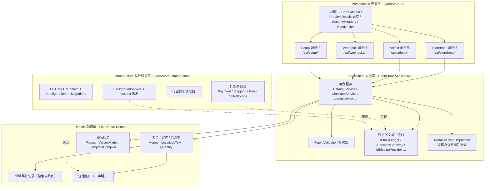
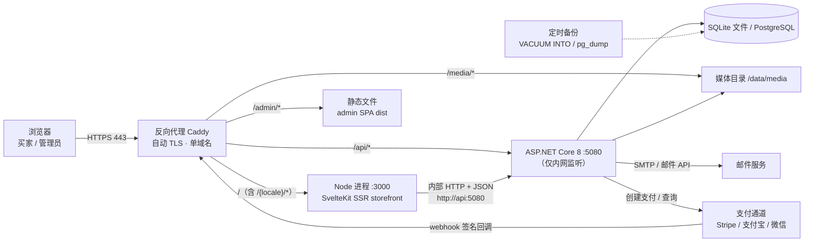
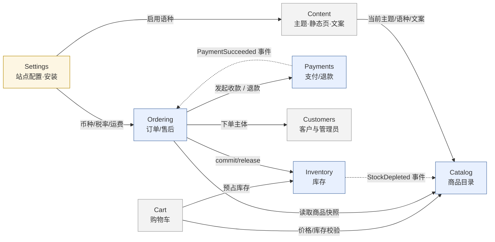
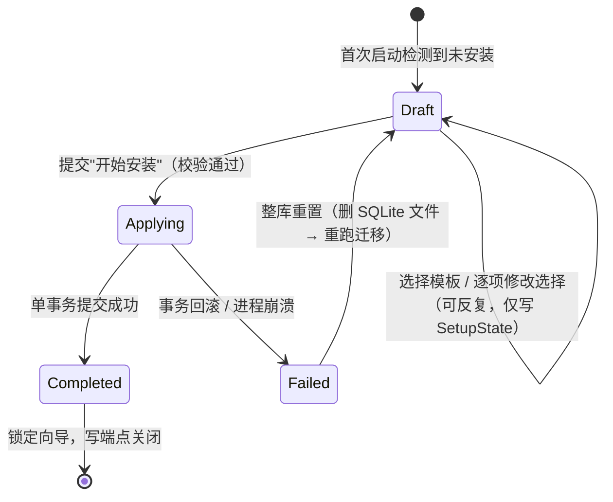
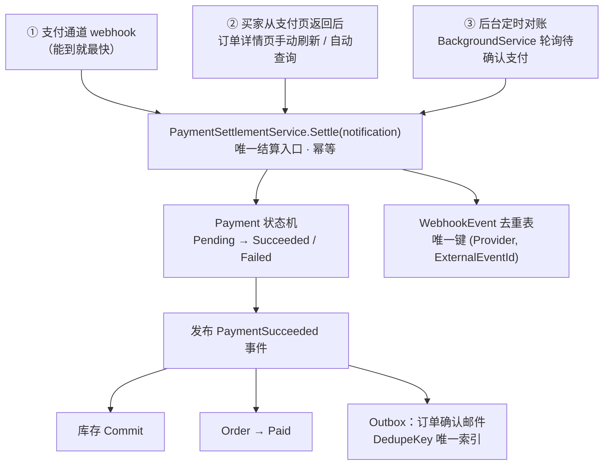

# OpenStore 总体架构方案（Phase 1）

> 代号：OpenStore —— 可复用电商独立站母版
> 版本：v1.7 / Phase 1 骨架交付（修订历史见附录 B；**正文不写需求版本号，只引用 AC 编号与台账 W 编号** —— 版本号永远在移动，W 编号永不复用）
> 作者：梁承宇（系统架构师）
> 下游消费者：数据建模师（表结构）、后端工程师（端点/实现）、前端工程师（页面/组件）、DevOps（部署）、QA（测试策略）
> **本文件不包含**：数据库表结构 DDL、API 端点清单、页面清单 —— 由对应角色在本文约束下自行产出。
>
> **四条写法规则（与需求基线文件头对齐，治"翻到旧句子当现行结论"这个根因）**
> 1. **物理分区**：正文只放**当前有效**结论；被推翻的句子从正文**删除**，只留在附录 B.5 台账里（带"作废了哪一版哪一句"）。读者可以**无条件信任正文**，不必交叉比对。
>    **并且要清依赖：撤回一条观察时，凡以它为「前提」立下的规则一并回改**（前端本轮撤回了一条"有人代我改了 `04` 并代提交"，而它差点让我立一条"同一文件不得并行改"的新规矩 —— 我恰好没写进文件，**但这是运气不是纪律**。**（本句刻意用"不得"而不是"禁止"，就是为了让 `grep -c` 数它的结果是 0 —— 见规则 4：不要把自己要数的那个词写进自己被数的那份文件。）** **一个被编出来的风险比一个错结论更危险，因为风险会催生规则，而规则会活过它的依据。**
>    **撤回也要留痕**（data-engineer-2 提出，我确认）：报过又被撤回的缺口，必须**在同一处**标"已撤回 + 撤回理由"。**否则审计只看得见缺口记录、看不见它已被证伪** —— 缺陷记录会活过它的依据，而后来的人会照着一条已被推翻的缺口去改代码。
> 2. **引用不复制**：凡验收判据、错误码清单、SEO 断言等"会被多处引用"的内容，只写"见需求 AC-xx / §6.1 Sn"，**不在本文复制一份**。复制省一次跳转，换来永久漂移 —— 本项目 6 处过时表述全部由此产生。
>    **一条正向证据（值得给下一个读规则的人看）**：前端只按编号引用本文的索引矩阵（`(b3-缺货)` / `(b3-归档)`），不抄表内容。结果我这一轮把矩阵从 6 行改到 8 行、中途还断过一次表，**他一次都不用重取**。常见质疑是"抄一份不是更省事"，答案是：**抄了要同步，不抄不用同步** —— 复制的收益是一次跳转，成本是往后每一次改动。
>    **跨项目/跨语境的短名必须带限定**（主理人提出，我确认为独立一类）：`openstore#M1` 是**别的项目**的 `M1`，本项目对应的可能是 `M5`。**借来的短名在被借的语境里指向另一个东西，而两边都写着"正确"的数字** —— 这类冲突不会被任何一方的自检发现，因为两边都没写错，只是"`M1`"这个词指的不是同一件事。判据：**引用编号一律写成"<项目/文件> 的 <编号>"**，同一文件内可省（`见 §3.9`），跨文件必带；**跨项目则必须带项目名**，不许裸写。
>    **同一文件内两套编号也不得共用字母**（qa 实测，我确认 —— 上面那条的"同一文件内"版本）：`06` 的手工清单自用了 `M1~M9`，而里程碑表里 `M1 = 目录与库存`，于是"`M1 真实支付通道沙箱联调`"会被逐字读成"里程碑 `M1`"。**这比"写错号"更糟：没有写错任何东西，只是同一个字母指了两件事。** 改法：自用编号换前缀（`MT1~MT9`）**并**在表前写明"本节的 `MTn` 不是里程碑号，不要拿去和里程碑表对号" —— 只换前缀不写说明，下一个人还会去对号。
> 3. **写"当前状态"必须附一条命令与期望值**，否则一律改写为"怎么验"。**理由是一次实测**：本轮我写过一段"落地状态：yaml 与 03 仍是旧拼写"，**15 分钟后另两方就把它们改完了**，那段文字当场变成假话——而我并没有做错什么，我只是写了一句话，时间把它变成了错的。**别的文档在动，你的文字不会自动跟着动**；命令会。
>    **七类断言，各自要附什么（"未核"必须说明属于哪一类，因为验法不同）**：
>
>    | 断言类型 | 必须附 | 反例（都是本轮真实发生的） |
>    |---|---|---|
>    | **动作**（"我改完了"） | 改后的**片段** + 位置 | 先声明"已加注释标为反例"，实际没落笔 |
>    | **残留**（"扫过了，一处不剩"） | `grep` **原文** + **`mtime`** | 主理人 `grep` = 3、我 = 0 —— 差的不是一个读数，是**两个快照** |
>    | **结构**（"接线如预期"） | **可复算的检查器读数** | 数出来的，不是看出来的 |
>    | **归属**（"不是我改的"） | **① 认领**（报告里明写"这是我改的"）+ **② 提交范围**（按路径提交，`git show --stat` 可复算）+ **③ 这一行属于哪一笔**（`git log -S "<被改的那行特征串>" --oneline -- <file>`）—— **不要求也不采信 `--format=%an`** | 本仓 `git log --format=%an` 全仓只有 **2 个 author、最近 8 笔同一身份**，是"恒返回同一答案"的检查（**与"查了 0 个也绿"同族：有输出、无信息**）；且它当天就失效过一次 —— 一条规则被记到我名下，而**我无法用 git 证伪自己**。**信息在文件清单里，不在作者字段里。** 正面实例（前端实测）：`1688ddc` 的提交信息只有 `fix(paging)`，而它**同时带走了他四处未提交改动** —— `git log -S` 告诉他"哪几行进了哪个提交"，不告诉他是谁敲的，**而这恰好够用**：规则要守的是"范围声明是否与 diff 一致"，不是"谁的手"。 |
>    | **已裁决已落地** | `<文件> + 命令 + 期望值` | 最贵的一类：会被三个方向当作前提引用（见下条实测） |
>    | **具体名字**（人/文件/词条） | 找到它的那条命令 | `ShowSettings` 在五个文件里 `grep` 全 0 —— 它从未存在 |
>    | **位置** | 一律**小节号 + 逐字串**；行号只能作辅助且必须带 `mtime` | **行号是快照，不是坐标**：读者按我给的 `L2291`/`L2563` 已经找不到那行了 |
>
>    **最危险的一类不是"没核"，是"看起来核过"**：判断说错，对方会去核；**带名字的实例会被直接采信并继续传播**。所以给不出命令时，一律降级成"我记得有类似一处，待核"，**不要写成一个具体名字。**
>    **☠️ 它有一个更上级的形态：形似完成**（前端自查所得，我确认为独立一类，比"看起来核过"更难发现）。他的实例：AC-11 规则 4 那格**参数写了、规则名写了、断言一行没有** —— 三个部件里有两个在，于是它**长得像已经写完了**。判据：**判据必须能被"只看它、不看上下文"的人直接执行**；需要读者先去别处补齐才能用，它就是没写完，而不是"写得简洁"。**更强的判法：换一个执行者会不会得到不同结论。** qa 写过一条"含一条与 `q` 相关的可判定标记"——**要素一个都没定**（哪个元素、什么文本、命中几个算过），执行者甲与乙都能报绿，而**绿的不是同一件事**。它同时踩了两格：**形似完成**（看起来可执行）与**塑形**（要落地就得让前端为一个测试长出 `data-*` 标记，于是被检对象为过它而变形）。**药方是回到"错误的写法"上**：这条要防的错法是"SSR 没带数据 / catch 成 200 空列表"，它们的共同表现是**没有那条商品** —— 所以判据写成"必须出现那条商品"，不写"必须出现某个标记"。
>    **以及一条文档级推论：写"已覆盖"比"不覆盖"更坏**（前端提出，我确认它是"假绿"在文档里的对应物）。他拒了我一个 `toContain(SITE)` 前哨建议，理由比我给得准：`toBe` 与 `toContain` 在"实现读了请求 `Host`"这个错面前**完全同形**（测试环境里请求 `Host` 与 `PublicSiteUrl` 通常同值），所以能分开的只是"红了之后是哪个变量错"，分不开"来源"。他改写成一段**「已知未覆盖」并说明由谁承接** —— **一个诚实的空洞会被人补上，一个假的覆盖不会**：写了"已覆盖"，就再没有人来看这一格。
>    **而且一条证据只能支持它覆盖的那一步**（backend 归纳，我确认为与我那个错正好互补的另一半）：我是"**只查了一个容器就宣布缺**"（证据不足），他是"**核了输入就宣布核了输出**"（证据够，但它只覆盖一步 —— `HealthProbeIntervalHours = 24` 支持"周期 24h"，**不支持"上界 24h"**，真值还要乘防抖次数）。**判据：写结论前先问"我这条证据覆盖到哪一步"，超出那一步的部分一律标未核。**
>    **为什么"必须带 `mtime`"不是格式要求**（主理人给的机制，我补一个拆分）：噪音的真实伤害不在"多核一次"，而在**一次被证伪的告警会让后面每一条都先被怀疑一遍**。所以处置不是"少报"，是**给每条报告打时点** —— 一旦都带 `mtime`，"过期"就不再是错误，而是"某时刻的快照"，两个时间戳一比就结束，不必争论谁读错了。
>    **并且"假红"与"假绿"是同一个机制的两面**（devops-2 实测补上后者，我原来只想到绿）：**两者都让人不再看输出** —— 假绿让人误信、假红让人放弃读。他的实测是，第一版核查脚本把加粗短语也当关键词，产生 **46 个假未命中**；如果就这样交付，"26 条真工单"会淹在 72 条噪音里，而**噪音的下场不是被修，是被关掉**。所以**判据的第一次真数据运行必须当成交付物的一部分**（期望发现数 ≥1），不是为了"更严谨"，是因为**没跑过的判据等于一条还没确定会不会乱红的判据**。
>    **但要盯两个数，不是一个**：`被指出是过期快照的报告数 / 总报告数` 会因为"打上 `mtime`"而下降，**而下降有两种原因共用同一个数字** —— ① 报告真的更新了（质量变好）；② 争议消失了（不再被判为错，但陈旧照旧；**这正是本文件"两种后果共享同一个观测值"判据的第 5 个实例**）。所以拆成：**陈旧报告数**（报告所基于的 `mtime` 早于对方最后一次改动）＝**质量指标**；**无时点报告数**（没带 `mtime` 就发出）＝**合规指标**。**只有前者归零才算变好；后者归零只说明格式被执行了。** 基线：本轮 **1/3**（某人 12 条外部反馈里 4 条基于旧版；我自己 5 条里 2 条同类）。
>    **统计的分类维度要按"接收方能观察到的现象"选，不按"发信人的动机"选**（backend 自查，我确认）：他把"真过期"与"我已改、但对方读到旧版"分成两类算比例，得 **1/6**；从接收方看**两者是同一个现象**，合并是 **1/3**。**分类维度选错，统计会系统性低估自己造成的噪音** —— 而低估的方向永远是"我这边问题不大"。
>    **判据要挂在"错误的写法"上，不挂在"错误的词"上**（数据建模师提出，比我那版"肯定式 0 处"更硬）：凡用**词**做判据，都会在"改对之后"继续红（因为正确的结论本身就要用到那个词），然后被加白名单 —— 而白名单一旦存在，判据就再也管不住那一片。改成**只有错的那种句式才会命中的模式**：
>    ```
>    grep -nE "(旧|最坏|最多)[^，。]{0,4}一天" docs/03-后端设计.md    # 期望 0 处
>    ```
>    「上界**不是**一天」不含 `旧`/`最坏`/`最多` 前缀，所以**不被命中**；「都能让列**旧**一天」「**最多**一天」全部命中。**这一步顺带把"要不要人工判否定"也消掉了** —— 判据里不再有需要读的人做判断的成分。
>    **同一种病换个粒度还会复发**（他自查所得）：白名单写成**整个实体**（`fx-arm` 全部豁免汉字）等于让该实体其余字段全部免疫；写成 **(实体, 字段)** 才只豁免"业务上必须带型号"的那一格。**粒度决定判据能不能在改对之后保持安静。**
>    **☠️ 报"缺"之前必须查两个容器：文档的法定归宿 + 可执行的实现**（本轮我犯了四次，每次各缺一个容器，记全）：
>    ① 报"三个向导码不在 `openapi` 的 `enum`" —— 没查 **§5.1「未进契约例外清单」**（文档归宿）；② 报"契约缺整条购买链" —— 没查 **`docs/00` 里程碑表**（文档归宿）；③ 报"7 处 SEO 断言没人守" —— **没 `grep` `scripts/verify-seo-matrix.sh`**，复核后 **4 处早已覆盖、1 处措辞不准（"500 空壳全过"错，实际 500 会红，漏的是"200 的白页"）、只剩 1 处成立**（实现容器）；④ 我向 devops 预警"判自指时 `?utm_*` 会误判成跨 URL"，而**他的 `S8` 早就用 `norm_url()` 归一后比较、并把自指降级为 `warned` 不判红** —— 我读的是 `06` 的新措辞，**没读脚本**（实现容器），预警指向一个不存在的洞。
>    **判据：任何"缺 X"的结论，必须同时给出"我在哪个容器里查过它不在"和"我为什么认为那个容器是唯一可能的家"。** 本项目每个结论至少有两个家（文档的例外清单/里程碑表 + 脚本/代码），**只查一处就报缺，误报率实测 4/4**。**注意第 ④ 次的形态与前三不同**：前三是我自己去查了一处就下结论，**这次我连"查"都没查，是从另一份文档的描述里推出实现的样子** —— 而"推导出来的实现"和"实现"差着的正是它有没有被跑过。
>    **⚠️ 判据可以降级，但降级理由必须能在「提交后的版本」上用一条命令复现**（主理人裁定）—— 做不到就写"未核"。**不要在任何人的未提交中间态上做判据变更**：中间态的定义就是"第二个人看不到"，以它为根据的结论不可复核，**而它和真结论长得一模一样**。这比"报告带 `mtime`"更硬：`mtime` 只能暴露"我读的是旧的"，**读中间态连 `mtime` 都救不了**（中间态的 `mtime` 就是当下）。实例：有人据一个未提交的编辑中状态判定"`soak.sh --self-test` 当前为红"，而提交后的版本复跑是 **`rc=0`、33 样本全过**。
>    **`rc` 也一样**（backend 补）：它是**产物**不是不变式，随工作区变。所以"自证为绿"必须写成"**自证为绿 @ `<commit>`**"——否则三天后它是假的，而读的人**无从判断它假了**。同一处他量到三个数：`HEAD` 版 `rc=0`、工作区 `rc=1`（1/35 红）、上一轮别人读的 2/33。**三个都真实，只有一个可复现**，而不可复现的那个正是"判定器当场抓住了自己没装完"。
>    **判定器的第四种病：恒真**（backend 提出分类、要我确认，我认；药方我改了）。`03` 今天有三种病：**弱化**（能红，但红得太少 → 加严）、**自证**（永远不会红 → 去耦合）、**塑形**（判据反过来要求对象长成某个样式，于是对象为过它而变形 → 判据挂到"错误的写法"上）。`--format=%an` 不属于任何一种：它不弱化（形式上是强断言）、不自证（数据源是 git 元数据，不是被测物）、不塑形（没人为了过它去改提交身份）—— **它在这个仓里恰好永远成立，"每条都通过"就是它的全部输出。**
>    **药方不是"换一个有方差的值"，是"先问这个量在本仓有没有方差"**：2 个 author、最近 8 笔同一身份 ⇒ 方差为 0 ⇒ 信息量恒为 0。换量只是把"零方差"推给下一个环境；**问方差才是能带走的判据**。
>    **☠️ 而这一族里最贵的一格：背书过期**（backend 提出，我确认它比"数字过期"高一级）。他给的机制一句话就够：**数字过期会被人重算，背书过期会让人不再重算。** 我今天那张 P1 就是标本 —— 我在错数旁边写了"我核过契约"，于是读的人（包括被我指控的那一方）没有一个去重算，**而重算恰好是唯一能发现它错的那一步**。落笔为格：**凡我不打算重算的东西，不许写成第一人称。**"我核过 X"只在 X 上真跑过命令时才成立；抄来的写成"`03` §5.1 里写着 X"。**报告里必须能分开读出"哪些是我核的、哪些是我抄的"。**
>    **同一族的第二个变体：锚点写命令，不写值**（team-lead 与 qa 在同一小时内各给了一个 `06` 锚点，两个都已过期：`fc64afe` → `68db00f` → `6f7e4c1`）。不是他们算错 —— **锚点在"发出那一刻"都是对的，错的是"把会变的值写进信里"**。所以凡"以某版本为准"的句子，写 `git log --oneline -1 -- docs/06-测试验收.md`，不写那串哈希。**判别法复制"去哪里查"，清单复制"现在是什么"** —— 锚点是清单。**接收方要的也不是"哪个 commit"，是"我该用哪条命令自己取到它"。**
>    **检索策略：两种 sweep 取并集，并集也不是终点**（backend 补的对称盲区）。清单法找"我知道该在哪"的东西 —— 盲区是**位置**；符号法找"我知道该长什么样"的东西 —— 盲区是**形式**；规则 4 那条"命令自证完整"的盲区是**裁判**。三种都是"用一个有盲区的视角去覆盖一个更大的集合，而盲区不在自己的视野里"。取并集只是把盲区从"一个视角的"缩成"两个视角共同的"。
>    **把分类翻成动作，需要的信息不在分类里**（我先前夸错过一次，被对方拆开）："四个码挂在不同的里程碑上"是分类；"删哪一行、留哪三行"是动作 —— **两者之间隔着"每个码各自的里程碑"这个事实**。所以"我理解了你的改动"推不出"这个改动简单"。**判断依据应是"这个代价对应的是已发生的失败模式，还是假想中的未来"**（同 A-W20）。
>    **☠️ 凡写"已落笔／已采纳／已改成"，必须附那条 `grep` 及其期望值**（我自己加的，因为我在一小时内犯了三次）。**理由不是给读者核，是给自己核**：写得出一条 `grep`，"我改完了"才有和"我记得我改完了"分得开的可能。**"已采纳"是全部句式里最不容易被核的一种，而它同时是姿态最好看的一种** —— 缺陷报告会被读的人去翻命令（"你查了哪个容器"），而 ACK 不会被任何人翻：读的人自己就是提出方，他刚说完就看见"采纳了"，没有理由再查一遍。**所以空的 ACK 传得比空的缺陷报告远**：本轮的实例是，我在回执里写了三条"已落进 §3/§5.1"，而那一刻 `grep -c` 分别是 0，对方已经照着把其中一条落进了 `03` —— **`03` 先有、`00` 后有了，中间那段时间里有一份文档引用了另一份文档里不存在的规则。** 判据：**ACK 与"引用"同权 —— 只要它会被别人当依据，它就是一条状态声明，就和"我改完了"用同一套证据要求。**
>    **判据写法四条（devops-2 在裁决落地核查脚本里实测提出，我确认；四条都不是"更严"，是"更诚"）**
>    ① **遇到"肯定句与否定句不可分"，正解不是加正则，是不下结论、印原文。** 命中数不分肯定/否定必然误判（"这里**不**采用 X"会被数成采用了 X），而靠正则去判否定，等于让判据做语义判断 —— **它做不到，且做错时无声**。改成：每个命中**把那一行原文印出来**，结论行明写"本判据不证明说的是那个意思"。**判据的诚实形态是把材料交给唯一能做语义判断的那一方（读者），而不是替他把结论下了。**
>    ② **免责与适用范围必须印在结论旁边，不能只写在文档头部。** 写在头部的适用范围声明，**在有人引用这条结论的时刻已经滚出屏幕了** —— 而人只在那个时刻需要它。所以它跟着结论走、每次运行都印，**尤其是绿的时候**：绿的那一刻正是它会被引用的那一刻。（与我那条规则 4 同源：结论行是唯一一定会被读到的地方。）
>    ③ **"不可核"与"没有一行可核"是两个数，不许合成一个。** 前者是**质量指标**（某些行抽不出关键词，属正常损耗，**不该红** —— 红了就会变成"每天红"，然后被关掉），后者是**结构指标**（可核行数 = 0 时判据是空集，"∀x∈∅ 为真"，**必须红**）。合并的后果和"陈旧报告数 / 无时点报告数"合并一样：**一个数字承载了两种相反的处置**。判据：**凡一个计数同时被用来"判断要不要红"和"描述覆盖了多少"，它必须拆开。**
>    ④ **"印出来"不等于"有人管"。** 未命中与不可核这两个数若只印不判，会退化成**装饰指标** —— 每天印一个没人处理的数字，三个月后那一行没人再看。所以它们必须**只减不增**（与 ⑤-b 同一条结构判据），且每条未命中要有 owner 与一句"为什么它算待办、不算缺陷"。**一个数字被印出来，只证明它可观测；证明它被管着，得有另一条断言。**

>    **上面"已裁决已落地"那一行的例子，本身在 47 分钟内就过期了 —— 而这恰好是它最好的证明**：我报给主理人的话是"`03` 没落地"，写下那一刻为真，47 分钟后为假。所以规则不是"要更小心地核实"，而是**"凡状态句必须自带时点"** —— 命令 + `mtime` + 期望值，三者缺一，那句话就只对它的采样时刻成立，而读者不会知道你采的是哪一刻。
> 4. **验收命令不得把被判对象的名字写进被判对象自身**（后端实测提出，我确认为独立一类，不是规则 3 的变体）。他的修订记录里内嵌了模式串，而那条命令统计的正是这份文件 —— **它永远能数到 1**，"期望 0"从写下那一刻就不成立。这类命令的坏处不在错，在**它不报错、不漂移、不随时间变化：它恒红或恒绿，而且看起来完全正常**（与规则 3 的区别：规则 3 治"随时间变假"，本条治"从出生就无信息"）。判据：**命令里出现的每一个字符串，都要问一句"它会不会同时出现在我统计的那份文件里"**；会，就把模式串搬进 `scripts/`，文档只写 `bash scripts/xxx.sh`。**同理适用于"检出脚本自己被写进被检出目录"**。
>    **第二种形式更隐蔽：核查者不得是被核对象**（backend 提出"自证不算证"，我确认为同一类的第二形态）。他正确地拒绝了由自己写"裁决落地核查"脚本 —— 因为那个脚本要核的正是他的文件。**自证不成立与人品无关，是因为"我核过了"与"我核的正好是我写的东西"在证据强度上没有区别**；这类核查的 owner 必须是第三方（他建议 `qa2` / `devops-2`），成本口径 **0.5 人日**（读台账与修订记录、逐条换写成 `grep`、跑一遍、输出"只有台账、正文没有"的条目）。
>    **第三种形式：命令完整、参数有意义、照做必然失败**（data-engineer-2 提出，我确认为同一类）。实例：`docs/02 §7.3.4` 的 S9 复现命令修前只给了 `--archived-gone`，而脚本前置是 `if [ -z "$ARCH_MOVED" ] || [ -z "$ARCH_GONE" ] || [ -z "$ARCH_GONE_FROM" ]; then … return 2` —— **照抄必然 `rc=2`**；而 `rc=2` 在 CI 里常被当成"跳过"，**"跳过"与"通过"在观感上等价**（又是共享观测值）。
>    **判据：凡在文档里给出可执行命令或参数清单，必须同时给出"谁在拒绝它"** —— 即脚本里那段 `PRECONDITION` / `if [ -z ... ]` 的原文，或 CLI 表里该子命令那一行。**因为命令的"完整性"只有拒绝它的那一方才能证伪，文档自己证不了。**
>    **并且要分清两种病，药不一样**（qa 指出、backend 落定）：**弱化** = 验了个更松的条件，**能红但红得太少** → **加严能救**；**自证** = 用被测物验被测物，**永远不会红** → **加严只会得到一个更强的假绿**，必须**去掉数据来源的耦合**。**判"该加严还是该解耦"之前，先问一句"它现在有没有可能红"。**

---

## 0. 一页纸结论（给决策者）

| 决策点 | 结论 | 一句话理由 |
|---|---|---|
| 部署形态 | **模块化单体**，单 .NET 进程 | 单商家部署 + 1 人开发，微服务的每一条收益在本场景都不成立 |
| DDD 上下文 | **8 个**，同进程内按命名空间隔离 + 架构测试守卫 | 边界要真实存在，但不需要物理拆分 |
| 鉴权 | **HttpOnly Cookie + Session（DB 存储）**，双端共用 | 同源部署下 JWT 无收益，全是成本 |
| MediatR / CQRS | **不用**，Application Service + 40 行领域事件分发器 | 无高并发读写分离场景，CQRS 是纯成本 |
| 主题 | **构建期打包的 npm 工作区主题包 + `import.meta.glob` 静态注册表 + DB token 覆盖** | Svelte 组件必须经 Vite 预编译，运行时"安装主题"在技术上不可能，只能在构建期"存在"、运行时"选择" |
| 多语种 | **所有语种一律带 `/{locale}/` 前缀（含默认）** + 业务内容用**翻译子表**（非同表 JSON 列） | per-locale slug 唯一索引是 SEO 的硬前提，JSON 列给不了；全带前缀让路径唯一 → 缓存键唯一 → 无重复内容（需求 AC-11） |
| 价格结构 | **本期内联在 `ProductVariant`（含 `Currency` 列）**，二期新增 `VariantPrice(VariantId, Currency)` 表 + 回填 + 双读切换；订单/退款/报表全部带货币代码 | 内联少一次热路径 join；二期是纯增量迁移（可在线可回退），比"改主键"安全（主理人复裁，见 §2.4） |
| 支付结算 | **回调 / 订单页手动刷新 / 后台定时对账三条路径共用同一段幂等结算逻辑** | 自托管商家常常没有公网 IP，回调收不到是常态而非异常（对齐 US-E6-03 / AC-07） |
| 行业模板 | **JSON 清单 + 纯函数编译器（TemplateCompiler）** | 配置驱动，非开发者可写，可 diff 可评审 |
| 属性模型 | **混合模型**：属性定义表 + 枚举选项表 + 窄表值（非万能 EAV、非 JSON 列） | 唯一能同时表达"兼容型号"与"尺码/版型"且保住筛选与校验的取向 |
| 前台渲染 | **storefront 用 SvelteKit + adapter-node 做 SSR**；admin 用 SvelteKit SPA 模式（纯静态） | 公开电商站 SEO 是硬需求，纯 CSR 在商品页排名与 OG 卡片上双输 |
| 数据库 | SQLite（开发/小店）→ PostgreSQL（生产），EF Core 只用可移植子集 | 既定；CI 双 provider 测试兜住差异 |

---

## 1. 总体架构

### 1.1 分层与依赖方向



**依赖规则（由 `OpenStore.ArchitectureTests` 强制，违反即 CI 失败）**

1. `Domain` 只依赖 BCL 与 `Domain/Shared`，**不引用** EF Core / ASP.NET Core / 任何第三方包（`Money`、`LocalizedText` 自己写）。
2. `Application` 依赖 `Domain`，**不引用** `Infrastructure`、不引用 `Microsoft.EntityFrameworkCore`。
3. `Infrastructure` 依赖 `Domain` + `Application`（实现其端口）。
4. `Api` 是**唯一组合根**：引用全部层，负责 DI 装配与端点注册，**不含业务逻辑**（端点方法体内只做 `Model → Command → Service → Response`）。
5. 禁止循环依赖：`Domain.Catalog` 不得引用 `Domain.Ordering`；跨上下文只能通过 ①Application 层端口接口 ②领域事件。

> **跨上下文读端口只有一个实现，`IStoreReadiness` 是它的具名归属（数据建模师提出，我确认并定归属）**：`CanSell`/`CanSellReason` 的**列**在 Settings（`StoreSettings`）、**事实源**在 Payments（`PaymentGatewayConfig`），因此这是一条 **Settings ← Payments 的读取依赖**——端口 `IStoreReadiness` 声明在 Application 的跨上下文端口组（与 `IStockLedger`/`IPaymentGateway` 同处），**由 Settings 实现**，`Payments`（结算确认/重新支付）与 `Storefront`（bootstrap）只许调这个端口。
>
> **只许有一个读口**：出现第二个读口就等于出现第二个事实源，而两个事实源之间没有任何机制保证一致——本项目已经因为"两处各自算一遍"栽过一次。**同理反向：写口也只有一个**（重算流程），任何 endpoint 直接 `UPDATE StoreSettings SET CanSell=…` 都视为架构违规。

> 组合根的特例：`Api` 引用 `Infrastructure` 是为了 DI 注册与迁移执行，不属于"业务依赖"，架构测试中显式白名单并加注释。

### 1.2 部署图



**三个进程/单元：`caddy`、`storefront(node)`、`api(dotnet)` + 一个数据卷。** 没有 Redis、没有 MQ、没有独立搜索服务。

**关键约束**：API 只监听内网/loopback，对外一律经反代；SSR 只能通过 HTTP 调 API，**不允许直连数据库**（否则会出现第二套数据访问与第二套业务规则）。

### 1.3 "母版"如何做到可复用：三分法

这是整个项目的核心命题。任何一块功能在写代码前必须先回答"它属于哪一类"，否则母版迟早退化成某个行业的定制站。

| 分类 | 定义 | 具体清单 | 变更方式 |
|---|---|---|---|
| **代码（不变）** | 跨所有商家完全一致，随版本升级 | 领域模型、用例、API 契约、`@openstore/ui` 组件、主题运行时与合并算法、安装向导引擎、属性/变体引擎、支付/物流/邮件适配器框架、计价与订单状态机 | 改代码 → 升版本 → 重新构建 |
| **配置 / 数据（每店不同）** | 同一份代码，落到具体商家就不同 | 站点设置（币种/税率/运费规则/重量单位/订单号格式）、启用语种、**当前主题 id + token 覆盖 + 首页区块编排**、分类树、属性定义与选项、商品与变体、静态页、UI 文案覆盖、管理员账号 | 后台 UI 编辑 → 存 DB |
| **扩展点（第三方/新行业接入口）** | 代码留好的插槽，新增能力不碰主干 | ① **行业模板**（JSON，`assets/industry-templates/*`）② **主题包**（pnpm 工作区包 `themes/*`）③ **语种包**（`packages/i18n/locales/*.json`）④ **基础设施适配器**（`IPaymentGateway` / `IShippingProvider` / `IEmailSender` / `IFileStorage`）⑤ **领域事件订阅**（未来拆服务的唯一合法出口） | 新增目录/实现接口 + 注册 |

**防止母版腐化的三条硬规则**

- **规则 A**：任何"某个行业才需要"的字段或规则，必须走 属性定义 / 模板 JSON / 设置项 三选一，**不允许加列、不允许加 if 分支**。评审时的提问模板："这是代码还是数据？"
- **规则 B**：主题只能消费 `ThemeContext`（受控只读数据），不得直接 `fetch` API、不得读环境变量、不得访问 `document`（SSR 会炸）。
- **规则 C**：`Domain` 层不出现任何字符串硬编码的业务文案与币种符号，全部走 `LocalizedText` / `Money`。

---

## 2. DDD 限界上下文与聚合边界

### 2.1 上下文地图



实线 = 同步调用（同进程，直接方法/端口）；虚线 = 异步领域事件（进程内派发）。

### 2.2 上下文清单

| # | 上下文 | 职责 | 核心聚合 | 聚合根 | 对外领域事件 |
|---|---|---|---|---|---|
| 1 | **Catalog** 商品目录 | 商品、变体、分类树、属性定义/选项集 | Product、Category、AttributeDefinition、AttributeSet | Product / Category | `ProductPublished` `ProductArchived` `VariantPriceChanged` `CategoryTreeChanged` |
| 2 | **Inventory** 库存 | 每个变体的可售/预占/已售数量 | StockItem | StockItem | `StockReserved` `StockReleased` `StockCommitted` `StockDepleted` |
| 3 | **Cart** 购物车 | 匿名/登录购物车、加购改量、结算前校验 | Cart | Cart | `CartCheckedOut`（结算快照移交） |
| 4 | **Ordering** 订单与售后 | 订单生命周期、金额快照、发货、退货/退款申请 | Order、ReturnRequest | Order | `OrderPlaced` `OrderPaid` `OrderShipped` `OrderCompleted` `OrderCancelled` `ReturnRequested` `ReturnApproved` |
| 5 | **Payments** 支付 | 支付意图、交易尝试、退款、webhook 幂等 | Payment、Refund | Payment | `PaymentSucceeded` `PaymentFailed` `PaymentRefunded` |
| 6 | **Customers** 客户与身份 | 买家账号/地址簿、管理员账号/角色、会话 | Customer、AdminUser | Customer / AdminUser | `CustomerRegistered` `AdminUserSuspended` |
| 7 | **Content** 内容与呈现 | 主题实例（激活主题 + token 覆盖 + 首页区块编排）、静态页、UI 文案覆盖 | ThemeInstance、StaticPage | ThemeInstance / StaticPage | `ThemeActivated` `ThemeConfigChanged` `StaticPagePublished` |
| 8 | **Settings** 站点配置与安装 | 币种/税率/运费规则/订单号格式、**`PublicSiteUrl`**、启用语种、**`CanSell` 派生值 + 支付通道健康状态**、安装向导状态 | StoreSettings、SetupState、PaymentChannelHealth | StoreSettings / SetupState | `SetupCompleted` `ShippingRuleChanged` `TaxRuleChanged` `CanSellChanged` |

> `CanSell` 放在 Settings 而不是 Payments：它是**站点可售状态**（前台据此禁用结算），只是**由**支付配置与健康状态派生。派生逻辑写在 Payments，落库与对外读取在 Settings（见 §5.5）。`PublicSiteUrl` 同理：它是站点身份，被 SEO 与支付回调地址共同消费，只有一处真源。

> 8 个已是上限。若后续觉得 7/8 太碎，唯一允许的合并是 `Content + Settings → Site`（两者都是低并发 CRUD）；但**不要**把 Inventory 并进 Catalog、不要把 Payments 并进 Ordering（见 2.4 裁决）。

### 2.3 模块隔离 vs 物理拆分：**模块化单体**

**结论：单一 .NET 进程，8 个上下文以命名空间 + 文件夹隔离，不拆微服务、不拆独立项目。**

| 判据 | 本场景的实际情况 | 指向 |
|---|---|---|
| 部署单元数 | 每个商家一台机器，峰值 ≤ 50 RPS | 单体 |
| 团队规模 | 1 名全栈 + AI 辅助 | 单体 |
| 需要独立伸缩的模块 | 无（没有单点热点） | 单体 |
| 需要跨上下文强一致 | 下单 = 库存预占 + 订单创建 + 支付意图创建，**必须同事务** | 单体（分布式事务是灾难） |
| 运维能力 | 商家自己部署，运维能力假设为"会跑 docker compose" | 单体 |
| 独立发布的诉求 | 无（一次发布 = 一个商家的一整套） | 单体 |

**被否决方案：8 个微服务 / 3 个服务（Catalog-Service / Order-Service / Payment-Service）拆分**
否决理由：① 每个商家要跑 3-8 个进程，VPS 内存成本翻 3 倍；② 下单链路从 1 个本地事务变成 Saga/补偿，工作量至少 +40%，且 1 人开发无分布式可观测能力，线上只能靠猜；③ 本场景无任何模块需要独立伸缩；④ 边界靠命名空间 + NetArchTest 已能守住 90% 的腐化风险。
唯一保留的出口：领域事件已经是一等公民，未来若真需要拆（例如支付模块被要求独立合规部署），事件订阅点可直接换传输层。

### 2.4 聚合边界的关键裁决

| 裁决点 | 结论 | 理由 | 代价/后果 |
|---|---|---|---|
| **Order 与 Payment 是否同一聚合** | **不同聚合，不同上下文** | 支付有独立生命周期：反复重试、部分退款、webhook 乱序到达、支付通道需要独立重放。Order 内聚它会导致订单行锁被支付回调长时间持有，且退款必然污染订单状态机 | Order 只持有 `PaymentStatus` 投影 + `PaidAmount`。两者靠 `PaymentSucceeded` 事件 + Application 层编排保持最终一致（同事务内先落 Payment 再改 Order，属于同 DB 本地事务，不需要 Saga） |
| **Cart 是否持久化** | **持久化（DB），匿名用 HttpOnly Cookie 持 cartId** | ① 支付回跳与结算页需要**服务端权威 cart 快照**；② 加购时就要给出权威库存/价格反馈，客户端算价必然与后端漂移；③ 之后任何优惠/促销逻辑都要塞进"结算事务"，会变成最难改的地方；④ 成本仅为 1 张表 + 1 个 cookie | 需要一个匿名会话机制 + 一个"登录后购物车合并"用例（约 60 行）。**被否决：localStorage 购物车** —— 价格全由客户端算或每次整单重算，加购体验与后续营销能力双输 |
| **Product 与 Variant 关系** | **Variant 是 Product 聚合内的实体**，不是独立聚合 | 变体的价格、SKU、图片、库存键必须与商品一起校验（轴组合唯一性是商品级不变量） | 变体轴**硬上限 3 维**（需求裁决 2 已钉死），单商品变体数上限 **≤ 100**（防止 3 轴 × 各 20 选项 = 8000 变体把管理端拖死） |
| **变体价格形态** | **本期内联在 `ProductVariant` 上**（`AmountMinor` / `CompareAtMinor` / `Currency`），**不建 `VariantPrice` 子表**；二期加币种 = **新增** `VariantPrice(VariantId, Currency)` 表 + 回填 + 双读切换 | **主理人复裁，架构 §2.4 原"本期就建子表"的判断已被改判**。改判理由（我接受）：本期建 1:1 子表 = 单值拆表，**列表/详情/下单每次价格读取都要多一次 join**，等于"为避免一次未来迁移先付永久利息"；而二期走"**新增**一张 1:N 表 + 回填"是纯增量、可在线、可回退。**关键认知修正**：我原先推"本期就把 PK 定成复合键"，但数据侧若已按单列 PK 落地，改 PK 本身就是破坏性变更 —— "只插行"只在 PK 已是复合键时成立，所以"二期新增表"才是真正的向前兼容路径 | ① `Currency` **必须本期就落库**（ISO 4217 定长 3 位，不用枚举整数），否则二期回填拿不到币种；② 域内仍用 `Variant.PriceFor(currency)` 返回 `Money`，**API DTO 只暴露单一价格对象**（不因内联变成数组），这样二期换实现时契约不变；③ 订单行、退款、报表全部以 `Money` 落库 |
| **Inventory 与 Product 是否分离** | **分离**：Product 不含库存字段，Inventory 独立聚合 | ① 一致性要求完全不同：库存每次下单都变（高争用），商品信息极少变；② 库存需要独立的事务与乐观锁；③ 商品目录需要被缓存，库存不能被缓存 | 商品列表展示"是否有货"需要跨上下文读一次库存（同进程，用 `IStockQuery` 端口 + 批量查询，一次 SQL）；缓存策略必须区分"商品信息"与"库存数字"（后者 TTL ≤ 5s 或直接不缓存） |
| **属性定义放哪** | Catalog 内，`AttributeDefinition` / `AttributeSet` 独立聚合，Category 按 id 引用 | 属性定义由运营改、被商品引用，属于慢变主数据 | 删除被引用的定义需先校验（不允许级联删除） |

**一致性策略（写死，避免后面争论）**

- 上下文之间：**同一 DbContext、同一本地事务**（模块化单体最大红利）。Order 创建 + StockReserve + Payment 创建 = 一个事务。
- 只有**外部副作用**（发邮件、调支付通道、写文件）才走 **Outbox 表 + BackgroundService**，保证"订单已提交则邮件最终会发"。**不用 Outbox 做领域事件投递**（进程内直接派发，简单且够用）。
- 库存扣减时机：**下单时 Reserve → 支付成功 Commit → 超时（默认 30 分钟，可配）或订单取消 Release**。

---

## 3. 技术选型表

| 层次 | 关注点 | 选型 | 理由 | **被否决的备选及否决理由** |
|---|---|---|---|---|
| 架构 | 应用层编排 | Application Service（每用例一个方法）+ 40 行 `IDomainEventDispatcher` | 调用栈短、调试直观、编译期可见依赖、无隐式魔法 | **MediatR + CQRS 读写分离**：本场景无高并发/读写模型差异，Handler 注册与 Pipeline 带来的是间接层而非收益，1 人维护成本 > 收益。**垂直切片框架（Wolverine/FastEndpoints 全家桶）**：同上，且把端点约定绑死在第三方库里，与"母版要长期可维护"冲突 |
| 后端 | ORM | **EF Core 8**（Code First + 显式 `IEntityTypeConfiguration`） | 既定；迁移/关系/查询/两 provider 兼容都成熟 | **Dapper**：SQL 手写量在 8 个上下文下会失控，迁移与关系维护成本对 1 人团队不可接受。**NHibernate**：生态与 LLM 辅助语料都远弱于 EF Core |
| 后端 | 数据库迁移 | **EF Core Migrations，CLI 显式执行**（`dotnet openstore migrate`）；启动时只做"检测 + 友好报错"，不自动迁移 | 生产自动迁移是事故源；向导首启时明确提示"需执行迁移" | **`EnsureCreated()`**：无法演进 schema，第二版必被推翻。**FluentMigrator**：多一层 DSL，EF 已够用 |
| 后端 | 鉴权（双端） | **HttpOnly + Secure + SameSite=Lax Cookie + 服务端 Session（DB 表，可撤销）**；admin 与 storefront 用两套 Cookie 名与两套授权策略 | 同域部署（反代同 origin）下 Cookie 是默认最安全解；Session 可即时踢下线（管理员重置密码/封禁立即生效）；无 token 刷新逻辑、无 XSS 可读问题 | **Bearer JWT 存 localStorage/sessionStorage**：XSS 直接拿走、需要 refresh token + 黑名单（等于又做了一遍 session），且无法即时撤销。**Duende IdentityServer / Auth0**：单商家部署多一个服务/一个第三方依赖，YAGNI。**ASP.NET Core Identity 全家桶**：带来 7 张表 + Razor UI + 双因素/外部登录等不需要的能力，对"两个用户类型 + 邮箱密码"是重锤 |
| 后端 | 密码哈希 | 复用 `Microsoft.AspNetCore.Identity.PasswordHasher<T>`（PBKDF2/Argon2 可配），仅复用一个类 | 官方实现、参数可调、无需引入整套 Identity | 全量 Identity（见上）。**自写 SHA256/MD5**：不安全，禁止 |
| 后端 | API 文档 | `Microsoft.AspNetCore.OpenApi`（.NET 8 内置）+ **Scalar** UI；OpenAPI JSON 同时作为前端类型生成输入 | 官方包，零第三方中间件；一份 JSON 同时服务文档与 `openapi-typescript` | **Swashbuckle**：可用但 .NET 8 上官方包更贴合且少一层依赖。**gRPC**：浏览器调用需要 gRPC-Web + 代理，SEO/demo 无收益 |
| 后端 | 参数校验 | **FluentValidation**，校验器放 Application 层，对 Command/DTO 生效 | 可单测、可复用、规则与领域不变量分开（DTO 校验 vs 聚合内不变量） | **DataAnnotations 一把梭**：跨字段规则（如"变体轴组合唯一"）表达不了。**端点里手写 if**：重复且必然漂移 |
| 后端 | 日志 | **Serilog** → JSON 控制台 + 滚动文件；`CorrelationId` 中间件（`X-Request-Id` 透传） | 结构化、出问题可直接 grep；不需额外服务 | **内置 Console Logger 默认配置**：无结构、无滚动、无上下文。**自建 ELK / Seq**：MVP 运维成本 > 收益；Seq 仅作为本地开发可选 |
| 后端 | 缓存 | **`IMemoryCache`** + 版本号键（`catalog:v{n}:{locale}`），写操作 bump 版本号 | 单实例部署，进程内缓存即最优；版本号失效避免逐键清理漏删 | **Redis**：单实例 + 一台机器，纯运维负担。**HTTP 响应缓存/OutputCache**：商品与主题可变，首版收益不确定，先不上 |
| 后端 | 后台任务 | **`BackgroundService` + Outbox 表**（邮件、支付对账、购物车清理） | 与业务同库同事务落地，不丢任务；无额外进程 | **Hangfire**：功能强但引入自有表 + 仪表盘 + 授权面，首版超范围；作为后续升级路径（触发条件：需要可视化重试/定时编排时）。**Quartz.NET**：同上 |
| 后端 | 邮件 | **MailKit/MimeKit** + **Scriban** 模板 + `IEmailSender` 端口；开发期用本地捕获端（smtpd/Papercut）验证真实 SMTP 路径 | 不锁厂商；模板可被商家覆盖；本地可无损验证 | **`System.Net.Mail.SmtpClient`**：官方已标记不推荐、TLS/认证支持落后。**SendGrid/SES SDK 直连**：厂商绑定，且商家可能只想用自己的 SMTP |
| 后端 | 文件存储 | **本地磁盘 `/data/media`** + `IFileStorage` 端口 + **ImageSharp**（上传即生成 3 档尺寸 + WebP） | 单机部署，本地盘最简单；端口留给未来 S3/OSS | **浏览器直传 S3**：需要给前端临时凭据，凭据管理复杂度远大于收益。**Cloudinary/imgix**：第三方成本 + 出网依赖 |
| 后端 | 限流/防护 | `Microsoft.AspNetCore.RateLimiter`（登录、下单、webhook 各自策略）+ 全局异常中间件输出 **ProblemDetails(RFC 7807)** | 框架内置，零依赖；ProblemDetails 让前端只写一套错误解析 | **自研限流**：重复造轮。**自定义错误包装体**：前后端要维护两套映射 |
| 后端 | 支付 | `IPaymentGateway` 端口；首版实现 **Stripe（PaymentIntent + Checkout 跳转）** + **FakeGateway（E2E 测试用）** | 抽象先行，通道可替换；Fake 让黄金链路自动化可跑 | **直连某通道 SDK 写死在 OrderService 里**：换通道 = 重写下单链路。具体通道仍待客户拍板（见 §8） |
| 后端 | 物流 | `IShippingProvider` 端口；首版只实现 **ManualShippingProvider**（承运商下拉 + 运单号录入 + 后台查单跳转） | MVP 不接实时费率，减少一个外部依赖与一堆异常分支 | **直接接顺丰/菜鸟 API**：签约、测试环境、异常码与对账全是额外工程量，MVP 不需要 |
| 测试 | 后端单测 | **xUnit + FluentAssertions**；`WebApplicationFactory` 集成测试 | 生态与 AI 辅助语料最全 | **NUnit/MSTest**：无技术优势，团队习惯 xUnit。**SpecFlow/Reqnroll BDD**：多一层 Gherkin 维护，收益在跨角色沟通，本团队 1 人 |
| 测试 | 架构门禁 | **NetArchTest**（分层依赖 + 上下文互引规则）+ `scripts/check.sh` 一键门禁 | 把"不要循环依赖"变成 CI 红灯，契合客户的门禁自检习惯 | **靠 Code Review**：8 个上下文 + AI 生成代码，纯人工守不住 |
| 测试 | 前端 | **Vitest + @testing-library/svelte**；**Playwright** 跑 1 条黄金链路（浏览→加购→下单→Fake 支付→后台发货） | Vitest 与 Vite 同源零配置；Playwright 多浏览器、并发好 | **Cypress**：启动慢、并行要付费/额外配置。**Jest**：在 Vite + ESM 下配置摩擦更大 |
| 前端 | 框架与构建 | **SvelteKit（Vite）**：storefront = `adapter-node` + SSR；admin = `adapter-static` + `ssr=false`（纯 SPA） | 仍是 Vite 构建；同一框架两种模式，开发者只学一套；storefront 拿到真 HTML 满足 SEO | **纯 Vite SPA + CSR（原方案）**：见 §5.4，SEO/OG 双输。**Next/Nuxt**：换语言栈，违反既定选型 |
| 前端 | 状态管理 | **Svelte 5 runes（`$state`/`$derived`）+ `.svelte.ts` 模块**，不引第三方 | 语言内建，无需 API 适配；SSR 下状态生命周期天然清晰 | **Pinia 类/Redux 类 store**：为跨组件共享加一层样板，runes 已覆盖。**全局单例 store 存购物车**：SSR 下会串用户数据（多请求共用单例），必须避免 |
| 前端 | 服务端数据获取 | storefront 用 SvelteKit `load`（`+page.server.ts`）；admin 用 80 行 `createQuery()/createMutation()`（runes 实现 loading/error/refetch） | 不引额外依赖；admin 的表格/表单需求用不到缓存失效图谱 | **TanStack Query（Svelte 版）**：SSR 水合 + Svelte 5 支持仍在演进，心智成本 > 收益 |
| 前端 | i18n | **自建 `t()`**：`locales/{en,zh}.json` + 从 `en.json` 生成 key 联合类型的脚本；解析顺序 `DB 覆盖 → 当前语种 → 默认语种 → key 本身` | 零运行时依赖、SSR 同步可用、类型安全、能自然支持"商家覆盖 UI 文案" | **svelte-i18n**：运行时异步加载字典，SSR 下有 locale 竞态与 FOUC 风险。**Paraglide/inlang codegen**：2 语种下引入 codegen 工具链的收益不抵复杂度；可作为语种 > 5 时的升级路径 |
| 前端 | 样式与主题 | **原生 CSS（Svelte 组件 scoped）+ CSS 自定义属性 token**，token 由主题定义、由 DB 覆盖 | 主题包可完全替换 token 而不动组件；运行时换色只需换一段 CSS 变量 | **Tailwind**：utility 类名会成为主题契约的一部分，第三方主题必须锁定同一 Tailwind 版本与配置，与"主题可独立分发"直接冲突。**第三方组件库（Skeleton/Flowbite）**：定制深度不够，主题做不深，且 SSR 兼容性需逐个验证 |
| 前端 | 组件复用 | `@openstore/ui` **源码分发**（工作区内 `.svelte` 源文件，约 20 个原语） | 无需构建产物、可被主题与两端同时消费、改动即时生效 | **打包成 dist 的组件库**：改一个 Props 要重建/发版，母版迭代期摩擦太大 |
| 前端 | API 类型 | `openapi-typescript` 从 OpenAPI JSON 生成 `.d.ts`（**只生成类型**，不生成客户端） | 零运行时、类型与后端契约强绑定 | **生成完整客户端代码**：多一层抽象且容易藏住请求细节（重试/取消/错误），调试更难 |

---

## 4. 模块划分

### 4.1 后端解决方案结构

```
OpenStore.sln
├─ src/
│  ├─ OpenStore.Domain/                      # 无第三方依赖；聚合、值对象、领域事件、不变量
│  │  ├─ Shared/                             # Entity / AggregateRoot / Money / LocalizedText / Quantity / IDomainEvent / DomainException
│  │  ├─ Catalog/                            # Product(AR) · Variant · Category(AR) · AttributeDefinition(AR) · AttributeSet(AR)
│  │  ├─ Inventory/                          # StockItem(AR)
│  │  ├─ Cart/                               # Cart(AR) · CartLine
│  │  ├─ Ordering/                           # Order(AR) · OrderLine · ReturnRequest(AR) · 订单状态机
│  │  ├─ Payments/                           # Payment(AR) · Refund(AR) · WebhookEvent
│  │  ├─ Customers/                          # Customer(AR) · Address · AdminUser(AR) · Session
│  │  ├─ Content/                            # ThemeInstance(AR) · StaticPage(AR) · UiTextOverride
│  │  └─ Settings/                           # StoreSettings(AR) · SetupState(AR) · TaxRule · ShippingRule
│  │
│  ├─ OpenStore.Application/                 # 依赖 Domain；用例编排、DTO、校验、端口声明
│  │  ├─ Abstractions/                       # IUnitOfWork · IClock · ICurrentUser · IFileStorage
│  │  │                                      # IEmailSender · IPaymentGateway · IShippingProvider
│  │  │                                      # IStockQuery · IIndustryTemplateReader · IThemeCatalog
│  │  ├─ Events/                             # IDomainEventDispatcher + 订阅者显式注册表
│  │  ├─ Catalog/ Inventory/ Cart/ Checkout/ Ordering/ Payments/ Customers/ Content/ Settings/
│  │  │                                      # 每个目录：XxxService.cs + Dtos/ + Validators/
│  │  └─ Setup/                              # InstallWizardService（阶段编排）
│  │
│  ├─ OpenStore.Infrastructure/               # 依赖 Domain + Application
│  │  ├─ Persistence/                        # OpenStoreDbContext · Configurations/ · Migrations/ · Repositories/
│  │  ├─ Providers/Payment/                  # StripeGateway · FakeGateway · NullGateway
│  │  ├─ Providers/Shipping/                 # ManualShippingProvider
│  │  ├─ Providers/Email/                    # SmtpEmailSender · FileDropEmailSender（开发用）
│  │  ├─ Providers/Storage/                  # LocalFileStorage + ImageSharp 处理管线
│  │  ├─ Templates/                          # JsonIndustryTemplateReader（读 assets/industry-templates）
│  │  └─ Jobs/                               # OutboxDispatcher · CartExpiryJob · StockHoldExpiryJob
│  │
│  └─ OpenStore.Api/                          # 组合根：DI、中间件、端点注册、静态资源
│     ├─ Endpoints/Storefront/ Admin/ Webhooks/ Setup/
│     ├─ Middlewares/                        # CorrelationId · Exception→ProblemDetails · SecurityHeaders
│     ├─ Program.cs
│     └─ wwwroot/                            # admin 构建产物 + /media 挂载点说明
│
├─ assets/industry-templates/                # 行业模板（内容文件，不是代码）
│  ├─ desk-robot-parts/  ├─ womenswear/  └─ menswear/
│
├─ tests/
│  ├─ OpenStore.Domain.Tests/                # 不变量、变体矩阵、计价
│  ├─ OpenStore.Application.Tests/           # 用例 + Fake 端口
│  ├─ OpenStore.Api.IntegrationTests/        # WebApplicationFactory + 文件型 SQLite / Testcontainers PG
│  └─ OpenStore.ArchitectureTests/           # NetArchTest 门禁
│
└─ scripts/check.sh                          # build + arch tests + unit + migrate drift + 主题/模板 schema 校验 + e2e smoke
```

**为什么是"按层 4 个项目 + 层内按上下文分目录"，而不是"每个上下文一个项目"**

| 方案 | 项目数 | 判断 |
|---|---|---|
| 按层 4 项目 + 上下文目录（**采纳**） | 4 | 编译快、IDE 索引轻、DI 装配集中；边界靠 NetArchTest + 目录约定守住 |
| 每上下文一组项目（Modules/Catalog/{Domain,Application,Infrastructure}） | 24 | 被否决：`.sln` 与依赖管理成本对 1 人是净负担，且本项目没有"模块独立发布"的需求 |

### 4.2 前端仓库结构（pnpm workspace 单仓）

```
frontend/
├─ pnpm-workspace.yaml
├─ apps/
│  ├─ storefront/                 # SvelteKit + adapter-node，SSR，/[locale]/... 路由
│  │  └─ src/
│  │     ├─ routes/[locale]/+layout.server.ts     # 语种解析、主题与 token 注入、站点设置（[locale] 必填）
│  │     ├─ routes/[locale]/+layout.svelte        # 选主题布局组件、挂载 svelte:head
│  │     ├─ routes/[...rest]/+server.ts           # 缺前缀兜底：302 → /{defaultLocale}/{rest}（保留 query）
│  │     ├─ routes/_preview/[locale]/…            # 主题草稿预览（noindex、no-store）
│  │     ├─ lib/server/api.ts                     # 服务端调 .NET API 的 typed fetch（带超时/降级）
│  │     └─ lib/themes/registry.ts                # import.meta.glob 主题静态注册表（仅 storefront）
│  └─ admin/                      # SvelteKit + adapter-static + ssr=false（纯 SPA）
│     └─ src/routes/(app)/…        # 商品/库存/订单/客户/主题编辑器/多语种/设置
├─ packages/
│  ├─ ui/                         # @openstore/ui   表现原语：Button/Input/Select/Modal/Drawer/Table/Pagination/Toast/EmptyState
│  ├─ sdk/                        # @openstore/sdk  openapi-typescript 生成的类型 + fetch 封装 + ProblemDetails 解析 + money.ts
│  ├─ i18n/                       # @openstore/i18n t() 实现 + locales/{en,zh}.json + key 类型生成脚本
│  └─ theme-runtime/              # @openstore/theme-runtime  ThemeDefinition 类型、token 三层合并、ThemeContext、区块渲染器
└─ themes/
   ├─ base/                       # @openstore/theme-base     默认主题（含全部布局，作为新主题的模板）
   └─ minimal/                    # @openstore/theme-minimal  第二个主题，验证"主题可替换"
```

**`[locale]` 是必填参数，不是 `[[locale]]`。** 这条不是风格问题：`[[locale]]` 在 SvelteKit 里语义就是"该段可省略"，等于在路由层承认"默认语种无前缀"，于是 `/products/x` 会真的返回 200 而不是 302 到 `/zh/products/x` —— 直接打穿 AC-11 的"缺前缀必须 302"。

**只有一个语种时也不做退化分支**：即使客户砍掉英文站（需求 §5.3 第 2 项），`/{locale}/` 前缀仍然存在，只是 `EnabledLocales = [zh]`。理由：为"单语种"写退化逻辑意味着两套路由/两套 URL 生成/两套测试；而商家日后启用第二语种时（US-E3-01 允许），退化逻辑必须拆掉，届时所有已收录 URL 形态整体翻转。**`[locale]` 永远必填，语种数量只影响 `EnabledLocales` 的长度。**

**缺前缀必须有一条兜底路由，否则 AC-11 规则 3 只兑现了根路径那一种情况。** `routes/[...rest]/+server.ts` 的职责：首段不是**已启用语种**时命中 → `redirect(302, /${defaultLocale}${pathname}${search})`。三条实现约束（前端 D-新 提出，我确认）：

1. **必须 302，不能 301**。301 会被浏览器/CDN 永久缓存，日后调整前缀策略或某语种临时下线，就会留下一批无法回滚的永久跳转。这条不写，实现者十有八九顺手写 301。
2. **必须保留查询串**。`/products/x?color=black` 缺前缀跳转若丢掉 query，用户的筛选状态就没了 —— 这是跳转实现里最常见的丢参数缺陷。
3. **`/setup`、`/sitemap.xml`、`/robots.txt` 不得被兜底吃掉**。SvelteKit 里更具体的静态路由优先匹配，语义上天然成立，但**必须显式测一遍**（已进 QA 缺陷面清单），因为它是"框架保证"而非"我们保证"，升级或改路由布局时可能悄悄失效。

**首段是"未启用的语种码"（例如只开 zh/en 时的 `/ja/...`）→ 直接 404，不做兜底 302。** 这条是语义选择，理由：把 `/ja/*` 302 到 `/zh/ja/*` 等于承认 `ja` 是一个有效路径段，搜索引擎会把整片 `/ja/*` 当作重复内容收录；404 明确表达"这个语种不存在"。**兜底路由只处理"首段压根不是语种码"的情况（如 `/products/x`）。**

**为什么 apps 里两个 SvelteKit 而不是两个 Vite SPA**：一套框架、一套路由/构建/部署心智；admin 用 `ssr=false` + `adapter-static` 得到纯静态产物，零 Node 成本。这满足"两个独立入口"的要求（两个独立 app、两个独立构建产物、两个独立部署位置），同时避免引入第二种前端工具链。

### 4.3 共享代码边界（DRY 的边界）

| 放 Shared（共享） | 理由 |
|---|---|
| `Money` / 货币格式化 / 日期时间与数字格式化 | 纯函数，双端语义一致，重复实现必出 bug |
| `@openstore/ui` 表现原语（Button/Input/Modal/Table…） | 与业务无关，只依赖 token |
| `@openstore/sdk`（DTO 类型 + ProblemDetails 解析 + fetch 封装） | 契约单一来源 |
| `@openstore/i18n` 运行时 `t()` | 两端一致 |
| `@openstore/theme-runtime`（token 合并、区块渲染器） | 主题是共享契约 |
| 领域事件/枚举的**字符串常量**（如订单状态码） | 需要跨端一致的状态机字面量 |
| 表单基础校验规则（邮箱/电话/邮编正则） | 纯规则 |

| 绝不共享（强制隔离） | 理由 |
|---|---|
| **API DTO 的"业务视图模型"在 storefront 与 admin 间共用** | admin 要看成本价、库存、内部备注；storefront 绝不能收到这些字段。共用 DTO 迟早会把成本价泄露到前台 —— 这是**安全边界**，不是代码风格问题 |
| 认证态 / 当前用户 store | 两端权限模型不同（Admin 角色 vs Customer），共享会诱导越权判断写在共享层 |
| 购物车逻辑、结算流程 | storefront 专属 |
| admin 的表格列定义/表单引擎/权限指令 | admin 专属 |
| 任何 `fetch` 到 DB 或密钥的代码 | 前端不接触 |

**判定口诀**：共享**表现原语**与**纯函数**；不共享**业务语义**与**权限判断**。

---

## 5. 关键机制架构

### 5.1 主题机制

#### 5.1.1 一个必须先说清的技术事实

> **Svelte 组件必须经过 Vite/编译器处理才能运行。** 因此"商家在后台上传一个 ZIP 主题，刷新即生效"在 Svelte 技术栈下**不可能实现**（除非在服务器上装 Node + 构建链给每个商家现场编译）。

所以本方案的主题模型是：**构建期存在、运行时选择**。

- 一个可复用母版**预装 2-3 个主题**（首版：`base` + `minimal`）；
- 商家能在后台**切换**已装主题、**可视化编辑**其 token / 首页区块 / 文案；
- 要让一个新主题上线，做法是 `pnpm add` 主题包 → 重新构建 → 重启，**这是发布行为，不是运营行为**；
- 这个约束必须写进 README 与安装文档顶部，否则商家会拿 Shopify 的"主题市场"来对标，期望落空。

#### 5.1.2 主题包物理形态

主题 = **pnpm 工作区包**（`themes/<id>/`），四件套：`theme.manifest.json`（元数据）+ `index.ts`（导出 `ThemeDefinition` 组件）+ **`tokens.schema.json`**（token 的 JSON Schema，**同时是默认值与可编辑白名单**）+ `blocks.schema.json`（区块 props 的 schema）。没有 npm 私服也能用，因为工作区直接按路径解析。

```json
// themes/base/theme.manifest.json —— 只描述元数据，不含逻辑，可被 admin 的"主题列表"直接读
{
  "id": "base",
  "name": "Base",
  "version": "1.2.0",
  "formatVersion": 1,
  "supports": { "storefront": ">=1.0.0 <2.0.0" },
  "entry": "./index.ts",
  "tokensSchema": "./tokens.schema.json",
  "blocksSchema": "./blocks.schema.json",
  "layouts": ["default", "product", "category", "search", "cart", "checkout", "account", "static"],
  "blocks": ["hero", "productGrid", "featureBar", "richText", "newsletter", "categoryTiles"],
  "preview": "./preview.png"
}
```

**关键修订：原设计的 `tokens.json` 与 `editable.schema.json` 两个文件已被否决，合并为一个 `tokens.schema.json`。**
两个文件必然漂移 —— 改 schema 忘改默认值、或默认值改了 schema 没跟着变，结果是"商家看到的默认色 ≠ 实际渲染的默认色"，而这种 bug 没人会主动发现。改法：**`tokens.schema.json` 本身就是 JSON Schema（draft 2020-12），每个属性带 `default` + `x-control` + `x-group` + `x-a11y`**：

| 用途 | 数据来源 | 收益 |
|---|---|---|
| 主题默认值 | `schemaDefaults(tokensSchema)` 自动派生（`ThemeDefinition.defaultTokens` 不再手写） | 默认值与白名单天然一致，**不可能漂移** |
| 管理端编辑表单 | `x-control`（color / font / length / select）+ `x-group` 分组 | schema 驱动渲染，新增 token 时 admin 零改动 |
| 对比度可访问性检查 | `x-a11y: [{ fg, bg, min }]` | 也是数据驱动，新增 token 零改动 |
| 保存校验 | 标准 JSON Schema 校验器 | 不自己写校验器 |

区块 props 的 schema 需要 **admin 也能读**（它要渲染区块参数表单），所以独立成 `blocks.schema.json`，由 manifest 的 `blocksSchema` 指向 —— 这样 admin 只读 JSON 文件、永不碰组件代码（见 §5.1.7）。

**主题包格式的版本与兼容规则（一旦对外发布就难改，必须一次定对）**

| 字段 | 作用 | 兼容策略 |
|---|---|---|
| `formatVersion` | **清单/契约格式版本**（整数，只在破坏性变更时 +1） | 宿主只接受自己认识的范围；不认识 → 主题列表里显示"不兼容，需升级"并拒绝激活，不静默降级 |
| `version` | 主题自身语义化版本 | 仅用于展示与缓存失效 |
| `supports.storefront` | 主题支持的宿主版本区间 | 激活时校验，不满足则拒绝并给出可读原因 |
| `tokensSchema` | **token 默认值 + 可编辑白名单 + 控件类型 + a11y 约束的唯一真源** | 宿主按 `x-` 注解渲染；未知 `x-*` 注解必须忽略而非报错（向前兼容） |
| `blocksSchema` | 区块 props 的 schema，admin 据此渲染区块参数表单 | 同上；新增区块 = 加一节 schema + 加组件 |

**向前兼容承诺（写进主题开发文档）**：① 宿主新增 token 键不影响旧主题（旧主题没声明就不用）；② schema 只增属性、**不改既有属性的语义与 `x-control`**；③ 布局 key 只增不删（删除一律走 2 个 minor 版本的弃用期）；④ 主题缺某个 layout 时自动回退到 `base` 的同名实现 —— 这条让"只是改了配色的主题"可以只实现 1 个文件；⑤ 未知 `x-*` 注解一律忽略。

```ts
// packages/theme-runtime/src/types.ts —— 主题与宿主之间的唯一契约（15 行内）
export interface ThemeDefinition {
  id: string
  layouts: Record<LayoutKey, Component<{ ctx: ThemeContext }>>   // 缺 layout 时回退到 base 同名实现
  blocks: Record<string, BlockDefinition>                        // 可视化编辑可用的首页区块
  defaultTokens: TokenMap                                        // 由 tokens.schema.json 的 default 派生，不手写（§5.1.2）
}
export interface ThemeContext {
  locale: string
  tokens: TokenMap              // 已合并：主题默认 ← 模板预设 ← 商家覆盖
  content: BlockConfig[]        // 首页区块顺序 / 显隐 / 区块参数
  t: (key: string, vars?: Record<string, unknown>) => string   // 已带 DB 覆盖
  url: (path: string, locale?: string) => string               // 自动带 locale 前缀
}
```

#### 5.1.3 运行时切换：`import.meta.glob` 静态注册表

```ts
// apps/storefront/src/lib/themes/registry.ts
const mods = import.meta.glob<{ default: ThemeDefinition }>('../../../../../themes/*/index.ts')
export const themeLoaders: Record<string, () => Promise<{ default: ThemeDefinition }>> =
  Object.fromEntries(Object.entries(mods).map(([p, load]) => [p.split('/').at(-2)!, load]))

export async function loadTheme(id: string) {          // SSR 与 CSR 同一条路径
  return (await (themeLoaders[id] ?? themeLoaders.base)()).default
}
```

- `import.meta.glob` 在**构建期**展开为显式映射 → 每个主题成为独立 chunk、可静态分析、SSR 下可 `await` 加载、不存在"运行时拼路径"的打包空洞。
- 切换主题 = 读 `ThemeInstance.ActiveThemeId` → `loadTheme()` → 用该主题的 layout 组件渲染。**无需重启、无需重构建**（因为两个主题都已在构建产物里）。
- **"切换后 ≤5 秒生效"怎么保证（需求 AC）**：主题与 token 配置在 SSR 侧走 **TTL = 5s 的进程内缓存**，且后台保存时**主动 bump 版本号立即失效** → 实际生效延迟 ≈ 0（保存即生效），最坏 5s。同时 storefront 的 HTML 响应设 `Cache-Control: private, max-age=0, must-revalidate`，防止中间层缓存住旧主题；JS/CSS chunk 带 hash 天然长缓存 —— **换主题只换 HTML 里引用的 chunk 与 CSS 变量，不换 URL**。
- **主题 + SSR 同时成立的充要条件（这是本项目最容易被低估的一点）**：① 所有主题都必须在构建产物里（5.1.1）；② 主题组件 SSR-safe（下行）；③ 主题解析发生在**服务端每次请求**（读一次 DB/缓存拿 ActiveThemeId，不是构建期固化）。三条缺一，运行时换主题或 SSR 就破。
- **被否决：`import(\`./themes/${id}/index.ts\`)` 运行时动态路径** —— Vite 无法静态分析，生产构建会告警并按 glob 兜底打包全部，行为与上面相同但不可控；更糟的是给"运行时加载任意路径"开了口子，安全边界失守。
- **SSR 影响（必须遵守）**：所有主题组件必须是 SSR-safe —— 模块顶层不得访问 `window`/`document`/`localStorage`；浏览器 API 一律放 `onMount`。这条写进 `check.sh`（用 jsdom 环境跑一次 SSR 冒烟）。

#### 5.1.4 token 三层覆盖（可视化编辑的核心）

```
主题默认值（代码，tokens.schema.json 的 default 派生）
   ↑ 被覆盖
行业模板预设（JSON，template.json.theme.presets —— 女装给暖色/衬线字体，配件店给冷色/无衬线）
   ↑ 被覆盖
商家编辑值（DB，Content.ThemeInstance.TokenOverrides: Dictionary<string,string>）
```

```ts
export const resolveTokens = (theme: TokenMap, preset: TokenMap = {}, override: TokenMap = {}) =>
  ({ ...theme, ...preset, ...override })                       // 扁平点分键，后者胜
export const tokensToCss = (t: TokenMap) =>
  Object.entries(t).map(([k, v]) => `--${k.replaceAll('.', '-')}: ${v};`).join('')
```

- 合并结果注入为 CSS 自定义属性（`--color-primary` 等），**运行时换色不需要重新编译组件**，这正是"主题色板统一变量"的落地方式。
- 注入时机：`+layout.server.ts` 返回 tokens → `+layout.svelte` 内 `<svelte:head><style>{cssText}</style></svelte:head>` 内联输出，避免 FOUC 与二次请求。
- **token schema 是编辑 UI 的唯一数据源**：`tokens.schema.json` 用 JSON Schema 声明每个键的默认值、类型、控件类型（`x-control`）、分组（`x-group`）与对比度约束（`x-a11y`）。**admin 的可视化编辑表单由 schema 渲染**（数据驱动 UI，契合客户习惯），不写死表单。新增一个可调 token 只需改 `tokens.schema.json` + 组件里用上它。
- 校验：保存时按 schema 校验 → 顺便做**对比度检查**（前景/背景 token 组合 WCAG AA 不足时给出警告而非阻断，避免商家被卡住）。
- 首页区块编排：`ThemeInstance.Layout: BlockConfig[]`，形如 `{ blockKey: "hero", visible: true, order: 1, props: {…} }`。区块渲染器在 `theme-runtime` 里统一实现，主题只声明有哪些区块、各自接受什么 props schema。

#### 5.1.5 新增一个主题：4 步

1. `cp -r themes/base themes/mytheme && 改 package.json 的 name 为 @openstore/theme-mytheme`
2. 改 `theme.manifest.json`（id/name/version/preview）与 `tokens.schema.json`（自己的色板/字体/间距**默认值直接写在 `default` 里**，同时就是可编辑白名单）
3. 改布局组件（`layouts/Product.svelte` 等），需要新首页区块就在 `blocks/` 加组件并在 manifest 里声明
4. `pnpm i && pnpm dev` —— 注册表由 glob 自动发现，**不需要改任何中心化清单**；后台主题列表即刻出现

#### 5.1.6 第三方/社区主题的安全边界

主题是**代码**，不是数据。它与后端插件同级，因此：

| 约束 | 说明 |
|---|---|
| 只经 `ThemeContext` 取数 | 不得自己 `fetch` API、不得读 env、不得 import `@openstore/sdk` 的写接口 |
| 构建期审查 | 上架/分发前必须走 PR review；不做运行时沙箱（Svelte 沙箱在技术上等于自建 JS 解释器） |
| 禁止服务端能力 | 主题不得在 `+page.server.ts` 里写逻辑（只允许纯渲染层），保证"主题坏了不坏数据" |
| 版本兼容 | manifest 声明 `supports.storefront` 语义化范围，安装时校验 |
| 失败兜底 | **见 §5.1.7 的三层防线** —— 不能只靠 `<svelte:boundary>`（它兜不住 SSR） |

**被否决：ZIP 上传 + 服务端模板引擎（Liquid/Handlebars/Scriban 渲染主题）**
否决理由：① 等于自建一门主题语言和一套运行时（Shopify 用十年做的），6-8 周不可能做对；② 模板注入 → 任意文件读/信息泄露，安全边界要重新设计；③ 放弃 Svelte 组件模型（响应式、TS 类型、组件复用）等于把前端能力降回 2010 年；④ 与既定技术栈直接冲突。

**被否决：每个商家在服务器上现场构建自己的主题（build-on-deploy）**
否决理由：生产机要装 Node + 完整 devDependencies + 构建缓存，内存与磁盘成本翻倍；构建失败 = 站点不可用；与"单实例轻部署"目标冲突。

**被否决：iframe / Shadow DOM 运行时隔离第三方主题**
否决理由：iframe 破坏 SSR 与 SEO（内容不在主文档），Shadow DOM 无法解决 Svelte 预编译问题。首版明确不做主题市场。

#### 5.1.7 主题的三层失败防线（修订：`<svelte:boundary>` 兜不住 SSR）

> **早期版本原稿的错误**：原文写"主题组件抛错 → 错误边界渲染降级布局"。这是**虚假安全感** —— `<svelte:boundary>` 只在**客户端渲染期**生效，**SSR 阶段没有 boundary 机制**，主题在服务端抛错就是整站 500。

| 层 | 时机 | 机制 | 定位 |
|---|---|---|---|
| ① **构建期 SSR 冒烟** | CI | 用 Node 环境（无 DOM）把 **8 个 layout × 每个 block** 各用 fixture `ThemeContext` 渲染一次；访问 `window` 即 `ReferenceError` → `check.sh` 红灯。配 ESLint `no-restricted-globals`（`window`/`document`/`localStorage`）**仅对 `themes/**` 生效** | **真防线，不可协商** |
| ② **SSR 运行时熔断** | 每次请求 | `hooks.server.ts` 的 `handleError` 累计 `failures[themeId]`；**5 分钟内 ≥3 次 → 该请求改用 `base` 布局渲染**并打 `theme_fallback` 日志（含 themeId/版本/栈），同时 admin 首页显示"当前主题渲染异常，已降级"横幅 | 兜住"已上线主题在特定数据下崩" |
| ③ **客户端区块级 boundary** | 浏览器 | `<svelte:boundary>` 只包**区块**，失败则该区块不渲染（不白屏），其余页面正常 | 只解决水合/交互期错误，**不要指望它兜 SSR** |

**结论：主题必须过 PR review + SSR 冒烟进 CI，这两条不可协商** —— 因为服务端没有第二道防线可用。

#### 5.1.8 admin 不打包任何主题组件（零 glob）

| | storefront | admin |
|---|---|---|
| 主题组件 | `import.meta.glob` 打进来（要渲染） | **完全不打包**（不渲染，也不该为它付体积） |
| 主题元数据与 schema | 从注册表读 | **`GET /api/admin/themes` 由后端 `IThemeCatalog` 读 `themes/*/` 下的 manifest / tokens.schema.json / blocks.schema.json 后原样透传 JSON** |
| 编辑器预览 | — | 用 iframe 打 storefront 的 `/_preview/{locale}?token=` 真实路由（复用真渲染，避免第二套渲染） |

**给后端的硬要求（交接项）**：`IThemeCatalog` 必须**暴露"读原始 JSON 文件内容"而不是"翻译成自定义 DTO"**。理由：schema 是主题作者的契约，任何中间 DTO 都会丢掉 `x-*` 注解（`x-control`/`x-group`/`x-a11y` 全靠这些自定义键传下去），admin 的编辑表单就渲染不出来了。宿主只做两件事：**校验合法性 + 原样转发**。

这条同时让两个约束成立：**"主题包是构建期数据文件"** 与 **"admin 是纯静态 SPA、零 Node 成本"** —— admin 不需要理解主题代码，只需要理解 JSON。

### 5.2 多语种机制

#### 5.2.1 文案在哪：两类来源，严格分家

| 类型 | 归属 | 存储 | 谁能改 | 例子 |
|---|---|---|---|---|
| **UI 文案（chrome）** | 开发者 | 代码里 `packages/i18n/locales/{en,zh}.json` | 开发者发版；**商家可覆盖个别键** → DB | `cart.empty`, `checkout.payNow` |
| **业务内容（content）** | 商家 | DB 翻译子表 | 商家后台 | 商品名/描述、分类名、**属性名与属性选项名**、静态页、首页区块标题 |
| **邮件模板** | 开发者出模板，商家可覆盖 | 代码里 `templates/email/{templateKey}.{locale}.sbn`（Scriban）+ DB 覆盖 `EmailTemplateOverride (TemplateKey, Locale, Subject, BodyHtml)` | 开发者发版；商家可改文案不改结构（变量占位白名单校验） | 订单确认、发货通知、退款通知、密码重置 |

判定口诀：**"跟着代码走的"放 JSON，"跟着商品/页面走的"放 DB。** 混在一起是所有 i18n 方案烂掉的起点。

**范围收敛（需求裁决 1 明确）**：只为**终端用户可见字段**建翻译。管理端内部字段（内部备注、SKU 编码、审计原因、导入批次号）**不建翻译**，一律按原样存储与展示。这条要在数据建模时逐个字段过一遍，否则翻译表会膨胀一倍。

商家覆盖 UI 文案存 `Content.UiTextOverride (Locale, Key, Value)`，是"主题可视化编辑·文案"功能的落点：

```
t(key) = override[locale][key] ?? dict[locale][key] ?? dict[defaultLocale][key] ?? key
```

#### 5.2.2 URL 策略：**所有语种一律带 `/{locale}/` 前缀（含默认语种）**

```
默认语种（zh）  https://shop.example.com/zh/products/robot-arm-usb-c
非默认（en）    https://shop.example.com/en/products/robot-arm-usb-c
根路径          https://shop.example.com/  →  302  →  /zh/
```

> 本条与 **AC-11 / US-E3-05** 强制对齐：需求侧最终选择"全带前缀"，早期讨论过的"默认语种可省前缀"方案已被删除。架构侧接受该裁决 —— 理由是路径唯一 → 缓存键唯一 → 无重复内容 → hreflang 一一映射，这是三件事同时成立的唯一形态；"URL 更短"的收益远小于它换来的去重风险。

| 方案 | 判断 | 理由 |
|---|---|---|
| **所有语种一律 `/{locale}/` 前缀（含默认）** | **采纳**（对齐 US-E3-05 / AC-11） | 路径唯一 → 缓存键唯一、无重复内容、hreflang 映射一一对应；语言切换 = 换第一段路径，等价页永不丢；每店无需配 DNS |
| 默认语种无前缀、其余带前缀 | **否决**（曾有讨论） | 主站 URL 更短，但同一内容存在两种"人手可达"的形态，必须靠重定向兜底；一旦某个链接漏了重定向就是重复内容。需求侧已明确删除该方案 |
| `?lang=en` | 否决 | 同一 URL 多语言 → canonical 混乱、缓存碎片、爬虫按参数忽略常见 |
| 子域 `en.shop.com` | 否决 | 每个语种要一张证书 + 一条 DNS 记录，自托管商家根本配不动；hreflang 维护成本上升 |
| Cookie/Accept-Language 自动判定且不改 URL | 否决（仅根路径辅助） | 一个 URL 多种输出，缓存与 SEO 双输 |

**实现要点（硬规则，写进 QA 断言）**

- SvelteKit 路由用**必填参数**：`routes/[locale]/...`（不是 `[[locale]]`）。`/{locale}/xxx` 与 `/en/xxx` 均直接 **200**，**不互相重定向**。
- `/` → **302** 到 `/{默认语种}/`。
- **任何前台路径缺少语言前缀 → 302 到带前缀的等价路径**（例：`/products/x` → `/zh/products/x`）。302 而非 301：默认语种将来可能变更，301 会被浏览器长期记住。
- **canonical 指向自身**（当前语种的真实 URL）；**hreflang 输出全部已启用语种 + `x-default` 指向默认语种 URL**，双向互指（每页输出完整集合，不只输出"其他语言"）。
- **slug 变更走 301**（旧 URL → 新 URL），需要落一张 slug 历史表；这与"缺前缀 302"是两条不同的规则，不要混。**未登记的历史 URL 返回 404，绝不能"未命中就回落到列表页/首页（200）"** —— 后者会把每个不存在的 URL 变成软 404，爬虫会把大量垃圾 URL 当有效页收录（需求 AC-11 规则 4）。
- **保留查询串**：缺前缀跳转（`/c/x?sort=price` → `/zh/c/x?sort=price`）与 slug 301 都必须带上原 query，否则用户的筛选/来源参数在跳转中丢失。
- **`Location` 头一律绝对 URL，来源 `PublicSiteUrl`，禁止读请求 Host**（与 canonical / `og:url` / hreflang 同档，AC-10）。**它比 canonical 更危险而不是更安全**：canonical 被注入只是"给搜索引擎一条可疑线索"，`Location` 被注入是**一次跳转就把访客和权重一起送走**，且用户看不出来（地址栏直接变了）。**归档跳转（(b3-归档) 的 301 `redirectTo`）同样受这条约束**——不得由前端用当前 origin 拼，服务端返回的就是完整绝对 URL。
- API 侧所有内容读接口统一接受 `locale` 参数（缺省 = `StoreSettings.DefaultLocale`）。语种列表来自 `StoreSettings.EnabledLocales`，**不是硬编码**。
- slug 唯一性索引按 `(Locale, Slug)` —— "同一 slug 在 zh 与 en 下各存在一行"是合法且期望的。

#### 5.2.3 内容翻译的数据形态：**子表多行，不用 JSON 列**

```
Product(Id, Sku, …)  ←── ProductTranslation(ProductId, Locale, Name, Slug, Description, SeoTitle…)
                         唯一索引 (ProductId, Locale) 、唯一索引 (Locale, Slug)
```

| 取向 | 判断 | 理由 |
|---|---|---|
| **翻译子表** | **采纳** | ① **SEO 需要 per-locale slug 唯一**（`/en/products/xxx` 与 `/zh/products/xxx` 各自唯一），只有唯一索引能给，JSON 列给不了；② 可按语种统计翻译覆盖率、按语种过滤后台列表；③ 数据库层可做 NOT NULL/长度约束；④ 新增语种 = 插行，不需要迁移 |
| 同表 JSON 列 `TranslationsJson` | 否决 | ① 无法建 per-locale slug 唯一索引 → SEO 路由要把唯一性校验移到应用层，必然出重复；② SQLite JSON1 与 PG jsonb 行为差异需要双份代码；③ EF Core 查询里做局部翻译过滤会退化为 client-eval；④ 报表/导出困难 |
| 全表按语种复制（`Product_zh` / `Product_en`） | 否决 | 表数量 × N，迁移与查询双倍维护，商品数量一多就崩 |

**一致性与兜底**：`LocalizedText` 作为值对象（`Dictionary<string,string>`），在 Domain 层以"集合"形式挂在聚合上；写入时保证 defaultLocale 必填（不允许整条无翻译）。读取兜底链与 `t()` 一致。

**代价（诚实说明）**：多了约 4 张翻译表、查询多一次 join、admin 表单要处理"每个语种一栏"。缓解：`@openstore/ui` 提供一个 `LocalizedField` 组件（Tab 切语种 + 覆盖率徽标），把复杂度收敛到一个组件里。

#### 5.2.4 缺翻译兜底与 SEO

- 兜底链：`请求语种 → 默认语种 → 占位`。前台**永不因缺翻译而报错或空白**。
- **hreflang 只对"该语种有翻译"的页面输出**（否则会出现大量"内容相同但标注多语言"的重复内容惩罚）。
- 缺失翻译的分类/商品页兜底到默认语种时，canonical 指向**自己的 URL**（不是默认语种 URL）—— 我们允许同一商品在不同语种下以兜底内容出现，但通过 hreflang 表明主次。
- admin 提供**翻译覆盖率看板**：每个语种 × 每种内容的已翻译百分比，可跳转到未翻译项。这是运营真实需要的东西，成本很低。

#### 5.2.5 翻译读取的批量约定（这是 SSR 下最容易爆的 N+1）

需求侧明确指出：**属性名与属性选项名也必须可译**（不翻属性名，英文站的筛选器会显示中文，等于英文站白做）。这带来一个真实的性能陷阱：

> 分类页 24 个商品 × 每个 5 个属性（每个属性含定义名 + 选项名）= **120+ 次翻译查询起步**，乘上有几个可筛选维度还会涨。逐条查必炸 500ms TTFB。

**硬约定（写进后端设计的评审清单）**：

1. **禁止"每个实体查一次翻译"**。所有列表/详情读接口必须走**批量端口**，一次 SQL 取齐：
   ```csharp
   // Application/Abstractions 层，按 Locale 批量取，禁止 per-entity 调用
   Task<IReadOnlyDictionary<(Guid EntityId, string Locale), IReadOnlyDictionary<string,string>>>
       GetManyAsync(string entityType, IReadOnlyCollection<Guid> ids, string locale, CancellationToken ct);
   ```
2. **属性定义与选项的翻译走进程内缓存**（`IMemoryCache`，键 `attr:{locale}:v{n}`，写操作 bump 版本）：它们属于**慢变主数据**，数量有界（几十个属性、几百个选项），缓存后分类页的筛选侧栏是零 SQL。
3. **商品翻译不缓存**（数量大、变更频繁），但必须一次 join 取回"当前列表页这 24 条"的 `Name/Slug` 两列，**不取 Description**（详情页才取）。
4. **验收方式**：集成测试断言"分类页首屏 SQL 语句数 ≤ 8"（这是唯一能防住 N+1 回归的手段，代码评审防不住）。

### 5.3 行业模板（安装向导）机制

#### 5.3.1 模板文件形态：**JSON 清单 + 目录**（不是代码）

```
assets/industry-templates/womenswear/
├─ template.json          # 唯一入口：元信息 + 分类树 + 属性集 + 变体轴 + 示例商品 + 设置预设
├─ i18n/
│  ├─ en.json             # 模板内文案（分类名/属性选项名/商品名）的翻译
│  └─ zh.json
└─ media/                 # 示例商品图（2-3 张即可，别堆素材）
```

```json
// template.json 结构示意（≤15 行），完整结构与 JSON Schema 由数据建模师细化
{
  "key": "womenswear", "name": { "zh": "女装", "en": "Womenswear" },
  "defaults": { "currency": "CNY", "locale": "zh", "themeId": "base",
                "themeTokens": { "color.primary": "#8c3a4a", "font.heading": "serif" } },
  "attributes": [ { "code": "size", "dataType": "enum", "scope": "variant",
                    "options": ["XS","S","M","L","XL"] },
                  { "code": "fit",  "dataType": "enum", "scope": "product",
                    "filterable": true, "options": ["slim","regular","loose"] } ],
  "categoryTree": [ { "key": "tops", "children": [ { "key": "knitwear", "attributeSet": "apparel" } ] } ],
  "products": [ { "key": "p1", "categoryKey": "knitwear", "variantAxes": ["size","color"], "basePrice": 29900 } ]
}
```

**为什么是 JSON 而不是 C# seed 类**：① 客户明确偏好配置驱动；② 非开发者（运营/客户方）能写新行业模板；③ 可 diff、可 code review、可被 `check.sh` 做 schema 校验；④ C# seed 类必然长出业务逻辑分支，变成第二套领域规则。

#### 5.3.2 属性模型抽象（本方案最关键的建模裁决）

**要同时容纳的两类东西，本质差异不在"属性"而在三个维度**：

| 维度 | "兼容型号 / 接口 / 材质 / 尺寸"（配件） | "尺码 / 版型 / 面料 / 颜色"（服装） |
|---|---|---|
| 是否参与 SKU 组合 | 否（一个商品就是一个 SKU，最多颜色不同） | **是**（尺码 × 颜色 → 变体矩阵） |
| 值类型 | 枚举 + 数值带单位 + 文本 | 枚举为主 |
| 是否用于筛选 | 是（按接口类型筛） | 是（按尺码/颜色筛） |

因此模型需要 `scope: Product | Variant`、`dataType: Enum | Number | Text | Bool`、`filterable` 三个正交属性。

**推荐取向：混合模型 —— 定义与选项规范化，值用窄表（不是万能 EAV，也不是 JSON 列）**

```
AttributeDefinition (code, dataType, scope, filterable, unit?, 多语种名)
   └── AttributeOption (code, 多语种标签, sortOrder)        # 仅 dataType=Enum
AttributeSet (code, 多语种名) ──< AttributeSetMember >── AttributeDefinition
Category ── attributeSetId                                  # 分类继承属性集
Product ──< ProductAttributeValue (attributeId, optionId? | numberValue? | textValue? | boolValue?)
Product ──< ProductVariantAxis (attributeId) ──> 笛卡尔积生成 Variant
Variant ──< VariantAttributeValue (attributeId, optionId)
```

要点：
1. **值表是"每个数据类型一列"的窄表**（`optionId` / `numberValue` / `textValue` / `boolValue` 互斥），不是单张 `Value TEXT` 装一切。查询与约束都能落到 SQL 上。
2. **变体轴从 `scope=Variant` 的定义里选，最多 3 个**，由 `VariantMatrix` 领域服务做笛卡尔积 + 唯一性校验（纯函数、可单测）。轴组合数上限 100。
3. **`filterable` 决定是否进筛选 facet 与列表页筛选项** —— 这是"能否在 SQL 上高效筛选"的开关，避免所有属性都变成筛选项把查询拖死。
4. 两种行业都能表达：
   - 配件店：`compatibleModel`(enum, product, filterable)、`interface`(enum, product, filterable)、`dimensions`(number+mm, product)、`material`(text, product)；颜色可选为 variant 轴 → 产生颜色变体。
   - 女装店：`size`(enum, **variant**)、`color`(enum, **variant**)、`fit`/`fabric`(enum/text, product, filterable)。

| 取向 | 判断 | 理由 / 代价 |
|---|---|---|
| **混合模型（定义 + 选项 + 窄值表）** | **采纳** | 保住类型安全、SQL 可筛选、schema 驱动的后台表单（数据驱动 UI 的前提）；代价：多 3-4 张表 + 管理端"属性管理"页面（约 1.5 天工作量） |
| 纯 EAV（一张 `AttributeValue(Entity, Field, Value TEXT)`） | 否决 | 类型全丢、约束全丢、EF 映射与查询退化、报表不可读写、后台表单无法 schema 化 —— 这是 20 年前就被否决的方案，AI 辅助生成时最容易滑向它，必须显式禁止 |
| 纯 JSON 列（`Product.Specs jsonb`） | 否决 | 无法做 facet 索引与范围查询（尺寸 10-20mm）、无法校验、SQLite/PG 行为分叉、变体矩阵无法由 DB 约束保证唯一 |
| 每个行业一套专用表 | 否决 | 母版立即退化为定制站，违反核心命题 |

#### 5.3.3 向导的事务边界与幂等

**整个向导不是一个长事务。** 分三阶段：



| 阶段 | 事务边界 | 说明 |
|---|---|---|
| A 选择 | 无事务，逐次 upsert `SetupState.Draft` | 商家可以先试"女装"再改"配件"，无副作用 |
| B 应用 | **一个 `IDbContextTransaction`**：分类树 + 属性集/选项 + 示例商品与变体 + 库存初始值 + 站点设置 + 运费/税规则 + 主题实例 + 管理员账号 | 单库单事务，SQLite/PG 都支持。8 个上下文的写入在同一 DbContext 内完成，任一失败整体回滚 |
| C 完成 | 事务提交后单独写入 `SetupState.Status=Completed` + `AppliedTemplateKey` + `CompletedAt` | 之所以放在提交后：避免"标记成功但数据没落" |

**幂等与失败恢复**

- 入口守卫：`Status == Completed` → 所有写端点返回 `409 SetupAlreadyCompleted`（只保留只读 status）。
- 进程在 `Applying` 中崩溃 → 启动时自检发现"Status=Applying 且无活动事务" → 标记 `Failed`，后台显示"上次安装未完成，请重置后重试"。
- **重跑策略 = 整库重置**：安装阶段 DB 里不存在任何真实业务数据（首次部署），所以最干净的做法是删掉 SQLite 文件（或 `DROP SCHEMA public CASCADE`）→ 重跑迁移 → 回到 Draft。**这比给每张表加 `SeedBatchId` 做增量回滚简单一个数量级**。
- 开发/运维逃生口：环境变量 `OPENSTORE_ALLOW_SETUP_RESET=true` 才允许在 Completed 后重置（默认关闭，防止商家误操作清站）。
- 完成后的"再导入一个模板的样例商品"：**明确 YAGNI 不做**（那时需要 SeedBatchId 与冲突处理，留作 T+1）。

**状态码口径（四档定稿，不得混用；判据见 AC-01）** —— **页面与接口分开，不要混**：

| 阶段 | `/setup` 前端页 | 安装写接口 | 语义 |
|---|---|---|---|
| `Draft` / `Failed`（未安装） | 200 | **200**（可用） | 还没装，来吧 |
| `Applying`（含崩溃残留） | 200（带 status） | **409 `SetupInProgress`** | **别插队** |
| `Completed`，未开逃生口 | **404** | **409 `SetupAlreadyCompleted`** | **功能已没了**（页面）/ 已装好别再试（接口） |
| `Completed` + 逃生口启用 + **重置进行中** | 200（status=resetting） | **503 + `Retry-After` + `SetupResetting`** | **正在重置，请等一下** |
| 重置完成（回到 `Draft`） | 200 | **200**（可用） | 重来一遍 |

三条口径细节：

1. **`SetupAlreadyCompleted` / `SetupInProgress` / `SetupResetting` 是契约的一部分**（写进 OpenAPI 错误码枚举），前端与运维脚本靠它判断，不靠 HTTP 状态码猜。**改错误码等于破坏契约。**
2. **四档语义必须可区分：409 = 别插队 / 404 = 功能已没了 / 503 = 正在重置请等一下。** 不得用 409 表达"正在重置"：409 的语义是"已装好别再试"，用它说"等一下"会让运维把"服务不可用"误判成"已装好、只是被拒绝"，转去查一个根本不存在的权限问题 —— **这是最贵的一种误诊，因为它把人引向错误的方向**。
3. **`/setup` 页面 404 是独立规则**：页面完成后就是不存在，不给任何提示；接口则给出可编程的 409 / 503。这两条同时成立，正是"收敛攻击面"与"错误码稳定"各自该拿到的部分。

> **⚠️ 这一格我改错过两次，记录在案（详见附录 B.4 #3 与 B.5 A-W9/A-W18，即需求台账 W22）**：我最初写 503（对）→ 后来推翻成 409，理由是"503 只可能来自反代，不属于应用契约"（错）→ 最终需求恢复 503 + `SetupResetting`（即我最初的判断）。**我错在哪**：把"503 = 基础设施信号"当成了绝对命题，忽略了应用**自己**主动重建数据库时**就是**在拒绝服务，此时 503 是应用自己的语义而不是反代的。教训：**"某状态码只由某层产生"这类全称判断，几乎总是错的** —— 判断依据应该是"谁在制造这个事实"，而不是"这个码通常归谁"。这条也是我把 404 改成 409 时的同一个思维习惯（当时对、这次错），说明**方法对但结论不能靠习惯迁移**。

#### 5.3.4 分类树 / 属性集 / 变体生成

```csharp
// Application/Setup/TemplateCompiler.cs（签名示意）
public sealed record CompileResult(
    IReadOnlyList<Category> Categories, IReadOnlyList<AttributeSet> AttributeSets,
    IReadOnlyList<Product> Products, IReadOnlyList<StockItem> InitialStock);

public CompileResult Compile(IndustryTemplate tpl, string defaultLocale, IClock clock);
```

`TemplateCompiler` 是**纯函数领域服务**（不碰 DB、不碰 IO），因此可以对着 3 个模板写快照测试。步骤：解析 categoryTree（父 key → 生成 id 映射，天然解决"子分类要引用父 id"的鸡生蛋问题）→ 属性定义/选项落库 → 商品按 `variantAxes` 调 `VariantMatrix` 生成变体（笛卡尔积 + SKU 推导 + 轴组合唯一校验）→ 生成初始库存 → 返回聚合集合由 Application 一次持久化。

#### 5.3.5 完成后的锁定机制（三层，纵深防御）

1. **数据层**：`SetupState.Status=Completed`（唯一行），是所有判断的权威源。
2. **应用层**：`InstallWizardService` 所有写方法首行 `EnsureNotCompleted()`。
3. **端点层**：**写路由照常注册，但统一被 `SetupLockFilter` 拦截** → `Completed` 且未开逃生口返回 **409 `SetupAlreadyCompleted`**；逃生口开启且重置进行中返回 **503 + `Retry-After` + `SetupResetting`**。

> **一处修正**：早先写的是"按状态决定是否映射写路由 → 404 减少攻击面"。**这条与需求 AC-01 冲突**：需求要的是**稳定错误码 `SetupAlreadyCompleted`**（前端与运维脚本靠它判断），而"路由不注册"只能给出泛化的 404，无法携带错误码。取舍是：**收敛攻击面的收益 < 错误码稳定性的收益** —— 安装接口的 URL 本来就不是秘密，且未安装状态下它必须公开可达。
>
> 页面与接口分开：**`/setup` 前端页完成后 404**（收敛攻击面、不给任何提示），**安装写接口 409 `SetupAlreadyCompleted`**。两者语义不同，不要统一。
>
> **重置中那一档是 503 而不是 409**（见 AC-01 与需求台账 W22）：409 表达"已装好别再试"，用来表达"等一下"会让运维放弃排障。**共享同一个 `SetupLockFilter`，但两档返回不同状态码** —— 不要为了"过滤器只有一个返回值"把它们合并。

> **判据（写进代码注释，不许实现者自行"优化"）**：
>
> **`SetupLockFilter` 永远挂在路由上，永不靠"不注册"来实现拒绝。因为路由表是启动时快照，安装状态是每请求事实，两者错配的症状是"安装入口永久失效且无报错"。**
>
> 展开一句为什么：**把"安装状态"编进"路由注册"，等于把一个动态事实冻结进启动时的静态表。** 安装状态是会变的 —— 恢复旧备份、清库重装、故障切换之后重来一遍，任何一种情况下**正在运行的进程仍然认为"写路由不存在"，而库里状态早已不是 `Completed`**，结果是安装入口再也打不开，**只能重启进程**，而重启的时机通常是"运维最慌的时候"。
>
> **这是同一类病的第四个变体，前三个是**：`SeoNoIndex` 的"忘了回滚"、正文写版本号的"忘了更新"、商品级"不收录"开关的"忘了改回来"。形态不同、病理相同 —— **都是"需要人工失效的缓存键"**。所以本项目凡是遇到"我能不能把这个动态事实缓存/固化/配置化一下"的问题，先问一句：**它失效的时候，谁负责让它失效？** 答不出人，就不要固化。（第四个变体是需求侧自己举的例：商家"不想被搜到"的真实诉求绝大多数是"已下架"，那是 `Status` 能表达的；做成开关后，重上架时忘记改回来就是**页面永远不被收录且没有报错**。）
>
> **更好的一条判据（frontend 提出，比"会不会忘"可执行）**：**这个值能不能由别的事实推出来？能推出来的，就不要存。**
>
> 四种变体的统一描述是"**把派生事实物化成了一个可以忘记的东西**"—— 本该由 `Status` / 库存 / 安装状态现算的值，被存成了独立状态；一旦独立，就出现"两边不一致"的窗口，而**窗口的闭合并不会报错**（页面照样 200、版本号照样合法、路由照样注册着）。
>
> 之所以说它更好：**"会不会忘"要靠想象力，"能不能推"看代码就行** —— 前者在 review 里无法当场判定，后者可以。所以评审时问的不是"这个开关容易忘吗"，而是"**这个字段是事实本身，还是事实的缓存？**"

### 5.4 SEO 与渲染

#### 5.4.1 结论与理由

**采纳：storefront 用 SvelteKit + `adapter-node` 做 SSR；admin 保持纯 SPA（`ssr=false`）。**

| 方案 | 判断 | 理由 |
|---|---|---|
| **SvelteKit SSR（storefront）** | **采纳** | 公开电商站点：商品页/分类页是核心流量入口，需要**真 HTML**（标题、描述、面包屑、价格、库存、JSON-LD）给爬虫与社交预览；LCP 也更好（服务端出首屏 HTML，无需等 JS 下载+水合）。`+page.server.ts` 里直接调 .NET API，逻辑仍只存在于后端 |
| 纯 CSR SPA + sitemap + meta | **否决** | Google 能跑 JS，但**抓取预算与渲染延迟会拖累商品页排名**；更要命的是微信/Facebook/Twitter/Slack 的 OG 抓取器**不执行 JS**，分享卡片全是空白 —— 对电商是致命的。首屏 LCP 也只能靠加大 JS 优化 |
| 构建期预渲染（`adapter-static` + prerender） | **否决** | 数据是"每个商家运行时才有"的，构建时不知道商品有哪些。除非"向导完成后在服务器上构建一次"，与 5.1 已否决的 build-on-deploy 同罪 |
| 服务端 meta 注入（API 返回 index.html 并插 OG 标签 + SPA 水合） | **否决（备选中的次优）** | 便宜，能救 OG 卡片，但正文仍是 JS 渲染，商品描述/规格爬虫拿不到；且要在 ASP.NET 里维护一份 HTML 模板，形成第二个渲染层 |
| 独立 SSR 服务（Next/Nuxt/自建） | 否决 | 换栈 / 多一套技术，违反既定 Svelte 选型 |

#### 5.4.2 对架构的影响（代价，必须接受）

| 影响 | 说明与缓解 |
|---|---|
| **多一个运行时进程** | 部署单元从 1 个变成 2 个（api + storefront）。缓解：docker compose 三行服务定义 + Caddy 自动 TLS；systemd 单元模板写进部署文档 |
| **SSR 只能走 HTTP 调 API** | 不走 DB 直连（否则第二套业务规则）。同机 loopback 往返通常亚毫秒级，对 P95 影响可忽略。SSR 侧必须设**超时（2s）+ 失败降级**，且降级页必须是 **`503` + `Retry-After: 60` + `Cache-Control: no-store`** 的"暂时不可用"页 —— **绝不能返回 200 的空白商品页**：搜索引擎会把空页索引掉，比 5xx 更糟（5xx 会让爬虫稍后重试并保留旧索引）。 |
| **绝对 URL 一律由 `PublicSiteUrl` 生成，禁止读 `Host` 头** | canonical / `og:url` / `og:image` / hreflang / sitemap 全部基于 `StoreSettings.PublicSiteUrl`。用 Host 头拼绝对 URL 会遇到 **Host 头注入**：攻击者构造任意 Host 让爬虫抓到错误的 canonical，一次污染就够毁掉索引。反向代理/容器下也不能"探测"Host 当基址。 |
| **主题必须 SSR-safe** | 主题组件禁 `window`/`document` 顶层访问；`check.sh` 加 SSR 冒烟 |
| **构建产物两条链** | storefront 与 admin 各自 build，各有 Dockerfile/build hook；但共享 workspace 包，版本一致 |
| **Node 侧缓存** | SSR 每次请求都会打 API；用 `load` 的 `setHeaders(Cache-Control)` + API 侧 `IMemoryCache` 兜住。不做 SSR 层自建缓存（YAGNI） |
| **开发者学习成本** | SvelteKit 路由/load 约定 ≈ 1 天（客户已有 Svelte 5 实战经验） |

#### 5.4.3 SEO 交付清单（并入 storefront 定义）

- 每页 `<title>` / `meta description` / `canonical` / `og:*` / `twitter:card`；商品页输出 **JSON-LD `Product` + `Offer` + `BreadcrumbList`**，静态页输出 `Organization`。
- **所有绝对 URL 由 `PublicSiteUrl` 生成，禁止读 `Host` 头**（见 §5.4.2）。
- `sitemap.xml` 由 **API 动态生成**（多语种 + 每语种 URL + `hreflang` 互指；只放分类页、商品页、静态页，按语种分开输出）。
- `robots.txt` **只有一条 `Disallow: /api`**，**不含任何前台路径**。这是**正确状态，不是配置遗漏**（见 AC-11 与需求台账 W15/W16）：`/admin`、`/cart`、`/checkout`、`/account`、站内搜索**全部允许抓取**，各自用页面级 `noindex` 或 `X-Robots-Tag` 表达"不收录"。**禁止出现任何通配参数模式**。QA 不得把"cart/checkout/search 没有 Disallow"记为缺陷。
- 结构化 404/410（已下架商品 410 而非 404，帮助搜索引擎快速剔除）。
- 图片：`srcset` + WebP + 固定宽高比（防 CLS）。
- 分页页面 `rel=next/prev` 不输出（已失效标准），改为清晰的可抓取分页链接。

**索引控制矩阵（两次推翻后的当前口径；判据见 AC-11 与 §6.1 S1~S11）**

> **推翻一（我判断错的地方）**：早先写"筛选/排序组合 → `noindex, follow` + canonical 指无筛选分类页"。这个组合是**打架的**：`noindex` 与"外指 canonical"是两个互相冲突的信号（`noindex` 优先生效、canonical 被忽略；多个被 noindex 的页同时外指同一目标，还可能反向拖累那个目标页的收录），且 `noindex` 的代价是这类页面完全退出索引 —— 而它们本来靠 canonical 归并就能保住分类页的权重。正确做法是**只用 canonical 归并，不加 noindex、也不 Disallow**（Disallow 会让爬虫根本读不到 canonical，同样废掉归并）。
>
> **推翻二（同一机制第 3 次被漏改）**：上一轮把站内搜索判成"无归并目标 → Disallow"。错在把**同一机制只用在一半页面上**：`Disallow` 只挡抓取、不挡收录，被挡的 URL 若被外链指向，仍会以"无标题无描述裸链接"进结果，而那一刻爬虫读不到页面里的 `noindex`。站内搜索的正解是 `noindex, follow`。**于是 `robots.txt` 里再没有任何前台路径，只剩 `/api`。**
>
> **判别口诀（三步，这是唯一判据，不是"带不带参数"）**：
> ① 该不该被收录？**不该**（私有页、站内搜索）→ `noindex, follow`，**canonical 不得指向其他 URL（自指或缺省都可）**、**不 Disallow**；
> ② 该收录的话有没有归并目标？**有**（带筛选/排序，**不论第几页**）→ canonical 指无参第 1 页；**没有**（分类页第 1 页、**不带筛选的**分页第 2 页起、商品详情）→ canonical 自引用；
> **注意 ② 里"分页自引用"带限定词"不带筛选的"** —— 少了这三个字就会复发**需求台账 W18**（"分页第 2 页起自引用"未限定是否带筛选），后果是带筛选的第 2 页自引用到"内容不同的自己"。（这里不再并列需求台账的 W17 —— 那条是"`noindex` + 外指 canonical"双信号叠加，属 ① 档的错误，与本句的限定词缺失不是同一件事。）
> ③ 要不要用 robots 挡？**不要**。`robots.txt` 只留 `/api`。
> **带参数 ≠ 要 Disallow；`noindex` 与 canonical 不叠加 —— 每档只用一种信号。**
>
> **编号与需求 AC-11 严格同构（(a)/(b1)/(b1∩分页)/(b2)/(b3)/(c)）。** 我在早前版本用过自己的 b1~b6 编号（b2=分页、b4=搜索），与需求的 b2=站内搜索**撞号**，QA 交叉引用时会把两套编号当同一件事 —— 这类"编号漂移"和结论漂移一样致命，故废弃自编号。

| 档 | URL 形态 | canonical | robots.txt | 页面信号 | 需求断言 |
|---|---|---|---|---|---|
| **(a)** 私有页（购物车/结算/支付结果/账户/订单查询/安装向导/**主题预览**） | `/{locale}/cart` 等 + `/_preview/*` | **不得指向其他 URL**（自指可接受，闸门见禁令 3） | **允许抓取** | **`noindex, follow`**（meta 或 `X-Robots-Tag`） | S1 + S2 |
| **(b1)** 带筛选/排序参数的分类页 | `/{locale}/c/tops?fit=slim&sort=price` | **该分类页的无参数第 1 页** | 允许抓取（**绝不 Disallow**） | **不加 noindex** | S3 |
| **(b1∩分页)** 带筛选/排序参数**且**分页 | `/{locale}/c/tops?fit=slim&page=2` | **仍是无参数第 1 页（不论第几页）** | 允许抓取 | 不加 noindex | S3 |
| **(b2)** 站内搜索 | `/{locale}/search?q=` | **不得指向其他 URL**（自指可接受，闸门见禁令 3） | 允许抓取（**绝不 Disallow**） | **`noindex, follow`** | S6 |
| **(b3)** 商品详情（在售有货） | `/{locale}/products/x?utm_source=...` | **自引用**，仅剔除 `utm_*`/`gclid` | 允许抓取 | 不加 noindex | S5 |
| **(b3-缺货)** 在售但库存 0 | `/{locale}/products/x` | **自引用**（与在售无异） | 允许抓取 | **200 + `availability=OutOfStock`，不得 404/410/noindex** | S10 |
| **(b3-归档)** 已归档商品 | `/{locale}/products/x` | — | 允许抓取 | **有替代分类 → 301；无替代 → 410 Gone**（不是 404），见下方判定来源 | S9 |
| **(c)** 管理端 | `/admin/*` | — | 允许抓取（**不得 Disallow**） | **可达 200** + **`X-Robots-Tag: noindex`**（Caddy 注入） | S11 |

> **表里的"`—`"是什么（本轮补的定义）**：`—` 表示**本条不约束**，因此**不得据此写断言** —— 既不能断言"允许有"，也不能断言"必须没有"。现在的例子是 **(b3-归档)** 与 **(c)** 的 canonical：(b3-归档) 根本不产出 HTML 正文（301/410），(c) 由 Caddy 注入响应头、页面 canonical 与收录结果无关。**把 `—` 读成"必须为空"是一个具体的坑**：那样会给一个没写 canonical 的实现判绿、给一个写了自引用 canonical 的实现判红，而两者都符合本矩阵。**判据：只有表里写出来的才算断言；`—` 格里不产生用例。** 反过来同样成立：**一张用 `—` 的表必须在一处说清它读什么**（主理人补），否则每个读者都会自己补一个默认值，**而大家补的默认值就是 `0`/"必须没有"**。
>
> **⚠️ (a)/(b2) 档的 canonical：这一节里同时躺着三个互相冲突的写法，qa 的一个提问把它们挖了出来**
>
> 三个写法都是我自己写的：**①本表 (a) 格 = `—`**（不约束）；**②判别口诀 ① 与 (b2) 格 = "不输出 canonical"**；**③禁令 3（来自 S8）= "闸门条件只能是'跨 URL'，不能是'有没有 canonical'……模板统一输出 canonical 是正常实现，为让脚本变绿而删掉自指 canonical 属无意义改动"**。三句话隔了十几行，**每一句单独看都成立，合起来不可能同时为真**。这类矛盾的特征是：**它不是一处笔误，是三次各自正确的修改叠在一起**——先写 ②，后来做 S8 时为了不误杀写了 ③，再后来我为 (a) 补 `—` 的定义时按 ③ 的意思填了 `—`，却没回头改 ②。
>
> **裁定：③ 胜。** 两档的 canonical 一律写成 **"不得指向其他 URL；自指或缺省均可"**，闸门只判"有没有一个指向别处的 canonical"。理由不是"③ 更新"，是**③ 说的是伤害机制**：真正的伤害是"被 noindex 的页把权重并到别的 URL 上、反向污染目标页"，伤害**只在那条跨 URL 的边上**；而 ① 会漏放这个伤害（`—` 不产生用例，真实违规样本 VQ13 就没有断言接住），② 会误杀一个正确实现并反过来给"删掉整个 head"发通过证。**同一条规则，一个方向漏、一个方向过严，两个方向都不在"伤害在哪"上。**
>
> **对 `06` 的影响（P1，已报 qa）：`TC-SEO-09` ② 现写"必须不含任何 `canonical`"，比禁令 3 更严。** 它会把"模板统一输出自指 canonical"这个**禁令 3 明写为正常实现**的做法判红；而它的绿可以由"整个 `<head>` 被删"达成（`noindex` 还能走 `X-Robots-Tag` 头，所以另一条断言也不会拦住）。改法：判据改成"**没有指向其他 URL 的 canonical**"，并给一条注入（把 canonical 改成跨 URL）证明它会红。**这也顺带回答了 qa 的 #7：不是 `—`（会漏 VQ13），不是"必须为空"（会判红正确实现 + 发通过证），是窄的跨 URL 禁止。**
>
> **并且这条禁止式必须有一个"配对"，但配对不必长在 canonical 上**：纯否定式断言最大的问题是**给"删掉整个 `<head>`"发通过证**。配对不一定要再加一条 canonical 断言 —— 它可以是**同一用例里"这页是真页面"的那条断言**（`TC-SEO-09` 的另一个缺口正是没有它：现只验"含 noindex"与"不含 canonical"）。**结论：(a)/(b2) 不再加任何"canonical 必须为空"类断言；但"页面真渲染"是这条禁止式的前置条件，不是可选项** —— 少了它，这条判据的绿说明不了任何事。

> **`(b3-归档)` 的"替代分类页"不是可配置项，判定来源见 AC-11 (b3)（前端提出，我确认）**：**归档前所属分类中，当前 `Active` 且该语种有译文的分类；多个取分类树最深；一个都不满足即视为无替代 → 410。** 该判定**完全可由既有数据推出，不新增任何商家侧字段或开关**。

> **接口层与页面层的分工（backend 提出，我确认）**：`(b3-归档)` 的 301/410 断言对象是**页面 URL**，接口层形状不作要求 —— 商品接口对"归档且有替代"可以返回**带 `targetUrl` 的 410**，页面必须据此发 **301**。**页面层不得把接口状态码原样透传**：410 与 301 在日志里都是"非 200"，透传错了**没有任何告警会发现**，而后果是把"该跳转的页面"变成"消失的页面"——301 的权重传递丢了，且不可回滚。**判据：这一档的对外行为由页面决定，接口只提供事实（有没有替代、替代是谁）。**

> **判据推广（主理人提出）**：**凡两种不同后果共享同一个观测值，就必须有一处断言把它们分开** —— 否则"没发生"与"发生了但没人看见"在监控上完全一样。本稿里已经出现四个实例：① 301 与 410 在日志里都是"非 200"；② `--self-test` 的"拦住问题"与"脚本自己崩了"都是非零退出；③ 门禁的"静默通过"与"静默跳过"都是绿色；④ **表格断掉与表格完好**——缺了表头的块被 GFM 渲染成"带竖线的普通段落"，**不报错，而且仍然长得像表格**（最新一例：台账 4 行漏了引用块前缀 `> `，整块被吞）。**四个实例的共同点不是疏忽，而是"用同一个信号表达了两件事"** —— 修法都一样：加一处能把它们分开的断言，而不是加一句叮嘱。第 ④ 类的机械判据已存在：`bash scripts/check-tables.sh`（`check.sh` 第 16 步；本目录实跑 **T1/T2/T3 全 0** —— **这里刻意不抄表张数**，因为它随本文每次改动而变，抄了就是本节第 1 类"数字证据"的自伤）。
>
> **禁止式断言比"会变成假的"更坏一档：它在持续给"删功能"发通过证**（qa 提炼，我采纳她的措辞 —— 她指出我原来的"会不会变成假的"说不到危险在哪）：**删掉一个东西永远比实现它便宜**，所以只要判据的形式是"不存在 X"，实现侧最省力的通过方式就是**让 X 不存在**，而"让 X 不存在"与"把 X 所在的那个东西一起删掉"在判据眼里没有区别。**"会变成假的"说的是它可能错一次；"发通过证"说的是它每跑一次发一张。** 本节的实例是 `(a)/(b2)` 的 canonical：绿灯可以由"整个 `<head>` 被删"达成，而 `noindex` 还能走 `X-Robots-Tag` 头，于是另一条断言也拦不住。**修法不是加一句叮嘱，是给禁止式配一个"这东西还在"的配对断言**（`PG9` 的落地形式）。
>
> **配套判据（数据建模师提出，我确认它是上面那条的"邻居"而不是同类）**：**判据量的集合，必须与它要防的东西所在的集合，是同一个。** 实例：某个 fixture 重置的删除集是「slug 前缀 ∪ `InternalCode`」，而静态页两样都不占（slug 不带前缀、`StaticPage` 没有 `InternalCode` 列）—— 残留**永远删不掉**，而"连跑两次计数不变"**照样绿**（upsert 把旧行覆盖成新值）。**计数覆盖的是写入路径，残留只出现在删除路径上。**
> **区别在于**：上面那条的两种后果**都能被同一个信号看见**（所以加一处断言即可分开）；这一条的第二种后果**根本不在那个信号的量程内**，加多少断言都看不见。**这类只能靠反向注入发现：删掉一条"声明"（不是删一条数据），看判据会不会红。**
>
> 为什么必须钉死来源而不是留给实现：① 不定来源则 S9 的前半（301 到替代分类页）**永远无法稳定通过**，每个实现方各写一套（"取第一个分类" vs "取最深" vs "取排序号最小"），QA 无法判定；② 一旦做成开关，它就变成了**本项目反复拒绝的那类东西** —— 只能靠"记得改回来"的配置。**需求侧已明确不提供商品级"不收录"开关**，理由值得原样记住：商家"不想被搜到"的真实诉求绝大多数是"已下架"，那是 `Status` 能表达的；而一个"记得改回来"的开关，重上架后页面永远不被收录、**且没有任何报错**——属静默失败。

> **(b3-缺货) 与 (b3-归档) 为什么必须分成两档（前端提出，我确认）**：它们不是一个判断。**归档 = 内容没了**（所以 301/410，且必须从 sitemap 移除）；**缺货 = 内容在、只是买不了**（所以 200 且**必须留在 sitemap**）。混成一行会丢掉 S10 的后半句"该 URL 仍在 `sitemap.xml` 中" —— 而那一半才是真正防错的：把缺货商品从 sitemap 摘掉是最常见的"看起来合理"的错，它会让断货期结束后的回榜变慢数周。
>
> **(c) 里"可达 200"这一条最容易被忽略**：为了"别收录 admin"而让它返回 403/404，S11 直接红。**挡收录只用 `X-Robots-Tag`，不动可达性** —— 与 (a) 档同一条道理。
>
> **(a) 档为什么包含主题预览 `_preview/*`，而不用 Disallow**：判据始终是"该不该被收录"，答案是不该 → `noindex, follow`。**"token 不可预测"不是 Disallow 的理由**：token 绑 Session + 30min TTL，URL 空间**随时间有界**，真正护住它的是 `no-store` + 不带 `Set-Cookie` + token 失效返 **404（不泄露存在性）**，这三条比 robots 有用得多；且预览页只从 admin iframe 打开、**无任何站内链接指向它**，不构成"无限空间"形态。
>
> **`(b1∩分页)` 为什么不是"第 2 页起自引用"（见 AC-11 的 (b1∩分页) 与需求台账 W18；我先前漏了这个交集）**：`?fit=slim&page=2` 是"筛选结果的第 25~48 个"，`?page=2` 是"全部商品的第 25~48 个"，**两组商品不同**，而 canonical 的语义是"同一内容"，指错会污染目标页；而"第 1 页归并、第 2 页自引用"会让父子指向不同族，给搜索引擎一组不自洽信号。**"第 2 页起自引用"只适用于不带任何筛选/排序参数的分页**。归并之所以不损失收录，前提是**筛选结果是主集合的子集** —— 所以筛选分页里的每个商品必然也出现在主分类页的某个分页中。
>
> **判据唯一载体是 `scripts/verify-seo-matrix.sh`，本节不再复制命令**（见 §6.1 与需求台账 W20）。同一份清单曾在五处文档各存一份，改一处必漏四处 —— 本轮 6 处过时表述全部由此产生。**脚本缺失、或未覆盖 S1~S11 任一条 → AC-11 判未通过，不得记"跳过"。**
>
> **并且脚本的 `--self-test` 必须双向自证 —— 缺任何一向都不算自证：** ① **注入样本必红**（在正文中间插一条，必须红在该行）；② **正样本必绿**（只在被豁免的位置出现，必须放行）。**只做"必须红"，一个永远红的门禁也能通过自证**；而永远红的门禁的下场是被人关掉——上一轮它误杀 47 处就是前兆。并且"红"必须**可区分**：结论行 + 退出码两个信号一起看，否则"拦住问题了"和"检查器自己崩了"是同一个非零值。
>
> **☠️ 注入的类型必须覆盖断言的类型，否则"双向自证"只覆盖了一半的档**（本轮反查所得，判据可复算：把每个 `Sn` 段与 `CASES` 里各自证注入的目标档对一遍）。**值型断言**（canonical 指向谁、状态码是 301 还是 410）用"**改错值**"的注入即可；**信号型断言**（有没有 `noindex`、有没有 `X-Robots-Tag`、有没有被 `Disallow`）必须用"**删掉信号**"的注入。本轮实测：七条注入**全是值型**，于是 `S1`/`S2`/`S5`/`S6`/`S8`/`S11` 六个档**只有"正样本绿"、没有"注入必红"** —— 而对这六档，**一条永远绿的断言与一条不存在的断言，在输出里是同一种观感**。讽刺的是信号型注入最容易造（删一个 header、少一个 meta、加一条 `Disallow`），**没造不是因为难，是因为造注入的人按"值"想问题**。
>
> **"绿"同样必须可区分 —— 这一半是我补的，红的那半是主理人补的，两半合起来才算完整**：`set(待检集合) = ∅` 时"每个元素都满足 P"**恒真**，门禁**出生即绿**，而这个绿与"查了 N 个全过"在退出码上完全一样。**这不是假设**：本轮 `docs/03` §5.1 的 ⑤-a/⑤-b 对"代码里每个 `code` 常量"做断言，而实测 `CANNOT_SELL` / `PAYMENT_PROVIDER_UNAVAILABLE` / `OFFLINE_VOUCHER_REQUIRED` / `OFFLINE_FALLBACK_NOT_ALLOWED` / `SetupResetting` 在 `src` 的 `.cs` 文件里**各 0 命中** —— 集合是空的，此刻它是绿的，**而它绿不代表任何事**。要求：**结论行必须印出"检查了 N 个"**，N=0 时那句要显眼（如 `⑤-b: 0 个 code 常量待检（端点未落地）`），**不许把 N=0 与 N=47 全过写成同一句话**。注意这与"恒红门禁要关掉"不冲突：**看到数字不是红**，把"查了 0 个"改成红色才是红（那样它会在 `M3`/`M4` 的端点落地前一直红，然后被人关掉；里程碑号以 `docs/00-项目交付方案.md` 的里程碑表为准，本文不复述 —— 见下文「推迟理由必须写可验证的里程碑号」）。
>
> **同类还有一条反向的单向断言缺口**：⑤-b 只断言"清单里每个码**不得**出现在 `enum` 中"（管的是"忘了删"），**没有断言"清单里每个码必须仍在源码里"**（管的是"忘了留"）。**判据：一条断言只朝一个方向，就只防得住一个方向的漂移。** 今天不能加这条 —— 源码里 0 命中，加了必红；所以登记为**触发条件：`/checkout/*` 与线下退款端点落地那天，⑤-b 改为双向相等**（`set(清单) == set(源码 code) − set(enum)`）。
>
> **同理，页面级的"不得出现"断言必须配一条"必须出现"的对照（前端提出，我确认）**：「筛选页不得出现 `noindex`」这类否定断言，**无法区分"按条件没有输出"与"整页 500 / 空壳，什么都输出"** —— 否定断言单独存在时，**页面坏掉反而更容易通过**。所以每条否定断言旁边要有一条肯定断言作对照（如"本页必须包含自指 canonical"）。**这与门禁的"正样本必绿"是同一条原理：只测一半，坏掉的那一半长得像通过。** 否则「非 0」会被读成"它拦住东西了"—— **静默通过和静默崩溃长得一模一样，都像在工作。** 这不是假想：本项目真实发生过一次，`--self-test` 只打印一行标题就 `exit 1`，而对外报的是"9/9 注入各自红在预期断言上"——**那个数字是算出来的，不是跑出来的**。判据载体自己也要被判据约束，否则它给的是"通过"的假象。

**六条禁令（写进 CI/评审，违反即回归）**

1. **`robots.txt` 禁止出现任何通配参数模式**（`Disallow: /*?*`、`/*?f.`、`/*&` 等），也禁止出现任何前台路径。它们会把 (b1)/(b3) 一起挡掉，而这两档恰恰依赖 canonical 被爬到。`^Disallow:` 全量只允许 `/api` 一条（S7）。
2. **同一 URL 不得双信号**：不得同时命中 `Disallow` 与 `noindex`、不得同时命中 `Disallow` 与**外指** canonical、不得同时输出 `noindex` 与**跨 URL 的** canonical（S8 的三条硬红）。前两种是最差结果（既不收录也读不到指令），后一种让归并彻底失效。
3. **`noindex` 页上的"自指 canonical"是告警、不是红，更不得为过门禁去删它**（S8 明写）。模板统一输出 canonical 是正常实现，为让脚本变绿而删掉自指 canonical 属无意义改动，且会让页面失去自我描述。**闸门条件只能是"跨 URL"，不能是"有没有 canonical"** —— 这条要写进代码注释，否则后来人会顺手收紧成红。
4. **`FILTER_CANONICAL` 一类开关只允许作灰度/回滚用，默认值必须 ON**，发布验收必须以 ON 状态过 §6.1 的 S1~S11。开关默认关闭 = AC-11 不通过，不得记作"次要问题"。
5. **`(b2)` 站内搜索页与 `(a)` 私有页：canonical 不得指向其他 URL**（自指或缺省都可，**闸门只判跨 URL，见禁令 3**）。两档都靠 `noindex` 单一信号挡收录，canonical 是否自指与收录结果无关；判据是"有没有一条把权重并到别处的 canonical"。
6. **挡收录不得动可达性**（S10/S11 的隐藏前提）：归档商品用 410 而不是"让它 404 消失"，缺货商品必须 200，`/admin` 必须 200。**"让页面打不开"是另一种形式的隐形收录失败** —— 它既没解决问题（被链接指向的 URL 仍会进结果），又额外丢掉诊断信息。
   **根因一句话（前端提出，我采纳）：可达性与收录是两个轴，用可达性去表达收录意图，等于把两个轴压成一个。** 压轴的代价是**两个意图从此只能同时满足或同时失败** —— 想"不收录"就只能"不可达"，于是排障信息和用户路径一起没了。

**为什么 `/admin` 用 `X-Robots-Tag` 而不是 meta noindex**：① admin 是纯静态产物、没有 Node 层可加响应头，只能由 Caddy 注入；② 覆盖非 HTML 资源（JSON/PDF/图片）；③ 对 HTML 两者等效 —— **不是因为 meta 无效**。这条写下来是防止后人"统一一下"改回 meta。

### 5.5 支付结算：三条路径、一段幂等逻辑

> 需求约束（US-E6-03 / AC-07）：自托管商家可能没有公网 IP / 没有域名 / 有防火墙 / 用内网穿透 —— **回调收不到是常态，不是异常**。因此三条路径必须都存在，且**共用同一段结算逻辑**。



```csharp
// Application/Payments/PaymentSettlementService.cs —— 三条路径唯一的写入点
public sealed record PaymentNotification(string Provider, string ExternalEventId,
    string ExternalPaymentId, PaymentOutcome Outcome, Money Amount, DateTimeOffset OccurredAt);

// 幂等三道闸，顺序不可颠倒：
// 1) WebhookEvent 唯一键 (Provider, ExternalEventId) —— 重复事件直接 return，不发事件不碰业务
// 2) Payment 状态机守卫 —— 只有 Pending 才允许迁移；Succeeded 再收到 Success 视为 no-op
// 3) 副作用经 Outbox，DedupeKey = $"{orderId}:{templateKey}" 唯一索引 —— 重复入队被 DB 拒绝
public Task<SettleResult> SettleAsync(PaymentNotification n, CancellationToken ct);
```

| 路径 | 触发时机 | 实现要点 |
|---|---|---|
| ① webhook | 通道能推到公网时 | 验签 + 时间戳窗口 + `WebhookEvent` 去重；**无论业务是否成功都返回 200**（否则通道会疯狂重试），失败只记日志留待对账 |
| ② 买家返回 / 手动刷新 | 支付完成后跳回站内；或买家点"我已支付" | 只做"向通道查一次状态 → 转成 `PaymentNotification` → `SettleAsync`"。**不信任前端传来的任何支付结果** |
| ③ 定时对账 | BackgroundService，每 2 分钟扫"创建超过 5 分钟仍 Pending"的支付 | 调通道查询接口；命中成功则 `SettleAsync`；连续 N 次查不到则标 `Failed` 并释放库存预占 |

**AC-07 的验收断言（重放 5 次同一成功回调）落地方式**：`WebhookEvent` 唯一键吃掉第 2-5 次 → 支付记录仍为 1；`Payment` 状态机保证库存 Commit 只发生一次；`Outbox.DedupeKey` 保证邮件只入队一次。三者都有唯一索引兜底，**不依赖代码里的 `if (alreadyDone)` 判断**（并发下会漏）。

**"通道能力可缺省"的抽象（回应 Q2 未定 + 退款可能被迫降级）**

```csharp
public interface IPaymentGateway {
    string ProviderKey { get; }
    GatewayCapabilities Capabilities { get; }   // 用能力位声明，不靠 if 判通道
    Task<CreateResult> CreateAsync(CreateRequest r, CancellationToken ct);
    Task<PaymentStatus> QueryAsync(string externalPaymentId, CancellationToken ct);
    Task<RefundResult> RefundAsync(RefundRequest r, CancellationToken ct);   // 不支持则抛 NotSupported
}
[Flags] public enum GatewayCapabilities { Webhook = 1, Query = 2, Refund = 4, PartialRefund = 8 }
```

- **退款能力不写进订单模型**：`Ordering` 只管"退款申请的状态流转"，真正退款由 `Payments` 调 `IPaymentGateway.RefundAsync`。通道不支持 → 后台该笔退款显示"需线下退款"，走**人工标记已退款 + 必填线下凭证号**的降级路径，订单与报表口径不变。
- 后台在支付设置里展示各通道的 `Capabilities`，让商家知道自己能做什么，不靠文档猜。

**退款重试的幂等键（定稿，对应 PM 的问题 ①）：用我方生成的 `Refund.Id`，不用"订单行 + 金额 + 时间窗"**

```
写入 Refund 行（Status=Requested，生成 Id）→ 同一事务落 Outbox 消息
Outbox 派发 → 调通道，Idempotency-Key = Refund.Id
通道回执（webhook 或查询）→ PaymentSettlementService 同一套幂等逻辑落地
```

| 取向 | 判断 | 理由 |
|---|---|---|
| **`Refund.Id`（我方主键）作幂等键** | **采纳** | 幂等键必须在**重试之间稳定不变**，而"时间窗"会随重试时刻漂移 → 第 2 次重试被判成新退款，重复退款；"订单行 + 金额"则挡住"同一行的部分退款分两次退"这种合法场景（金额相同也会被误判）。用我方主键，一次退款意图 = 一个 Id，重试永远同一个 Id |
| 订单行 + 金额 + 时间窗 | 否决 | 既会误判重复（部分退款），又会漏判（时间窗过期后重试被当新单） |
| 订单号作幂等键 | 否决 | 一单可多次退款（部分退/多次退），订单号不唯一映射到退款意图 |

三道兜底：① `Idempotency-Key = refund:{RefundId}`（**带 `refund:` 前缀**，与支付创建的 key 空间区分，避免同一通道上 `payment:{id}` 与 `refund:{id}` 撞键）→ 传给通道；② 本地 `Refund` 唯一约束 **`(ReturnRequestId)`** 保证一次退货申请最多产生一张退款单；③ 回执按 **`(Provider, ProviderRefundId)`** 唯一落地。
**通道不支持幂等键时**：重试前必须先 `QueryRefund(ProviderRefundId ?? RefundId)` 查一次状态，状态为已成功则直接落库不再发起 —— 这是没有服务端幂等能力时的唯一正确做法，不能靠"重试应该没事"。

> **命名对齐（小但会持续制造摩擦）**：需求与本文用 `Provider` / `ProviderRefundId`，数据模型当前用 `Gateway` / `GatewayRefundId`，二者同义。**以数据模型列名为准落地 DB，以 `Provider*` 为 OpenAPI 与需求口径**，并在数据模型里加一行注释说明同义，避免前后端各写一套。

**"需线下退款"是退款单状态，不是订单状态**

| 实体 | 状态取值 | 说明 |
|---|---|---|
| `Refund.Status`（内部） | `Requested → Processing → Succeeded` / `Failed` / **`AwaitingManual`** | 通道不支持 `Refund` 能力时进 `AwaitingManual`；该状态**必须**落 `Provider = manual`、`ProviderRefundId = 线下凭证号`、操作人与操作时间 |
| `Refund.Status`（**对外投影**） | **`AwaitingManual` 一律投影为 `Processing`** | **买家侧只看到"退款处理中"，不暴露"线下/人工"细节**（细节只给运营端：线下标记 + 凭证号） |
| `Order.Status` | **不新增任何分支**，仍是 `Paid → Refunding → Refunded` | 订单只看"钱有没有全退完"这个结果，不关心钱走的哪条路 |

理由：**订单状态机越短越不容易错**，且报表与对账只需要"订单金额 / 已退金额"两个数，这两个数在两种路径下算法完全一致。若把"需线下退款"做成订单状态，前端订单详情、买家查单、报表分组、CSV 导出全部要多一个 case，而它携带的信息量为零（订单已经在 `Refunding` 里了）。

**对外投影这一层是本稿的关键增量**：买家不需要知道商家是走线上还是线下退的，暴露"人工退款"只会让人怀疑"是不是没人管"。同一份内部状态，两个视图。

> 需求侧对应 US-E7-07（Must）：**降级路径的订单状态、金额口径、报表口径必须与线上退款完全一致，不得另建一套状态或另算一套金额。**

**支付配置健康检查 → `CanSell` + `CanSellReason` 派生**

`CanSell` **不是可编辑设置项，而是派生值**，且必须**落库**（首页与商品详情都要读它，每次请求现算会拖慢 TTFB）：

```
CanSell        = 支付凭据已填 && 最近一次连接测试通过 && 通道处于启用
CanSellReason  = ok | noCredentials | testFailed | channelDisabled     // 与 CanSell 同时落库
```

**只给布尔值是错的**：商家看到"不能卖"却不知道为什么，等于把排障成本丢给客户。前台必须按 `reason` 区分文案与视觉层级 —— `noCredentials` → 中性提示"本站暂未开通在线支付"；`testFailed` / `channelDisabled` → **警示样式**"支付通道连接异常，请联系商家"（这是运维问题，不是"没开通"）。`CanSell == false` 时**不渲染结算按钮**（不是渲染出来再报错）。

> **⚠️ 命名陷阱（前端提出，我确认，必须写进代码注释）：`CanSellReason` 与 `details.reason` 的「两个域」不要合并成一个类型 —— 但「拼写」必须统一为驼峰，不要因为"两个域"就给它们两套写法。域是语义，拼写是解析成本，两件事分开管。**
> - `CanSellReason`（数据字段）：`ok` / `noCredentials` / `testFailed` / `channelDisabled` —— **AC-17 原文的驼峰**，派生值、落库、用于**渲染**。
> - `details.reason`（错误载荷）：**一律驼峰，一个字段名只有一种风格**（硬约束）。`CANNOT_SELL` 用它自己那三个词（与 `canSellReason` 同词表、去掉 `ok`）；`PAYMENT_PROVIDER_UNAVAILABLE` 用另一组词（`providerTimeout` / `providerError` / `providerRateLimited`）。
> - **不要合并成一个 `type`**：它们回答的是不同问题（"现在为什么不能卖" vs "这一次请求为什么失败"），合并后无法区分"一直不可用"与"这次刚好失败"。
> - **但错误码 `code` 本身的拼写以需求逐字为准，"两套风格并存"不是笔误**：向导三码是 Pascal（`SetupAlreadyCompleted` / `SetupInProgress` / `SetupResetting`），支付两码是 UPPER_SNAKE（`CANNOT_SELL` / `PAYMENT_PROVIDER_UNAVAILABLE`）。**"统一一下"就是 breaking change**，实现侧按自己习惯规范化风格，等于单方面改契约（本项目已经发生过一次，见附录 B.5 的 A-W19）。**注意区分：`code` 是多个独立字段（各自名字），可以各有拼写；`details.reason` 是同一个字段名，只能有一种。**
>   **补一条精确化（我原句写漏了，见 A-W21）：冻结这三/两个码的，不是"在 `enum` 里"，是"有一处门禁逐字比对"**（`docs/03` §5.1 ⑤-a / ⑤-b：代码里每个 `code` 常量必须逐字 ∈ `enum` ∪「未进契约例外清单」）。因此**向导三码进 `enum`、支付两码留在例外清单，两者被冻结的强度完全相同**，差别只在"该端点的路径本轮在不在契约里"。**推论：不要为了"凑进 enum"而改动契约** —— 那既不改安全性，又要拉 04/前端/QA 一起动。

**两个错误码的边界与值域（契约，前端与后端都按此实现）**

| 错误码 | HTTP | 何时抛 | `details.reason` 值域 | 前端处置 |
|---|---|---|---|---|
| `CANNOT_SELL` | **503** | **稳态不可卖**：`CanSell == false`。在结算确认与重新支付的**第一条语句**断言，早于读库存/建单/建支付意图 | `noCredentials` / `testFailed` / `channelDisabled`（**与 `canSellReason` 同一套词表，只是不含 `ok`** —— 同一判定域的两个出口，**共用一张映射表**） | 引导去改配置（`details.fixPath`），**不给"重试"** |
| `PAYMENT_PROVIDER_UNAVAILABLE` | **503** | **瞬时可卖但本次失败**：`CanSell == true`，发起支付时通道超时 / 5xx / 限流 | `providerTimeout` / `providerError` / `providerRateLimited`（**独立词表，与上面三个词一个字都不重合**） | **给"重试"**，不引导改配置 |

> **判据：这两个错误能同时为真吗？** 不能 —— 若稳态不可卖，请求止于第一句断言，根本走不到通道；若已走到通道，稳态必为"可卖"。**互斥的事实不共用词。**
>
> **但"不共用"是语义要求，不是拼写要求，两件事要分开管**：不共用词解决"哪个值属于哪个域"（否则前端仅凭值判断不出该"去改配置"还是"重试"）；拼写统一解决"解析器/映射表要不要按 `code` 分支"。前者是正确性，后者是工程成本。
>
> **我原来主张"错误原因一律 UPPER_SNAKE + 与 `canSellReason` 1:1 映射"，被主理人驳回，记在这里免得后人再提**：那套的收益是"内部枚举将来改名不破契约"——**这是假设性收益**（`canSellReason` 的词来自 AC-17 原文，改名概率很低）；代价是**多一层映射，而"两处必须同步"恰恰是本项目复发最多的失败模式**（本轮 6 处过时表述全部由此产生）。**假设性收益对上已复发的失败模式，后者优先。**
>
> **判据推广**：任何"看起来像同义词的枚举"先问两句 —— ① **是不是同一个事实的两个视角？**（是 → 共用同一套词、同一张表）② **这两个错误能同时为真吗？**（不能 → 词必须不重叠）。

> **同一次请求里，"码"与"副作用"可以分开（backend 提出，我确认）**：认证类失败（通道返回认证错误）**已经走到通道**，所以本次返回 `PAYMENT_PROVIDER_UNAVAILABLE` + 瞬时候选值（它问的是"这一次为什么失败"），**同时**写 `LastTestFailedAt`，使**下一次**请求变成 `CANNOT_SELL` + 稳态域对应的值。**码描述这一次，副作用改写下一次的稳态。**
>
> **不要为了让本次的码"更准确"而加第四个 reason**：那是用一次**永久的契约扩项**去描述一个**一次性的中间状态**。但**内部日志必须能区分认证类**（结构化字段，如 `failureKind=auth`，**不进对外契约**）—— 否则运维看到一片"通道错误"不会想到问题在凭据上，而凭据问题与通道故障的处置完全不同（改配置 vs 等/重试）。
>
> **⚠️ 与防抖的耦合（改之前先读这段，否则会被"修"坏）**：认证类失败**当次**走瞬时域，而**稳态翻转仍走防抖**（连续 2 次失败才翻 `canSell=false`，见后端 §2.7）——所以第一次 401 之后 `canSell` 仍为 true、用户重试一次仍失败，第二次才进入稳态域。**这个"忍一次"是刻意的**：一次网络抖动不该导致关店。半年后一定有人问"认证失败为什么不立刻关店"，然后把它改成立即翻转 —— **那会把一次抖动变成一次关店**，而"关店"的代价是商家当天收不到钱。

> **⚠️ 落地状态：以命令为准，不以这段文字为准**
>
> `enum` 与 `openapi/openstore.yaml` 是**唯一被机器执行**的部分（客户端生成器、schema 校验只认它们，`description` 只是注释）。**所以判据是两条命令，不是一段描述：**
>
> ```
> grep -c "PAYMENT_NOT_CONFIGURED\|CREDENTIAL_INVALID\|PROVIDER_DISABLED" openapi/openstore.yaml docs/03-后端设计.md   # 期望：两个都 0
> grep -c "noCredentials" openapi/openstore.yaml                                                                     # 期望：≥ 1
> ```
>
> 落笔时两条都成立（契约文件与 03 已同步为驼峰）。**但这段文字会在任何一方下次改动后立刻过期 —— 所以它写的是"怎么验"，不是"现在是什么"。** 唯一会残留旧写法的地方是**作废留痕**（`docs/04` / `docs/06` 里"旧写法 `PAYMENT_NOT_CONFIGURED`…已删"那类引用），**那是有意保留的，不要清掉**：删了留痕，下一个人会用同样的理由把同一个错再犯一次。
>
> **⚠️ 这两条命令的退出码是反的，不要直接串成门禁**：`grep -c` 在"命中 0 处"时**退出码是 1** —— 也就是说**它通过的时候退出码为非零**。写成 `cmd && echo pass` 会把"正确"判成"失败"，而"判据把通过判成失败"这种形态本项目已经踩过（上一轮门禁误杀 47 处就是这个前兆）。要进 CI 必须显式判数值：`grep -c … | cut -d: -f2` 再和 `0` 比较，**不要依赖退出码**。
>
> **本稿不再回改** —— 一处分歧翻两次比任何单一写法都糟。

> **推迟理由必须写可验证的里程碑号 —— "某码/某路径属哪个 M"是可查的，不是记忆**
> 契约**按里程碑增量交付**（`docs/00-项目交付方案.md` 的里程碑表：本轮覆盖 `M1+M2`；购物车与下单 `M3`、支付闭环 `M4`、向导与模板 `M5`、管理端补齐与部署 `M7`）。**"本轮没进契约"不是遗漏，但必须有一处能让三类读者（前端、QA、实现）得到同一答案的东西**。
> **⚠️ 那处必须是"判别法"，不能是"清单"**（主理人裁定，比我原来的主张硬；我一度赞成写一张手写覆盖表，**现撤回**）：一张手写覆盖表就是**第二份真相**，而它漂的方式是"表说未覆盖、其实已覆盖"，**没有人会去核一份手写清单**。它唯一能用的情况是"与某个机器执行的东西同生共死"（例如挂在错误码枚举旁的段说明）—— 抄到别处，它就从"契约的一部分"降级成"某个人的笔记"。**判别法不会漂，因为它的输入是里程碑表；清单会漂。**
> **判别法本身写在 `openapi` 的 `info` 第 2 条**（措辞以该文件为准，本文不复述），它的形状是："有意不出现"分两种 —— ① **属于更晚的里程碑**（按里程碑表）= 排期，不是缺；② **遗漏** = 缺陷；**判据只认里程碑表，且不许在文件里再抄一份覆盖清单**。
> **但推迟理由里的里程碑号必须能被里程碑表验证**：本轮实测多处把"结算类码何时进契约"写成 `M2`，而按里程碑表 `M2 = storefront + 主题`，不含任何错误码。**写错的代价不是难听**："何时进"那一列是**将来删行的依据** —— 到 `M2` 末有人按它核对，发现"该进没进"，于是要么加一批本不该现在加的码，要么认定清单不可信。**两种都比赛前不写更糟。**
> **判据**：凡写"等 `Mn` 进契约"，该 `Mn` 必须能在里程碑表里查到对应项，并**逐字带上里程碑名**（写 `M4 支付闭环`，不写"后续""二期""本轮"—— 不可判定的词等于没有理由）。

> **sweep 时搜什么：结论会传播，证据不会**（数据建模师归纳，我采纳为架构判据）
> 同一次裁决之后，两份文档的**结论行都正确**，而**支撑结论的那句事实**各留了一处旧的，方向还相反：一处留"列旧一天"（数字让"放行读列也凑合"看起来可省），一处留"`StoreSettings` 无该列"（存在性断言让"删掉这一列"的实现反而更容易变绿）。**所以按结论词去 `grep` 是满屏绿，按证据去 `grep` 才有命中。**
> 回看时按三类搜 —— 它们的共性是**永远不会出现在"本轮改了什么"的清单上**（清单记"定了 A"，证据句记"因为 B"；B 变了而 A 没变时，没人会回看 B）：
>
> | 类 | 典型 | 为什么最危险 |
> |---|---|---|
> | **数字** | 陈旧度、上界、条数、并发数、周期数 | **假确定值比模糊更坏** —— "最多一天"这种短常量让人**停止核算**，而它往往是两个配置相乘 |
> | **存在性** | 某列 / 某表 / 某端点"有 / 没有" | 写着"没有"的旧句，会让**错误实现靠删东西通过验收**（最新一例：一条 P0 用例的预期是"`StoreSettings` 无该列"） |
> | **顺序** | 先告警还是先回写、先鉴权还是先校验 | 不留数字也不留名词，只留在句式里 —— **连 `grep` 关键词都没有**，只能靠不变量断言 |
>
> **判据：目标值必须可数且区分肯定/否定** —— 写"改完 `grep -c` = 0"，不写"读一遍觉得对了"；但**否定句会保住计数**（"上界不是一天"仍是 1 处 `一天`），所以目标值要写"**肯定式 0 处**"，否则下一个人会把一句正确的话再"修"一次。

| 重算时机 | 触发 | 实现 |
|---|---|---|
| 支付配置变更 | 保存凭据 / 启用停用通道 / 切换通道 | `PaymentConfigService` 保存后**同一事务内**重算并写回 `StoreSettings.CanSell` + `CanSellReason` + `PaymentChannelHealth(LastVerifiedAt, LastVerifyResult)` |
| 定时健康检查 | **复用 §5.5 的 2 分钟对账 Job**（不另开定时器） | 该 Job 已每 2 分钟跑一次，顺手调 `QueryAsync`/轻量验签测试；失败 → `CanSell = false, Reason = testFailed` |
| 凭据被清除 / 失效 | 上述两条路径覆盖 | 自动回 `false`，**admin 不提供直接翻转 `CanSell` 的开关** |

> **一致性校验 Job 是探针，不是修复器（主理人裁决）**：它每天用 `EXISTS` 重算一次并与落库列比对，**不一致只告警、不回写**。
>
> 理由：这个 Job 存在的唯一意义是"事务内重算漏了某条写路径"。**一旦它回写，那条被漏掉的路径就永远修不掉了** —— 新增一个配置写入口忘了重算，第二天 04:20 自动补齐，`canSell.drift` 告警大概率没人看，漏洞可以活到下一次有人改这块代码。**自动修复把"间歇性错误"升级成"看不见的错误"**；"只比对"会把同一个遗漏以**持续可见**的形式留在 `/health` 与告警里，直到有人去补那条路径。
>
> 告警文案必须写「**某条写路径漏了重算，去补那条路径**」，不许写「已自动修复」—— 前者指向动作，后者让人以为可以不管。**这是本项目对"投影列 + 对账"的一贯立场：对账负责发现，人负责修，机器不许替人做决定。**
>
> **注意区分两件事，否则会被读成"自相矛盾"**：2 分钟探针**写的是事实源**（`LastTestSucceededAt` / `LastTestFailedAt` / `PaymentChannelHealth`），投影列随**同一事务**内的重算写出 —— 那是**正常写入**；每日一致性 Job 是**修投影而不修事实**，所以不许它写。一句话：**写事实的可以写，修投影的不许写。**
>
> **而且"不许写"只适用于就绪型投影（`CanSell`），不能外推到全部投影列**（数据建模师提出，主理人采纳）：
> - **值型投影**（`Product.MinPriceMinor` / `Order.PaidMinor` 等）：漂移意味着**有人绕过事务把数据改坏了**——这是数据要修，**仍以真值回写**。
> - **就绪型投影**（`CanSell`）：漂移意味着**某条代码路径漏了重算**——这是代码要修，**只报警不回写**，否则那条路径永远修不掉。
>
> **判据一句话：漂移表示"数据要修"就回写，表示"代码要修"就只报警。** 差别在于回写能不能把根因一起修掉：值型的根因是脏数据（回写就是修），就绪型的根因是缺一条写路径（回写只是遮盖）。
>
> **投影列有且只有一个消费者：展示。任何"是否放行/拒绝"的判定必须回到事实源实时求值。**（数据建模师发现 `INV-SS08` 的**原始措辞**只要求"第一条语句断言 `canSell`" —— 在 `CanSell` 落库之后，这句话字面上可被实现成**读那一列**；我确认这不是措辞问题，是一条架构规则。该条现在写全了没有、写到哪一层，以 `docs/03` 正文为准，本文不复述。）
> 为什么必须分开：就绪型投影**允许**与事实源不一致 —— 重算的触发点只有三处（配置变更同事务 / 连接测试同事务 / 健康探测翻转；探测默认 24h 节流，且**连续 2 次失败才翻**，见 `docs/03` 的 `INV-SS06`），所以"通道真的挂了"这个方向**最多延后约两个探测周期**才反映到列上；而探测设为 `0` 时**没有上界**（退化为"等有人尝试付款才知道"）。每日对账按裁决**只比对告警、不回写**。
> **这个上界不是常数，它随运维参数变 —— 而这正是"放行必须现算"比"精确知道列能旧多久"更重要的理由**：上界可以去调参数、可以写成 `0` 变成无上界、也可以因部署漏配而根本不是你以为的那个数；**现算没有上界问题**。所以别把"列最多旧 X"当安全论证，它只对展示成立。
> **两条互为前提，改一条必须同时改另一条**：「每日 Job 只告警不回写」之所以安全，**前提正是**「放行判定不读列」—— 而且这个"允许旧"**只在它不参与放行时才安全**：横幅说"可结算"而结算拒绝，用户只白点一次；反过来（结算读列）会变成**横幅过期 = 店铺在不收钱的情况下继续卖**。谁若为了让"横幅与结算一致"而让结算改读列，他得到的不是一致性，而是一台**横幅照旧、放行只看旧值**的机器 —— 这正是 §2.7 那条防抖要防的事（把人送去旧通道）。
> **可执行的判据：`CanSell` 出现在任何判定分支里即架构违规；它只许出现在渲染与只读查询里。** 代价也要说清：结算确认与重新支付各多一次单行读（`PaymentGatewayConfig` 一行 + 三个布尔判定），换掉的是"过期展示值决定收不收钱"这一类事故 —— **这是本项目里最便宜的一次现算**。

**TOCTOU 防护（必须做，否则前端禁用只是摆设）**：`CanSell` 是"读时判定"，但从"页面显示可结算"到"用户点提交"之间存在时间窗 —— 通道可能刚好挂了、凭据可能刚被改坏。因此 **`POST 结算确认` 与 `POST 重新支付` 两个动作在服务端必须各自再判一次可售性，而且是按事实源现算，不许读 `CanSell` 列**（列只服务展示，见上），false → **`503 CANNOT_SELL`**，原因放 **`details.reason`（驼峰，稳态域取值 `noCredentials` / `testFailed` / `channelDisabled`，见上方值域表）**；若稳态通过而发起支付时通道失败，则是另一个码 **`PAYMENT_PROVIDER_UNAVAILABLE`**。**不要只在渲染页面时判一次。**

`CanSell ≠ true` 时：storefront **不渲染支付按钮**（而不是渲染后报错，省掉"点了才发现不能付"的挫败）+ 按 `reason` 给文案；admin 首页横幅直达支付配置页；**不产生任何订单**（比"能下单但收不到钱"的僵尸订单代价低一个数量级）。

---

## 6. 非功能性设计

> 性能与容量基线已由需求侧钉死（US-E9-03 / AC-12），不再是"待确认"：**10,000 商品 / 50,000 变体 / 每分类 500 商品 / 单机 2 核 2GHz / 2GB 内存 / SQLite / 无外部缓存**。本节所有手段都是为这个量级选的，不要按"几十个商品"的直觉做简化。

| 维度 | 目标 | 实现手段 | 验证方式 |
|---|---|---|---|
| **性能（硬指标）** | 首页 / 分类页（24 商品/页）/ 商品详情页 **TTFB P95 ≤ 500ms**；**Lighthouse 移动端 LCP ≤ 2.5s、性能分 ≥ 70**；**分类页筛选切换 ≤ 800ms**；admin 列表页 P95 ≤ 800ms | ① **列表查询只投影 + 覆盖索引**：`(CategoryId, Status, SortKey)` 与 `(AttributeId, OptionId, ProductId)` 两个方向都要有索引，否则 500 商品/分类的属性筛选会全表扫；② **筛选切换走客户端 `load` 局部取数**（SvelteKit 客户端路由，不整页重载），只请求列表片段 JSON → 800ms 轻松满足；③ **LCP 图预加载**：首图 `<link rel="preload">` + `fetchpriority=high` + WebP + 固定宽高比，非首屏图 `loading=lazy`；④ 分页硬上限 24/页（`max 100`）；⑤ `AsNoTracking` + 分页游标优先于 `OFFSET`（深翻页）；⑥ `IMemoryCache` 缓存分类树 / 主题 token / 翻译字典 / 筛选 facet 定义（**不缓存库存数字与商品列表**）；⑦ facet 计数**不做实时交叉计算**（YAGNI，见 §7 风险 11） | `scripts/check.sh` 跑 k6（100 VU × 60s）+ 真实数据量种子库（10k/50k）跑基准；Lighthouse CI 对首页/分类页/商品页设阈值；**空库跑出来的数字不算数** |
| **内存预算（2GB 硬约束）** | .NET 进程 ≤ 900MB、Node(SSR) ≤ 400MB、SQLite page cache ≤ 128MB、系统与反代 ≤ 400MB，合计留 10% 余量 | .NET：Server GC 关（用 Workstation GC）、`DOTNET_GCHeapHardLimit=0x38000000`；EF 禁止无分页查询（代码评审 + 集成测试断言无 `ToList()` 全表）；Node：`--max-old-space-size=384`；SQLite：`PRAGMA journal_mode=WAL; synchronous=NORMAL; cache_size=-131072; mmap_size=268435456` 并在部署文档固化 | 部署后用 `docker stats` + `/metrics` 记录 P95 内存；压测期间观察是否触发 OOM |
| **并发假设** | 峰值 ≤ 50 RPS 读 / ≤ 10 并发下单；SKU 10,000；变体 50,000；分类 500 商品；订单 ≤ 20,000/年；DB ≤ 2GB | 单进程 + SQLite WAL（写串行，但本场景写极少）；库存用乐观并发（`RowVersion`）+ 失败重试 1 次即提示"库存变化请重试"；下单接口限流（IP + 会话）。**SQLite 单写者是已知上限**，触顶（写等待 > 200ms）时切 PG | 压测覆盖"同变体并发下单"，断言**无超卖**；另压"10k 商品 + 500/分类"下的列表与筛选 |
| **可用性** | 单机目标 **99.5%（月停机 ≤ 3.6h）**；无 HA（单商家不投入多机） | 支付 webhook 幂等（`WebhookEvent` 唯一键 + 已处理直接返回 200）；外部依赖全部超时 3s + 熔断（简单计数熔断，不引 Polly 全家桶）；优雅降级：库存服务异常仍可浏览，结算页明确提示 | `/health/live`（进程）、`/health/ready`（DB + 迁移版本 + 模板目录可读）；外部通道故障注入测试 |
| **安全** | OWASP ASVS L1 全部覆盖；**支付 PCI 边界 = SAQ-A** | ① 卡号**永不经过我方服务器**（Stripe 托管字段/跳转页；国内通道用跳转或 JS SDK）→ 只拿 token/回调，因此范围是 SAQ-A；② 所有 Cookie `HttpOnly+Secure+SameSite=Lax`；admin 写操作额外 **double-submit CSRF token**；③ 密码 `PasswordHasher` + 登录失败 5 次/15 分钟锁定 + 登录限流；④ 安全响应头：`HSTS`、`X-Content-Type-Options`、`Referrer-Policy`、`CSP`（因主题注入内联 `<style>` 与 token，`style-src` 需 `'unsafe-inline'` —— 这是明确取舍，脚本侧仍严格 `script-src 'self'`）；⑤ 上传白名单（jpg/png/webp）+ ImageSharp 重编码（剥离 EXIF/恶意载荷）+ 大小上限 5MB；⑥ webhook 验签 + 时间戳窗口 + IP 允许列表（可配）；⑦ 越权：所有 admin 端点走 `AdminOnly` 策略，所有客户资源端点按 `CustomerId` 过滤（**服务层强制**，不靠前端）；⑧ 密钥只走环境变量 / `dotnet user-secrets`，`.env` 进 `.gitignore` | 集成测试覆盖"用户 A 访问用户 B 的订单/地址"；`check.sh` 内跑 `dotnet list package --vulnerable`；提交前 secret 扫描（gitleaks） |
| **可观测性** | 任一订单问题能在 5 分钟内定位 | Serilog JSON（含 `CorrelationId`、`OrderId`、`UserId`）；每个用例 Start/End/耗时；Outbox 派发失败计数；`/metrics`（Prometheus 文本格式，可选）暴露订单数、支付成功率、SSR 5xx | 本地 `grep` 一个订单号看完整链路；Sentry 可选（首版不引入，仅文件日志 + 简单告警脚本） |
| **备份与恢复** | **RPO ≤ 24h / RTO ≤ 1h** | SQLite：每日 `VACUUM INTO` 快照（在线、一致）+ `/data/media` 打包，保留 14 天，异机/对象存储各一份；PG：`pg_dump -Fc` 同理。恢复 runbook 写进部署文档并**季度演练一次** | 演练：新机器上从备份恢复 → 向导锁定状态正确 → 能下单 |
| **可访问性** | **WCAG 2.1 AA** | 语义 HTML（主题不得滥用 div 当按钮）；表单 label 关联、错误文案 `aria-describedby`；focus 可见（token `--focus-ring`）；键盘可完成加购与结算；颜色对比度由主题编辑器校验提示；`prefers-reduced-motion` 尊重 | axe-core 集成进 Playwright 冒烟（关键 5 个页面 0 critical） |
| **浏览器兼容** | Chrome/Edge/Safari/Firefox 最近 2 个大版本 + iOS Safari 16+；**不支持 IE** | 构建目标由 Vite 默认;不用实验性 CSS（除 `:has` 降级可接受）；SSR 让老设备也能看到内容 | Playwright 三浏览器（chromium/webkit/firefox）跑黄金链路 |
| **成本** | 单商家基础设施 ≤ 1 台 2C4G VPS | 2 进程 + 1 DB 文件；无 Redis/MQ/搜索服务；图片本地存储；邮件走商家自有 SMTP | 部署文档给出资源下限与压测对照 |
| **数据合规** | 只存必要个人信息；可导出/删除 | 客户邮箱/姓名/地址/电话；不存卡号；提供"删除我的账户"（匿名化订单归属，保留金额与流水以满足财务） | 删除流程集成测试 |

---

## 7. 架构风险与技术债预判

| # | 风险 | 触发条件 | 缓解措施 |
|---|---|---|---|
| 1 | **"主题可上传"预期落空** | 客户拿 Shopify 主题市场对标；或运营想在后台装新主题 | 在项目启动就把"Svelte 主题必须构建期存在"作为**已确认的技术约束**写进 README + 向导文案；首版预装 2 个主题并做一份"如何新增主题（4 步）"文档；把 `themes/*` 保持为工作区包，让"加主题"成本 ≈ 10 分钟 |
| 2 | **SSR 引入 Node 的运维复杂度** | 商家自己部署时只跑起了 API、storefront 白屏；或 Node 进程内存泄漏 | 提供 docker compose 一键（caddy + api + storefront）+ systemd 双单元 + 健康检查；Caddy 配置托管在仓库里；文档明确"两个进程都要活" |
| 3 | **属性模型过度抽象 / 不够用** | 模板要求 4 个变体轴、或"每个变体独立图片+独立价+独立 SKU"（后者已支持）、或要"属性值带单位换算" | 轴上限 3 + 变体上限 100 为**硬校验并给出可读错误**；`Variant` 已含图片/价格/SKU/条码；单位换算 YAGNI（只存单位符号不做换算）；先跑通 3 个模板再回头抽象 |
| 4 | **多语种内容管理拖垮交付** | 语种 > 3；或商品 > 2k 后 admin 翻译表单效率崩 | UI 文案与业务内容严格分家；`LocalizedField` 组件统一交互；提供覆盖率看板；翻译导入/导出（CSV）作为 T+1 |
| 5 | **支付通道不确定导致返工** | 客户市场在国内 vs 海外摇摆；签约周期长 | `IPaymentGateway` 端口 + `FakeGateway` 先跑通全链路（E2E 不阻塞）；接入顺序：Fake → Stripe（沙箱可自助）→ 国内通道；回调契约统一为"内部 `PaymentNotification`" |
| 6 | **1 人开发的"框架税"压垮工期** | 第 3 周末黄金链路（商品→加购→下单→假支付→后台发货）仍不通 | **强制顺序**：Week1-2 只做最小垂直切片（含 1 个主题、1 个语种、1 个行业模板的最小版）；Content/Settings 的完整版推迟到功能齐备之后；8 个上下文里 `Content` 与 `Settings` 允许只实现 MVP 子集 |
| 7 | **SQLite ↔ PostgreSQL 行为差异** | 大小写排序、日期/时区、JSON、`decimal` 精度、`LIKE` 与全文检索 | 只用 EF Core 可移植子集（显式 `HasColumnType` 仅用于 PG 分支则禁止）；金额统一 `Money(long minorUnits, currency)` 避免浮点与精度差异；CI 双 provider 跑同一套集成测试（文件 SQLite + Testcontainers PG） |
| 8 | **金额/税/币种计算错误（最贵的 bug）** | 用 `double` 算钱、多处各自 round、运费税叠加顺序不一致 | `Money` 值对象（minor units + currency）为唯一金额类型，禁止裸 `decimal` 跨层传递；税额与运费计算集中在 `Pricing` 领域服务并有快照测试；订单落库保存**金额快照**（不随后续改价变化） |
| 9 | **主题编辑把站点搞坏** | 商家把主色设成白色、区块全隐藏、字体文件 404 | schema 校验 + 对比度告警；区块全隐藏时保留最小布局并提示；主题渲染错误边界降级到 base 布局；提供"恢复主题默认值"按钮 |
| 10 | **AI 辅助生成代码侵蚀边界** | AI 在 `Domain` 里 import EF、跨上下文直接注入别的仓储、在 storefront 里加"成本价"字段 | NetArchTest 门禁 + `check.sh` 在提交前跑；PR 模板加三条自检问题（属于代码还是数据？跨上下文了吗？前台会看到内部字段吗？） |
| 11 | **属性筛选在 500 商品/分类下退化为全表扫** | 属性值窄表只有 `(ProductId)` 索引；或筛选组合超过 2 个属性 | 强制索引 `(AttributeId, OptionId, ProductId)` 与 `(CategoryId, Status, SortOrder)`；筛选只允许在 `filterable=true` 的维度上做且**默认最多 3 个维度同选**；**facet 计数不做实时交叉计算**（只显示"全部商品数"，点开某维度后才算该维度各选项计数）；用 10k/50k 种子库做基准，索引方案以 EXPLAIN QUERY PLAN 验收 |
| 12 | **2GB 内存下三进程互相挤爆** | 压测正常但生产 OOM kill；或 Node SSR 在爬虫抓取高峰内存上涨 | 见 §6 内存预算行：GC 堆硬限 + Node `--max-old-space-size` + SQLite `cache_size` 固化；SSR 侧禁止全量预取（只取当前页所需）；部署脚本设置容器 mem_limit 让 OOM 发生在可控位置而非拖死整机 |
| 13 | **翻译表膨胀 + 属性翻译 N+1 拖垮分类页** | 列表查询每次 join 翻译表；或误把管理端内部字段也建翻译；或属性名/选项名逐条查 | 列表按 `(EntityId, Locale)` 覆盖索引取值，只取 `Name/Slug` 不取 Description；内部字段不建翻译（§5.2.1）；**属性/选项翻译走批量端口 + 进程内缓存**（见 §5.2.5）；**集成测试断言"分类页首屏 SQL ≤ 8 条"**（唯一能防 N+1 回归的手段） |
| 14 | **筛选组合 URL 被爬、Host 头污染 canonical** | US-E5-01 要求筛选状态进 URL 且"可被索引"；反向代理/容器下用 Host 头拼绝对 URL | 索引控制矩阵（§5.4.3，判据见需求 §6.1 S1~S11）：**该收录 + 有归并目标 → 允许抓取 + canonical 归并（不加 noindex、不 Disallow）**；**不该收录（私有页/站内搜索）→ 允许抓取 + `noindex,follow`，canonical 不得指向其他 URL、不 Disallow**；`/admin` → `X-Robots-Tag`。**`robots.txt` 只留 `/api`，禁止任何通配参数模式**。**绝对 URL 一律取 `PublicSiteUrl` 且优先级高于任何请求头**（Host 头注入 = 把索引权重转让给攻击者） |

### 7.1 显式声明：留的扩展点 vs 明确不做

**为未来留的扩展点（成本已计入，但现在不用）**

| 扩展点 | 未来能换来什么 |
|---|---|
| `IPaymentGateway` / `IShippingProvider` / `IEmailSender` / `IFileStorage` 端口 | 换通道/上 S3/接实时运费不改业务代码 |
| 领域事件 + 订阅者注册表 | 未来需要拆服务时，事件投递换传输层即可 |
| Outbox 表 | 未来换消息队列时，Outbox 前缀模式已就位 |
| `themes/*` 工作区包约定 | 主题可独立 repo/独立发包 |
| `assets/industry-templates/*` + JSON Schema | 新行业模板零代码接入 |
| `Money` / `LocalizedText` 值对象 | 未来支持多币种/更多语种（只加数据不加结构） |
| `Category.AttributeSetId` 继承 | 未来细分品类差异化属性 |

**YAGNI 明确不做（并写进 README，防止中途加需求）**

- 多租户 / `TenantId` / 单实例多店铺
- 微服务、消息队列、Redis、独立搜索服务（用 DB 查询 + 索引；PG 时可用 `tsvector` 全文）
- 多仓库、多币种换算、多税辖区、税号校验
- 优惠券/促销引擎（**注意**：这会是第一个被提出的新需求，届时应在 `Ordering` 加 `Discount` 值对象 + `Pricing` 服务扩展，而不是改表结构）
- 细粒度 RBAC（只保留 `Admin` / `Staff` 两个角色）
- 商品批量导入导出（CSV）—— T+1
- 主题市场 / 主题 ZIP 上传 / 运行时安装主题
- 移动 App / PWA 离线（PWA 仅加 manifest，不做 Service Worker 缓存策略）
- 完整数据版本历史/审计回溯（只记 admin 写操作日志）
- CDN 集成（图片走本地；`Cache-Control` 已设好，接 CDN 是运维动作）
- i18n 的复数规则引擎/ICU MessageFormat（中英都不需要；`t()` 支持简单变量插值即可）
- **实时 facet 交叉计数**（"选尺码 M 后各颜色还剩多少件"这类联动计数）。500 商品/分类 + SQLite 下这是指数级查询量；先只显示单维度选项与总数，二期用预计算表解决
- 商品全文搜索的独立引擎（Elasticsearch/Meilisearch）；先用 `LIKE` + 索引 + 标题权重，切 PG 后可用 `tsvector`

---

## 8. 待确认项（需客户拍板，含我的推荐）

| # | 待确认 | 我的推荐 | 理由 | 影响面 |
|---|---|---|---|---|
| 1 | **支付通道** | 海外 → **Stripe**（PaymentIntent + 托管页面）；国内 → **支付宝 + 微信支付（Native/H5）**。首版建议**先 Stripe（沙箱可自助开通）+ FakeGateway**，国内通道排 T+1 | Stripe 文档/沙箱/回调模型最规范，1 天能跑通；国内通道要企业资质与签约周期，容易阻塞工期 | `Payments` 上下文、结算页、退款流程、部署配置 |
| 2 | **生产部署环境** | **Linux VPS + Docker Compose + Caddy**（三服务：caddy / api / storefront） | 自动 HTTPS、SSR 的 Node 进程天然适配、备份脚本简单；商家自助部署门槛最低 | 部署文档、CI/CD、监控、备份脚本 |
| 2b | 若必须 Windows/IIS | **Windows + IIS(ARR 反代) + API 走 IIS + storefront 走 Node Windows 服务（NSSM）** | 可行但多一层；**否决纯 IIS 单进程方案**（无法承载 SSR） | 同上，复杂度 +30% |
| 3 | **语种清单** | 首版 **zh-Hans + en**；架构按 N 语种设计。若目标市场含日韩/繁体，请在模板文案阶段就加入（模板文案是主要成本） | 语种数量对架构无影响，对**模板内容量**影响线性；晚加要重写行业模板文案 | 行业模板内容、hreflang、admin 表单 |
| 4 | **物流范围** | 首版 **人工发货 + 承运商下拉 + 运单号**（`ManualShippingProvider`）；不接实时费率 | 实时费率要签约 + 测试环境 + 一整套异常码，MVP 不必要；`IShippingProvider` 已留口 | 后台订单履约页、发货通知邮件 |
| 5 | **首版主题数量** | **2 个**（`base` 功能完整 + `minimal` 极简，用于验证主题可替换性）。行业模板与主题**不绑定**，模板只给 token 预设 | 1 个主题无法证明"主题机制真的可替换"；3 个则是纯内容工作量 | 前端工作量（每个主题约 3-4 天） |
| 6 | **存量数据迁移** | 假设全新开店、无存量迁移。若**确有**存量数据，需单列 CSV 导入器（+2-3 天） | 商品规模已定（10k/50k，不需确认）；只剩"要不要导入器"这一项 | 向导、Catalog、运维 |
| 7 | **货币与税** | **已定**：MVP 单一币种（价格表按 `(variant, currency)` 建，二期加币种不改表）。仍待确认两项：① 税率是"统一税率 + 分类覆盖"够不够；② 价格含税还是不含税（做成设置开关，默认国内含税、欧美不含税） | 税制是唯一还需客户输入的点；多辖区税首版不做 | `Pricing`、订单金额快照、发票 |
| 8 | **是否需要发票/收据 PDF** | 首版**不做**（只发订单确认邮件 + 后台可打印的 HTML 订单页） | PDF 生成要引库 + 中文字体 + 模板，2-3 天，非核心闭环 | 订单域、依赖 |
| 9 | **邮件发送方式** | 商家自有 **SMTP**（配置项）。开发期用本地捕获端（smtpd/Papercut）验证真实路径，不"先申请账号" | 母版不应绑定某邮件服务商 | `IEmailSender` 实现、部署配置 |
| 10 | **admin 与 storefront 是否同域** | **同域同 origin**（`/admin` 与 `/` 同一域名） | 同域让 Cookie `SameSite=Lax` 直接可用、无 CORS、CSP 统一。若必须分离，则 Cookie 需 `SameSite=None; Secure` + CORS 白名单 + CSRF 策略调整 | 鉴权、CORS、CSP、部署 |
| 11 | **SQLite 是否可上生产** | **可以**，且这是母版"零运维即可跑起来"的核心价值。容量上限已对齐需求（10k 商品 / 50k 变体 / 2GB），写并发是唯一风险点：写等待 > 200ms 时切 PG，迁移步骤写进文档 | 需求侧已把 SQLite 写进性能基线（AC-12），本项只是让客户确认"知道单写者上限" | `Infrastructure`、备份策略 |
| 12 | **支付之外的合规要求**（隐私政策/条款/Cookie 同意） | 首版提供静态页占位 + 可选 Cookie 提示条（配置开关，默认关） | 各市场要求不同，做成配置 | Content 上下文、storefront |
| 13 | **公网可达性（决定支付主路径是回调还是轮询）** | 客户需明确：商家是否普遍拥有公网域名/证书。若大概率没有 → **对账轮询为默认主路径，webhook 为增强**；文档与向导里要把"回调地址"标注为可选 | 这直接决定支付联调方式与商家上手难度（US-E6-03 的判断依据） | `Payments` 三路径权重、部署文档、向导 |

---

## 附录 A. 给下游角色的交接要点

| 角色 | 从本文必须带走的东西 |
|---|---|
| **数据建模师** | §2.4 五个裁决（Order≠Payment、Cart 持久化、Variant 在 Product 内、Inventory 独立、**价格本期内联在 `ProductVariant`（`Currency` 必须本期落库）**，二期新增 `VariantPrice(VariantId, Currency)` 表 + 回填）；§5.2.3 翻译子表 + `(EntityId, Locale)` 与 `(Locale, Slug)` 双唯一索引，**只译终端可见字段**；§5.3.2 混合属性模型（定义/选项/窄值表 + scope/dataType/filterable）；`Money` = minor units + currency，订单/退款/报表全部带货币；`SetupState` 单行 + 状态机；**`StoreSettings` 必须有 `CanSell(bool)` + `CanSellReason` 两个投影列** —— §5.5 已裁"落库、读路径读列不现算"（TTFB 与"首页说能买、结算也说能买"都靠它），但现值只在 `PaymentGatewayConfig` 上派生、`StoreSettings` 里没有这两列：**建表时缺列 = 写路径必挂**。列**不可被任何 endpoint 写**（不是"可翻列"），唯一写入点是重算流程（保存支付配置同事务）+ 每日 `EXISTS` 漂移**检测**（只告警、**不回写** —— 见 §5.5"探针不是修复器"）。**补这两个列不构成翻案**：02 §9 Q1 讨论的是另外四个列的取舍，"当时没人提出"≠"被否决"——**判断同类实例的标准是"是不是同一个理由"，不是"上次结论里有没有它"**；Outbox（含 `DedupeKey` 唯一索引）；`WebhookEvent (Provider, DedupeKey)` 唯一键；`EmailTemplateOverride (TemplateKey, Locale)`；会话表（可撤销）；**性能索引三件套**：`(CategoryId, Status, SortOrder)`、`(AttributeId, OptionId, ProductId)`、翻译表 `(EntityId, Locale)` |
| **后端工程师** | §1.1 依赖方向 + 架构测试规则；§3 选型（不引 MediatR/CQRS）；§5.3.2 `VariantMatrix` 与 `TemplateCompiler` 是**纯函数领域服务**；§5.3.3 向导状态码表（**四档：`Draft/Failed` 200 / `Applying` 409 `SetupInProgress` / `Completed` 页面 404 + 写接口 409 `SetupAlreadyCompleted` / 重置进行中 503 + `Retry-After` + `SetupResetting`**）；**§5.5 支付三路径共用 `PaymentSettlementService.SettleAsync`，幂等靠唯一索引而非 if 判断，`GatewayCapabilities` 声明能力而不是按通道 if，退款幂等键 = `Idempotency-Key: refund:{RefundId}`（通道无幂等键时先 `QueryRefund`），"需线下退款"= `Refund.Status.AwaitingManual` 且**对外投影为 `Processing`**，订单状态机不新增分支**；**`CanSell` + `CanSellReason`（`ok/noCredentials/testFailed/channelDisabled`）派生值必须落库；`CanSell=false` 时 `/checkout/confirm`、`/pay`、`/pay-url` 三个入口的**第一条语句**断言它（早于读库存/建单/建支付意图），false → `503 CANNOT_SELL` + `details.reason`（**驼峰**：稳态域 `noCredentials`/`testFailed`/`channelDisabled`，与 `canSellReason` 同词表去 `ok`；瞬时域另一组词 `providerTimeout`/`providerError`/`providerRateLimited`，**一个字段一种拼写**）；稳态通过但通道失败 → `PAYMENT_PROVIDER_UNAVAILABLE`（值域与前者不重叠）**（admin 无翻转开关）；**§5.1.8 `IThemeCatalog` 必须原样透传主题 JSON（不得翻成 DTO，会丢 `x-*` 注解）**；**§5.2.5 翻译批量端口 + "分类页首屏 SQL ≤ 8 条"**；§2.4 一致性策略（本地事务 + 仅外部副作用走 Outbox）；§6 安全清单（越权在服务层强制、绝对 URL 不读 Host 头）+ 内存预算（GC 硬限、禁止无分页查询） |
| **前端工程师** | §5.4 storefront = SvelteKit SSR、admin = `ssr=false`；§4.2 **`routes/[locale]/` 必填，不是 `[[locale]]`；单语种也不做退化分支**；§5.1.3 `import.meta.glob` 注册表（**路径 5 个 `../`**）+ 主题必须 SSR-safe + 5s 生效缓存；§5.1.2 **`tokens.schema.json` 单文件（默认值 + 白名单 + `x-control`/`x-group`/`x-a11y`）+ `blocks.schema.json`** 是编辑面板唯一真源；§5.1.7 **`<svelte:boundary>` 兜不住 SSR，三层防线**；§5.1.8 admin 零 glob、预览走 iframe；§5.1.4 token 三层合并 + CSS 变量注入；**§5.2.2 所有语种一律 `/{locale}/` 前缀（含默认），`/` 302，缺前缀 302，slug 变更才 301**；§5.4.3 **索引控制矩阵 (a)/(b1)/(b1∩分页)/(b2)/(b3)/(b3-缺货)/(b3-归档)/(c)，每档只用一种信号（判据 S1~S11）**：私有页与站内搜索 → `noindex,follow` 且**不输出 canonical**；筛选/排序（含带筛选的分页，不论第几页）→ canonical 指无参第 1 页、**不加 noindex 不 Disallow**；不带筛选的分页第 2 页起 → canonical 自引用；商品页只剔 `utm_*` 自引用；**缺货商品必须 200 且留在 sitemap**；**归档商品有替代分类 301、无替代 410**；`/admin` **必须可达 200** + `X-Robots-Tag`；**`robots.txt` 只有 `/api` 一条，禁通配参数**；`noindex` 页上的**自指** canonical 是告警不是红、不得为过门禁删除；**`details.reason` 一律驼峰（同一个字段名只能有一种拼写）：`CANNOT_SELL` 与 `canSellReason` 同域、共用一张映射表，`PAYMENT_PROVIDER_UNAVAILABLE` 独立一张，两表词不重叠**；§5.4.2 **降级页必须 503 + `Retry-After` + `no-store`，绝不返回 200 空壳；绝对 URL 取 `PublicSiteUrl` 不读 Host 头**；§4.3 共享边界（**storefront 的 DTO 不得含成本价/库存内情**）；筛选切换走客户端 `load` 局部取数（800ms 指标靠这个） |
| **DevOps** | §1.2 三进程一数据卷；API 仅内网；`/data/media` 与 DB 在同一备份策略内；`check.sh` 进 CI；`/health/*` 探针；备份 RPO 24h/RTO 1h + 恢复演练；**§6 内存预算必须落到容器 mem_limit 与 `PRAGMA`/Node 参数上**（2GB 机器三进程是硬约束）；**§5.3.3 向导重置逃生口 `OPENSTORE_ALLOW_SETUP_RESET` 默认关闭；四档状态码 `Applying`→409 `SetupInProgress`、`Completed`→409 `SetupAlreadyCompleted`、重置进行中→503 + `Retry-After` + `SetupResetting`（反代不得改写该状态码）** |
| **QA** | §6 性能与并发基线（10k/50k 种子库压测、断言"无超卖"、Lighthouse LCP ≤ 2.5s、筛选 ≤ 800ms、分类页首屏 SQL ≤ 8）；**§5.5 重放同一成功回调 5 次 → 支付记录 1、库存只扣 1、邮件只发 1（串行 + 并发都要测）**；§5.5 退款重试 3 次只产生 1 笔 + 线下退款降级后订单/报表口径与线上一致；§5.3.3 向导中断/重跑 + **四档状态码分别断言（`Draft/Failed` 200、`Applying` 409 `SetupInProgress`、`/setup` 页 404 + 写接口 409 `SetupAlreadyCompleted`、重置进行中 503 + `Retry-After` + `SetupResetting`；不得用 409 冒充"正在重置"）**；§5.2.2 缺语言前缀必须 302（`/products/x` → `/zh/products/x`），`/` 302 到 `/{default}/`，**两语种页面互不重定向**，slug 变更才是 301；§5.4.3 **索引矩阵以需求 §6.1 的 S1~S11 为准、机器判据只看 `scripts/verify-seo-matrix.sh`**（尤其：筛选页不得出现 `noindex`、`robots.txt` 的 `Disallow` 只有 `/api`、**带筛选的分页不论第几页都归并到无参第 1 页**、**不带筛选的分页第 2 页起自引用**、站内搜索 `noindex` 且 canonical 不得指向其他 URL（自指可接受）、**缺货商品 200 且仍在 sitemap**、**归档商品有替代 301 / 无替代 410**、**`/admin` 可达 200**、任一 URL 不得双信号；脚本缺失或未覆盖任一 S 条即判 AC-11 未通过，**不得记"跳过"**；脚本的 `--self-test` 未含"崩溃也红"的自证同样判未通过）；§5.5 **`CanSellReason` 四值分别验文案 + 结算确认与重新支付时改坏凭据必须被服务端拦住（TOCTOU，断言返回 `503 CANNOT_SELL` 且 `details.reason` ∈ 驼峰三值之一（`noCredentials`/`testFailed`/`channelDisabled`））+ 稳态可卖但通道超时必须返回 `PAYMENT_PROVIDER_UNAVAILABLE`（与前者值域不重叠）**；§5.4.2 **断开后端必须返回 503 而非 200 空页**；§5.2.4 缺翻译兜底与双向 hreflang；§7 风险表触发条件即回归重点；Playwright 黄金链路 + axe 可访问性 |

---

*性能与容量基线的数据量已由需求侧钉死（AC-12），本文按其设计；仍待客户拍板的只剩 §8 列出的 13 项，其中只有第 7 项（税制）与第 13 项（公网可达性）会影响架构形态。*

---

## 附录 B. 变更记录（v1.0 → v1.6）

### B.1 v1.1（对齐需求 6 条硬约束）

对需求基线（`docs/01-需求基线-OpenStore.md`）的 6 条硬约束逐条应答，有 4 处架构修订：

| # | 需求约束 | 架构响应 | 改动位置 |
|---|---|---|---|
| 1 | AC-10：商城端必须服务端渲染完整可索引 HTML | **成立，无需修订**（v1.0 已选 SvelteKit SSR）。补充"主题 + SSR 同时成立的三个充要条件"，并把 `curl` 断言写进 QA 清单 | §5.1.3、§5.4 |
| 2 | 主题包是 MVP 对外契约（白名单可编辑项、≤5s 生效、带版本兼容规则） | **补充**：manifest 增加 `formatVersion` / `supports` / 可编辑 schema，并写明向前兼容承诺；补充 5s 生效的缓存与失效策略 | §5.1.2、§5.1.3 |
| 3 | 裁决 1：多语种实体+语言形态；URL 前缀策略 | **修订两次，最终以 AC-11 为准**：**所有语种一律 `/{locale}/` 前缀（含默认）**，根路径 302，缺前缀 302，slug 变更 301，canonical 指自身，hreflang 双向 + x-default。同时补充"属性名与选项名可译""邮件模板可译""只译终端可见字段" | §0、§5.2.1、§5.2.2 |
| 4 | 裁决 2/4：变体 ≤3 维；价格结构"变体 × 币种"，订单/退款/报表带货币代码 | ~~价格从 Variant 列改为 `VariantPrice(VariantId, Currency)` 子表~~ **⚠️ 已被主理人复裁推翻（见 B.5 A-W13）**：本期内联在 `ProductVariant`（`Currency` 必须落库），二期新增 `VariantPrice` 表 + 回填 | §2.4、§0、附录 A |
| 5 | US-E6-03 / AC-07：回调可能收不到，需轮询对账兜底，三路径共用幂等 | **新增**：§5.5 支付结算三路径 + `PaymentSettlementService` 唯一入口 + 三道唯一索引幂等 + `GatewayCapabilities` 能力声明（退款可缺省） | §5.5、§0 |
| 6 | AC-12：10k 商品 / 50k 变体 / 500 每分类 / 2C2G / SQLite | **修订**：性能与容量基线从"假设 5k SKU"上调为需求值；新增 **2GB 内存预算** 与索引三件套；新增风险 11-13 | §6、§7、附录 A |

### B.2 v1.2（URL 策略回滚，纠口径漂移）

| # | 事件 | 处置 |
|---|---|---|
| 1 | 需求侧消息与需求文档对 URL 前缀口径不一致（消息说"默认语种可省前缀"，文档 v1.1 变更 #2 说"全带前缀"），架构一度被改成"默认无前缀" | **以文档为准**，回滚为"全带前缀（含默认）"。同时把"缺前缀 302 / slug 变更 301"两条规则显式分开，避免 QA 混用 |

### B.3 v1.3（采纳前端评审 + canSell 派生 + 4 个口径定稿）

| # | 来源 | 问题 | 处置 | 位置 |
|---|---|---|---|---|
| 1 | 前端 D-1 | §0 表与 §5.2.2 正文矛盾；§4.2 用 `[[locale]]`（可选参数 = 无前缀语义），照此实现会让 `/products/x` 返回 200 而非 302，打穿 AC-11 | 统一为 `[locale]` 必填，并写明"**单语种时也不做退化分支**"（砍英文站后 `[locale]` 仍必填，否则启用第二语种时全站 URL 形态翻转） | §4.2、§0、§5.2.2 |
| 2 | 前端 D-3 | §5.1.3 的 `import.meta.glob` 相对路径少一层（4 个 `../` → 解析到不存在的 `apps/themes`），照抄构建期直接报错 | 改为 5 个 `../`（`registry.ts` → `lib` → `src` → `storefront` → `apps` → `frontend`） | §5.1.3 |
| 3 | 前端 D-2 | `tokens.json` 与 `editable.schema.json` 双文件必然漂移（默认值与白名单不一致，商家看到的默认色 ≠ 实际渲染色） | 合并为单一 `tokens.schema.json`（JSON Schema draft 2020-12，带 `default` / `x-control` / `x-group` / `x-a11y`）；`defaultTokens` 由 `schemaDefaults()` 派生不手写；区块 props 另立 `blocks.schema.json` | §5.1.2 |
| 4 | 前端 D-4 | admin 若也用 glob，会把全部主题组件打进 SPA（体积 ×3 且引入 SSR 假设） | 新增 §5.1.8：**admin 零 glob**，`/api/admin/themes` 由 `IThemeCatalog` **原样透传 JSON**（不得翻译成 DTO，否则丢掉 `x-*` 注解，编辑表单渲染不出来）；预览用 iframe 打 storefront `/_preview` | §5.1.8 |
| 5 | 前端 D-7 | §5.1.6 原写"错误边界渲染降级布局"是**虚假安全感** —— `<svelte:boundary>` 兜不住 SSR（服务端无 boundary 机制），主题在 SSR 抛错仍是整站 500 | 改为三层防线：① 构建期 SSR 冒烟（真防线，不可协商）② SSR 运行时熔断（5 分钟 ≥3 次 → 降级 base 布局）③ 客户端区块级 boundary | §5.1.7 |
| 6 | 前端补充 | SSR 2s 超时降级若返回 200 空壳，爬虫会索引空页 | 降级必须是 **503 + `Retry-After` + `no-store`**；并新增一条：**绝对 URL 一律取 `PublicSiteUrl`，禁止读 `Host` 头**（防 Host 头注入污染 canonical） | §5.4.2、§5.4.3 |
| 7 | PM canSell | `canSell` 若做成可手改布尔 → 商家会开出"收不到钱的僵尸订单"，比演示模式不能下单糟得多 | 定为**派生值并落库**：`凭据已填 && 最近连接测试通过 && 通道启用`；支付配置变更时同事务重算 + **复用 2 分钟对账 Job** 定时重算；admin 不提供翻转开关 | §5.5、§2.2 |
| 8 | PM 问题 ① | 退款重试幂等键未定，AC-19 写不下去 | **用我方 `Refund.Id`**（`Idempotency-Key` 传给通道）+ 唯一约束 `(ReturnRequestId)` + 回执按 `(Gateway, GatewayRefundId)` 落地。否决"订单行+金额+时间窗"（会误判部分退款、会漏判超窗重试） | §5.5 |
| 9 | PM 问题 ② | 筛选组合 URL 数量爆炸（6 属性 × 5 值 = 15,625），爬虫抓取预算被吃光 | ~~三档归并：筛选/排序组合 `noindex,follow` + canonical 指无筛选分类页~~ **⚠️ 已被 B.4 #1 推翻**（`noindex` + 外指 canonical 是冲突信号）：现为**只做 canonical 归并、不加 noindex、不 Disallow** | §5.4.3 |
| 10 | PM 问题 ③ | 向导逃生口重置期间返回 409 还是 503 未定 | 已定稿（见 AC-01 与需求台账 W22/W23）：**重置进行中 → 503 + `Retry-After` + `SetupResetting`**，重置完成回落 409 `SetupAlreadyCompleted`。~~曾被 B.4 #3 推翻为 409~~ **该推翻本身已作废（A-W18）** —— 判定依据是"谁在制造这个事实"，不是"这个码通常归谁" | §5.3.3 |
| 11 | PM 问题 ④ | "需线下退款"是退款单状态还是订单状态 | **退款单状态**（订单状态机不新增分支，此结论成立）；但 **`ManualPending/ManualCompleted` 命名已被 B.4 #2 推翻** → 现为单个 **`AwaitingManual`** 且**对外投影为 `Processing`** | §5.5 |
| 12 | PM 需求事实 | 属性名与选项名必须可译 → 分类页 24 商品 × 5 属性 = 120+ 次翻译查询，SSR 必炸 500ms | 新增 §5.2.5：批量端口 `GetManyAsync` 禁止 per-entity；属性/选项翻译进进程内缓存；商品列表只取 `Name/Slug` 不取 Description；**集成测试断言"分类页首屏 SQL ≤ 8 条"** | §5.2.5、§7 风险 13 |

### B.4 我判断错在哪（跨多轮累积，按需求台账编号引用）

需求文档在 v1.5~v1.10 又推进了 29 条变更，其中 **8 条直接推翻或部分推翻了我 v1.3~v1.5 的判断**。这一节记录下来，是因为"我做错过的判断"比"我做对的判断"对后人更有用 —— 做对的结论没有上下文，做错的结论有"为什么当时会这么想"。

> **本回合最深的一条教训（写在最前面，因为它比任何单条结论都值钱）**：索引控制这一类，**全组共踩了 6 次**（需求侧 2 次、我 2 次、team-lead 1 次、前端 1 次），而每次犯的是**同一个错**：把"不该收录"读成"不该抓取"。这不是理解力问题，是**表述结构问题** —— 只要写成"结论表"（`b1 → Disallow`），下一个人就会照抄；只要写成"依据 + 判别步骤"（`Disallow` 只表达"别抓"，从不表达"别收录"），才不会复发。**所以本轮所有索引相关表述都改成了"带原因的判别式"。**

| # | 需求条目 | 我 v1.3 写的 | 为什么是我错 | 现在 |
|---|---|---|---|---|
| 1 | v1.6 #28 筛选页 canonical 归并 | 筛选/排序组合 → `noindex, follow` + canonical 指无筛选分类页 | **`noindex` 与"外指 canonical"是冲突信号**：`noindex` 让页面退出索引，归并就失去意义；而换成 Disallow 又会让爬虫读不到 canonical —— 两条路都是死路。正确做法是**只用 canonical 归并，既不加 noindex 也不 Disallow** | §5.4.3 索引控制矩阵 (a)/(b1)/(b1∩分页)/(b2)/(b3)/(b3-缺货)/(b3-归档)/(c)，并加六条禁令：robots.txt 只留 `/api` 且禁通配参数、同一 URL 不得双信号、`noindex` 页自指 canonical 是告警不是红且不得删除、`FILTER_CANONICAL` 默认必须 ON、`(b2)` 绝不输出 canonical、**挡收录不得动可达性** |
| 2 | v1.6 #30 线下退款状态命名 | `Refund.Status: ManualPending → ManualCompleted` | ① 命名与该状态的真实语义不符（它不是一个"待处理→已完成"的两段流程，而是"等人工处理"这一个状态）；② **更严重的是我漏了"对外投影"这一层** —— 买家看到"线下退款"只会怀疑"是不是没人管我" | 内部 **`AwaitingManual`**（`Provider = manual`、`ProviderRefundId` = 凭证号）；**对外一律投影为 `Processing`**；运营端才看得到线下标记 |
| 3 | v1.6 #29 向导锁定状态码 | 重置进行中 → **503 + `Retry-After`**；接口 404（路由不注册） | **这一条我只对了一半，且后来把对的那半也改错了，须分两段记**：<br>**（对的一半）接口 404 → 409**：需求要**稳定错误码 `SetupAlreadyCompleted`**，而"路由不注册"只能给泛化 404、**带不了错误码**，前端与运维脚本无法区分"已完成"与"权限不足"。这个纠正成立。<br>**（错的一半）503 → 409**：我把"503 = 基础设施信号"当成了绝对命题。**应用自己主动重建数据库时，它就是在拒绝服务**，503 是应用自己的语义，不是反代的。真正的错因是：我用"这个码通常归谁"代替了"谁在制造这个事实" | §5.3.3 + §5.3.5 重写：**页面 404 / 接口 409 `SetupAlreadyCompleted`（未开逃生口）/ 503 + `Retry-After` + `SetupResetting`（重置进行中）**；`Applying` → 409 `SetupInProgress`；写路由**照常注册**但被 `SetupLockFilter` 拦截。**这一格共改错两次（v1.3 对 → v1.4 错 → v1.10 回到 v1.3），见 B.5 A-W9/A-W18** |
| 1b | 需求台账 W15（站内搜索索引控制） | 站内搜索 → `robots Disallow`（"无归并目标就用 Disallow"） | **同一个机制我只用在一半页面上**：前面刚论证过"Disallow 只挡抓取不挡收录"，转手就把搜索页判成 Disallow，理由是"它没有归并目标"—— 但"没有归并目标"决定的只是**要不要输出 canonical**，不是**要不要 Disallow**。两个判断被我合成了一个 | §5.4.3：站内搜索 → 允许抓取 + `noindex,follow` + **不输出 canonical**；`robots.txt` 只剩 `/api`。见需求台账 W15/W16 |
| 4 | v1.5 #25 `canSellReason` | 只有 `CanSell: bool` | 布尔值丢掉了"为什么不能卖"，把排障成本转嫁给了商家 | `CanSell` + **`CanSellReason` 四值**（`ok/noCredentials/testFailed/channelDisabled`），前台按 reason 区分中性提示与警示样式 |
| 5 | v1.5 #26 TOCTOU | 只在渲染页面时判 `CanSell` | "页面可结算 → 凭据被改坏 → 提交"这个窗口里，前端禁用只是摆设 | **结算确认 + 重新支付两个动作在服务端各再校验一次**，false → **`503 CANNOT_SELL`**，原因放 **`details.reason`**（~~UPPER_SNAKE 域~~ **现为统一驼峰，见 B.5 的 A-W20**）；稳态通过但通道失败 → `PAYMENT_PROVIDER_UNAVAILABLE` |
| 6 | v1.6 #27 退款幂等键格式 | `Idempotency-Key = Refund.Id` | 裸 ID 会与通道上 `payment:{id}` 的 key 空间混在一起 | **`Idempotency-Key: refund:{RefundId}`**；**通道不支持幂等键时重试前必须先 `QueryRefund` 查状态**（不能靠"重试应该没事"）；落库兜底 `(Provider, ProviderRefundId)` |
| 7 | v1.7 #32/#36、v1.10 #48 可执行判据 | 只写原则，没给可跑的检查 | 原则会被读成不同意思（同一结论在需求侧复发了 3 次） | **判据收敛到单点**：需求 §6.1 的 **S1~S11 语义断言**，唯一机器载体是 `scripts/verify-seo-matrix.sh`；本文不再复制命令清单（复制一次就多一处漂移源）。脚本缺失或漏覆盖任一 S 条 → AC-11 判未通过 |

### B.4b v1.5~v1.6 改动清单（非推翻类，便于下游增量对照）

| 位置 | 改动 | 为什么现在必须改 |
|---|---|---|
| §4.2 路由树 | 新增 `routes/[...rest]/+server.ts` **缺前缀兜底**（302，保留 query）+ 三条实现约束 + **未启用语种 → 404 不做 302** | 原文档只有 `[locale]` 必填，没有兜底路由。AC-11 规则 3 要求"**任意**前台路径缺前缀 302"，光有必填参数只兑现了根路径那一种情况（前端 D-新 提出） |
| §5.3.3 | 向导状态码改为**四档**（含重置进行中 503 `SetupResetting`）；三层锁定里的端点层同步分档 | 见 AC-01 / 需求台账 W22·W23；且 409/503 混用会让运维误诊 |
| §5.4.3 | 矩阵重排为与需求同构的 **(a)/(b1)/(b1∩分页)/(b2)/(b3)/(b3-缺货)/(b3-归档)/(c)**，挂 **S1~S11** 编号；禁令 3 → 6 条；判据统一指向 `scripts/verify-seo-matrix.sh` | ① 需求新增 (b1∩分页) 交集规则；② 我曾自编号 b1~b6 与需求撞号（我的 b2=分页、需求的 b2=搜索），会误导 QA 交叉引用 |
| 文件头 | 采纳需求侧两条写法规则：**物理分区**（正文只放有效结论）+ **引用不复制**（判据只写"见 AC-xx / Sn"） | 本轮 6 处过时表述**全部**由"复制一份到下游"产生，不是理解错误 |
| 附录 A | 交接表同步上述各处，QA 行改为"以 S1~S11 + 单脚本为准" | 交接表是下游实际会照着做的那一页，最不能滞后 |

### B.5 已作废结论台账（架构侧）

> 只记"我曾经写过、现在不成立"的句子。写清**作废了哪一版的哪一句**，避免后人翻到旧段落以为是现行结论。
>
> **编号命名空间（重要）**：本表用 **`A-Wn`** 前缀，与需求基线的 `Wn` **是两个独立命名空间**。引用本表写 `A-Wn`，引用需求台账写"需求台账 Wn"。**两个命名空间不得互相替代、也不得复用编号** —— 否则"见 W18"会有两种解释，而这正是本轮反复吃亏的形态（读者必须判断"这是哪套编号"，等于给引用加了一个隐式缓存键）。**（上文"见 W18"中的裸 `W18` 是为演示歧义而保留的反例，不得前缀化；本表其余引用一律 `A-Wn` 或「需求台账 Wn」。）**

| # | 已作废的原文 | 出自 | 现结论 |
|---|---|---|---|
| A-W1 | "默认语种无前缀、其余语种带 `/{locale}/` 前缀" | v1.1 §0 / §5.2.2 | **所有语种一律带前缀（含默认）**；见 AC-11 |
| A-W2 | "`/{defaultLocale}/xxx` → 301 到 `/xxx`" | v1.1 §5.2.2 | 删除。全前缀下此规则多余，且会误导实现者去兼容无前缀形态 |
| A-W3 | "`routes/[[locale]]/`（可选参数）" | v1.0~v1.2 §4.2 | **`routes/[locale]/`（必填）**；单语种也不做退化分支 |
| A-W4 | "import.meta.glob `'../../../../themes/*/index.ts'`" | v1.0~v1.2 §5.1.3 | **5 个 `../`**（少一层会解析到不存在的 `apps/themes`，构建期直接报错） |
| A-W5 | "`tokens.json` + `editable.schema.json` 双文件" | v1.1~v1.2 §5.1.2 | 合并为单一 **`tokens.schema.json`**（默认值与白名单同源，防漂移） |
| A-W6 | "主题组件抛错 → 错误边界渲染降级布局" | v1.0~v1.2 §5.1.6 | **`<svelte:boundary>` 兜不住 SSR**。改为三层防线（构建期冒烟 / SSR 熔断 / 客户端区块级） |
| A-W7 | "筛选/排序组合 → `noindex, follow`" | v1.3 §5.4.3 | **不加 noindex、不 Disallow，只做 canonical 归并**（见 B.4 #1）。需求台账把同一条记为 W17 |
| A-W8 | "分页 canonical 指向第 1 页" | v1.3 曾短暂如此 | **不带筛选/排序参数的分页第 2 页起自引用**；**带筛选的一律归并到无参第 1 页**（见 A-W17）。原句"分页自引用"缺限定词，是 A-W17 复发的原因 |
| A-W9 | "重置进行中 → 503 + `Retry-After`" | v1.3 §5.3.3 | **⚠️ 本条作废本身已被作废（见 A-W18）**：v1.3 原文是对的，后来我改成 409 是错的。**现结论：重置进行中 = 503 + `Retry-After` + `SetupResetting`，`Completed` 未开逃生口 = 409 `SetupAlreadyCompleted`**（需求台账 W22） |
| A-W10 | "`Refund.Status: ManualPending / ManualCompleted`" | v1.3 §5.5 | **`AwaitingManual`** 单状态 + **对外投影 `Processing`** |
| A-W11 | "`robots.txt` 屏蔽 `/admin`、`/cart`、`/checkout`、`/account`" | v1.0~v1.3 §5.4.3 | **允许抓取 + 页面级 `noindex`**；`/admin` 用 `X-Robots-Tag`。Disallow 会让页面读不到 noindex，得到最差结果 |
| A-W12 | "`import.meta.glob` 由 admin 也读主题" | 隐含在 v1.0 schema-driven 编辑里 | **admin 零 glob**，走 `/api/admin/themes` 原样透传 JSON |
| A-W13 | "价格是 `VariantPrice(VariantId, Currency)` 子表，不在 Variant 列上" | v1.1~v1.3 §2.4 / §0 | **本期内联在 `ProductVariant`**（`AmountMinor`/`CompareAtMinor`/`Currency`），`Currency` 必须本期落库；二期**新增** `VariantPrice` 表 + 回填 + 双读切换。**主理人复裁**：1:1 子表要给热路径价格读取付**永久** join 成本，而"二期新增表"是纯增量、可在线、可回退；"只插行"只在 PK 已是复合键时成立，我原先的推法依赖数据侧尚未落地这一前提 |
| A-W14 | "已完成时安装写路由不注册 → 404 收敛攻击面" | v1.0~v1.3 §5.3.5 第 3 层 | **写路由照常注册，由 `SetupLockFilter` 统一返回 409 `SetupAlreadyCompleted`**；只有 `/setup` 页面是 404。理由：稳定错误码的价值 > 收敛 URL 攻击面的价值（安装接口 URL 本不是秘密）。需求台账把同一句记为 W24 |
| A-W15 | "站内搜索用 `robots Disallow` 挡，因为无归并目标" | v1.4~v1.5 §5.4.3 (b2 档) | **允许抓取 + `noindex, follow`，且该页的 canonical 不得指向其他 URL**（自指可接受，闸门只判跨 URL，见 §5.4.3 禁令 3）。`Disallow` 只挡抓取不挡收录，被外链指向时仍以裸链接进结果、而爬虫读不到 `noindex`。需求台账同为 W15 |
| A-W16 | "`robots.txt` 含 `Disallow: /*/search`（一条前台路径）" | v1.4~v1.5 §5.4.3 | **`robots.txt` 只剩 `/api` 一条，不含任何前台路径**。这是正确状态、不是配置遗漏；QA 不得把"cart/checkout/search 无 Disallow"记为缺陷。需求台账同为 W16 |
| A-W17 | "分类页分页从第 2 页起 `canonical` 自引用"（未加筛选限定） | v1.4~v1.5 §5.4.3 | **带任何筛选/排序参数的分页，不论第几页，`canonical` 一律指该分类页的无参第 1 页**；自引用**仅**适用于不带筛选/排序参数的分页。需求台账把这条记为 W18 |
| A-W18 | "重置进行中 → 409 `SetupAlreadyCompleted`"（即 B.4 #3 的推翻） | v1.4~v1.5 §5.3.3 | **重置进行中 = 503 + `Retry-After` + `SetupResetting`**，重置完成后回落 409。理由：409 语义是"已装好别再试"，用它表达"等一下"会让运维放弃排障。**这是本项目第一次出现"作废的作废"，记此提醒：推翻结论时先确认推翻依据是否成立**。需求台账把这条记为 W22 |
| A-W19 | 重置窗口错误码写作 **`RESET_IN_PROGRESS`**（全大写 + 下划线） | v1.6 §5.3.3 / 附录 B.4b | 定名 **`SetupResetting`**（与 `SetupAlreadyCompleted` 同一命名族）。**理由不是"哪种更好看"，是契约稳定性**：错误码进 OpenAPI 枚举后就是永久契约，实现侧一按自己习惯规范化（`SETUP_RESETTING`）就产生 breaking change。需求台账把这条记为 W23 |
| A-W20 | "错误原因 `details.reason` 一律 **UPPER_SNAKE**，与 `canSellReason` 1:1 映射、不共用拼写"（我提出，后端已按此落进 03，并把来源记成"主理人裁决 / 架构 §5.5"） | §5.5 命名陷阱 + 契约表；附录 B.4 #5 | **驳回，现结论：`details.reason` 全驼峰 —— 一个字段名只有一种拼写。** 两个域靠「词不重叠」区分，不靠「拼写不同」：稳态域 = `noCredentials`/`testFailed`/`channelDisabled`（与 `canSellReason` 同词表去 `ok`，前端**共用一张表**）；瞬时域 = `providerTimeout`/`providerError`/`providerRateLimited`。**我错在哪**：我拿"内部枚举改名会破契约"这个**假设性收益**（词来自 AC-17 原文，改名概率极低），去换**多一层映射表**，而"两处必须同步"恰是本项目复发最多的失败模式（本轮 6 处过时表述全由此产生）。**判断依据应是"这个代价对应的是已发生的失败模式，还是假想中的未来"。** |
| A-W21 | **P1 我报成"缺陷"**：所述"三个向导码不在 `openapi` 的 `ProblemCode.enum` 里（各 0 命中）"，据此报为"声明了契约、契约里没有" | 本轮报给主理人与后端的 P1 | **结论不变（补进 `enum` 是好事），但我的理由错了，且这比结论错更危险 —— 结论替错的理由打了掩护。** 事实是：`docs/03` §5.1 的「未进契约例外清单」**本来就是"声明了契约、路径还没进"的法定归宿**，三个向导码原本正躺在那张清单里，且 ⑤-b 门禁**双向**断言（源码 code ∈ `enum` ∪ 清单；清单里的码不得已进 `enum`）—— **它们当时已经被机器守卫着，"唯一没有机器执行的地方"这句话不成立**。我只查了 `enum` 一个容器就下了"缺"的判断。**错法可推广性检验**：若按我的理由（"拼写被别处声明为契约 ⇒ 必须进 `enum`"）一致执行，**支付两码 `CANNOT_SELL` / `PAYMENT_PROVIDER_UNAVAILABLE` 也得搬进去**，清单从 4 条继续掉到 2 条 —— 而那张清单是 ⑤-b 的唯一判据来源，**抽干它等于把门禁的输入抽走**。**判据：报"缺"之前先搜一次"这个缺有没有法定的临时归宿"，并检查那处归宿是否已有门禁；有，就不是缺。** |
| A-W22 | **(a)/(b2) 档的 canonical 在同一个 §5.4.3 里同时有三种写法**：表 (a) 格 = `—`（不约束）；口诀 ① 与 (b2) 格 = "不输出 canonical"；禁令 3（S8 时写的）= "闸门条件只能是'跨 URL'，不能是'有没有 canonical'……模板统一输出 canonical 是正常实现" | §5.4.3 表 + 口诀 ① + 禁令 3/5；前端契约表；风险表 #14；台账 A-W15 | **现结论：两档一律"不得指向其他 URL；自指或缺省均可"，闸门只判跨 URL。** 作废两句：① 表 (a) 格的 `—`（它会让真实违规样本 VQ13 —— `noindex` + 跨 URL canonical —— 没有任何断言接住）；② "绝不输出 canonical"（它会把禁令 3 明写为"正常实现"的自指 canonical 判红，且它的绿可以由"删掉整个 `<head>`"达成）。**错法不是笔误，是三次各自正确的修改叠在一起**：先写"不输出"，做 S8 时为避免误杀写了"只判跨 URL"，后为 (a) 补 `—` 定义时按后者填了 `—`，**却没回头改前者**。**判据（可推广）：同一节里出现"只判 X"与"必须没有 X"两种措辞时，它们不是详略关系，是冲突；而写第二条的人通常不知道第一条存在 —— 所以每次新增禁令，必须回扫本节所有含同一名词的格子。** 另一个促成因素值得记：这个问题是**别人提问**才被发现的（qa 问"私有页 canonical 到底是 `—` 还是应当不输出"），我自己从头读过三遍都没发现 —— **因为三次修改都发生在"我刚写完、最有理由确信它自洽"的时刻**。 |

> **关于台账本身的一条教训**：本表的价值在于"作废的作废"这一形态（A-W9 ↔ A-W18）—— 它让"我曾经对过、后来改错了、又改回来"这件事不会被两次覆盖抹掉。**只记最终结论的台账会让人以为这个判断一次就对**，从而在下一次遇到同类问题时重复同样的错误推论。
